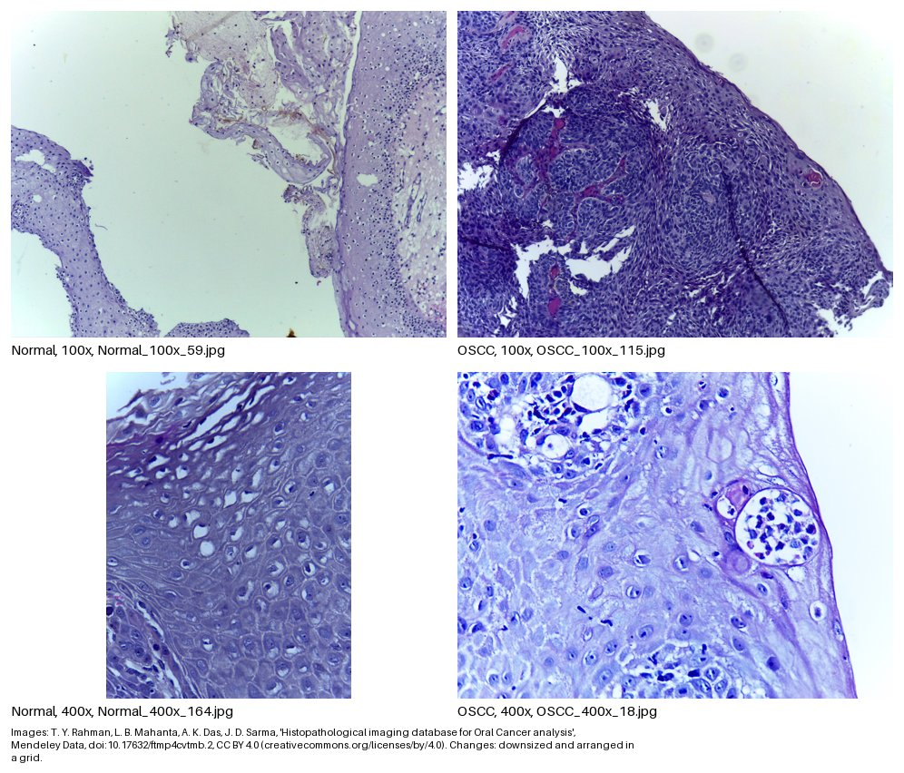

# Data defence dossier (FYP-I viva)

Everything here is either (a) a number produced by a script whose output is named next to it, or
(b) a statement from a source that was opened and checked (23 Nov 2026). Model results are **not**
repeated here; they live in generated files (`results/TABULAR_RESULTS.md`, and after the
university run `results/baseline_fyp1.md`, `results/MODEL_SELECTION.md`). Anything that rests only
on the WHO classification book, which we could not open, is marked **unverified**.

Sources used below:

- **[R]** Rahman TY, Mahanta LB, Das AK, Sarma JD. *Histopathological imaging database for oral
  cancer analysis.* Data in Brief 2020;29:105114. doi:10.1016/j.dib.2020.105114, PMC6994517
  (CC BY 4.0).
- **[S1]** Ranganathan K, Kavitha L. *Oral epithelial dysplasia: classifications and clinical
  relevance in risk assessment of oral potentially malignant disorders.* J Oral Maxillofac Pathol
  2019;23(1):19–27. doi:10.4103/jomfp.JOMFP_13_19, PMC6503768. (Criteria for **dysplasia**, the
  precursor lesion.)
- **[S2]** Sudhakara M, Reshma V, Khan N, Amulya SR. *Uncommon features in conventional oral
  squamous cell carcinoma.* J Oral Maxillofac Pathol 2016;20(2):316–319.
  doi:10.4103/0973-029X.185905, PMC4989568. (Invasive OSCC.)
- **[S3]** Groeger S, Meyle J. *Oral mucosal epithelial cells.* Front Immunol 2019;10:208.
  doi:10.3389/fimmu.2019.00208, PMC6383680 (CC BY). (Normal oral epithelium.)
- Proposal references [4]–[12] (`docs/proposal.txt`); where we repeat what the proposal's
  related-work table says about a paper, it is marked "as summarised in the proposal".

---

## a. Why these datasets

### Availability and licences

| Dataset | Access | Licence (as stated by the source) | Evidence |
| --- | --- | --- | --- |
| Rahman et al. (Mendeley Data `ftmp4cvtmb`, v1 and v2) | Free download, no registration | CC BY 4.0 (both versions) | `docs/datasheet.md` "Sources and licences" (API records saved 22 Nov 2026) |
| Kebede, Kaggle "Oral Cancer Histopathological Images" (proposal [12]) | Free with a Kaggle account | "CC0: Public Domain" on the Kaggle page; we still credit Rahman et al. under CC BY 4.0 because the images are theirs | `docs/datasheet.md`; all 1,224 Kaggle originals are byte-identical to Mendeley v2 (audit §4.1) |
| Multi-OSCC (proposal [10], [11]) | Zenodo, one archive of 34.6 GB | CC-BY-SA-4.0 as recorded from the Zenodo record in open PR #21 (not re-checked in this document) | `docs/datasheet.md` "Multi-OSCC"; PR #21 datasheet |

### H&E with binary labels

[R] describes H&E-stained biopsy slides of the oral cavity, labelled **normal epithelium** or
**OSCC**, at 100x and 400x: "The repository is composed of 1224 images…" (89 normal + 439 OSCC at
100x; 201 normal + 495 OSCC at 400x) from 230 patients. Labels come from the patients' pathology
reports: "We have also collected the corresponding pathological reports of the patients, which are
used for labelling of the images." This matches our task exactly: binary OSCC vs non-OSCC on H&E.

### Link to the literature in the proposal ([4]–[12])

- [4] and [5] (as summarised in the proposal) benchmark ResNet50, DenseNet and EfficientNet on OSCC
  histopathology; [5] uses the same 5,192-image Kaggle release. Our CNN track repeats this family
  under one protocol.
- [6]–[8] (as summarised in the proposal) combine CNNs and ViTs in hybrids; the proposal notes that
  hybrids make it hard to isolate CNN vs ViT. Our benchmark compares them side by side. [8] fuses
  LBP and GLCM features with deep features; our tabular track uses the same classical texture
  descriptors on their own, as a transparent baseline.
- [9] gives the Pakistani clinical context (motivation, not data).
- [10], [11] Multi-OSCC: a larger, patient-level dataset, but OSCC only (see below).
- [12] Kaggle: the copy we used, traced back to [R].

### Why Multi-OSCC alone cannot be used

Multi-OSCC contains **only OSCC patients** (the proposal: "1,325 OSCC patients"; our metadata check
in open PR #21 found the same). A binary OSCC-vs-normal classifier needs negatives. Mixing
Multi-OSCC positives with Rahman negatives would let a model learn "which lab/scanner" instead of
"which tissue" (plan §3 consequence 3). It is therefore reserved as an **external positive test
set** (recall on unseen-source OSCC) and deferred to FYP-II (errata E11) because of its 34.6 GB size.

### Alternatives considered

- **Kaggle split as published:** rejected; it leaks (section b).
- **The 5,192 Kaggle files as-is:** rejected; 3,968 are the publisher's augmented copies of training
  images (section b), so counting them as independent images would inflate results.
- **Multi-OSCC with Rahman negatives:** rejected for the primary benchmark (source shortcut).
- **Patient-level split:** not possible; no release has patient IDs (errata E7).

---

## b. What is in the data

All counts below are produced by `oscc-ml prepare --manifest-only` and reproduced independently by
`ml_research/scripts/audit/verify_dataset_independent.py` (46/46 checks, two identical runs,
22 Nov 2026); see `docs/datasheet.md` and ADR-0005.

| Step | Count | Evidence |
| --- | ---: | --- |
| Files in the Kaggle release | 5,192 | verifier `counts.n_files` |
| Publisher augmented copies (`aug_*.jpg`, Kaggle train folder only), excluded by name | 3,968 | verifier `n_publisher_augmented` |
| Original images | 1,224 (290 Normal, 934 OSCC; 89/439 at 100x, 201/495 at 400x) | verifier; equals [R] |
| Label-conflict clusters (same or near-identical image published under both labels), excluded whole | 17 clusters (14 byte-identical, 3 near-duplicate), **35 images** | ADR-0003, ADR-0005 |
| Duplicates removed (pHash ≤ 4 plus 2 reviewed same-field pairs) | 10 | ADR-0005 |
| **Kept** | **1,179** | |
| Split train / val / test (grouped, stratified, seed 42) | **829 / 174 / 176**; non-OSCC/OSCC 191/638, 39/135, 41/135 | `manifest_only.json`; verifier |
| Kept image sizes | 956 at 2048×1536, 222 at 1536×2048, 1 at 1435×916 | verifier `kept_dimensions` |
| Closest pair of kept images in different splits | pHash distance 12 (none ≤ 10) | verifier `split_hygiene` |

- **Magnifications:** 100x and 400x ([R]: "100x (10x objective lens × 10x eyepiece) and 400x (40x
  objective lens × 10x eyepiece)"); Leica DM 750 microscope with ICC50 HD camera ([R]).
- **Balance:** about 1 non-OSCC : 3.3 OSCC in every split (class-weighted loss + recall-oriented τ).
- **Provenance checks:** every Kaggle original is byte-identical to Mendeley v2; v1 = v2.
- **The publisher's Kaggle split leaks:** of 16 byte-identical groups among the originals, 7 span
  the publisher's train/val/test folders and 6 of those carry opposite labels (datasheet).
- **Cleaning decisions:** ADR-0003 (label conflicts), ADR-0005 (pHash thresholds and the reviewed
  list, with contact sheets in `docs/audit/figures/`).
- **Split:** grouped by pHash similarity (≤ 10) so near-identical images never cross splits; not by
  patient (no IDs) — the main threat to validity (errata E7).
- **Tissue filter and patching (image models):** tissue = HSV saturation > min(Otsu, 40)
  (ADR-0002); 224×224 tiles with ≥ 50% tissue, at most 64 per image; train-only augmentation (flips,
  90° rotations, mild colour jitter; ADR-0004).
- **Tabular features:** 67 model inputs per image (colour, H&E stain, texture, nuclei-density
  proxies), dictionary in `results/TABULAR_DATA_DICTIONARY.md` (ADR-0006).

### Limitations

1. No patient IDs: 230 patients for 1,179 images; same-patient images may sit in different splits
   (test metrics may be optimistic).
2. One centre region and one microscope ([R]: two institutions in Guwahati, Assam, India;
   buccal mucosa): generalisation to other labs is untested until the Multi-OSCC check.
3. Image-level labels from pathology reports ([R]); no region annotations, so every patch inherits
   its image label (weak patch labels).
4. Small test set (176 images, 41 non-OSCC): wide confidence intervals.
5. The publisher's augmented copies and its split cannot be used (they leak).
6. Tabular nuclei features are proxies at reduced resolution; stain vectors are generic.

---

## c. How can you tell OSCC from normal tissue on H&E?

> **Educational explainer for the viva, not diagnostic guidance.** To be reviewed by the
> co-supervisor or a pathologist before it is used anywhere else. Paraphrased from the sources;
> quotes are marked.

**Normal oral epithelium.** The oral mucosa has a surface stratified squamous epithelium over a
connective-tissue layer, the lamina propria, separated by a basement membrane [S3]. In keratinised
mucosa the epithelium matures in order through the basal, spinous, granular and keratin layers;
lining mucosa such as the cheek (the site of the Rahman images, [R]: buccal mucosa) is
non-keratinising [S3]. In short: orderly layers, cells maturing from the base to the surface, and an
intact boundary with the connective tissue.

| Feature | What it means (paraphrase) | Source | Can our models "see" it? |
| --- | --- | --- | --- |
| Epithelial architectural disorder | Loss of the normal orderly layering and maturation; irregular stratification, basal cells losing polarity; "disorganized growth" in OSCC | [S1] (dysplasia criteria), [S2] | CNN/ViT: patch texture/layout; tabular: only indirectly (GLCM/LBP) |
| Invasion through the basement membrane | Tumour cells break the basement membrane and invade the connective tissue as nests, islands or sheets — the defining step from dysplasia to carcinoma | [S2]; [R] calls invasion "a very important architectural feature for diagnosing OSCC" | Needs spatial context: CNN/ViT within a 224 px patch; tabular: no |
| Keratin pearls | Concentric whorls of keratin formed by tumour cells; typical of keratinising SCC | [S2]; also listed in [S1] ("Keratin pearls within rete ridges") | CNN/ViT: possible at 100x; tabular: no |
| Nuclear pleomorphism | Abnormal variation in nuclear size and shape | [S1]; [S2] (for giant cells) | CNN/ViT at 400x; tabular: blob-area spread (proxy) |
| Hyperchromatism | Nuclei stain darker (more hematoxylin) | [S1] (dysplasia criterion "hyperchromasia"); for invasive OSCC [S2] speaks of "nuclear chromatin irregularities" | Tabular: hematoxylin OD features (proxy) |
| Increased N:C ratio | Nuclei large relative to their cytoplasm | [S1], [S2] | Tabular: hematoxylin share, blob density/size (proxies) |
| Abnormal mitoses | Atypical mitotic figures; increased mitotic activity | [S1] (atypical, dysplasia); [S2] ("increased mitotic figures") | Unlikely at our resolution |
| Dyskeratosis | Premature keratinisation of single cells within the epithelium | [S1], [S2] | CNN/ViT possibly; tabular: no |

Gaps, stated honestly: in the opened sources, *atypical* mitoses and hyperchromatism appear as
criteria for **dysplasia** [S1]; we did not find them stated for invasive OSCC in an opened source.
Grading criteria from the WHO classification book are **unverified** (not opened).

**Contact sheet.** One example per class and magnification, chosen deterministically (the kept
training image with the smallest `image_id` per cell; `ml_research/scripts/make_dossier_sheet.py`):

*Captions give class, magnification and file ID only. Images: T. Y. Rahman, L. B. Mahanta, A. K.
Das, J. D. Sarma, Mendeley Data doi:10.17632/ftmp4cvtmb.2, CC BY 4.0; downsized and arranged in a
grid.*

---

## d. What the models see

- **Tabular feature importances** (permutation importance on validation), **class-level image
  statistics** (train split, mean ± SD per class) and the **magnification ablation**:
  generated in [`results/TABULAR_RESULTS.md`](results/TABULAR_RESULTS.md).
- **Shortcut check** (non-pathology cues: file size, JPEG settings, image size, whole-frame colour
  histogram; magnification alone): same file, section "Shortcut check", with the rule fixed before
  the run (AUC ≥ 0.80 = major finding).
- **CNN/ViT explanation maps** (Grad-CAM, attention rollout): FYP-II (R4).

---

## e. Likely viva questions (short answers with evidence)

**Data**

1. *Where do the images come from?* Rahman et al. [R]; we used the Kaggle copy and proved it
   byte-identical to Mendeley v2 (datasheet).
2. *How many images and patients?* 1,224 originals from 230 patients [R]; 1,179 kept after cleaning
   (datasheet, ADR-0005).
3. *Why not 5,192?* 3,968 files are the publisher's augmented copies of training images; counting
   them would duplicate images across our split (datasheet).
4. *What did you remove and why?* 35 images in 17 label-conflict clusters (same image under both
   labels; ADR-0003) and 10 duplicates (ADR-0005).
5. *How do you know the duplicates are real?* SHA-256 for exact copies; pHash ≤ 4 plus two pairs
   confirmed visually on contact sheets (ADR-0005, `docs/audit/figures/`).
6. *Why not use the Kaggle split?* It leaks: 7 byte-identical groups cross its folders, 6 with
   opposite labels (datasheet).
7. *Is your split patient-level?* No; there are no patient IDs. We group near-identical images so
   they never cross splits; test metrics may still be optimistic (errata E7, datasheet L1).
8. *How balanced is it?* About 1 non-OSCC : 3.3 OSCC per split (manifest counts).
9. *Who labelled the images?* Labels come from the patients' pathology reports [R].
10. *What is the licence?* CC BY 4.0 for Mendeley; Kaggle states CC0; we credit Rahman et al.
11. *Why not Multi-OSCC?* OSCC only, so no negatives; mixing sources invites a shortcut; 34.6 GB;
    reserved as an external positive test set in FYP-II (E11).
12. *Are 100x and 400x from the same patients?* Possibly; [R] gives no mapping. That is one reason
    our split cannot be patient-level.
13. *How did you check nothing was changed in the raw data?* Raw folder is read-only; every file's
    SHA-256 is in the manifest and re-checked by the tabular extraction.
14. *Is the data reproducible?* One command (`oscc-ml prepare`) rebuilds the manifest; the
    independent verifier reproduces all counts (46/46).

**Tabular vs computer vision**

15. *What is a tabular feature here?* A number measured per image: colour, H&E stain, texture,
    nuclei-density proxy (`results/TABULAR_DATA_DICTIONARY.md`).
16. *Why tabular at all?* Transparent, cheap baseline; shows what deep models add
    (`docs/TABULAR_VS_CV_EXPLAINER.md`).
17. *Same split for both?* Yes; copied from the manifest and re-checked (`tabular-check`).
18. *How were tabular models tuned without touching test?* Grouped 5-fold CV on train; τ on
    validation; test once (ADR-0006).
19. *Why grouped CV?* Near-duplicate images in different folds would inflate CV scores.
20. *Which features matter most?* Permutation importance on validation, in
    `results/TABULAR_RESULTS.md`.
21. *Can the tabular model see invasion or keratin pearls?* Not directly; those are architectural.
    That is the expected advantage of CNN/ViT (section c).
22. *Could magnification be a shortcut?* The classes are not equally frequent at 100x and 400x,
    so we keep magnification out of the features, report a magnification-only baseline and an
    ablation (`results/TABULAR_RESULTS.md`).
23. *Could the file format be a shortcut?* That is the shortcut check; its AUC with CI is published
    whatever it is.

**Methods**

24. *How is τ chosen?* On validation: highest F1 among thresholds with recall ≥ 0.95 (errata E8).
25. *What does "inconclusive" mean?* Probability within ±0.05 of τ (SRS Appendix B).
26. *Why bootstrap over groups?* Images in one group are correlated; resampling groups gives honest
    CIs.
27. *How do you compare two models?* Paired bootstrap ΔAUC and McNemar on the same test images,
    Holm-corrected (`MODEL_SELECTION.md` after the run).
28. *How is the final model chosen?* SDS: highest test AUC, recall as tie-breaker; with an
    optimism caveat; FYP-I uses 1 seed, FYP-II 3 seeds.
29. *Why ImageNet statistics for the ViT?* The SDS requires identical preprocessing; the ViT's own
    0.5/0.5 statistics and its ImageNet-21k pretraining are stated as confounds (ADR-0004, E9).
30. *Why not minority-class augmentation?* Class-weighted loss and recall-oriented τ instead; it
    becomes an FYP-II ablation (E10).
31. *Did training ever see the test set?* No; only `oscc-ml evaluate` reads test, and a
    before/after fingerprint proved the change did not alter training (PR #25).
32. *How do you know the features are computed correctly?* Known-answer tests, an independent
    second implementation on 12 images and two byte-identical extractions (Phase T record).
33. *What would you do with more time?* Patient IDs (ask the authors), Multi-OSCC external test,
    3 seeds, explanation maps reviewed by a pathologist.
