<table>
<colgroup>
<col style="width: 100%" />
</colgroup>
<thead>
<tr class="header">
<th><table>
<colgroup>
<col style="width: 100%" />
</colgroup>
<thead>
<tr class="header">
<th>
<strong>Software Design Specifications</strong>

<em><strong>OSCC Health Intelligence</strong></em>

<strong>Version: 1.0</strong>

<table>
<colgroup>
<col style="width: 50%" />
<col style="width: 50%" />
</colgroup>
<thead>
<tr class="header">
<th>Project Code</th>
<th>AI FYP 1015</th>
</tr>
<tr class="odd">
<th>Supervisor</th>
<th>Miss Rubab Manzar</th>
</tr>
<tr class="header">
<th>Co Supervisor</th>
<th>Miss Alina Arshad</th>
</tr>
<tr class="odd">
<th>Project Team</th>
<th>
Muhammad Mudassir Bhatti (23K-3003)

Shahryar (22K-4435)

Zaid (23K-0028)
</th>
</tr>
<tr class="header">
<th>Submission Date</th>
<th></th>
</tr>
</thead>
<tbody>
</tbody>
</table></th>
</tr>
</thead>
<tbody>
</tbody>
</table></th>
</tr>
</thead>
<tbody>
</tbody>
</table>

**Document History**

| Version | Name of Person           | Date     | Description of change                                   |
|---------|--------------------------|----------|---------------------------------------------------------|
| 0.1     | Muhammad Mudassir Bhatti | 10/01/26 | Document created from template                          |
| 0.2     | Muhammad Mudassir Bhatti | 10/08/26 | Design considerations, system and software architecture |
| 0.3     | Shahryar, Zaid           | 10/15/26 | Design strategy, ML serving and chatbot design          |
| 0.4     | Muhammad Mudassir Bhatti | 10/22/26 | ER diagram and relationships                            |
| 0.5     | All members              | 10/29/26 | Data dictionary for all tables                          |
| 0.6     | All members              | 11/05/26 | Sequence diagrams                                       |
| 0.7     | All members              | 11/09/26 | State diagrams and Level-1 DFD                          |
| 1.0     | All members              |          | Final review for supervisor sign-off                    |

**Distribution List**

| **Name**                                          | **Role**      |
|---------------------------------------------------|---------------|
| Miss Rubab Manzar                                 | Supervisor    |
| Miss Alina Arshad                                 | Co-Supervisor |
| Project Coordinator's Office (through Supervisor) | Distribution  |

**Document Sign-Off**

| **Version** | **Sign-off Authority**         | **Project Role** | **Signature** | **Sign-off Date** |
|-------------|--------------------------------|------------------|---------------|-------------------|
| 1.0         | Supervisor (Miss Rubab Manzar) | Supervisor       |               |                   |

**Document Information**

<table>
<colgroup>
<col style="width: 33%" />
<col style="width: 66%" />
</colgroup>
<thead>
<tr class="header">
<th><strong>Category</strong></th>
<th><strong>Information</strong></th>
</tr>
<tr class="odd">
<th>Customer</th>
<th>FAST-NU</th>
</tr>
<tr class="header">
<th>Project</th>
<th>OSCC Health Intelligence</th>
</tr>
<tr class="odd">
<th>Document</th>
<th>Software Design Specification</th>
</tr>
<tr class="header">
<th>Document Version</th>
<th>1.0</th>
</tr>
<tr class="odd">
<th>Status</th>
<th>Submitted for Review</th>
</tr>
<tr class="header">
<th>Author(s)</th>
<th>
Muhammad Mudassir Bhatti

Shahryar

Zaid
</th>
</tr>
<tr class="odd">
<th>Approver(s)</th>
<th>Miss Rubab Manzar (Supervisor)</th>
</tr>
<tr class="header">
<th>Issue Date</th>
<th></th>
</tr>
<tr class="odd">
<th>Document Location</th>
<th>Project repository, /docs (https://github.com/zaidbinnaveed/FYP-Fall-2026)</th>
</tr>
<tr class="header">
<th>Distribution</th>
<th>
Supervisor

Project Coordinator's Office (through Supervisor)
</th>
</tr>
</thead>
<tbody>
</tbody>
</table>

**Definition of Terms, Acronyms and Abbreviations**

| **Term**            | **Description**                                                                                                            |
|---------------------|----------------------------------------------------------------------------------------------------------------------------|
| API                 | Application Programming Interface                                                                                          |
| Attention rollout   | A method that propagates ViT self-attention weights through all layers to show which image patches influenced a prediction |
| AUC-ROC             | Area Under the Receiver Operating Characteristic Curve                                                                     |
| CNIC                | Computerized National Identity Card                                                                                        |
| CNN                 | Convolutional Neural Network                                                                                               |
| CRUD                | Create, Read, Update, Delete                                                                                               |
| DFD                 | Data Flow Diagram                                                                                                          |
| Embedding           | A fixed-length numeric vector that represents the meaning of a text; used for similarity search                            |
| ENT                 | Ear, Nose and Throat                                                                                                       |
| ERD                 | Entity Relationship Diagram                                                                                                |
| F1                  | F1-score, the harmonic mean of precision and recall                                                                        |
| FYP                 | Final Year Project                                                                                                         |
| GPU                 | Graphics Processing Unit                                                                                                   |
| Grad-CAM            | Gradient-weighted Class Activation Mapping: a heatmap of the image regions that most influenced a CNN prediction           |
| H&E                 | Hematoxylin and Eosin                                                                                                      |
| Haversine           | A formula that gives the great-circle (straight-line) distance between two latitude/longitude points on a sphere           |
| HTTPS               | Hypertext Transfer Protocol Secure                                                                                         |
| JSON                | JavaScript Object Notation                                                                                                 |
| JWT                 | JSON Web Token                                                                                                             |
| LLM                 | Large Language Model                                                                                                       |
| ORM                 | Object-Relational Mapping                                                                                                  |
| OSCC                | Oral Squamous Cell Carcinoma                                                                                               |
| pgvector            | A PostgreSQL extension that stores vectors and performs similarity search                                                  |
| PII                 | Personally Identifiable Information                                                                                        |
| PMDC                | Pakistan Medical and Dental Council                                                                                        |
| RAG                 | Retrieval-Augmented Generation                                                                                             |
| RBAC                | Role-Based Access Control                                                                                                  |
| REST                | Representational State Transfer                                                                                            |
| SCC                 | Squamous Cell Carcinoma                                                                                                    |
| SDS                 | Software Design Specification                                                                                              |
| Signed URL          | A time-limited URL that grants temporary access to one private storage object                                              |
| SKIP LOCKED         | A PostgreSQL row-locking option that lets several workers claim different rows without blocking or double-processing       |
| SMTP                | Simple Mail Transfer Protocol                                                                                              |
| SPA                 | Single-Page Application                                                                                                    |
| SRS                 | Software Requirements Specification                                                                                        |
| Stain normalization | A preprocessing step that maps H&E color variation from different labs and scanners to a reference appearance              |
| TLS                 | Transport Layer Security                                                                                                   |
| UML                 | Unified Modeling Language                                                                                                  |
| ViT                 | Vision Transformer                                                                                                         |
| WSI                 | Whole-Slide Image                                                                                                          |

  
**Table of Contents**

[**1 Introduction 9**](#introduction)

> [1.1 Purpose of Document 9](#purpose-of-document)
>
> [1.2 Intended Audience 9](#intended-audience)
>
> [1.3 Document Convention 9](#document-convention)
>
> [1.4 Project Overview 10](#project-overview)
>
> [1.5 Scope 10](#scope)

[**2 Design Considerations 11**](#design-considerations)

> [2.1 Assumptions and Dependencies 11](#assumptions-and-dependencies)
>
> [2.2 Risks and Volatile Areas 11](#risks-and-volatile-areas)

[**3 System Architecture 13**](#system-architecture)

> [3.1 System Level Architecture 13](#system-level-architecture)
>
> [3.2 Software Architecture 17](#software-architecture)

[**4 Design Strategy 18**](#design-strategy)

[**5 Detailed System Design 21**](#detailed-system-design)

> [5.1 Database Design 21](#database-design)
>
> [5.1.1 ER Diagram 21](#er-diagram)
>
> [5.1.2 Data Dictionary 28](#data-dictionary)
>
> [5.1.2.1 Data 1: users 28](#data-1-users)
>
> [5.1.2.2 Data 2: patient_profiles 29](#data-2-patient_profiles)
>
> [5.1.2.3 Data 3: professional_profiles 30](#data-3-professional_profiles)
>
> [5.1.2.4 Data 4: patient_professional_links 31](#data-4-patient_professional_links)
>
> [5.1.2.5 Data 5: histopathology_images 31](#data-5-histopathology_images)
>
> [5.1.2.6 Data 6: model_versions 32](#data-6-model_versions)
>
> [5.1.2.7 Data 7: screenings 33](#data-7-screenings)
>
> [5.1.2.8 Data 8: screening_predictions 34](#data-8-screening_predictions)
>
> [5.1.2.9 Data 9: hospitals 35](#data-9-hospitals)
>
> [5.1.2.10 Data 10: recommendation_requests 36](#data-10-recommendation_requests)
>
> [5.1.2.11 Data 11: recommendation_items 37](#data-11-recommendation_items)
>
> [5.1.2.12 Data 12: treatment_plans 37](#data-12-treatment_plans)
>
> [5.1.2.13 Data 13: medications 38](#data-13-medications)
>
> [5.1.2.14 Data 14: medication_reminders 39](#data-14-medication_reminders)
>
> [5.1.2.15 Data 15: chat_sessions 39](#data-15-chat_sessions)
>
> [5.1.2.16 Data 16: chat_messages 40](#data-16-chat_messages)
>
> [5.1.2.17 Data 17: knowledge_articles 41](#data-17-knowledge_articles)
>
> [5.1.2.18 Data 18: helpline_contacts 42](#data-18-helpline_contacts)
>
> [5.1.2.19 Data 19: auth_tokens 42](#data-19-auth_tokens)
>
> [5.1.2.20 Data 20: audit_logs 43](#data-20-audit_logs)
>
> [5.2 Application Design 43](#application-design)
>
> [5.2.1 Sequence Diagram 43](#sequence-diagram)
>
> [5.2.1.1 Sequence Diagram 1: Registration, Email Verification and Login 44](#sequence-diagram-1-registration-email-verification-and-login)
>
> [5.2.1.2 Sequence Diagram 2: Password Reset 51](#sequence-diagram-2-password-reset)
>
> [5.2.1.3 Sequence Diagram 3: Image Upload and OSCC Classification 54](#sequence-diagram-3-image-upload-and-oscc-classification)
>
> [5.2.1.4 Sequence Diagram 4: Share Screening Result with Patient 60](#sequence-diagram-4-share-screening-result-with-patient)
>
> [5.2.1.5 Sequence Diagram 5: Nearest Hospital Recommendation 65](#sequence-diagram-5-nearest-hospital-recommendation)
>
> [5.2.1.6 Sequence Diagram 6: Chatbot Message Handling 69](#sequence-diagram-6-chatbot-message-handling)
>
> [5.2.1.7 Sequence Diagram 7: Treatment Plan Creation and Reminder Dispatch/Acknowledgement 74](#sequence-diagram-7-treatment-plan-creation-and-reminder-dispatchacknowledgement)
>
> [5.2.1.8 Sequence Diagram 8: Admin Hospital Directory CSV Import with Geocoding and Verification 81](#sequence-diagram-8-admin-hospital-directory-csv-import-with-geocoding-and-verification)
>
> [5.2.1.9 Sequence Diagram 9: Admin Model Version Registration and Activation 86](#sequence-diagram-9-admin-model-version-registration-and-activation)
>
> [5.2.1.10 Sequence Diagram 10: Admin Knowledge Base and Helpline Management 91](#sequence-diagram-10-admin-knowledge-base-and-helpline-management)
>
> [5.2.1.11 Sequence Diagram 11: Admin User Management, System Health and Audit Logs 95](#sequence-diagram-11-admin-user-management-system-health-and-audit-logs)
>
> [5.2.1.12 Sequence Diagram 12: Profile, Chat History and Account Data Management 99](#sequence-diagram-12-profile-chat-history-and-account-data-management)
>
> [5.2.2 State Diagram 102](#state-diagram)
>
> [5.2.2.1 State Diagram 1: User Account Lifecycle 102](#state-diagram-1-user-account-lifecycle)
>
> [5.2.2.2 State Diagram 2: Screening Request Lifecycle 104](#state-diagram-2-screening-request-lifecycle)
>
> [5.2.2.3 State Diagram 3: Hospital Recommendation Request 106](#state-diagram-3-hospital-recommendation-request)
>
> [5.2.2.4 State Diagram 4: Chatbot Message Processing 108](#state-diagram-4-chatbot-message-processing)
>
> [5.2.2.5 State Diagram 5: Medication Reminder Lifecycle 109](#state-diagram-5-medication-reminder-lifecycle)
>
> [5.2.2.6 State Diagram 6: Hospital Directory Record Lifecycle 111](#state-diagram-6-hospital-directory-record-lifecycle)
>
> [5.2.2.7 State Diagram 7: Model Version Lifecycle 112](#state-diagram-7-model-version-lifecycle)
>
> [5.2.2.8 State Diagram 8: Overall System 113](#state-diagram-8-overall-system)
>
> [5.2.3 Data Flow Diagram (Level 1) 114](#data-flow-diagram-level-1)

[**6 References 119**](#references)

[**7 Appendices 121**](#appendices)

# **Introduction**

## ***Purpose of Document***

*This Software Design Specification (SDS) translates the OSCC Health Intelligence SRS (version 1.0) into an architecture, a data design and a behavioral design that the team will implement in FYP-II. It commits to the technology choices that the proposal left open and records the reasoning behind them. Its content follows the FAST-NU template, informed by IEEE Std 1016 \[22\]; the requirements it realizes follow IEEE Std 830 \[14\] and ISO/IEC/IEEE 29148 \[13\]. It provides:*

- *The design considerations, assumptions and risks that shape the solution (Section 2).*

- *The system-level and software architecture: package, component, deployment and layered views (Section 3).*

- *The design strategy, technology decisions and the three core mechanisms: classification decision logic, facility recommendation and the chatbot guardrail pipeline (Section 4).*

- *The database design: ER diagrams, relationships and a data dictionary for all 20 tables (Section 5.1).*

- *The application design: 12 sequence diagrams with parameter lists, 8 state diagrams and the Level-1 DFD (Section 5.2).*

- *The ML training and evaluation protocol, the REST endpoint catalog and the hospital CSV format (Section 7).*

## ***Intended Audience***

- ***Developers on the team:** Sections 3–5 and Appendix B are the implementation baseline.*

- ***ML engineers:** Sections 4 and 5.2 (inference) and Appendix A (training and evaluation protocol).*

- ***Supervisor and co-supervisor:** the whole document for review and sign-off.*

- ***FAST-NU FYP Evaluation Committee / Jury:** Sections 1, 3 and 4 for the overall design and its rationale.*

- ***Testers:** Section 5.2 and Appendix B to derive integration and API tests.*

- ***Future maintainers and student researchers:** Sections 2.2, 3 and 4 to understand where change is expected.*

## ***Document Convention***

- *Font family = Arial; level-1 headings 16 pt bold, level-2 headings 14 pt bold italic, level-3 headings 13 pt bold, level-4 headings 12 pt bold, body text 10 pt; tables use 8–12 pt.*

- *“Shall” denotes a mandatory requirement and “should” a desirable one; requirement and use case identifiers (FR-x.y, NFR-\<area\>-nn, UC-\<module\>-nn) are those of the SRS.*

- *UML diagrams follow UML 2.5.1 \[24\]; the ERDs use crow's-foot (Information Engineering) notation; the DFD uses Gane–Sarson notation. Each diagram carries a legend where the notation is not obvious.*

- *Data-dictionary content descriptions use composition notation:* = *is composed of,* + *and,* ( ) *optional,* { } *iteration,* \[ a \| b \] *selection,* @ *key,* \* \* *comment.*

- *Figures are numbered sequentially; API paths, table names, column names and enum values appear in a monospace font (e.g.,* POST /api/v1/screenings*,* screenings.status*).*

## ***Project Overview***

*OSCC Health Intelligence is a web-based research prototype for Oral Squamous Cell Carcinoma (OSCC) screening on H&E histopathology images. It benchmarks CNN (ResNet50, EfficientNet, DenseNet) and Vision Transformer models under one protocol, serves the selected model behind a non-diagnostic result page, recommends the nearest suitable Pakistani oncology/ENT facilities, and supports patients through a guarded chatbot and medication reminders. The models build on ResNet \[1\], EfficientNet \[2\] and ViT \[3\]; prior OSCC studies \[4\]–\[8\] motivate the side-by-side benchmark, the Pakistani clinical context is described in \[9\], and the data come from public datasets \[10\]–\[12\].*

***Included Functionalities:***

- *Accounts and RBAC for patients, healthcare professionals and administrators.*

- *Screening with primary and compare modes, explanation heatmaps, sharing and history.*

- *Nearest-facility recommendation with road-distance refinement and fallbacks.*

- *Patient-support chatbot with retrieval, guardrails and distress escalation; medication reminders and adherence.*

- *Administration of users, the hospital directory, model versions, the knowledge base and helplines; audit logs and health.*

- *Offline model development and benchmarking.*

***Excluded Functionalities:***

- *Clinical deployment, regulatory certification and multi-hospital validation; hospital ratings; full Urdu localization; native mobile apps; OSCC grading or multi-class classification; WSI viewing; appointment booking; integration with hospital information systems.*

## ***Scope***

*The design covers every functional requirement of the SRS. FYP-I delivers this design together with the dataset pipeline and the baseline CNN and ViT models; FYP-II implements and integrates the remaining modules and tests the complete system.*

***Included Functionalities:***

- *Web front end (React SPA), REST API (FastAPI), inference service, scheduler worker, PostgreSQL + pgvector database and object storage, deployed with Docker Compose.*

- *Model registry and compare mode supporting all four benchmarked architectures.*

- *Adapters for the LLM, mapping and SMTP providers with defined fallbacks.*

***Excluded Functionalities:***

- *Clinical deployment, regulatory certification and large-scale multi-hospital validation.*

- *Hospital reviews and ratings; full Urdu UI localization; native mobile applications.*

- *OSCC grading or multi-class classification; whole-slide image viewing or processing.*

- *Appointment booking and integration with hospital information systems.*

# **Design Considerations**

*The design must turn a research benchmark into a dependable, safe user-facing service on a student budget. The following assumptions and risks shaped it; assumptions already stated in the SRS are not repeated.*

## ***Assumptions and Dependencies***

- *Inputs are tiles or patches exported from slides, not gigapixel whole-slide images.*

- *All deployed model versions fit together in GPU or CPU memory, so compare mode can score one image with every model.*

- *Pretrained ImageNet weights are cached as build artifacts, so containers start without internet downloads.*

- *The LLM provider offers a chat-completion endpoint and a moderation capability.*

- *The mapping API offers a distance/route endpoint usable within free-tier quotas for the demonstration.*

- *A single-region deployment with one PostgreSQL instance is sufficient at FYP scale.*

- *The inference service is stateless; the API owns all persistent state.*

- *The embedding model's vector dimension (768) is fixed at design time and matches* knowledge_articles.embedding*.*

## ***Risks and Volatile Areas***

*The table rates each risk's impact and likelihood (High, Medium, Low) and states its mitigation or contingency.*

| **Risk**                                                                                                                            | **Impact** | **Likelihood** | **Mitigation / Contingency**                                                                                                                                              |
|-------------------------------------------------------------------------------------------------------------------------------------|------------|----------------|---------------------------------------------------------------------------------------------------------------------------------------------------------------------------|
| Dataset label availability: the Zenodo Multi-OSCC data may contain only OSCC samples, leaving no non-OSCC class for binary training | High       | Medium         | Verify labels in FYP-I before training; source negatives from the Kaggle dataset \[12\] with patient-level hygiene and document the composition in the dataset datasheet. |
| Cross-dataset stain and scanner shift                                                                                               | High       | High           | Stain normalization (optional), color augmentation, per-source evaluation and a report of per-source metrics.                                                             |
| Class imbalance                                                                                                                     | Medium     | High           | Augmentation of the minority class, class-weighted loss, threshold calibration on validation data and recall-oriented model selection.                                    |
| Duplicate or leaked images across splits                                                                                            | High       | Medium         | Perceptual-hash deduplication across sources and a patient-level 70:15:15 split (seed 42).                                                                                |
| ViT underperforms on small data                                                                                                     | Medium     | Medium         | ImageNet-pretrained weights, smaller ViT variants, augmentation and early stopping; the comparison is reported whichever family wins.                                     |
| Compute and GPU limits                                                                                                              | Medium     | Medium         | Mixed-precision training, lab and cloud-notebook GPUs, smaller batch sizes and a fixed training budget per model.                                                         |
| Hospital data inaccuracy or staleness                                                                                               | High       | Medium         | Verification workflow, last-verified date, 180-day staleness alerts and “call ahead” advice in the UI.                                                                    |
| Mapping API quota or cost                                                                                                           | Medium     | Medium         | Provider adapter with an OpenStreetMap fallback (Nominatim/OSRM), caching of geocodes and haversine-only fallback.                                                        |
| LLM hallucination or unsafe advice                                                                                                  | High       | Medium         | Retrieval over curated content, a guarded system prompt, output checks, refusal of medical decisions and a visible disclaimer.                                            |
| LLM cost, latency or outage                                                                                                         | Medium     | Medium         | Timeouts, a circuit breaker, a canned fallback reply with knowledge-base links and a short context window.                                                                |
| Privacy breach                                                                                                                      | High       | Low            | TLS, private storage with signed URLs, PII scrubbing, location rounding, RBAC, audit logs and deletion of user data on request.                                           |
| Requirement churn between FYP-I and FYP-II                                                                                          | Medium     | Medium         | Ledger-driven traceability, versioned SRS/SDS and change review with the supervisor.                                                                                      |
| Team availability                                                                                                                   | Medium     | Medium         | Clear module ownership, shared repository conventions and cross-review so each module has a second person.                                                                |
| Misuse as a diagnostic tool                                                                                                         | High       | Medium         | Non-diagnostic wording, persistent disclaimers, the inconclusive band and consistent referral to clinicians and facilities.                                               |

*The design absorbs change in three places. The **model registry** lets new architectures be added, compared and activated without code changes. **Provider adapters** isolate the LLM, mapping and email services behind small interfaces, so a provider can be replaced or a fallback added in one module. **Configuration-driven thresholds** (τ and the inconclusive margin per model version, search radii, reminder windows and snooze limits) are data, not code.*

# **System Architecture**

*The system is decomposed into five deployable services (web, api, worker, inference and db) plus object storage, and into five code packages. Responsibilities are separated so that the heavy ML runtime, the transactional web API and the background scheduler can be developed, scaled and failed independently.*

## ***System Level Architecture***

- ***Decomposition into elements:** the React SPA; the FastAPI API with its routers, services, guardrails, repositories and adapters; the scheduler worker; the inference service; PostgreSQL with pgvector; object storage.*

- ***Relationships between elements:** the SPA calls only the API; the API calls the inference service and the external adapters; the worker shares the API's services and repositories; only repositories touch the database.*

- ***Interfaces to external systems:** the LLM API (chat completion, moderation), the mapping and geocoding API (geocoding, route distances) and SMTP, each behind an adapter.*

- ***Where elements execute:** every service runs in its own Docker container on one cloud VM behind Nginx; model training runs offline on a GPU environment.*

- ***Global design strategies:** a uniform error envelope, retries and fallbacks for external calls, structured logging with request IDs, environment-based configuration and mitigation of the OWASP Top 10 risks \[15\] (described below).*

*Figure 1 shows the package structure. Dependencies flow one way, from frontend to api, api to inference and inference to the offline ml_research package (shared preprocessing code and exported weights); infrastructure builds and serves the other packages. There are no cycles.*

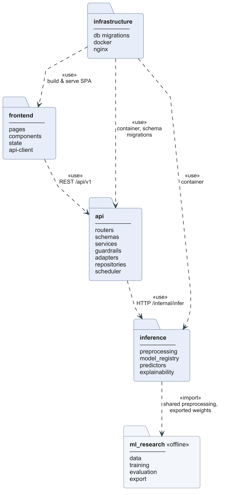

Figure : Package Diagram

*Figure 2 shows the components and their provided and required interfaces. The API Gateway/Router exposes* REST /api/v1 *to the SPA and dispatches to the domain services; the Screening Service requires the inference service's* /infer *interface; the services and the worker require the* SQL *and* S3 API *interfaces of the data stores; external providers are reached only through adapters.*

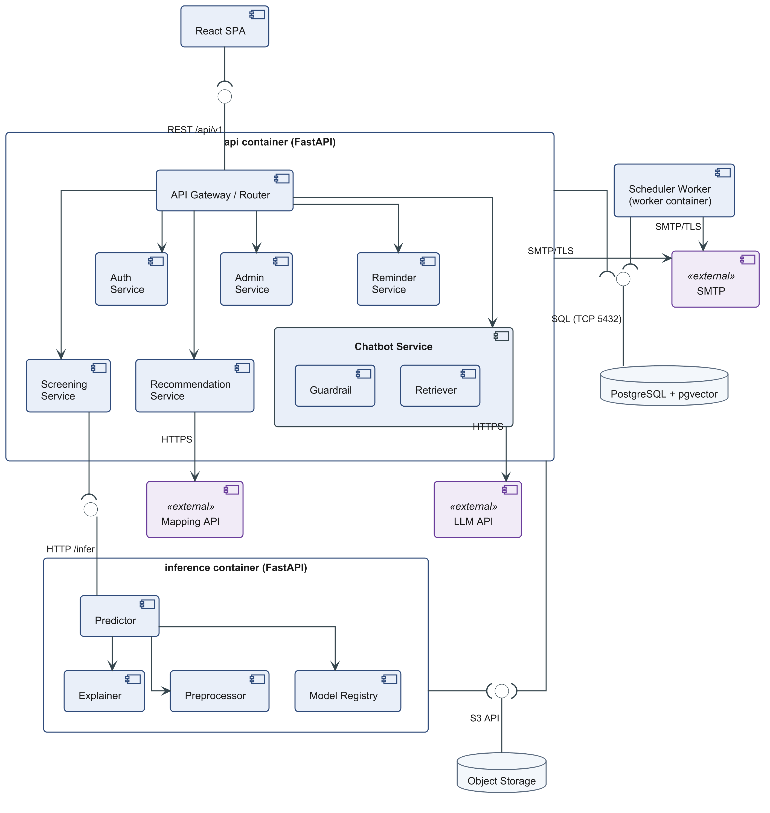

Figure : Component Diagram

*Figure 3 shows the deployment. Nginx terminates TLS on port 443 and routes to the web and api containers; all internal traffic stays on the private Docker network. The database listens on TCP 5432, email leaves on SMTP port 587, and model weights trained offline are uploaded to the storage volume and registered with the inference service.*

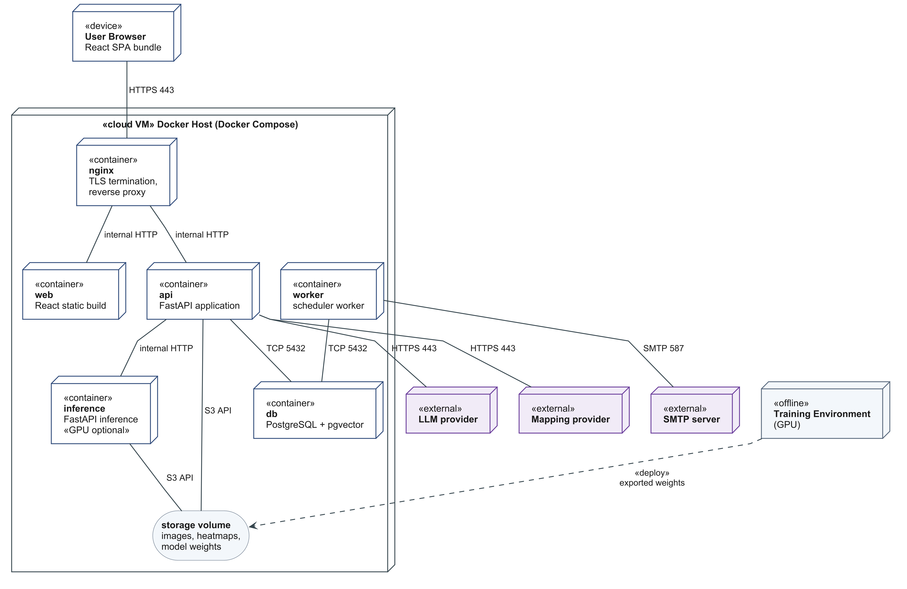

Figure : Deployment Diagram

***Global error handling.** Every error response uses one JSON envelope* {error_code, message, details, request_id} *with a stable, machine-readable* error_code*. Calls to external APIs use timeouts and retries with exponential back-off; a circuit breaker opens after repeated failures and the documented fallback is used instead (canned chatbot reply, straight-line distances, queued screening, retried email). All services write structured JSON logs that carry the request ID, and configuration and secrets come only from environment variables.*

## ***Software Architecture***

*Figure 4 shows the layered software architecture. Calls flow downward only, or sideways to the inference layer and to the external-service adapters.*

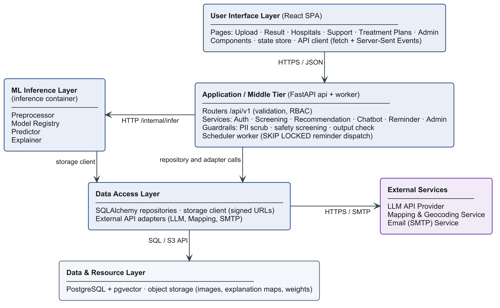

Figure : Layered Software Architecture

- ***User Interface Layer:** React pages for the guided Upload → Result → Hospitals → Support flow plus the treatment-plan and admin screens; it holds only view state and talks to the API through the API client.*

- ***Application / Middle Tier:** routers validate input and enforce RBAC; services implement the use cases; guardrails protect the chatbot; the scheduler worker dispatches reminders. It depends only on the data access layer and the inference layer.*

- ***ML Inference Layer:** a separate service that preprocesses images exactly as in training, runs the registered models and produces explanation maps. It has no database access and reads images only through signed URLs.*

- ***Data Access Layer:** SQLAlchemy repositories, the storage client and the external API adapters; it is the only layer that knows SQL, storage keys or provider protocols.*

- ***Data & Resource Layer:** PostgreSQL with pgvector and the object storage. Lower layers never call upward.*

# **Design Strategy**

***Future system extension or enhancement***

*New architectures are added by registering a model version; multi-class OSCC grading needs only a new outcome mapping in the inference service and new enum values. WSI support can be added as a tiling front end to the existing patch pipeline. The UI uses externalized strings, so Urdu localization and a mobile client can reuse the same REST API. Hospital ratings would be a new table linked to* hospitals*.*

***System reuse***

*The inference service and the hospital locator are self-contained components with narrow interfaces (*/internal/infer *and the recommendation service) and can be reused by other screening tools. The provider adapters allow the LLM, mapping and email services to be swapped without touching the domain services.*

***User interface paradigms***

*A guided wizard (Upload → Result → Hospitals → Support) and a responsive layout serve non-technical users on any device. Text is plain-language; color is never the only carrier of meaning (every outcome has a label and an icon); the non-diagnostic disclaimer is always visible on results and in the chatbot; the target is WCAG 2.1 AA \[16\].*

***Data management (storage, distribution, persistence)***

*Relational and vector data live in PostgreSQL (pgvector for knowledge-base embeddings), while images, explanation maps and weights live in private object storage referenced by URI and SHA-256 checksum. Only rounded coordinates are persisted, chat content is PII-scrubbed before storage, users can delete their data, and the database is backed up daily.*

***Concurrency and synchronization***

*The API is asynchronous (FastAPI), so slow external calls do not block other requests. Inference runs in a bounded worker pool to protect the GPU. The scheduler claims due reminders with* SELECT … FOR UPDATE SKIP LOCKED*, so several worker instances never send the same reminder twice, and reminder delivery is idempotent per* reminder_id*. Hospital edits use optimistic locking on* hospitals.version*.*

***Technology decisions***

*The proposal left some technology choices open; the table records the final decision and its rationale.*

| **Area**       | **Decision**                                                                                                                                                       | **Rationale**                                                                                                                                  |
|----------------|--------------------------------------------------------------------------------------------------------------------------------------------------------------------|------------------------------------------------------------------------------------------------------------------------------------------------|
| Back end       | Python FastAPI REST API                                                                                                                                            | Same language as the ML stack; asynchronous I/O for external API calls; auto-generated OpenAPI documentation \[17\].                           |
| Model serving  | Separate FastAPI inference service (own container) hosting all registered models                                                                                   | Isolates heavy ML dependencies and the GPU from the web tier; scales independently; lets one image be scored by several models (compare mode). |
| Database       | PostgreSQL \[19\] + pgvector \[20\] for knowledge-base embeddings                                                                                                  | One DBMS for transactional and retrieval data; strong constraints for medical-adjacent records; matches the relational data dictionary.        |
| Image storage  | Private object storage: Docker volume in development, S3-compatible bucket in the cloud; the database stores only URIs and SHA-256 checksums                       | Keeps large binaries out of the database; access through short-lived signed URLs.                                                              |
| Front end      | React SPA \[18\], responsive, guided flow Upload → Result → Hospitals → Support                                                                                    | Component reuse, a large ecosystem and a simple deployment as static files.                                                                    |
| Mapping        | Google Maps Platform (Geocoding, distance/route); fallback OpenStreetMap Nominatim + OSRM; final fallback haversine only                                           | Resilience to cost and quota limits.                                                                                                           |
| Reminders      | Database-persisted schedule + background worker polling every 60 s with SELECT … FOR UPDATE SKIP LOCKED; in-app delivery + optional SMTP email                     | Simple, robust and restart-safe; a reminder can never be sent twice.                                                                           |
| Authentication | JWT access token (15 min) + refresh token (7 days) in httpOnly secure cookies; Argon2id (or bcrypt) password hashing; RBAC with roles patient, professional, admin | Stateless API authentication with short-lived tokens and safe password storage.                                                                |
| Deployment     | Docker Compose services web (React via Nginx), api, inference, worker, db; Nginx reverse proxy with TLS; one cloud VM (GPU optional)                               | Reproducible environments and a single-command demonstration deployment \[25\].                                                                |

***Classification decision logic***

*Large images are tiled into 224×224 patches, normalized with ImageNet mean and standard deviation (and the same stain normalization as in training, if adopted), and scored by the model. The patch probabilities are averaged into the image-level probability p. With the version's calibrated threshold τ (chosen on the validation set to favor recall) and inconclusive margin m, the outcome is* oscc_suspected *if p ≥ τ + m,* inconclusive *if τ − m ≤ p \< τ + m, and* non_oscc *if p \< τ − m. Both oscc_suspected and inconclusive trigger the facility offer.*

***Facility recommendation algorithm***

*For an origin (φ1, λ1) and a facility (φ2, λ2), the straight-line distance uses the haversine formula \[21\] with R = 6371 km:*

$$d\  = \ 2R\  \cdot \ arcsin\left( \sqrt{\sin^{2}\left( \frac{\Delta\varphi}{2} \right)\  + \ cos\ \varphi_{1}\  \cdot \ cos\ \varphi_{2}\  \cdot \ \sin^{2}\left( \frac{\Delta\lambda}{2} \right)} \right)$$

- *Prefilter verified and stale facilities with a bounding box around the origin (initial radius 50 km).*

- *Compute the haversine distance d for each candidate and keep the 10 nearest.*

- *Request road distance and travel time for those 10 from the mapping API.*

- *Re-rank and return the top N (default 5, configurable from 3 to 10).*

- *If nothing lies within 50 km, expand to 150 km and then nationwide.*

- *If the mapping API fails, return haversine-only results labeled “straight-line distance”.*

- *Show each facility's last-verified date and “call ahead to confirm services”.*

***Chatbot guardrail pipeline***

- ***Input:** the patient's message is received in a session.*

- ***PII scrubbing:** names, phone numbers and CNIC numbers are removed before anything leaves the server.*

- ***Safety screening:** keyword rules plus the provider's moderation endpoint detect distress or self-harm; distress produces an empathetic reply, the active helplines and a safety flag.*

- ***Intent routing:*** precaution *(retrieval over the curated knowledge base),* reminder *(read or propose a schedule, saved only after confirmation),* support *(empathetic conversation), or* medical_decision */* out_of_scope *(polite redirect to the treating physician and the recommended hospitals).*

- ***LLM call:** a guarded system prompt with the retrieved passages and recent context.*

- ***Output check:** replies containing a diagnosis, dosage advice or advice to stop or change medication are replaced with a safe redirect.*

- ***Response:** the reply is streamed and stored; if the LLM fails, a canned reply with knowledge-base links is sent. Reminders contain only what the patient entered from the prescription.*

# **Detailed System Design**

## ***Database Design***

### **ER Diagram**

*The database has 20 tables in five domains. Figure 5 is the domain overview (entities and relationships only); Figures 6–10 detail each domain with every column, its type and its keys. Entities owned by another domain appear as grey reference boxes. Columns marked with a dot are NOT NULL.*

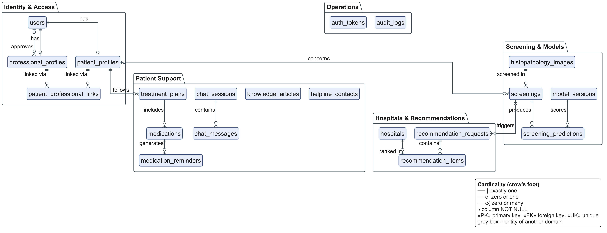

Figure : Entity Relationship Diagram — Domain Overview

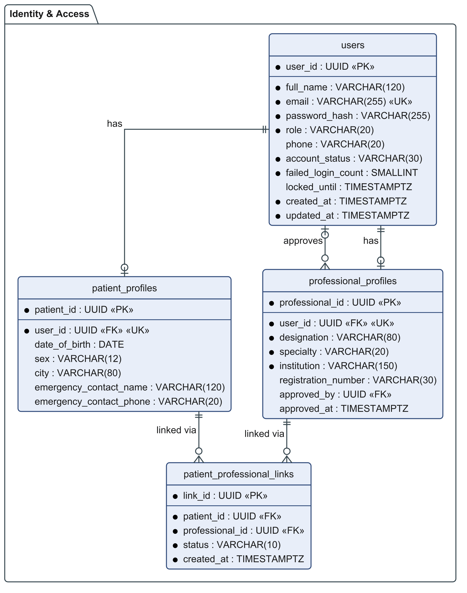

Figure : Entity Relationship Diagram — Identity & Access

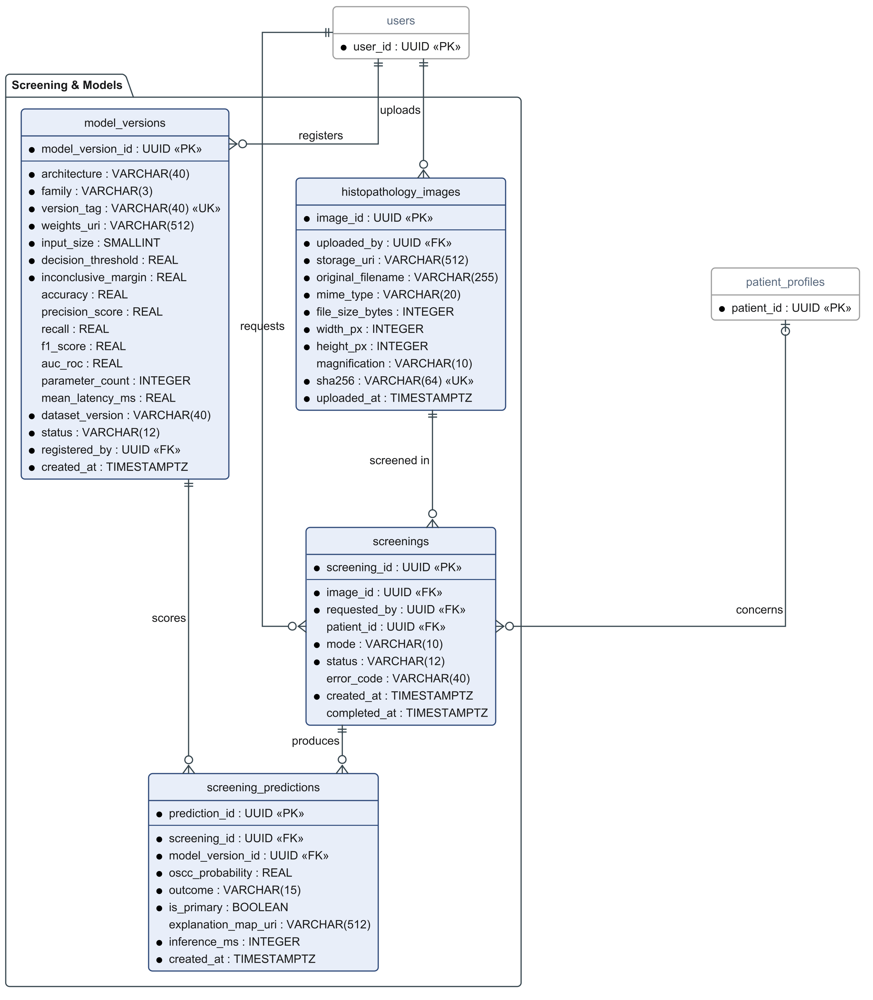

Figure : Entity Relationship Diagram — Screening & Models

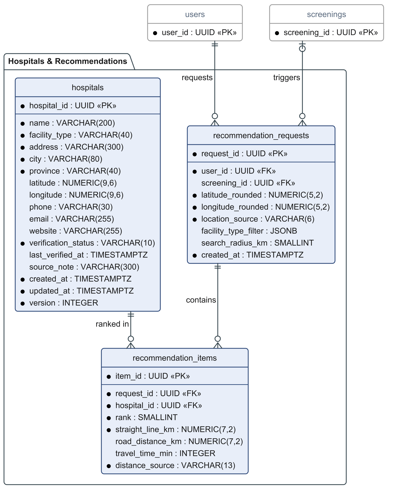

Figure : Entity Relationship Diagram — Hospitals & Recommendations

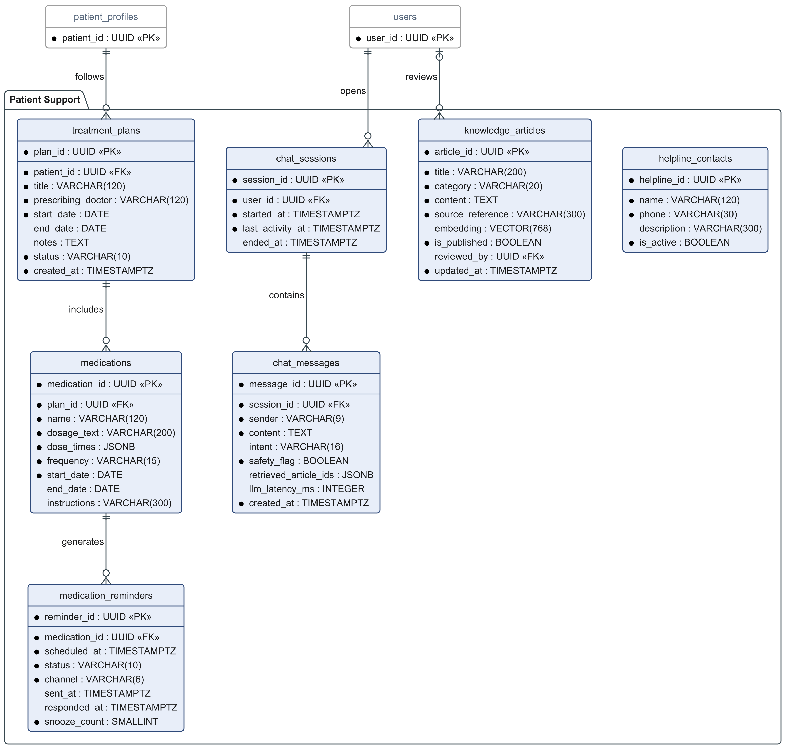

Figure : Entity Relationship Diagram — Patient Support

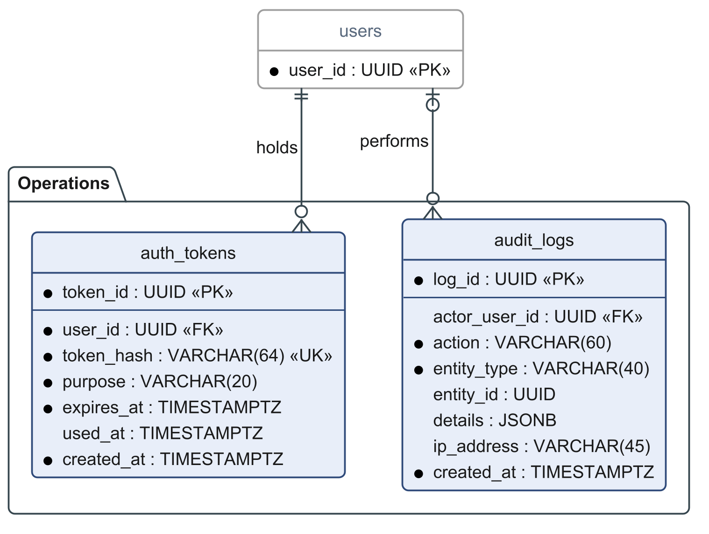

Figure : Entity Relationship Diagram — Operations

***Relationships***

| **Relationship**                                            | **Cardinality**                                                                 | **Foreign key**                            |
|-------------------------------------------------------------|---------------------------------------------------------------------------------|--------------------------------------------|
| users has patient_profiles                                  | users (exactly one) — patient_profiles (zero or one)                            | patient_profiles.user_id                   |
| users has professional_profiles                             | users (exactly one) — professional_profiles (zero or one)                       | professional_profiles.user_id              |
| users approves professional_profiles                        | users (zero or one) — professional_profiles (zero or many)                      | professional_profiles.approved_by          |
| patient_profiles linked via patient_professional_links      | patient_profiles (exactly one) — patient_professional_links (zero or many)      | patient_professional_links.patient_id      |
| professional_profiles linked via patient_professional_links | professional_profiles (exactly one) — patient_professional_links (zero or many) | patient_professional_links.professional_id |
| users uploads histopathology_images                         | users (exactly one) — histopathology_images (zero or many)                      | histopathology_images.uploaded_by          |
| users registers model_versions                              | users (exactly one) — model_versions (zero or many)                             | model_versions.registered_by               |
| histopathology_images screened in screenings                | histopathology_images (exactly one) — screenings (zero or many)                 | screenings.image_id                        |
| users requests screenings                                   | users (exactly one) — screenings (zero or many)                                 | screenings.requested_by                    |
| patient_profiles concerns screenings                        | patient_profiles (zero or one) — screenings (zero or many)                      | screenings.patient_id                      |
| screenings produces screening_predictions                   | screenings (exactly one) — screening_predictions (zero or many)                 | screening_predictions.screening_id         |
| model_versions scores screening_predictions                 | model_versions (exactly one) — screening_predictions (zero or many)             | screening_predictions.model_version_id     |
| users requests recommendation_requests                      | users (exactly one) — recommendation_requests (zero or many)                    | recommendation_requests.user_id            |
| screenings triggers recommendation_requests                 | screenings (zero or one) — recommendation_requests (zero or many)               | recommendation_requests.screening_id       |
| recommendation_requests contains recommendation_items       | recommendation_requests (exactly one) — recommendation_items (zero or many)     | recommendation_items.request_id            |
| hospitals ranked in recommendation_items                    | hospitals (exactly one) — recommendation_items (zero or many)                   | recommendation_items.hospital_id           |
| patient_profiles follows treatment_plans                    | patient_profiles (exactly one) — treatment_plans (zero or many)                 | treatment_plans.patient_id                 |
| treatment_plans includes medications                        | treatment_plans (exactly one) — medications (zero or many)                      | medications.plan_id                        |
| medications generates medication_reminders                  | medications (exactly one) — medication_reminders (zero or many)                 | medication_reminders.medication_id         |
| users opens chat_sessions                                   | users (exactly one) — chat_sessions (zero or many)                              | chat_sessions.user_id                      |
| chat_sessions contains chat_messages                        | chat_sessions (exactly one) — chat_messages (zero or many)                      | chat_messages.session_id                   |
| users reviews knowledge_articles                            | users (zero or one) — knowledge_articles (zero or many)                         | knowledge_articles.reviewed_by             |
| users holds auth_tokens                                     | users (exactly one) — auth_tokens (zero or many)                                | auth_tokens.user_id                        |
| users performs audit_logs                                   | users (zero or one) — audit_logs (zero or many)                                 | audit_logs.actor_user_id                   |

### **Data Dictionary**

*Each table below follows the template's data-dictionary layout. Lengths give the declared length or precision; “–” marks fixed-size types. Key types: PK primary key, FK → foreign-key target, UK unique.*

#### **Data 1: users**

<table>
<colgroup>
<col style="width: 13%" />
<col style="width: 12%" />
<col style="width: 4%" />
<col style="width: 13%" />
<col style="width: 13%" />
<col style="width: 12%" />
<col style="width: 13%" />
<col style="width: 17%" />
</colgroup>
<thead>
<tr class="header">
<th colspan="8"><strong>users</strong></th>
</tr>
<tr class="odd">
<th colspan="2"><strong>Name</strong></th>
<th colspan="6">Every account of the system: patients, healthcare professionals and administrators.</th>
</tr>
<tr class="header">
<th colspan="2"><strong>Alias</strong></th>
<th colspan="6">User</th>
</tr>
<tr class="odd">
<th colspan="2"><strong>Where-used/how-used</strong></th>
<th colspan="6">Written by registration (UC-USR-01), login/lockout (UC-USR-02), password reset (UC-USR-03) and user management (UC-ADM-01); read by every authenticated request for RBAC.</th>
</tr>
<tr class="header">
<th colspan="2"><strong>Content description</strong></th>
<th colspan="6">
users = @user_id + full_name + email + password_hash + role + (phone) + account_status + failed_login_count + (locked_until) + created_at + updated_at

role = [ patient | professional | admin ]

account_status = [ pending_verification | active | pending_approval | locked | deactivated ]
</th>
</tr>
<tr class="odd">
<th colspan="8"></th>
</tr>
<tr class="header">
<th><strong>Column Name</strong></th>
<th colspan="2"><strong>Description</strong></th>
<th><strong>Type</strong></th>
<th><strong>Length</strong></th>
<th><strong>Null able</strong></th>
<th><strong>Default Value</strong></th>
<th><strong>Key Type</strong></th>
</tr>
<tr class="odd">
<th>user_id</th>
<th colspan="2">Unique identifier of the user</th>
<th>UUID</th>
<th>–</th>
<th>NO</th>
<th>gen_random_uuid()</th>
<th>PK</th>
</tr>
<tr class="header">
<th>full_name</th>
<th colspan="2">User's full name</th>
<th>VARCHAR</th>
<th>120</th>
<th>NO</th>
<th>None</th>
<th>–</th>
</tr>
<tr class="odd">
<th>email</th>
<th colspan="2">Login email address (stored lower-case)</th>
<th>VARCHAR</th>
<th>255</th>
<th>NO</th>
<th>None</th>
<th>UK</th>
</tr>
<tr class="header">
<th>password_hash</th>
<th colspan="2">Argon2id hash of the password</th>
<th>VARCHAR</th>
<th>255</th>
<th>NO</th>
<th>None</th>
<th>–</th>
</tr>
<tr class="odd">
<th>role</th>
<th colspan="2">patient | professional | admin</th>
<th>VARCHAR</th>
<th>20</th>
<th>NO</th>
<th>None</th>
<th>–</th>
</tr>
<tr class="header">
<th>phone</th>
<th colspan="2">Contact phone number</th>
<th>VARCHAR</th>
<th>20</th>
<th>YES</th>
<th>None</th>
<th>–</th>
</tr>
<tr class="odd">
<th>account_status</th>
<th colspan="2">pending_verification | active | pending_approval | locked | deactivated</th>
<th>VARCHAR</th>
<th>30</th>
<th>NO</th>
<th>'pending_verification'</th>
<th>–</th>
</tr>
<tr class="header">
<th>failed_login_count</th>
<th colspan="2">Consecutive failed login attempts</th>
<th>SMALLINT</th>
<th>–</th>
<th>NO</th>
<th>0</th>
<th>–</th>
</tr>
<tr class="odd">
<th>locked_until</th>
<th colspan="2">End of the current lockout window</th>
<th>TIMESTAMPTZ</th>
<th>–</th>
<th>YES</th>
<th>None</th>
<th>–</th>
</tr>
<tr class="header">
<th>created_at</th>
<th colspan="2">Creation timestamp (UTC)</th>
<th>TIMESTAMPTZ</th>
<th>–</th>
<th>NO</th>
<th>now()</th>
<th>–</th>
</tr>
<tr class="odd">
<th>updated_at</th>
<th colspan="2">Last update timestamp (UTC)</th>
<th>TIMESTAMPTZ</th>
<th>–</th>
<th>NO</th>
<th>now()</th>
<th>–</th>
</tr>
</thead>
<tbody>
</tbody>
</table>

#### **Data 2: patient_profiles**

<table>
<colgroup>
<col style="width: 13%" />
<col style="width: 12%" />
<col style="width: 4%" />
<col style="width: 13%" />
<col style="width: 13%" />
<col style="width: 12%" />
<col style="width: 13%" />
<col style="width: 17%" />
</colgroup>
<thead>
<tr class="header">
<th colspan="8"><strong>patient_profiles</strong></th>
</tr>
<tr class="odd">
<th colspan="2"><strong>Name</strong></th>
<th colspan="6">Patient-specific profile attached one-to-one to a patient account.</th>
</tr>
<tr class="header">
<th colspan="2"><strong>Alias</strong></th>
<th colspan="6">Patient Profile</th>
</tr>
<tr class="odd">
<th colspan="2"><strong>Where-used/how-used</strong></th>
<th colspan="6">Created at patient registration (UC-USR-01); read when linking results (UC-SCR-04), treatment plans (UC-MED-01) and profile management.</th>
</tr>
<tr class="header">
<th colspan="2"><strong>Content description</strong></th>
<th colspan="6">
patient_profiles = @patient_id + user_id + (date_of_birth) + (sex) + (city) + (emergency_contact_name) + (emergency_contact_phone)

sex = [ female | male | other | undisclosed ]
</th>
</tr>
<tr class="odd">
<th colspan="8"></th>
</tr>
<tr class="header">
<th><strong>Column Name</strong></th>
<th colspan="2"><strong>Description</strong></th>
<th><strong>Type</strong></th>
<th><strong>Length</strong></th>
<th><strong>Null able</strong></th>
<th><strong>Default Value</strong></th>
<th><strong>Key Type</strong></th>
</tr>
<tr class="odd">
<th>patient_id</th>
<th colspan="2">Unique identifier of the patient profile</th>
<th>UUID</th>
<th>–</th>
<th>NO</th>
<th>gen_random_uuid()</th>
<th>PK</th>
</tr>
<tr class="header">
<th>user_id</th>
<th colspan="2">Owning user account</th>
<th>UUID</th>
<th>–</th>
<th>NO</th>
<th>None</th>
<th>FK → users.user_id, UK</th>
</tr>
<tr class="odd">
<th>date_of_birth</th>
<th colspan="2">Date of birth</th>
<th>DATE</th>
<th>–</th>
<th>YES</th>
<th>None</th>
<th>–</th>
</tr>
<tr class="header">
<th>sex</th>
<th colspan="2">female | male | other | undisclosed</th>
<th>VARCHAR</th>
<th>12</th>
<th>YES</th>
<th>None</th>
<th>–</th>
</tr>
<tr class="odd">
<th>city</th>
<th colspan="2">City of residence</th>
<th>VARCHAR</th>
<th>80</th>
<th>YES</th>
<th>None</th>
<th>–</th>
</tr>
<tr class="header">
<th>emergency_contact_name</th>
<th colspan="2">Trusted contact's name</th>
<th>VARCHAR</th>
<th>120</th>
<th>YES</th>
<th>None</th>
<th>–</th>
</tr>
<tr class="odd">
<th>emergency_contact_phone</th>
<th colspan="2">Trusted contact's phone number</th>
<th>VARCHAR</th>
<th>20</th>
<th>YES</th>
<th>None</th>
<th>–</th>
</tr>
</thead>
<tbody>
</tbody>
</table>

#### **Data 3: professional_profiles**

<table>
<colgroup>
<col style="width: 13%" />
<col style="width: 12%" />
<col style="width: 4%" />
<col style="width: 13%" />
<col style="width: 13%" />
<col style="width: 12%" />
<col style="width: 13%" />
<col style="width: 17%" />
</colgroup>
<thead>
<tr class="header">
<th colspan="8"><strong>professional_profiles</strong></th>
</tr>
<tr class="odd">
<th colspan="2"><strong>Name</strong></th>
<th colspan="6">Professional details and approval data of a healthcare professional account.</th>
</tr>
<tr class="header">
<th colspan="2"><strong>Alias</strong></th>
<th colspan="6">Professional Profile</th>
</tr>
<tr class="odd">
<th colspan="2"><strong>Where-used/how-used</strong></th>
<th colspan="6">Created at professional registration (UC-USR-01); approval fields set by UC-ADM-01; read for compare mode and sharing (UC-SCR-03, UC-SCR-04).</th>
</tr>
<tr class="header">
<th colspan="2"><strong>Content description</strong></th>
<th colspan="6">
professional_profiles = @professional_id + user_id + designation + specialty + institution + (registration_number) + (approved_by) + (approved_at)

specialty = [ pathologist | oncologist | ent_specialist | dentist | lab_technician ]
</th>
</tr>
<tr class="odd">
<th colspan="8"></th>
</tr>
<tr class="header">
<th><strong>Column Name</strong></th>
<th colspan="2"><strong>Description</strong></th>
<th><strong>Type</strong></th>
<th><strong>Length</strong></th>
<th><strong>Null able</strong></th>
<th><strong>Default Value</strong></th>
<th><strong>Key Type</strong></th>
</tr>
<tr class="odd">
<th>professional_id</th>
<th colspan="2">Unique identifier of the professional profile</th>
<th>UUID</th>
<th>–</th>
<th>NO</th>
<th>gen_random_uuid()</th>
<th>PK</th>
</tr>
<tr class="header">
<th>user_id</th>
<th colspan="2">Owning user account</th>
<th>UUID</th>
<th>–</th>
<th>NO</th>
<th>None</th>
<th>FK → users.user_id, UK</th>
</tr>
<tr class="odd">
<th>designation</th>
<th colspan="2">Job title, e.g. Consultant, Lab Technician</th>
<th>VARCHAR</th>
<th>80</th>
<th>NO</th>
<th>None</th>
<th>–</th>
</tr>
<tr class="header">
<th>specialty</th>
<th colspan="2">pathologist | oncologist | ent_specialist | dentist | lab_technician</th>
<th>VARCHAR</th>
<th>20</th>
<th>NO</th>
<th>None</th>
<th>–</th>
</tr>
<tr class="odd">
<th>institution</th>
<th colspan="2">Employing hospital, clinic or laboratory</th>
<th>VARCHAR</th>
<th>150</th>
<th>NO</th>
<th>None</th>
<th>–</th>
</tr>
<tr class="header">
<th>registration_number</th>
<th colspan="2">PMDC registration number, if any</th>
<th>VARCHAR</th>
<th>30</th>
<th>YES</th>
<th>None</th>
<th>–</th>
</tr>
<tr class="odd">
<th>approved_by</th>
<th colspan="2">Administrator who approved the account</th>
<th>UUID</th>
<th>–</th>
<th>YES</th>
<th>None</th>
<th>FK → users.user_id</th>
</tr>
<tr class="header">
<th>approved_at</th>
<th colspan="2">Approval timestamp</th>
<th>TIMESTAMPTZ</th>
<th>–</th>
<th>YES</th>
<th>None</th>
<th>–</th>
</tr>
</thead>
<tbody>
</tbody>
</table>

#### **Data 4: patient_professional_links**

<table>
<colgroup>
<col style="width: 13%" />
<col style="width: 12%" />
<col style="width: 4%" />
<col style="width: 13%" />
<col style="width: 13%" />
<col style="width: 12%" />
<col style="width: 13%" />
<col style="width: 17%" />
</colgroup>
<thead>
<tr class="header">
<th colspan="8"><strong>patient_professional_links</strong></th>
</tr>
<tr class="odd">
<th colspan="2"><strong>Name</strong></th>
<th colspan="6">Consent link between a patient and a professional who shares results with them.</th>
</tr>
<tr class="header">
<th colspan="2"><strong>Alias</strong></th>
<th colspan="6">Care Link</th>
</tr>
<tr class="odd">
<th colspan="2"><strong>Where-used/how-used</strong></th>
<th colspan="6">Created when a professional shares a result (UC-SCR-04) and activated when the patient accepts; read by authorization checks so professionals see only linked patients.</th>
</tr>
<tr class="header">
<th colspan="2"><strong>Content description</strong></th>
<th colspan="6">
patient_professional_links = @link_id + patient_id + professional_id + status + created_at

status = [ pending | active | revoked ]
</th>
</tr>
<tr class="odd">
<th colspan="8"></th>
</tr>
<tr class="header">
<th><strong>Column Name</strong></th>
<th colspan="2"><strong>Description</strong></th>
<th><strong>Type</strong></th>
<th><strong>Length</strong></th>
<th><strong>Null able</strong></th>
<th><strong>Default Value</strong></th>
<th><strong>Key Type</strong></th>
</tr>
<tr class="odd">
<th>link_id</th>
<th colspan="2">Unique identifier of the link</th>
<th>UUID</th>
<th>–</th>
<th>NO</th>
<th>gen_random_uuid()</th>
<th>PK</th>
</tr>
<tr class="header">
<th>patient_id</th>
<th colspan="2">Linked patient</th>
<th>UUID</th>
<th>–</th>
<th>NO</th>
<th>None</th>
<th>FK → patient_profiles.patient_id</th>
</tr>
<tr class="odd">
<th>professional_id</th>
<th colspan="2">Linked professional</th>
<th>UUID</th>
<th>–</th>
<th>NO</th>
<th>None</th>
<th>FK → professional_profiles.professional_id</th>
</tr>
<tr class="header">
<th>status</th>
<th colspan="2">pending | active | revoked</th>
<th>VARCHAR</th>
<th>10</th>
<th>NO</th>
<th>'pending'</th>
<th>–</th>
</tr>
<tr class="odd">
<th>created_at</th>
<th colspan="2">Creation timestamp</th>
<th>TIMESTAMPTZ</th>
<th>–</th>
<th>NO</th>
<th>now()</th>
<th>–</th>
</tr>
</thead>
<tbody>
</tbody>
</table>

#### **Data 5: histopathology_images**

<table>
<colgroup>
<col style="width: 13%" />
<col style="width: 12%" />
<col style="width: 4%" />
<col style="width: 13%" />
<col style="width: 13%" />
<col style="width: 12%" />
<col style="width: 13%" />
<col style="width: 17%" />
</colgroup>
<thead>
<tr class="header">
<th colspan="8"><strong>histopathology_images</strong></th>
</tr>
<tr class="odd">
<th colspan="2"><strong>Name</strong></th>
<th colspan="6">Metadata of an uploaded H&amp;E image; the binary is kept in private object storage.</th>
</tr>
<tr class="header">
<th colspan="2"><strong>Alias</strong></th>
<th colspan="6">Image</th>
</tr>
<tr class="odd">
<th colspan="2"><strong>Where-used/how-used</strong></th>
<th colspan="6">Written on upload (UC-SCR-01); read by the inference service through a short-lived signed URL.</th>
</tr>
<tr class="header">
<th colspan="2"><strong>Content description</strong></th>
<th colspan="6">
histopathology_images = @image_id + uploaded_by + storage_uri + original_filename + mime_type + file_size_bytes + width_px + height_px + (magnification) + sha256 + uploaded_at

mime_type = [ image/jpeg | image/png | image/tiff ]
</th>
</tr>
<tr class="odd">
<th colspan="8"></th>
</tr>
<tr class="header">
<th><strong>Column Name</strong></th>
<th colspan="2"><strong>Description</strong></th>
<th><strong>Type</strong></th>
<th><strong>Length</strong></th>
<th><strong>Null able</strong></th>
<th><strong>Default Value</strong></th>
<th><strong>Key Type</strong></th>
</tr>
<tr class="odd">
<th>image_id</th>
<th colspan="2">Unique identifier of the image</th>
<th>UUID</th>
<th>–</th>
<th>NO</th>
<th>gen_random_uuid()</th>
<th>PK</th>
</tr>
<tr class="header">
<th>uploaded_by</th>
<th colspan="2">User who uploaded the image</th>
<th>UUID</th>
<th>–</th>
<th>NO</th>
<th>None</th>
<th>FK → users.user_id</th>
</tr>
<tr class="odd">
<th>storage_uri</th>
<th colspan="2">Private object-storage URI</th>
<th>VARCHAR</th>
<th>512</th>
<th>NO</th>
<th>None</th>
<th>–</th>
</tr>
<tr class="header">
<th>original_filename</th>
<th colspan="2">File name supplied by the client</th>
<th>VARCHAR</th>
<th>255</th>
<th>NO</th>
<th>None</th>
<th>–</th>
</tr>
<tr class="odd">
<th>mime_type</th>
<th colspan="2">image/jpeg | image/png | image/tiff</th>
<th>VARCHAR</th>
<th>20</th>
<th>NO</th>
<th>None</th>
<th>–</th>
</tr>
<tr class="header">
<th>file_size_bytes</th>
<th colspan="2">File size in bytes (≤ 20 MB)</th>
<th>INTEGER</th>
<th>–</th>
<th>NO</th>
<th>None</th>
<th>–</th>
</tr>
<tr class="odd">
<th>width_px</th>
<th colspan="2">Width in pixels (≥ 224)</th>
<th>INTEGER</th>
<th>–</th>
<th>NO</th>
<th>None</th>
<th>–</th>
</tr>
<tr class="header">
<th>height_px</th>
<th colspan="2">Height in pixels (≥ 224)</th>
<th>INTEGER</th>
<th>–</th>
<th>NO</th>
<th>None</th>
<th>–</th>
</tr>
<tr class="odd">
<th>magnification</th>
<th colspan="2">Optional magnification, e.g. x200, x400</th>
<th>VARCHAR</th>
<th>10</th>
<th>YES</th>
<th>None</th>
<th>–</th>
</tr>
<tr class="header">
<th>sha256</th>
<th colspan="2">SHA-256 checksum used for content-addressed deduplication</th>
<th>VARCHAR</th>
<th>64</th>
<th>NO</th>
<th>None</th>
<th>UK</th>
</tr>
<tr class="odd">
<th>uploaded_at</th>
<th colspan="2">Upload timestamp</th>
<th>TIMESTAMPTZ</th>
<th>–</th>
<th>NO</th>
<th>now()</th>
<th>–</th>
</tr>
</thead>
<tbody>
</tbody>
</table>

#### **Data 6: model_versions**

<table>
<colgroup>
<col style="width: 13%" />
<col style="width: 12%" />
<col style="width: 4%" />
<col style="width: 13%" />
<col style="width: 13%" />
<col style="width: 12%" />
<col style="width: 13%" />
<col style="width: 17%" />
</colgroup>
<thead>
<tr class="header">
<th colspan="8"><strong>model_versions</strong></th>
</tr>
<tr class="odd">
<th colspan="2"><strong>Name</strong></th>
<th colspan="6">Registry entry of a trained classification model with its threshold, metrics and lifecycle status.</th>
</tr>
<tr class="header">
<th colspan="2"><strong>Alias</strong></th>
<th colspan="6">Model Version</th>
</tr>
<tr class="odd">
<th colspan="2"><strong>Where-used/how-used</strong></th>
<th colspan="6">Written by model registration/activation (UC-ADM-03); read by the screening service to select the primary model and by compare mode (UC-SCR-03).</th>
</tr>
<tr class="header">
<th colspan="2"><strong>Content description</strong></th>
<th colspan="6">
model_versions = @model_version_id + architecture + family + version_tag + weights_uri + input_size + decision_threshold + inconclusive_margin + (accuracy) + (precision_score) + (recall) + (f1_score) + (auc_roc) + (parameter_count) + (mean_latency_ms) + dataset_version + status + registered_by + created_at

family = [ CNN | ViT ]

status = [ registered | validated | active | retired ]
</th>
</tr>
<tr class="odd">
<th colspan="8"></th>
</tr>
<tr class="header">
<th><strong>Column Name</strong></th>
<th colspan="2"><strong>Description</strong></th>
<th><strong>Type</strong></th>
<th><strong>Length</strong></th>
<th><strong>Null able</strong></th>
<th><strong>Default Value</strong></th>
<th><strong>Key Type</strong></th>
</tr>
<tr class="odd">
<th>model_version_id</th>
<th colspan="2">Unique identifier of the model version</th>
<th>UUID</th>
<th>–</th>
<th>NO</th>
<th>gen_random_uuid()</th>
<th>PK</th>
</tr>
<tr class="header">
<th>architecture</th>
<th colspan="2">e.g. ResNet50, EfficientNet-B0, DenseNet121, ViT-B/16</th>
<th>VARCHAR</th>
<th>40</th>
<th>NO</th>
<th>None</th>
<th>–</th>
</tr>
<tr class="odd">
<th>family</th>
<th colspan="2">CNN | ViT</th>
<th>VARCHAR</th>
<th>3</th>
<th>NO</th>
<th>None</th>
<th>–</th>
</tr>
<tr class="header">
<th>version_tag</th>
<th colspan="2">Human-readable release tag, e.g. resnet50-v1.0</th>
<th>VARCHAR</th>
<th>40</th>
<th>NO</th>
<th>None</th>
<th>UK</th>
</tr>
<tr class="odd">
<th>weights_uri</th>
<th colspan="2">Object-storage URI of the exported weights</th>
<th>VARCHAR</th>
<th>512</th>
<th>NO</th>
<th>None</th>
<th>–</th>
</tr>
<tr class="header">
<th>input_size</th>
<th colspan="2">Input patch edge length in pixels</th>
<th>SMALLINT</th>
<th>–</th>
<th>NO</th>
<th>224</th>
<th>–</th>
</tr>
<tr class="odd">
<th>decision_threshold</th>
<th colspan="2">Calibrated decision threshold τ</th>
<th>REAL</th>
<th>–</th>
<th>NO</th>
<th>None</th>
<th>–</th>
</tr>
<tr class="header">
<th>inconclusive_margin</th>
<th colspan="2">Half-width m of the inconclusive band around τ</th>
<th>REAL</th>
<th>–</th>
<th>NO</th>
<th>None</th>
<th>–</th>
</tr>
<tr class="odd">
<th>accuracy</th>
<th colspan="2">Test-set accuracy</th>
<th>REAL</th>
<th>–</th>
<th>YES</th>
<th>None</th>
<th>–</th>
</tr>
<tr class="header">
<th>precision_score</th>
<th colspan="2">Test-set precision</th>
<th>REAL</th>
<th>–</th>
<th>YES</th>
<th>None</th>
<th>–</th>
</tr>
<tr class="odd">
<th>recall</th>
<th colspan="2">Test-set recall (sensitivity)</th>
<th>REAL</th>
<th>–</th>
<th>YES</th>
<th>None</th>
<th>–</th>
</tr>
<tr class="header">
<th>f1_score</th>
<th colspan="2">Test-set F1-score</th>
<th>REAL</th>
<th>–</th>
<th>YES</th>
<th>None</th>
<th>–</th>
</tr>
<tr class="odd">
<th>auc_roc</th>
<th colspan="2">Test-set AUC-ROC</th>
<th>REAL</th>
<th>–</th>
<th>YES</th>
<th>None</th>
<th>–</th>
</tr>
<tr class="header">
<th>parameter_count</th>
<th colspan="2">Number of trainable parameters</th>
<th>INTEGER</th>
<th>–</th>
<th>YES</th>
<th>None</th>
<th>–</th>
</tr>
<tr class="odd">
<th>mean_latency_ms</th>
<th colspan="2">Mean single-image inference latency</th>
<th>REAL</th>
<th>–</th>
<th>YES</th>
<th>None</th>
<th>–</th>
</tr>
<tr class="header">
<th>dataset_version</th>
<th colspan="2">Identifier of the unified dataset release</th>
<th>VARCHAR</th>
<th>40</th>
<th>NO</th>
<th>None</th>
<th>–</th>
</tr>
<tr class="odd">
<th>status</th>
<th colspan="2">registered | validated | active | retired</th>
<th>VARCHAR</th>
<th>12</th>
<th>NO</th>
<th>'registered'</th>
<th>–</th>
</tr>
<tr class="header">
<th>registered_by</th>
<th colspan="2">Administrator who registered the model</th>
<th>UUID</th>
<th>–</th>
<th>NO</th>
<th>None</th>
<th>FK → users.user_id</th>
</tr>
<tr class="odd">
<th>created_at</th>
<th colspan="2">Registration timestamp</th>
<th>TIMESTAMPTZ</th>
<th>–</th>
<th>NO</th>
<th>now()</th>
<th>–</th>
</tr>
</thead>
<tbody>
</tbody>
</table>

#### **Data 7: screenings**

<table>
<colgroup>
<col style="width: 13%" />
<col style="width: 12%" />
<col style="width: 4%" />
<col style="width: 13%" />
<col style="width: 13%" />
<col style="width: 12%" />
<col style="width: 13%" />
<col style="width: 17%" />
</colgroup>
<thead>
<tr class="header">
<th colspan="8"><strong>screenings</strong></th>
</tr>
<tr class="odd">
<th colspan="2"><strong>Name</strong></th>
<th colspan="6">One screening request for one image, in primary or compare mode.</th>
</tr>
<tr class="header">
<th colspan="2"><strong>Alias</strong></th>
<th colspan="6">Screening</th>
</tr>
<tr class="odd">
<th colspan="2"><strong>Where-used/how-used</strong></th>
<th colspan="6">Written by UC-SCR-01 and the inference callback; read by UC-SCR-02, UC-SCR-05 and the recommendation offer (UC-HOS-01).</th>
</tr>
<tr class="header">
<th colspan="2"><strong>Content description</strong></th>
<th colspan="6">
screenings = @screening_id + image_id + requested_by + (patient_id) + mode + status + (error_code) + created_at + (completed_at)

mode = [ primary | compare ]

status = [ validating | rejected | queued | processing | completed | failed ]
</th>
</tr>
<tr class="odd">
<th colspan="8"></th>
</tr>
<tr class="header">
<th><strong>Column Name</strong></th>
<th colspan="2"><strong>Description</strong></th>
<th><strong>Type</strong></th>
<th><strong>Length</strong></th>
<th><strong>Null able</strong></th>
<th><strong>Default Value</strong></th>
<th><strong>Key Type</strong></th>
</tr>
<tr class="odd">
<th>screening_id</th>
<th colspan="2">Unique identifier of the screening</th>
<th>UUID</th>
<th>–</th>
<th>NO</th>
<th>gen_random_uuid()</th>
<th>PK</th>
</tr>
<tr class="header">
<th>image_id</th>
<th colspan="2">Image being screened</th>
<th>UUID</th>
<th>–</th>
<th>NO</th>
<th>None</th>
<th>FK → histopathology_images.image_id</th>
</tr>
<tr class="odd">
<th>requested_by</th>
<th colspan="2">User who requested the screening</th>
<th>UUID</th>
<th>–</th>
<th>NO</th>
<th>None</th>
<th>FK → users.user_id</th>
</tr>
<tr class="header">
<th>patient_id</th>
<th colspan="2">Patient the result concerns, if linked</th>
<th>UUID</th>
<th>–</th>
<th>YES</th>
<th>None</th>
<th>FK → patient_profiles.patient_id</th>
</tr>
<tr class="odd">
<th>mode</th>
<th colspan="2">primary | compare</th>
<th>VARCHAR</th>
<th>10</th>
<th>NO</th>
<th>'primary'</th>
<th>–</th>
</tr>
<tr class="header">
<th>status</th>
<th colspan="2">validating | rejected | queued | processing | completed | failed</th>
<th>VARCHAR</th>
<th>12</th>
<th>NO</th>
<th>'validating'</th>
<th>–</th>
</tr>
<tr class="odd">
<th>error_code</th>
<th colspan="2">Machine-readable reason for rejected/failed</th>
<th>VARCHAR</th>
<th>40</th>
<th>YES</th>
<th>None</th>
<th>–</th>
</tr>
<tr class="header">
<th>created_at</th>
<th colspan="2">Request timestamp</th>
<th>TIMESTAMPTZ</th>
<th>–</th>
<th>NO</th>
<th>now()</th>
<th>–</th>
</tr>
<tr class="odd">
<th>completed_at</th>
<th colspan="2">Completion timestamp</th>
<th>TIMESTAMPTZ</th>
<th>–</th>
<th>YES</th>
<th>None</th>
<th>–</th>
</tr>
</thead>
<tbody>
</tbody>
</table>

#### **Data 8: screening_predictions**

<table>
<colgroup>
<col style="width: 13%" />
<col style="width: 12%" />
<col style="width: 4%" />
<col style="width: 13%" />
<col style="width: 13%" />
<col style="width: 12%" />
<col style="width: 13%" />
<col style="width: 17%" />
</colgroup>
<thead>
<tr class="header">
<th colspan="8"><strong>screening_predictions</strong></th>
</tr>
<tr class="odd">
<th colspan="2"><strong>Name</strong></th>
<th colspan="6">Output of one model version for one screening.</th>
</tr>
<tr class="header">
<th colspan="2"><strong>Alias</strong></th>
<th colspan="6">Prediction</th>
</tr>
<tr class="odd">
<th colspan="2"><strong>Where-used/how-used</strong></th>
<th colspan="6">Written after inference (UC-SCR-01/03); read by result display (UC-SCR-02), compare view (UC-SCR-03) and the benchmark dashboard.</th>
</tr>
<tr class="header">
<th colspan="2"><strong>Content description</strong></th>
<th colspan="6">
screening_predictions = @prediction_id + screening_id + model_version_id + oscc_probability + outcome + is_primary + (explanation_map_uri) + inference_ms + created_at

outcome = [ oscc_suspected | non_oscc | inconclusive ]
</th>
</tr>
<tr class="odd">
<th colspan="8"></th>
</tr>
<tr class="header">
<th><strong>Column Name</strong></th>
<th colspan="2"><strong>Description</strong></th>
<th><strong>Type</strong></th>
<th><strong>Length</strong></th>
<th><strong>Null able</strong></th>
<th><strong>Default Value</strong></th>
<th><strong>Key Type</strong></th>
</tr>
<tr class="odd">
<th>prediction_id</th>
<th colspan="2">Unique identifier of the prediction</th>
<th>UUID</th>
<th>–</th>
<th>NO</th>
<th>gen_random_uuid()</th>
<th>PK</th>
</tr>
<tr class="header">
<th>screening_id</th>
<th colspan="2">Parent screening</th>
<th>UUID</th>
<th>–</th>
<th>NO</th>
<th>None</th>
<th>FK → screenings.screening_id</th>
</tr>
<tr class="odd">
<th>model_version_id</th>
<th colspan="2">Model version that produced it</th>
<th>UUID</th>
<th>–</th>
<th>NO</th>
<th>None</th>
<th>FK → model_versions.model_version_id</th>
</tr>
<tr class="header">
<th>oscc_probability</th>
<th colspan="2">Aggregated image-level OSCC probability</th>
<th>REAL</th>
<th>–</th>
<th>NO</th>
<th>None</th>
<th>–</th>
</tr>
<tr class="odd">
<th>outcome</th>
<th colspan="2">oscc_suspected | non_oscc | inconclusive</th>
<th>VARCHAR</th>
<th>15</th>
<th>NO</th>
<th>None</th>
<th>–</th>
</tr>
<tr class="header">
<th>is_primary</th>
<th colspan="2">True for the primary model's prediction</th>
<th>BOOLEAN</th>
<th>–</th>
<th>NO</th>
<th>false</th>
<th>–</th>
</tr>
<tr class="odd">
<th>explanation_map_uri</th>
<th colspan="2">Grad-CAM / attention-rollout overlay URI</th>
<th>VARCHAR</th>
<th>512</th>
<th>YES</th>
<th>None</th>
<th>–</th>
</tr>
<tr class="header">
<th>inference_ms</th>
<th colspan="2">Server-side inference time</th>
<th>INTEGER</th>
<th>–</th>
<th>NO</th>
<th>None</th>
<th>–</th>
</tr>
<tr class="odd">
<th>created_at</th>
<th colspan="2">Creation timestamp</th>
<th>TIMESTAMPTZ</th>
<th>–</th>
<th>NO</th>
<th>now()</th>
<th>–</th>
</tr>
</thead>
<tbody>
</tbody>
</table>

#### **Data 9: hospitals**

<table>
<colgroup>
<col style="width: 13%" />
<col style="width: 12%" />
<col style="width: 4%" />
<col style="width: 13%" />
<col style="width: 13%" />
<col style="width: 12%" />
<col style="width: 13%" />
<col style="width: 17%" />
</colgroup>
<thead>
<tr class="header">
<th colspan="8"><strong>hospitals</strong></th>
</tr>
<tr class="odd">
<th colspan="2"><strong>Name</strong></th>
<th colspan="6">Curated directory record of a Pakistani oncology/ENT facility.</th>
</tr>
<tr class="header">
<th colspan="2"><strong>Alias</strong></th>
<th colspan="6">Facility</th>
</tr>
<tr class="odd">
<th colspan="2"><strong>Where-used/how-used</strong></th>
<th colspan="6">Maintained by UC-ADM-02 (CRUD, CSV import, geocoding, verification); read by the recommendation algorithm (UC-HOS-01..03).</th>
</tr>
<tr class="header">
<th colspan="2"><strong>Content description</strong></th>
<th colspan="6">
hospitals = @hospital_id + name + facility_type + address + city + province + (latitude) + (longitude) + (phone) + (email) + (website) + verification_status + (last_verified_at) + (source_note) + created_at + updated_at + version

facility_type = [ oncology_center | ent_clinic | general_hospital_oncology_ward ]

verification_status = [ draft | verified | stale | archived ]
</th>
</tr>
<tr class="odd">
<th colspan="8"></th>
</tr>
<tr class="header">
<th><strong>Column Name</strong></th>
<th colspan="2"><strong>Description</strong></th>
<th><strong>Type</strong></th>
<th><strong>Length</strong></th>
<th><strong>Null able</strong></th>
<th><strong>Default Value</strong></th>
<th><strong>Key Type</strong></th>
</tr>
<tr class="odd">
<th>hospital_id</th>
<th colspan="2">Unique identifier of the facility</th>
<th>UUID</th>
<th>–</th>
<th>NO</th>
<th>gen_random_uuid()</th>
<th>PK</th>
</tr>
<tr class="header">
<th>name</th>
<th colspan="2">Facility name</th>
<th>VARCHAR</th>
<th>200</th>
<th>NO</th>
<th>None</th>
<th>–</th>
</tr>
<tr class="odd">
<th>facility_type</th>
<th colspan="2">oncology_center | ent_clinic | general_hospital_oncology_ward</th>
<th>VARCHAR</th>
<th>40</th>
<th>NO</th>
<th>None</th>
<th>–</th>
</tr>
<tr class="header">
<th>address</th>
<th colspan="2">Street address</th>
<th>VARCHAR</th>
<th>300</th>
<th>NO</th>
<th>None</th>
<th>–</th>
</tr>
<tr class="odd">
<th>city</th>
<th colspan="2">City</th>
<th>VARCHAR</th>
<th>80</th>
<th>NO</th>
<th>None</th>
<th>–</th>
</tr>
<tr class="header">
<th>province</th>
<th colspan="2">Province or territory</th>
<th>VARCHAR</th>
<th>40</th>
<th>NO</th>
<th>None</th>
<th>–</th>
</tr>
<tr class="odd">
<th>latitude</th>
<th colspan="2">WGS-84 latitude</th>
<th>NUMERIC</th>
<th>9,6</th>
<th>YES</th>
<th>None</th>
<th>–</th>
</tr>
<tr class="header">
<th>longitude</th>
<th colspan="2">WGS-84 longitude</th>
<th>NUMERIC</th>
<th>9,6</th>
<th>YES</th>
<th>None</th>
<th>–</th>
</tr>
<tr class="odd">
<th>phone</th>
<th colspan="2">Public contact number</th>
<th>VARCHAR</th>
<th>30</th>
<th>YES</th>
<th>None</th>
<th>–</th>
</tr>
<tr class="header">
<th>email</th>
<th colspan="2">Public contact email</th>
<th>VARCHAR</th>
<th>255</th>
<th>YES</th>
<th>None</th>
<th>–</th>
</tr>
<tr class="odd">
<th>website</th>
<th colspan="2">Official website</th>
<th>VARCHAR</th>
<th>255</th>
<th>YES</th>
<th>None</th>
<th>–</th>
</tr>
<tr class="header">
<th>verification_status</th>
<th colspan="2">draft | verified | stale | archived</th>
<th>VARCHAR</th>
<th>10</th>
<th>NO</th>
<th>'draft'</th>
<th>–</th>
</tr>
<tr class="odd">
<th>last_verified_at</th>
<th colspan="2">When details were last verified</th>
<th>TIMESTAMPTZ</th>
<th>–</th>
<th>YES</th>
<th>None</th>
<th>–</th>
</tr>
<tr class="header">
<th>source_note</th>
<th colspan="2">Public source used for verification</th>
<th>VARCHAR</th>
<th>300</th>
<th>YES</th>
<th>None</th>
<th>–</th>
</tr>
<tr class="odd">
<th>created_at</th>
<th colspan="2">Creation timestamp</th>
<th>TIMESTAMPTZ</th>
<th>–</th>
<th>NO</th>
<th>now()</th>
<th>–</th>
</tr>
<tr class="header">
<th>updated_at</th>
<th colspan="2">Last update timestamp</th>
<th>TIMESTAMPTZ</th>
<th>–</th>
<th>NO</th>
<th>now()</th>
<th>–</th>
</tr>
<tr class="odd">
<th>version</th>
<th colspan="2">Optimistic-locking counter</th>
<th>INTEGER</th>
<th>–</th>
<th>NO</th>
<th>1</th>
<th>–</th>
</tr>
</thead>
<tbody>
</tbody>
</table>

#### **Data 10: recommendation_requests**

<table>
<colgroup>
<col style="width: 13%" />
<col style="width: 12%" />
<col style="width: 4%" />
<col style="width: 13%" />
<col style="width: 13%" />
<col style="width: 12%" />
<col style="width: 13%" />
<col style="width: 17%" />
</colgroup>
<thead>
<tr class="header">
<th colspan="8"><strong>recommendation_requests</strong></th>
</tr>
<tr class="odd">
<th colspan="2"><strong>Name</strong></th>
<th colspan="6">One nearest-facility search, stored with rounded coordinates only.</th>
</tr>
<tr class="header">
<th colspan="2"><strong>Alias</strong></th>
<th colspan="6">Recommendation Request</th>
</tr>
<tr class="odd">
<th colspan="2"><strong>Where-used/how-used</strong></th>
<th colspan="6">Written by UC-HOS-01/02 with rounded coordinates only; read by the chatbot redirect (UC-CHT-01).</th>
</tr>
<tr class="header">
<th colspan="2"><strong>Content description</strong></th>
<th colspan="6">
recommendation_requests = @request_id + user_id + (screening_id) + latitude_rounded + longitude_rounded + location_source + (facility_type_filter) + (search_radius_km) + created_at

location_source = [ gps | manual ]

facility_type_filter = { facility_type_filter } *Array of facility_type values; NULL = all types*
</th>
</tr>
<tr class="odd">
<th colspan="8"></th>
</tr>
<tr class="header">
<th><strong>Column Name</strong></th>
<th colspan="2"><strong>Description</strong></th>
<th><strong>Type</strong></th>
<th><strong>Length</strong></th>
<th><strong>Null able</strong></th>
<th><strong>Default Value</strong></th>
<th><strong>Key Type</strong></th>
</tr>
<tr class="odd">
<th>request_id</th>
<th colspan="2">Unique identifier of the request</th>
<th>UUID</th>
<th>–</th>
<th>NO</th>
<th>gen_random_uuid()</th>
<th>PK</th>
</tr>
<tr class="header">
<th>user_id</th>
<th colspan="2">Requesting user</th>
<th>UUID</th>
<th>–</th>
<th>NO</th>
<th>None</th>
<th>FK → users.user_id</th>
</tr>
<tr class="odd">
<th>screening_id</th>
<th colspan="2">Screening that triggered the request, if any</th>
<th>UUID</th>
<th>–</th>
<th>YES</th>
<th>None</th>
<th>FK → screenings.screening_id</th>
</tr>
<tr class="header">
<th>latitude_rounded</th>
<th colspan="2">Origin latitude rounded to 2 dp (≈1 km)</th>
<th>NUMERIC</th>
<th>5,2</th>
<th>NO</th>
<th>None</th>
<th>–</th>
</tr>
<tr class="odd">
<th>longitude_rounded</th>
<th colspan="2">Origin longitude rounded to 2 dp (≈1 km)</th>
<th>NUMERIC</th>
<th>5,2</th>
<th>NO</th>
<th>None</th>
<th>–</th>
</tr>
<tr class="header">
<th>location_source</th>
<th colspan="2">gps | manual</th>
<th>VARCHAR</th>
<th>6</th>
<th>NO</th>
<th>None</th>
<th>–</th>
</tr>
<tr class="odd">
<th>facility_type_filter</th>
<th colspan="2">Array of facility_type values; NULL = all types</th>
<th>JSONB</th>
<th>–</th>
<th>YES</th>
<th>None</th>
<th>–</th>
</tr>
<tr class="header">
<th>search_radius_km</th>
<th colspan="2">Final radius used (50 or 150); NULL = nationwide</th>
<th>SMALLINT</th>
<th>–</th>
<th>YES</th>
<th>50</th>
<th>–</th>
</tr>
<tr class="odd">
<th>created_at</th>
<th colspan="2">Request timestamp</th>
<th>TIMESTAMPTZ</th>
<th>–</th>
<th>NO</th>
<th>now()</th>
<th>–</th>
</tr>
</thead>
<tbody>
</tbody>
</table>

#### **Data 11: recommendation_items**

<table>
<colgroup>
<col style="width: 13%" />
<col style="width: 12%" />
<col style="width: 4%" />
<col style="width: 13%" />
<col style="width: 13%" />
<col style="width: 12%" />
<col style="width: 13%" />
<col style="width: 17%" />
</colgroup>
<thead>
<tr class="header">
<th colspan="8"><strong>recommendation_items</strong></th>
</tr>
<tr class="odd">
<th colspan="2"><strong>Name</strong></th>
<th colspan="6">One ranked facility within a recommendation request.</th>
</tr>
<tr class="header">
<th colspan="2"><strong>Alias</strong></th>
<th colspan="6">Recommendation Item</th>
</tr>
<tr class="odd">
<th colspan="2"><strong>Where-used/how-used</strong></th>
<th colspan="6">Written with each recommendation request; read by result lists and hospital details (UC-HOS-03).</th>
</tr>
<tr class="header">
<th colspan="2"><strong>Content description</strong></th>
<th colspan="6">
recommendation_items = @item_id + request_id + hospital_id + rank + straight_line_km + (road_distance_km) + (travel_time_min) + distance_source

distance_source = [ road | straight_line ]
</th>
</tr>
<tr class="odd">
<th colspan="8"></th>
</tr>
<tr class="header">
<th><strong>Column Name</strong></th>
<th colspan="2"><strong>Description</strong></th>
<th><strong>Type</strong></th>
<th><strong>Length</strong></th>
<th><strong>Null able</strong></th>
<th><strong>Default Value</strong></th>
<th><strong>Key Type</strong></th>
</tr>
<tr class="odd">
<th>item_id</th>
<th colspan="2">Unique identifier of the item</th>
<th>UUID</th>
<th>–</th>
<th>NO</th>
<th>gen_random_uuid()</th>
<th>PK</th>
</tr>
<tr class="header">
<th>request_id</th>
<th colspan="2">Parent request</th>
<th>UUID</th>
<th>–</th>
<th>NO</th>
<th>None</th>
<th>FK → recommendation_requests.request_id</th>
</tr>
<tr class="odd">
<th>hospital_id</th>
<th colspan="2">Recommended facility</th>
<th>UUID</th>
<th>–</th>
<th>NO</th>
<th>None</th>
<th>FK → hospitals.hospital_id</th>
</tr>
<tr class="header">
<th>rank</th>
<th colspan="2">Position in the returned list (1 = best)</th>
<th>SMALLINT</th>
<th>–</th>
<th>NO</th>
<th>None</th>
<th>–</th>
</tr>
<tr class="odd">
<th>straight_line_km</th>
<th colspan="2">Haversine distance in km</th>
<th>NUMERIC</th>
<th>7,2</th>
<th>NO</th>
<th>None</th>
<th>–</th>
</tr>
<tr class="header">
<th>road_distance_km</th>
<th colspan="2">Road distance in km, if available</th>
<th>NUMERIC</th>
<th>7,2</th>
<th>YES</th>
<th>None</th>
<th>–</th>
</tr>
<tr class="odd">
<th>travel_time_min</th>
<th colspan="2">Estimated travel time in minutes</th>
<th>INTEGER</th>
<th>–</th>
<th>YES</th>
<th>None</th>
<th>–</th>
</tr>
<tr class="header">
<th>distance_source</th>
<th colspan="2">road | straight_line</th>
<th>VARCHAR</th>
<th>13</th>
<th>NO</th>
<th>None</th>
<th>–</th>
</tr>
</thead>
<tbody>
</tbody>
</table>

#### **Data 12: treatment_plans**

<table>
<colgroup>
<col style="width: 13%" />
<col style="width: 12%" />
<col style="width: 4%" />
<col style="width: 13%" />
<col style="width: 13%" />
<col style="width: 12%" />
<col style="width: 13%" />
<col style="width: 17%" />
</colgroup>
<thead>
<tr class="header">
<th colspan="8"><strong>treatment_plans</strong></th>
</tr>
<tr class="odd">
<th colspan="2"><strong>Name</strong></th>
<th colspan="6">A treatment plan copied by the patient from a prescription.</th>
</tr>
<tr class="header">
<th colspan="2"><strong>Alias</strong></th>
<th colspan="6">Treatment Plan</th>
</tr>
<tr class="odd">
<th colspan="2"><strong>Where-used/how-used</strong></th>
<th colspan="6">Written by UC-MED-01; status changes cancel pending reminders; read by the chatbot reminder intent.</th>
</tr>
<tr class="header">
<th colspan="2"><strong>Content description</strong></th>
<th colspan="6">
treatment_plans = @plan_id + patient_id + title + prescribing_doctor + start_date + (end_date) + (notes) + status + created_at

status = [ active | completed | cancelled ]
</th>
</tr>
<tr class="odd">
<th colspan="8"></th>
</tr>
<tr class="header">
<th><strong>Column Name</strong></th>
<th colspan="2"><strong>Description</strong></th>
<th><strong>Type</strong></th>
<th><strong>Length</strong></th>
<th><strong>Null able</strong></th>
<th><strong>Default Value</strong></th>
<th><strong>Key Type</strong></th>
</tr>
<tr class="odd">
<th>plan_id</th>
<th colspan="2">Unique identifier of the plan</th>
<th>UUID</th>
<th>–</th>
<th>NO</th>
<th>gen_random_uuid()</th>
<th>PK</th>
</tr>
<tr class="header">
<th>patient_id</th>
<th colspan="2">Owning patient</th>
<th>UUID</th>
<th>–</th>
<th>NO</th>
<th>None</th>
<th>FK → patient_profiles.patient_id</th>
</tr>
<tr class="odd">
<th>title</th>
<th colspan="2">Plan title, e.g. Post-biopsy course</th>
<th>VARCHAR</th>
<th>120</th>
<th>NO</th>
<th>None</th>
<th>–</th>
</tr>
<tr class="header">
<th>prescribing_doctor</th>
<th colspan="2">Name of the prescribing doctor</th>
<th>VARCHAR</th>
<th>120</th>
<th>NO</th>
<th>None</th>
<th>–</th>
</tr>
<tr class="odd">
<th>start_date</th>
<th colspan="2">Plan start date</th>
<th>DATE</th>
<th>–</th>
<th>NO</th>
<th>None</th>
<th>–</th>
</tr>
<tr class="header">
<th>end_date</th>
<th colspan="2">Plan end date, if known</th>
<th>DATE</th>
<th>–</th>
<th>YES</th>
<th>None</th>
<th>–</th>
</tr>
<tr class="odd">
<th>notes</th>
<th colspan="2">Free-text notes from the prescription</th>
<th>TEXT</th>
<th>–</th>
<th>YES</th>
<th>None</th>
<th>–</th>
</tr>
<tr class="header">
<th>status</th>
<th colspan="2">active | completed | cancelled</th>
<th>VARCHAR</th>
<th>10</th>
<th>NO</th>
<th>'active'</th>
<th>–</th>
</tr>
<tr class="odd">
<th>created_at</th>
<th colspan="2">Creation timestamp</th>
<th>TIMESTAMPTZ</th>
<th>–</th>
<th>NO</th>
<th>now()</th>
<th>–</th>
</tr>
</thead>
<tbody>
</tbody>
</table>

#### **Data 13: medications**

<table>
<colgroup>
<col style="width: 13%" />
<col style="width: 12%" />
<col style="width: 4%" />
<col style="width: 13%" />
<col style="width: 13%" />
<col style="width: 12%" />
<col style="width: 13%" />
<col style="width: 17%" />
</colgroup>
<thead>
<tr class="header">
<th colspan="8"><strong>medications</strong></th>
</tr>
<tr class="odd">
<th colspan="2"><strong>Name</strong></th>
<th colspan="6">A medication of a treatment plan with its verbatim dosage and dose times.</th>
</tr>
<tr class="header">
<th colspan="2"><strong>Alias</strong></th>
<th colspan="6">Medication</th>
</tr>
<tr class="odd">
<th colspan="2"><strong>Where-used/how-used</strong></th>
<th colspan="6">Written by UC-MED-01 (directly or after chatbot confirmation); read by the reminder generator.</th>
</tr>
<tr class="header">
<th colspan="2"><strong>Content description</strong></th>
<th colspan="6">
medications = @medication_id + plan_id + name + dosage_text + dose_times + frequency + start_date + (end_date) + (instructions)

dose_times = { dose_time } *Array of local dose times (HH:MM)*

frequency = [ daily | every_other_day | weekly ]
</th>
</tr>
<tr class="odd">
<th colspan="8"></th>
</tr>
<tr class="header">
<th><strong>Column Name</strong></th>
<th colspan="2"><strong>Description</strong></th>
<th><strong>Type</strong></th>
<th><strong>Length</strong></th>
<th><strong>Null able</strong></th>
<th><strong>Default Value</strong></th>
<th><strong>Key Type</strong></th>
</tr>
<tr class="odd">
<th>medication_id</th>
<th colspan="2">Unique identifier of the medication entry</th>
<th>UUID</th>
<th>–</th>
<th>NO</th>
<th>gen_random_uuid()</th>
<th>PK</th>
</tr>
<tr class="header">
<th>plan_id</th>
<th colspan="2">Parent treatment plan</th>
<th>UUID</th>
<th>–</th>
<th>NO</th>
<th>None</th>
<th>FK → treatment_plans.plan_id</th>
</tr>
<tr class="odd">
<th>name</th>
<th colspan="2">Medicine name as prescribed</th>
<th>VARCHAR</th>
<th>120</th>
<th>NO</th>
<th>None</th>
<th>–</th>
</tr>
<tr class="header">
<th>dosage_text</th>
<th colspan="2">Dosage copied verbatim from the prescription</th>
<th>VARCHAR</th>
<th>200</th>
<th>NO</th>
<th>None</th>
<th>–</th>
</tr>
<tr class="odd">
<th>dose_times</th>
<th colspan="2">Array of local dose times (HH:MM)</th>
<th>JSONB</th>
<th>–</th>
<th>NO</th>
<th>None</th>
<th>–</th>
</tr>
<tr class="header">
<th>frequency</th>
<th colspan="2">daily | every_other_day | weekly</th>
<th>VARCHAR</th>
<th>15</th>
<th>NO</th>
<th>'daily'</th>
<th>–</th>
</tr>
<tr class="odd">
<th>start_date</th>
<th colspan="2">First dose date</th>
<th>DATE</th>
<th>–</th>
<th>NO</th>
<th>None</th>
<th>–</th>
</tr>
<tr class="header">
<th>end_date</th>
<th colspan="2">Last dose date, if known</th>
<th>DATE</th>
<th>–</th>
<th>YES</th>
<th>None</th>
<th>–</th>
</tr>
<tr class="odd">
<th>instructions</th>
<th colspan="2">Prescription instructions, e.g. after meals</th>
<th>VARCHAR</th>
<th>300</th>
<th>YES</th>
<th>None</th>
<th>–</th>
</tr>
</thead>
<tbody>
</tbody>
</table>

#### **Data 14: medication_reminders**

<table>
<colgroup>
<col style="width: 13%" />
<col style="width: 12%" />
<col style="width: 4%" />
<col style="width: 13%" />
<col style="width: 13%" />
<col style="width: 12%" />
<col style="width: 13%" />
<col style="width: 17%" />
</colgroup>
<thead>
<tr class="header">
<th colspan="8"><strong>medication_reminders</strong></th>
</tr>
<tr class="odd">
<th colspan="2"><strong>Name</strong></th>
<th colspan="6">One scheduled dose reminder and its delivery/response state.</th>
</tr>
<tr class="header">
<th colspan="2"><strong>Alias</strong></th>
<th colspan="6">Reminder</th>
</tr>
<tr class="odd">
<th colspan="2"><strong>Where-used/how-used</strong></th>
<th colspan="6">Generated from medications; claimed and dispatched by the scheduler worker; updated by UC-MED-02; aggregated by UC-MED-03.</th>
</tr>
<tr class="header">
<th colspan="2"><strong>Content description</strong></th>
<th colspan="6">
medication_reminders = @reminder_id + medication_id + scheduled_at + status + channel + (sent_at) + (responded_at) + snooze_count

status = [ scheduled | sent | taken | snoozed | skipped | missed | cancelled ]

channel = [ in_app | email ]
</th>
</tr>
<tr class="odd">
<th colspan="8"></th>
</tr>
<tr class="header">
<th><strong>Column Name</strong></th>
<th colspan="2"><strong>Description</strong></th>
<th><strong>Type</strong></th>
<th><strong>Length</strong></th>
<th><strong>Null able</strong></th>
<th><strong>Default Value</strong></th>
<th><strong>Key Type</strong></th>
</tr>
<tr class="odd">
<th>reminder_id</th>
<th colspan="2">Unique identifier of the reminder</th>
<th>UUID</th>
<th>–</th>
<th>NO</th>
<th>gen_random_uuid()</th>
<th>PK</th>
</tr>
<tr class="header">
<th>medication_id</th>
<th colspan="2">Medication the reminder is for</th>
<th>UUID</th>
<th>–</th>
<th>NO</th>
<th>None</th>
<th>FK → medications.medication_id</th>
</tr>
<tr class="odd">
<th>scheduled_at</th>
<th colspan="2">Due time (UTC)</th>
<th>TIMESTAMPTZ</th>
<th>–</th>
<th>NO</th>
<th>None</th>
<th>–</th>
</tr>
<tr class="header">
<th>status</th>
<th colspan="2">scheduled | sent | taken | snoozed | skipped | missed | cancelled</th>
<th>VARCHAR</th>
<th>10</th>
<th>NO</th>
<th>'scheduled'</th>
<th>–</th>
</tr>
<tr class="odd">
<th>channel</th>
<th colspan="2">in_app | email</th>
<th>VARCHAR</th>
<th>6</th>
<th>NO</th>
<th>'in_app'</th>
<th>–</th>
</tr>
<tr class="header">
<th>sent_at</th>
<th colspan="2">Dispatch timestamp</th>
<th>TIMESTAMPTZ</th>
<th>–</th>
<th>YES</th>
<th>None</th>
<th>–</th>
</tr>
<tr class="odd">
<th>responded_at</th>
<th colspan="2">Patient response timestamp</th>
<th>TIMESTAMPTZ</th>
<th>–</th>
<th>YES</th>
<th>None</th>
<th>–</th>
</tr>
<tr class="header">
<th>snooze_count</th>
<th colspan="2">Number of snoozes used (max 3)</th>
<th>SMALLINT</th>
<th>–</th>
<th>NO</th>
<th>0</th>
<th>–</th>
</tr>
</thead>
<tbody>
</tbody>
</table>

#### **Data 15: chat_sessions**

| **chat_sessions**       |                                  |                                                                                    |             |            |               |                   |                    |
|-------------------------|----------------------------------|------------------------------------------------------------------------------------|-------------|------------|---------------|-------------------|--------------------|
| **Name**                |                                  | A patient's conversation with the support chatbot.                                 |             |            |               |                   |                    |
| **Alias**               |                                  | Chat Session                                                                       |             |            |               |                   |                    |
| **Where-used/how-used** |                                  | Created by UC-CHT-01/02; deleted on user request with all messages.                |             |            |               |                   |                    |
| **Content description** |                                  | chat_sessions = @session_id + user_id + started_at + last_activity_at + (ended_at) |             |            |               |                   |                    |
|                         |                                  |                                                                                    |             |            |               |                   |                    |
| **Column Name**         | **Description**                  |                                                                                    | **Type**    | **Length** | **Null able** | **Default Value** | **Key Type**       |
| session_id              | Unique identifier of the session |                                                                                    | UUID        | –          | NO            | gen_random_uuid() | PK                 |
| user_id                 | Session owner                    |                                                                                    | UUID        | –          | NO            | None              | FK → users.user_id |
| started_at              | Session start                    |                                                                                    | TIMESTAMPTZ | –          | NO            | now()             | –                  |
| last_activity_at        | Last message time                |                                                                                    | TIMESTAMPTZ | –          | NO            | now()             | –                  |
| ended_at                | Session end, if closed           |                                                                                    | TIMESTAMPTZ | –          | YES           | None              | –                  |

#### **Data 16: chat_messages**

<table>
<colgroup>
<col style="width: 13%" />
<col style="width: 12%" />
<col style="width: 4%" />
<col style="width: 13%" />
<col style="width: 13%" />
<col style="width: 12%" />
<col style="width: 13%" />
<col style="width: 17%" />
</colgroup>
<thead>
<tr class="header">
<th colspan="8"><strong>chat_messages</strong></th>
</tr>
<tr class="odd">
<th colspan="2"><strong>Name</strong></th>
<th colspan="6">One PII-scrubbed message in a chat session.</th>
</tr>
<tr class="header">
<th colspan="2"><strong>Alias</strong></th>
<th colspan="6">Chat Message</th>
</tr>
<tr class="odd">
<th colspan="2"><strong>Where-used/how-used</strong></th>
<th colspan="6">Written by the chatbot pipeline (UC-CHT-01/02); read for conversation context and history.</th>
</tr>
<tr class="header">
<th colspan="2"><strong>Content description</strong></th>
<th colspan="6">
chat_messages = @message_id + session_id + sender + content + (intent) + safety_flag + (retrieved_article_ids) + (llm_latency_ms) + created_at

sender = [ user | assistant | system ]

intent = [ precaution | reminder | support | medical_decision | out_of_scope ]

retrieved_article_ids = { retrieved_article_id } *Array of knowledge-article IDs used as context*
</th>
</tr>
<tr class="odd">
<th colspan="8"></th>
</tr>
<tr class="header">
<th><strong>Column Name</strong></th>
<th colspan="2"><strong>Description</strong></th>
<th><strong>Type</strong></th>
<th><strong>Length</strong></th>
<th><strong>Null able</strong></th>
<th><strong>Default Value</strong></th>
<th><strong>Key Type</strong></th>
</tr>
<tr class="odd">
<th>message_id</th>
<th colspan="2">Unique identifier of the message</th>
<th>UUID</th>
<th>–</th>
<th>NO</th>
<th>gen_random_uuid()</th>
<th>PK</th>
</tr>
<tr class="header">
<th>session_id</th>
<th colspan="2">Parent session</th>
<th>UUID</th>
<th>–</th>
<th>NO</th>
<th>None</th>
<th>FK → chat_sessions.session_id</th>
</tr>
<tr class="odd">
<th>sender</th>
<th colspan="2">user | assistant | system</th>
<th>VARCHAR</th>
<th>9</th>
<th>NO</th>
<th>None</th>
<th>–</th>
</tr>
<tr class="header">
<th>content</th>
<th colspan="2">PII-scrubbed message text</th>
<th>TEXT</th>
<th>–</th>
<th>NO</th>
<th>None</th>
<th>–</th>
</tr>
<tr class="odd">
<th>intent</th>
<th colspan="2">precaution | reminder | support | medical_decision | out_of_scope</th>
<th>VARCHAR</th>
<th>16</th>
<th>YES</th>
<th>None</th>
<th>–</th>
</tr>
<tr class="header">
<th>safety_flag</th>
<th colspan="2">True when distress indicators were detected</th>
<th>BOOLEAN</th>
<th>–</th>
<th>NO</th>
<th>false</th>
<th>–</th>
</tr>
<tr class="odd">
<th>retrieved_article_ids</th>
<th colspan="2">Array of knowledge-article IDs used as context</th>
<th>JSONB</th>
<th>–</th>
<th>YES</th>
<th>None</th>
<th>–</th>
</tr>
<tr class="header">
<th>llm_latency_ms</th>
<th colspan="2">LLM round-trip time</th>
<th>INTEGER</th>
<th>–</th>
<th>YES</th>
<th>None</th>
<th>–</th>
</tr>
<tr class="odd">
<th>created_at</th>
<th colspan="2">Creation timestamp</th>
<th>TIMESTAMPTZ</th>
<th>–</th>
<th>NO</th>
<th>now()</th>
<th>–</th>
</tr>
</thead>
<tbody>
</tbody>
</table>

#### **Data 17: knowledge_articles**

<table>
<colgroup>
<col style="width: 13%" />
<col style="width: 12%" />
<col style="width: 4%" />
<col style="width: 13%" />
<col style="width: 13%" />
<col style="width: 12%" />
<col style="width: 13%" />
<col style="width: 17%" />
</colgroup>
<thead>
<tr class="header">
<th colspan="8"><strong>knowledge_articles</strong></th>
</tr>
<tr class="odd">
<th colspan="2"><strong>Name</strong></th>
<th colspan="6">Administrator-curated precaution article with its embedding for retrieval.</th>
</tr>
<tr class="header">
<th colspan="2"><strong>Alias</strong></th>
<th colspan="6">KB Article</th>
</tr>
<tr class="odd">
<th colspan="2"><strong>Where-used/how-used</strong></th>
<th colspan="6">Curated by UC-ADM-04; published articles are retrieved by vector similarity in UC-CHT-02.</th>
</tr>
<tr class="header">
<th colspan="2"><strong>Content description</strong></th>
<th colspan="6">
knowledge_articles = @article_id + title + category + content + source_reference + (embedding) + is_published + (reviewed_by) + updated_at

category = [ diet | lifestyle | oral_care | treatment_support | emotional_support ]
</th>
</tr>
<tr class="odd">
<th colspan="8"></th>
</tr>
<tr class="header">
<th><strong>Column Name</strong></th>
<th colspan="2"><strong>Description</strong></th>
<th><strong>Type</strong></th>
<th><strong>Length</strong></th>
<th><strong>Null able</strong></th>
<th><strong>Default Value</strong></th>
<th><strong>Key Type</strong></th>
</tr>
<tr class="odd">
<th>article_id</th>
<th colspan="2">Unique identifier of the article</th>
<th>UUID</th>
<th>–</th>
<th>NO</th>
<th>gen_random_uuid()</th>
<th>PK</th>
</tr>
<tr class="header">
<th>title</th>
<th colspan="2">Article title</th>
<th>VARCHAR</th>
<th>200</th>
<th>NO</th>
<th>None</th>
<th>–</th>
</tr>
<tr class="odd">
<th>category</th>
<th colspan="2">diet | lifestyle | oral_care | treatment_support | emotional_support</th>
<th>VARCHAR</th>
<th>20</th>
<th>NO</th>
<th>None</th>
<th>–</th>
</tr>
<tr class="header">
<th>content</th>
<th colspan="2">Curated article body</th>
<th>TEXT</th>
<th>–</th>
<th>NO</th>
<th>None</th>
<th>–</th>
</tr>
<tr class="odd">
<th>source_reference</th>
<th colspan="2">Citation of the reputable source</th>
<th>VARCHAR</th>
<th>300</th>
<th>NO</th>
<th>None</th>
<th>–</th>
</tr>
<tr class="header">
<th>embedding</th>
<th colspan="2">768-dimension sentence embedding for retrieval</th>
<th>VECTOR</th>
<th>768</th>
<th>YES</th>
<th>None</th>
<th>–</th>
</tr>
<tr class="odd">
<th>is_published</th>
<th colspan="2">Visible to the chatbot retriever</th>
<th>BOOLEAN</th>
<th>–</th>
<th>NO</th>
<th>false</th>
<th>–</th>
</tr>
<tr class="header">
<th>reviewed_by</th>
<th colspan="2">Administrator who reviewed the article</th>
<th>UUID</th>
<th>–</th>
<th>YES</th>
<th>None</th>
<th>FK → users.user_id</th>
</tr>
<tr class="odd">
<th>updated_at</th>
<th colspan="2">Last update timestamp</th>
<th>TIMESTAMPTZ</th>
<th>–</th>
<th>NO</th>
<th>now()</th>
<th>–</th>
</tr>
</thead>
<tbody>
</tbody>
</table>

#### **Data 18: helpline_contacts**

| **helpline_contacts**   |                                   |                                                                                                 |          |            |               |                   |              |
|-------------------------|-----------------------------------|-------------------------------------------------------------------------------------------------|----------|------------|---------------|-------------------|--------------|
| **Name**                |                                   | Helpline shown in distress-escalation replies.                                                  |          |            |               |                   |              |
| **Alias**               |                                   | Helpline                                                                                        |          |            |               |                   |              |
| **Where-used/how-used** |                                   | Configured by UC-ADM-04; active entries are shown by the distress-escalation path of UC-CHT-01. |          |            |               |                   |              |
| **Content description** |                                   | helpline_contacts = @helpline_id + name + phone + (description) + is_active                     |          |            |               |                   |              |
|                         |                                   |                                                                                                 |          |            |               |                   |              |
| **Column Name**         | **Description**                   |                                                                                                 | **Type** | **Length** | **Null able** | **Default Value** | **Key Type** |
| helpline_id             | Unique identifier of the helpline |                                                                                                 | UUID     | –          | NO            | gen_random_uuid() | PK           |
| name                    | Helpline or service name          |                                                                                                 | VARCHAR  | 120        | NO            | None              | –            |
| phone                   | Contact number                    |                                                                                                 | VARCHAR  | 30         | NO            | None              | –            |
| description             | When to use this helpline         |                                                                                                 | VARCHAR  | 300        | YES           | None              | –            |
| is_active               | Shown in distress responses       |                                                                                                 | BOOLEAN  | –          | NO            | true              | –            |

#### **Data 19: auth_tokens**

<table>
<colgroup>
<col style="width: 13%" />
<col style="width: 12%" />
<col style="width: 4%" />
<col style="width: 13%" />
<col style="width: 13%" />
<col style="width: 12%" />
<col style="width: 13%" />
<col style="width: 17%" />
</colgroup>
<thead>
<tr class="header">
<th colspan="8"><strong>auth_tokens</strong></th>
</tr>
<tr class="odd">
<th colspan="2"><strong>Name</strong></th>
<th colspan="6">Hashed single-use or refresh token (refresh, password reset, email verification).</th>
</tr>
<tr class="header">
<th colspan="2"><strong>Alias</strong></th>
<th colspan="6">Auth Token</th>
</tr>
<tr class="odd">
<th colspan="2"><strong>Where-used/how-used</strong></th>
<th colspan="6">Written and consumed by UC-USR-01 (email verification), UC-USR-02 (refresh) and UC-USR-03 (password reset).</th>
</tr>
<tr class="header">
<th colspan="2"><strong>Content description</strong></th>
<th colspan="6">
auth_tokens = @token_id + user_id + token_hash + purpose + expires_at + (used_at) + created_at

purpose = [ refresh | password_reset | email_verification ]
</th>
</tr>
<tr class="odd">
<th colspan="8"></th>
</tr>
<tr class="header">
<th><strong>Column Name</strong></th>
<th colspan="2"><strong>Description</strong></th>
<th><strong>Type</strong></th>
<th><strong>Length</strong></th>
<th><strong>Null able</strong></th>
<th><strong>Default Value</strong></th>
<th><strong>Key Type</strong></th>
</tr>
<tr class="odd">
<th>token_id</th>
<th colspan="2">Unique identifier of the token</th>
<th>UUID</th>
<th>–</th>
<th>NO</th>
<th>gen_random_uuid()</th>
<th>PK</th>
</tr>
<tr class="header">
<th>user_id</th>
<th colspan="2">Token owner</th>
<th>UUID</th>
<th>–</th>
<th>NO</th>
<th>None</th>
<th>FK → users.user_id</th>
</tr>
<tr class="odd">
<th>token_hash</th>
<th colspan="2">SHA-256 hash of the opaque token</th>
<th>VARCHAR</th>
<th>64</th>
<th>NO</th>
<th>None</th>
<th>UK</th>
</tr>
<tr class="header">
<th>purpose</th>
<th colspan="2">refresh | password_reset | email_verification</th>
<th>VARCHAR</th>
<th>20</th>
<th>NO</th>
<th>None</th>
<th>–</th>
</tr>
<tr class="odd">
<th>expires_at</th>
<th colspan="2">Expiry timestamp</th>
<th>TIMESTAMPTZ</th>
<th>–</th>
<th>NO</th>
<th>None</th>
<th>–</th>
</tr>
<tr class="header">
<th>used_at</th>
<th colspan="2">When the token was consumed or revoked</th>
<th>TIMESTAMPTZ</th>
<th>–</th>
<th>YES</th>
<th>None</th>
<th>–</th>
</tr>
<tr class="odd">
<th>created_at</th>
<th colspan="2">Issue timestamp</th>
<th>TIMESTAMPTZ</th>
<th>–</th>
<th>NO</th>
<th>now()</th>
<th>–</th>
</tr>
</thead>
<tbody>
</tbody>
</table>

#### **Data 20: audit_logs**

| **audit_logs**          |                                              |                                                                                                                     |             |            |               |                   |                    |
|-------------------------|----------------------------------------------|---------------------------------------------------------------------------------------------------------------------|-------------|------------|---------------|-------------------|--------------------|
| **Name**                |                                              | Append-only record of security-relevant and administrative actions.                                                 |             |            |               |                   |                    |
| **Alias**               |                                              | Audit Entry                                                                                                         |             |            |               |                   |                    |
| **Where-used/how-used** |                                              | Appended by authentication, administrative and model-activation actions; read by UC-ADM-05.                         |             |            |               |                   |                    |
| **Content description** |                                              | audit_logs = @log_id + (actor_user_id) + action + entity_type + (entity_id) + (details) + (ip_address) + created_at |             |            |               |                   |                    |
|                         |                                              |                                                                                                                     |             |            |               |                   |                    |
| **Column Name**         | **Description**                              |                                                                                                                     | **Type**    | **Length** | **Null able** | **Default Value** | **Key Type**       |
| log_id                  | Unique identifier of the entry               |                                                                                                                     | UUID        | –          | NO            | gen_random_uuid() | PK                 |
| actor_user_id           | User who acted; NULL for system jobs         |                                                                                                                     | UUID        | –          | YES           | None              | FK → users.user_id |
| action                  | Action code, e.g. auth.login, model.activate |                                                                                                                     | VARCHAR     | 60         | NO            | None              | –                  |
| entity_type             | Affected table name                          |                                                                                                                     | VARCHAR     | 40         | NO            | None              | –                  |
| entity_id               | Affected row identifier                      |                                                                                                                     | UUID        | –          | YES           | None              | –                  |
| details                 | Structured before/after details              |                                                                                                                     | JSONB       | –          | YES           | None              | –                  |
| ip_address              | Client IP address (IPv4/IPv6)                |                                                                                                                     | VARCHAR     | 45         | YES           | None              | –                  |
| created_at              | Event timestamp                              |                                                                                                                     | TIMESTAMPTZ | –          | NO            | now()             | –                  |

## ***Application Design***

### **Sequence Diagram**

*Each sequence diagram uses autonumbered messages; the parameter table that follows each diagram lists every message with the same number. Solid arrows are calls, dashed arrows are returns, and alt/opt/loop/break fragments show the alternate scenarios of the SRS use cases. Long diagrams are split into consecutive parts whose message numbers continue.*

#### **Sequence Diagram 1: Registration, Email Verification and Login**

*A healthcare professional registers, verifies the email address and waits for administrator approval; the administrator approves the account; the user logs in (with the wrong-password, lockout and pending-approval branches), the SPA silently refreshes the session and the user logs out. Patients follow the same flow but become active immediately after verification. Realizes: UC-USR-01, UC-USR-02, UC-ADM-01. Figures 11–16 show the diagram.*

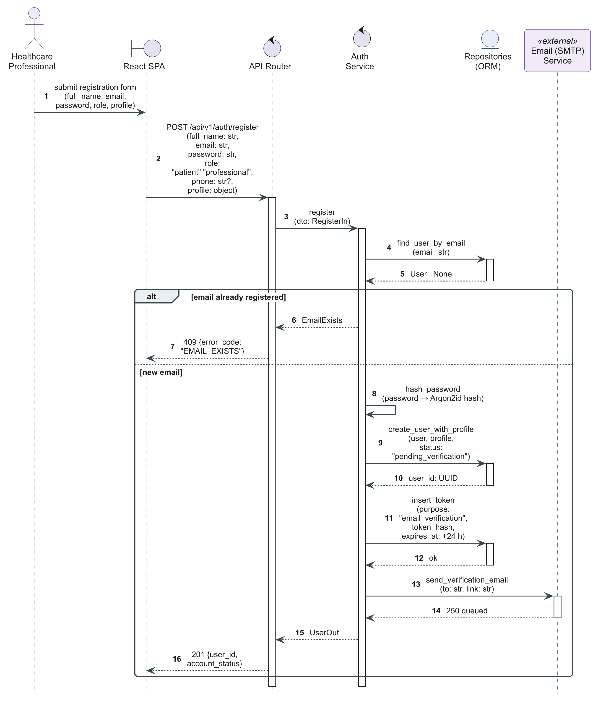

Figure : SD1 Registration, Email Verification and Login (Part 1 of 6)

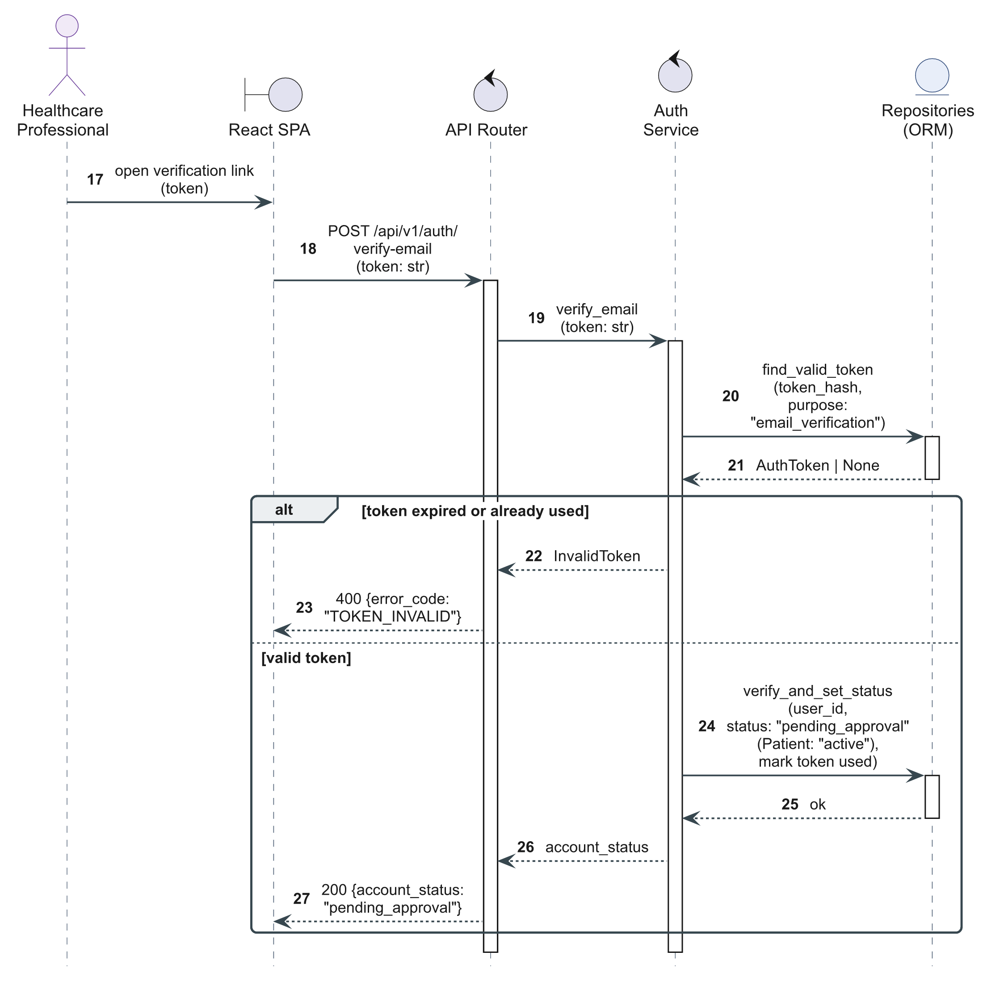

Figure : SD1 Registration, Email Verification and Login (Part 2 of 6)

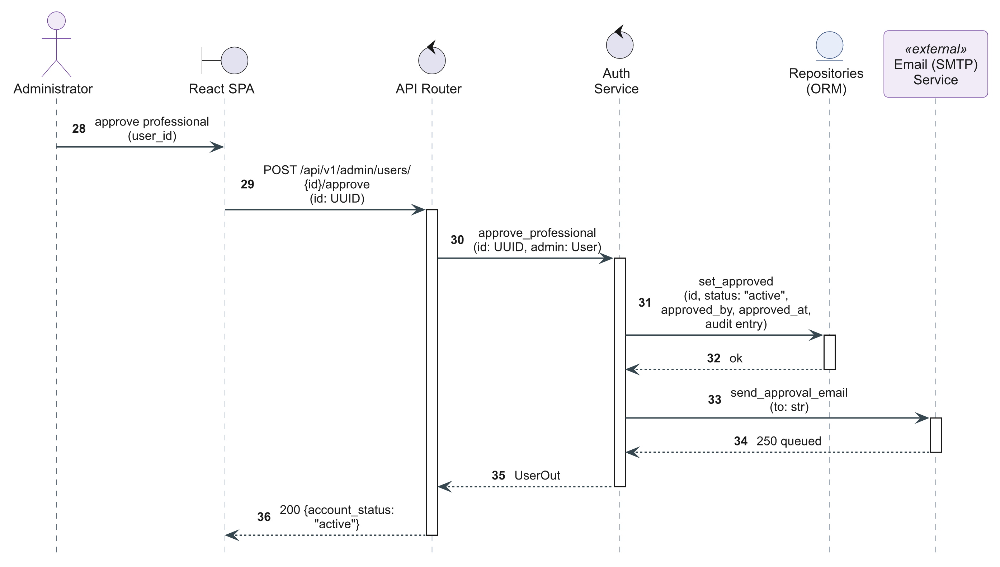

Figure : SD1 Registration, Email Verification and Login (Part 3 of 6)

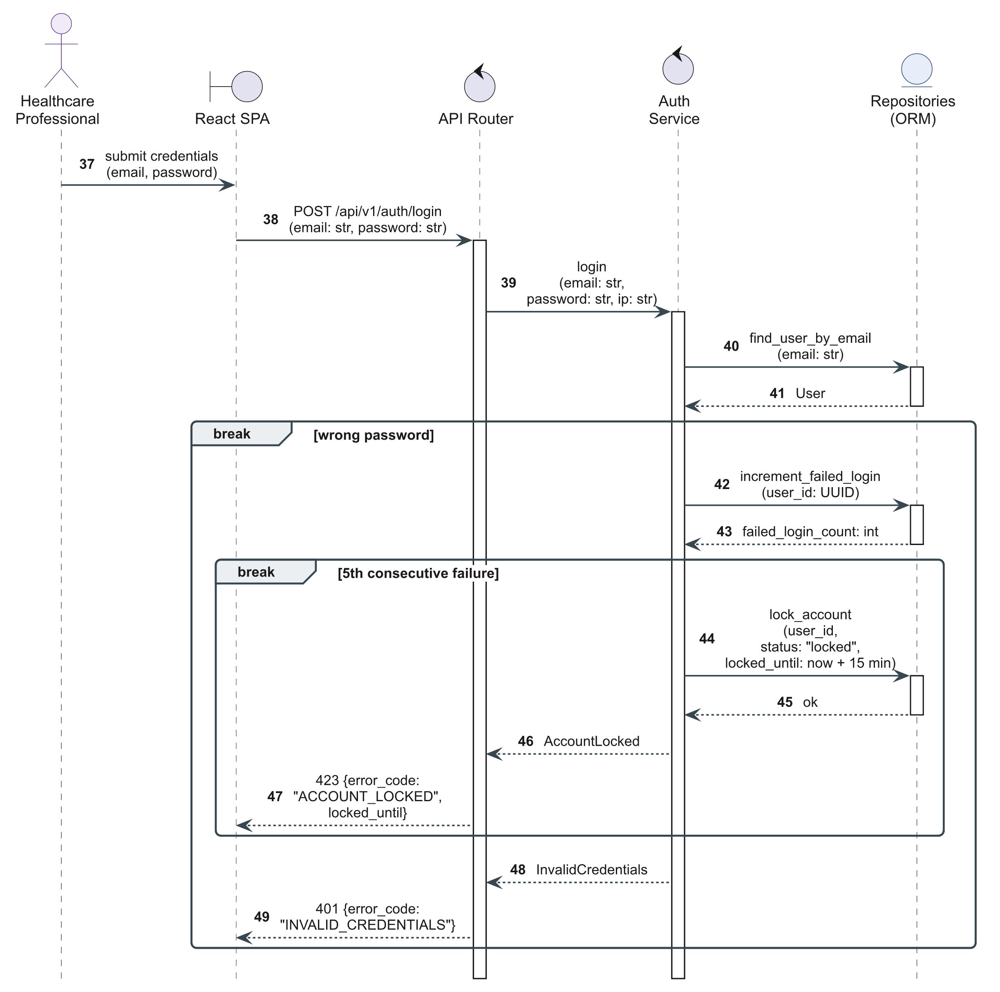

Figure : SD1 Registration, Email Verification and Login (Part 4 of 6)

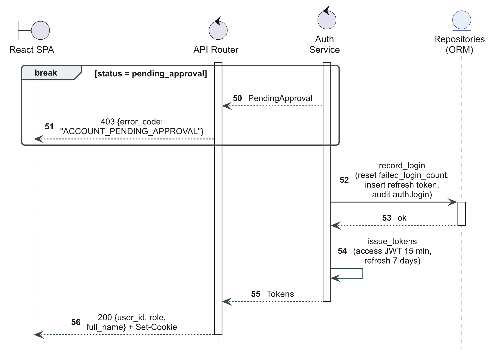

Figure : SD1 Registration, Email Verification and Login (Part 5 of 6)

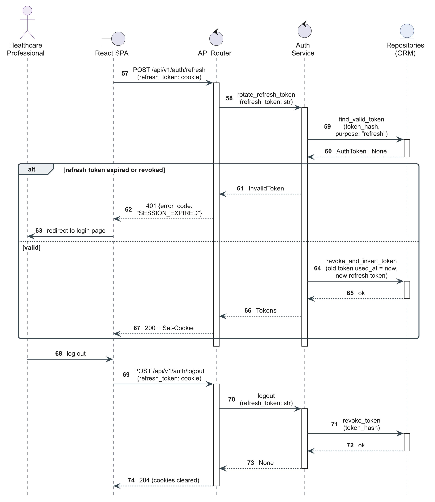

Figure : SD1 Registration, Email Verification and Login (Part 6 of 6)

***Parameter list of SD1:***

| **Msg \#** | **Operation / Endpoint**              | **Parameters (name: type)**                                                                              | **Returns**                                                                                                                                                                                          |
|------------|---------------------------------------|----------------------------------------------------------------------------------------------------------|------------------------------------------------------------------------------------------------------------------------------------------------------------------------------------------------------|
| 1          | submit registration form              | full_name, email, password, role, profile                                                                | –                                                                                                                                                                                                    |
| 2          | POST /api/v1/auth/register            | full_name: str, email: str, password: str, role: "patient"\|"professional", phone: str?, profile: object | 7: 409 {error_code: "EMAIL_EXISTS"}; 16: 201 {user_id, account_status}                                                                                                                               |
| 3          | register                              | dto: RegisterIn                                                                                          | 6: EmailExists; 15: UserOut                                                                                                                                                                          |
| 4          | find_user_by_email                    | email: str                                                                                               | 5: User \| None                                                                                                                                                                                      |
| 8          | hash_password                         | password → Argon2id hash                                                                                 | –                                                                                                                                                                                                    |
| 9          | create_user_with_profile              | user, profile, status: "pending_verification"                                                            | 10: user_id: UUID                                                                                                                                                                                    |
| 11         | insert_token                          | purpose: "email_verification", token_hash, expires_at: +24 h                                             | 12: ok                                                                                                                                                                                               |
| 13         | send_verification_email               | to: str, link: str                                                                                       | 14: 250 queued                                                                                                                                                                                       |
| 17         | open verification link                | token                                                                                                    | –                                                                                                                                                                                                    |
| 18         | POST /api/v1/auth/verify-email        | token: str                                                                                               | 23: 400 {error_code: "TOKEN_INVALID"}; 27: 200 {account_status: "pending_approval"}                                                                                                                  |
| 19         | verify_email                          | token: str                                                                                               | 22: InvalidToken; 26: account_status                                                                                                                                                                 |
| 20         | find_valid_token                      | token_hash, purpose: "email_verification"                                                                | 21: AuthToken \| None                                                                                                                                                                                |
| 24         | verify_and_set_status                 | user_id, status: "pending_approval" (Patient: "active"), mark token used                                 | 25: ok                                                                                                                                                                                               |
| 28         | approve professional                  | user_id                                                                                                  | –                                                                                                                                                                                                    |
| 29         | POST /api/v1/admin/users/{id}/approve | id: UUID                                                                                                 | 36: 200 {account_status: "active"}                                                                                                                                                                   |
| 30         | approve_professional                  | id: UUID, admin: User                                                                                    | 35: UserOut                                                                                                                                                                                          |
| 31         | set_approved                          | id, status: "active", approved_by, approved_at, audit entry                                              | 32: ok                                                                                                                                                                                               |
| 33         | send_approval_email                   | to: str                                                                                                  | 34: 250 queued                                                                                                                                                                                       |
| 37         | submit credentials                    | email, password                                                                                          | –                                                                                                                                                                                                    |
| 38         | POST /api/v1/auth/login               | email: str, password: str                                                                                | 47: 423 {error_code: "ACCOUNT_LOCKED", locked_until}; 49: 401 {error_code: "INVALID_CREDENTIALS"}; 51: 403 {error_code: "ACCOUNT_PENDING_APPROVAL"}; 56: 200 {user_id, role, full_name} + Set-Cookie |
| 39         | login                                 | email: str, password: str, ip: str                                                                       | 46: AccountLocked; 48: InvalidCredentials; 50: PendingApproval; 55: Tokens                                                                                                                           |
| 40         | find_user_by_email                    | email: str                                                                                               | 41: User                                                                                                                                                                                             |
| 42         | increment_failed_login                | user_id: UUID                                                                                            | 43: failed_login_count: int                                                                                                                                                                          |
| 44         | lock_account                          | user_id, status: "locked", locked_until: now + 15 min                                                    | 45: ok                                                                                                                                                                                               |
| 52         | record_login                          | reset failed_login_count, insert refresh token, audit auth.login                                         | 53: ok                                                                                                                                                                                               |
| 54         | issue_tokens                          | access JWT 15 min, refresh 7 days                                                                        | –                                                                                                                                                                                                    |
| 57         | POST /api/v1/auth/refresh             | refresh_token: cookie                                                                                    | 62: 401 {error_code: "SESSION_EXPIRED"}; 67: 200 + Set-Cookie                                                                                                                                        |
| 58         | rotate_refresh_token                  | refresh_token: str                                                                                       | 61: InvalidToken; 66: Tokens                                                                                                                                                                         |
| 59         | find_valid_token                      | token_hash, purpose: "refresh"                                                                           | 60: AuthToken \| None                                                                                                                                                                                |
| 63         | redirect to login page                | –                                                                                                        | –                                                                                                                                                                                                    |
| 64         | revoke_and_insert_token               | old token used_at = now, new refresh token                                                               | 65: ok                                                                                                                                                                                               |
| 68         | log out                               | –                                                                                                        | –                                                                                                                                                                                                    |
| 69         | POST /api/v1/auth/logout              | refresh_token: cookie                                                                                    | 74: 204 (cookies cleared)                                                                                                                                                                            |
| 70         | logout                                | refresh_token: str                                                                                       | 73: None                                                                                                                                                                                             |
| 71         | revoke_token                          | token_hash                                                                                               | 72: ok                                                                                                                                                                                               |

#### **Sequence Diagram 2: Password Reset**

*A user requests a password reset; the API always answers with the same generic message, stores a hashed 30-minute token and emails the link only when the account exists. Confirming the reset replaces the hash, revokes all sessions and clears any lockout. Realizes: UC-USR-03. Figures 17–18 show the diagram.*

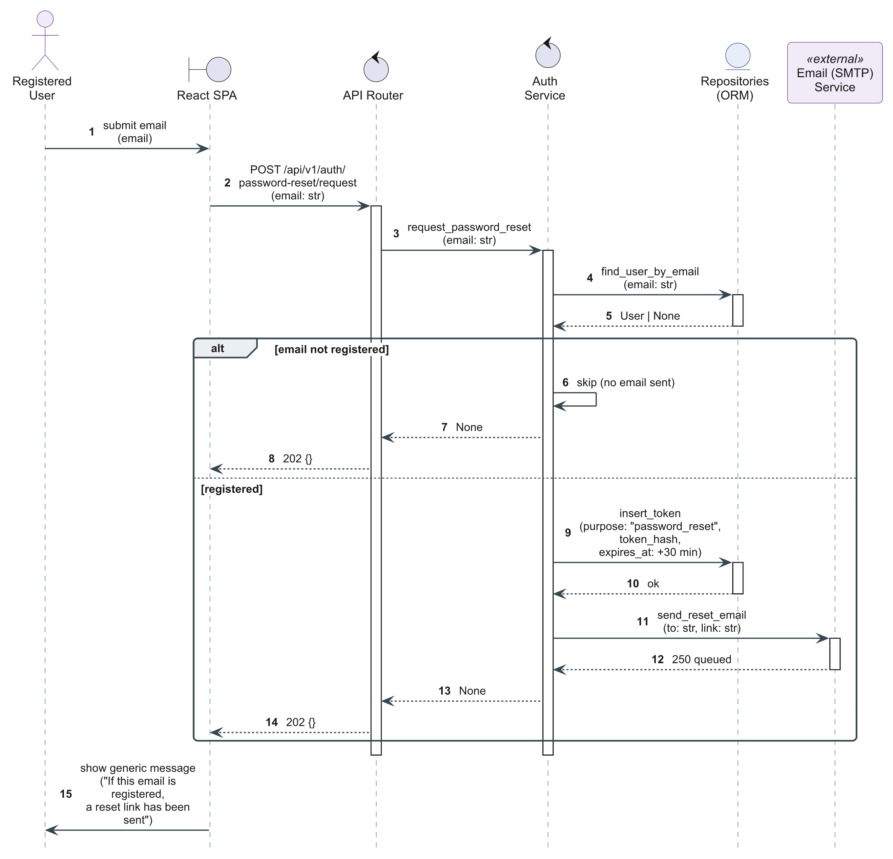

Figure : SD2 Password Reset (Part 1 of 2)

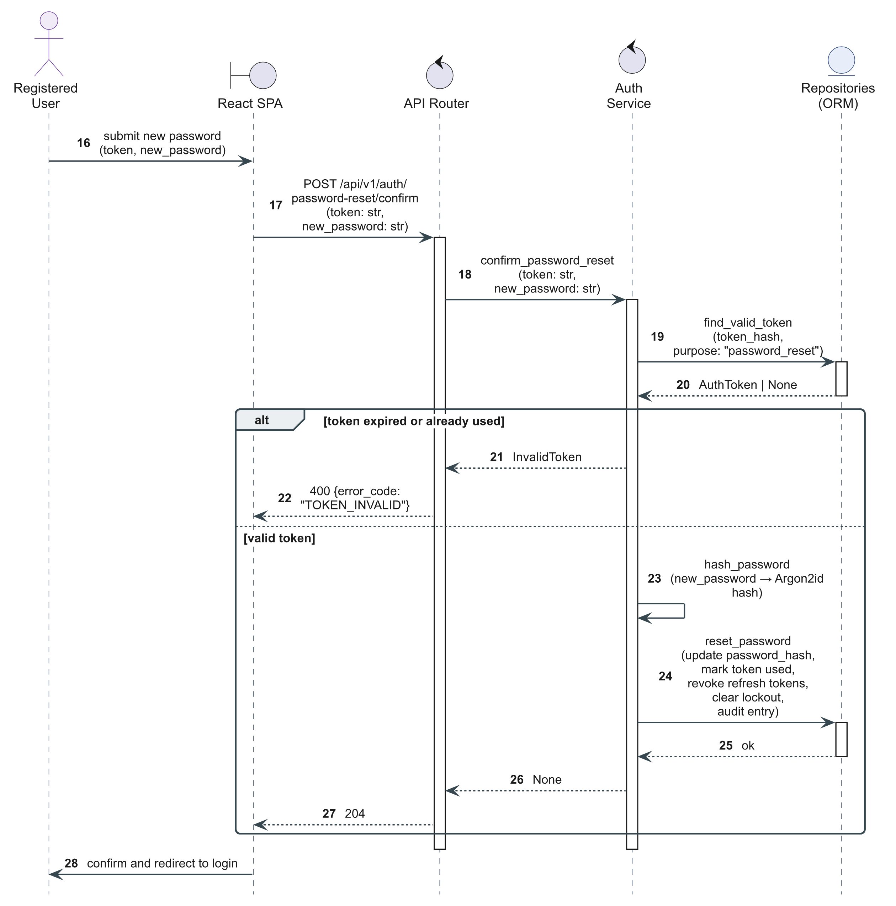

Figure : SD2 Password Reset (Part 2 of 2)

***Parameter list of SD2:***

| **Msg \#** | **Operation / Endpoint**                 | **Parameters (name: type)**                                                              | **Returns**                                    |
|------------|------------------------------------------|------------------------------------------------------------------------------------------|------------------------------------------------|
| 1          | submit email                             | email                                                                                    | –                                              |
| 2          | POST /api/v1/auth/password-reset/request | email: str                                                                               | 8: 202 {}; 14: 202 {}                          |
| 3          | request_password_reset                   | email: str                                                                               | 7: None; 13: None                              |
| 4          | find_user_by_email                       | email: str                                                                               | 5: User \| None                                |
| 6          | skip (no email sent)                     | –                                                                                        | –                                              |
| 9          | insert_token                             | purpose: "password_reset", token_hash, expires_at: +30 min                               | 10: ok                                         |
| 11         | send_reset_email                         | to: str, link: str                                                                       | 12: 250 queued                                 |
| 15         | show generic message                     | "If this email is registered, a reset link has been sent"                                | –                                              |
| 16         | submit new password                      | token, new_password                                                                      | –                                              |
| 17         | POST /api/v1/auth/password-reset/confirm | token: str, new_password: str                                                            | 22: 400 {error_code: "TOKEN_INVALID"}; 27: 204 |
| 18         | confirm_password_reset                   | token: str, new_password: str                                                            | 21: InvalidToken; 26: None                     |
| 19         | find_valid_token                         | token_hash, purpose: "password_reset"                                                    | 20: AuthToken \| None                          |
| 23         | hash_password                            | new_password → Argon2id hash                                                             | –                                              |
| 24         | reset_password                           | update password_hash, mark token used, revoke refresh tokens, clear lockout, audit entry | 25: ok                                         |
| 28         | confirm and redirect to login            | –                                                                                        | –                                              |

#### **Sequence Diagram 3: Image Upload and OSCC Classification**

*The user uploads an image. The screening service validates it, stores it in private object storage and queues the screening; a background task calls the inference service, which tiles, normalizes, predicts, aggregates and explains. The SPA polls until the result is ready and shows the outcome-specific wording. Compare mode passes every validated or active model version to the same call. Realizes: UC-SCR-01, UC-SCR-02, UC-SCR-03. Figures 19–23 show the diagram.*

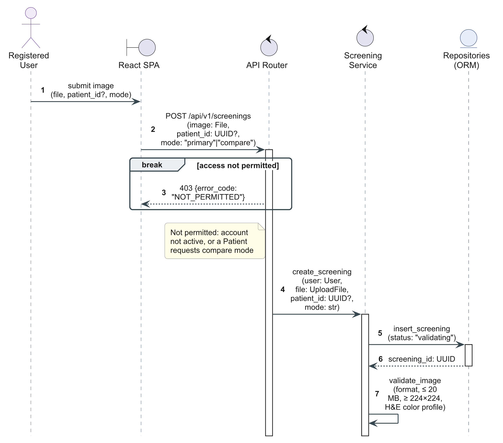

Figure : SD3 Image Upload and OSCC Classification (Part 1 of 5)

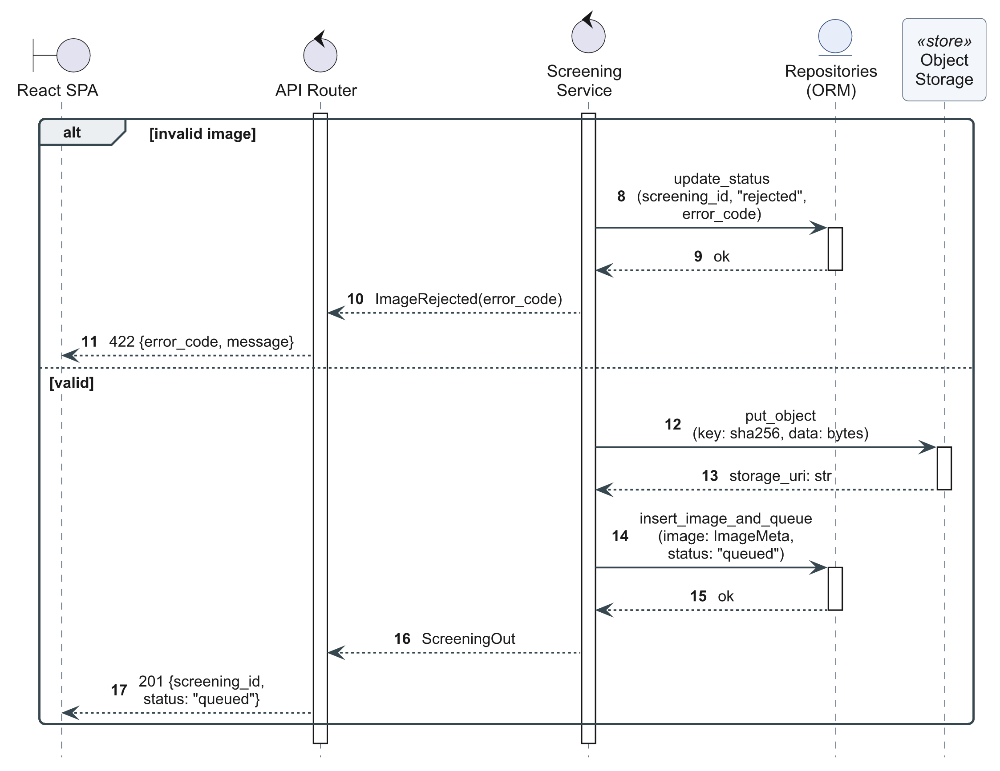

Figure : SD3 Image Upload and OSCC Classification (Part 2 of 5)

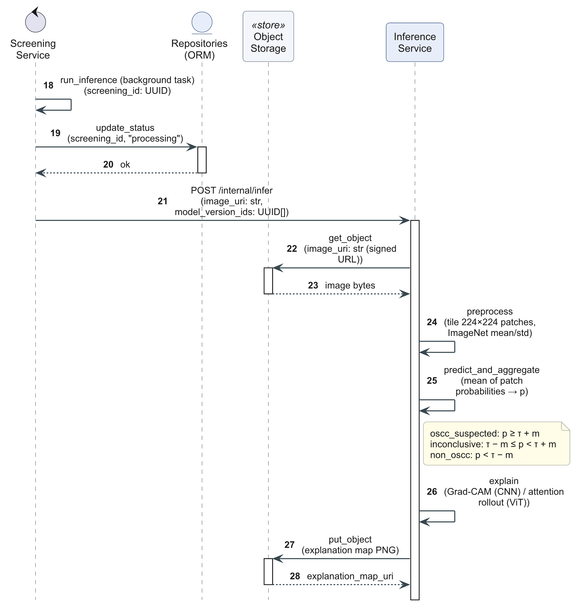

Figure : SD3 Image Upload and OSCC Classification (Part 3 of 5)

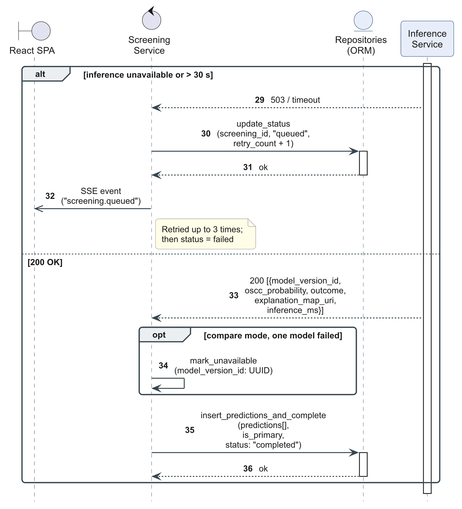

Figure : SD3 Image Upload and OSCC Classification (Part 4 of 5)

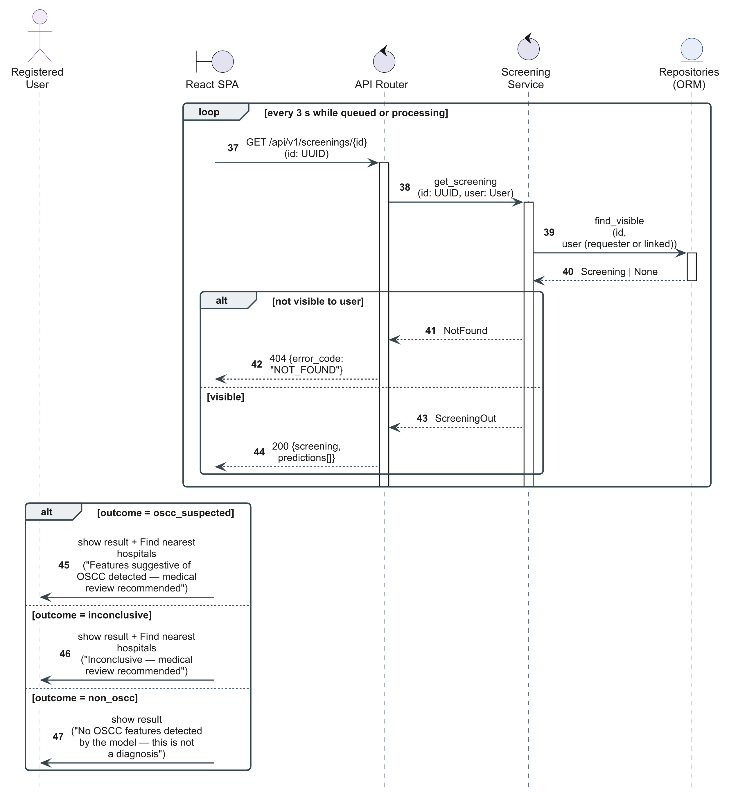

Figure : SD3 Image Upload and OSCC Classification (Part 5 of 5)

***Parameter list of SD3:***

| **Msg \#** | **Operation / Endpoint**             | **Parameters (name: type)**                                         | **Returns**                                                                                                     |
|------------|--------------------------------------|---------------------------------------------------------------------|-----------------------------------------------------------------------------------------------------------------|
| 1          | submit image                         | file, patient_id?, mode                                             | –                                                                                                               |
| 2          | POST /api/v1/screenings              | image: File, patient_id: UUID?, mode: "primary"\|"compare"          | 3: 403 {error_code: "NOT_PERMITTED"}; 11: 422 {error_code, message}; 17: 201 {screening_id, status: "queued"}   |
| 4          | create_screening                     | user: User, file: UploadFile, patient_id: UUID?, mode: str          | 10: ImageRejected(error_code); 16: ScreeningOut                                                                 |
| 5          | insert_screening                     | status: "validating"                                                | 6: screening_id: UUID                                                                                           |
| 7          | validate_image                       | format, ≤ 20 MB, ≥ 224×224, H&E color profile                       | –                                                                                                               |
| 8          | update_status                        | screening_id, "rejected", error_code                                | 9: ok                                                                                                           |
| 12         | put_object                           | key: sha256, data: bytes                                            | 13: storage_uri: str                                                                                            |
| 14         | insert_image_and_queue               | image: ImageMeta, status: "queued"                                  | 15: ok                                                                                                          |
| 18         | run_inference (background task)      | screening_id: UUID                                                  | –                                                                                                               |
| 19         | update_status                        | screening_id, "processing"                                          | 20: ok                                                                                                          |
| 21         | POST /internal/infer                 | image_uri: str, model_version_ids: UUID\[\]                         | 29: 503 / timeout; 33: 200 \[{model_version_id, oscc_probability, outcome, explanation_map_uri, inference_ms}\] |
| 22         | get_object                           | image_uri: str (signed URL)                                         | 23: image bytes                                                                                                 |
| 24         | preprocess                           | tile 224×224 patches, ImageNet mean/std                             | –                                                                                                               |
| 25         | predict_and_aggregate                | mean of patch probabilities → p                                     | –                                                                                                               |
| 26         | explain                              | Grad-CAM (CNN) / attention rollout (ViT)                            | –                                                                                                               |
| 27         | put_object                           | explanation map PNG                                                 | 28: explanation_map_uri                                                                                         |
| 30         | update_status                        | screening_id, "queued", retry_count + 1                             | 31: ok                                                                                                          |
| 32         | SSE event                            | "screening.queued"                                                  | –                                                                                                               |
| 34         | mark_unavailable                     | model_version_id: UUID                                              | –                                                                                                               |
| 35         | insert_predictions_and_complete      | predictions\[\], is_primary, status: "completed"                    | 36: ok                                                                                                          |
| 37         | GET /api/v1/screenings/{id}          | id: UUID                                                            | 42: 404 {error_code: "NOT_FOUND"}; 44: 200 {screening, predictions\[\]}                                         |
| 38         | get_screening                        | id: UUID, user: User                                                | 41: NotFound; 43: ScreeningOut                                                                                  |
| 39         | find_visible                         | id, user (requester or linked)                                      | 40: Screening \| None                                                                                           |
| 45         | show result + Find nearest hospitals | "Features suggestive of OSCC detected — medical review recommended" | –                                                                                                               |
| 46         | show result + Find nearest hospitals | "Inconclusive — medical review recommended"                         | –                                                                                                               |
| 47         | show result                          | "No OSCC features detected by the model — this is not a diagnosis"  | –                                                                                                               |

#### **Sequence Diagram 4: Share Screening Result with Patient**

*A professional lists their screenings, shares one with a registered patient (creating a pending link when needed) and the patient accepts or declines the link. Realizes: UC-SCR-04, UC-SCR-05. Figures 24–27 show the diagram.*

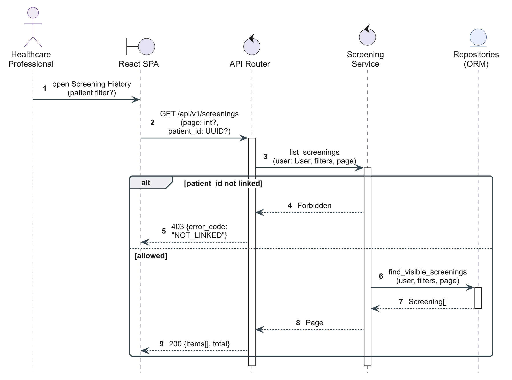

Figure : SD4 Share Screening Result with Patient (Part 1 of 4)

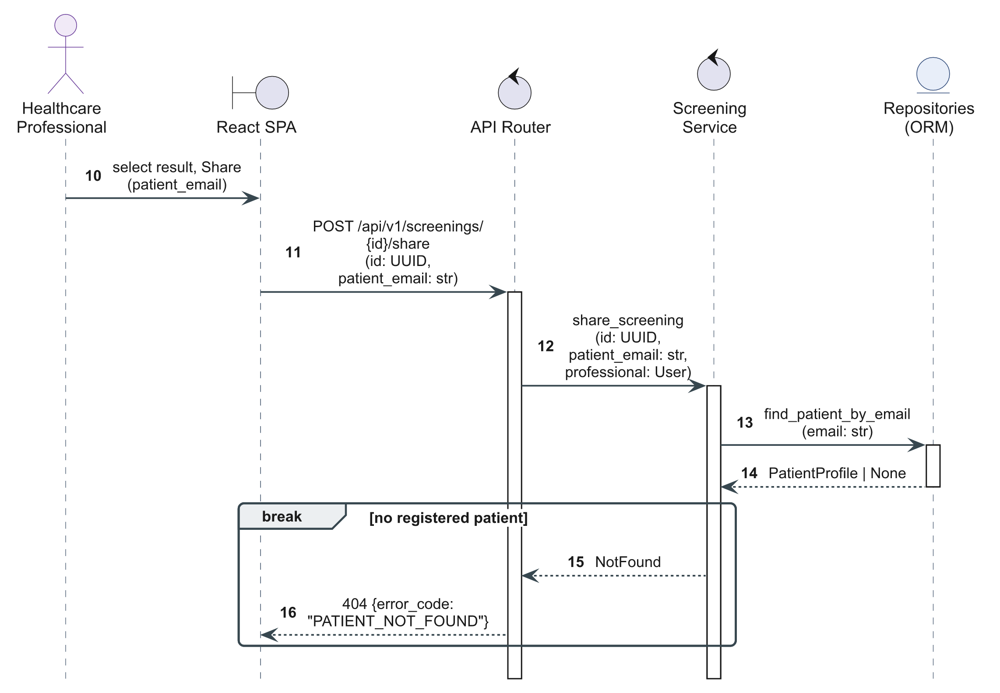

Figure : SD4 Share Screening Result with Patient (Part 2 of 4)

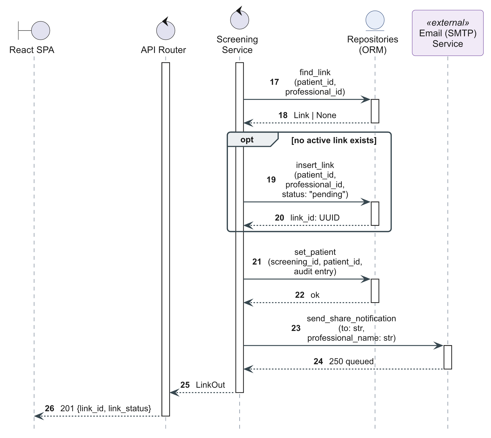

Figure : SD4 Share Screening Result with Patient (Part 3 of 4)

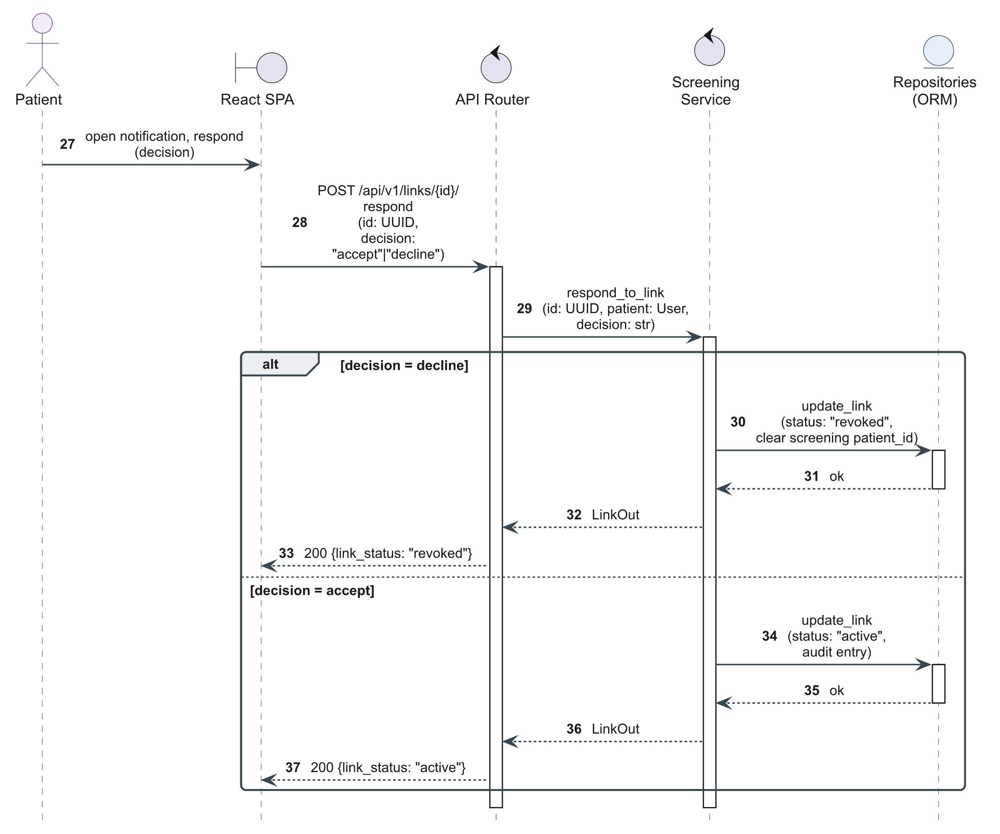

Figure : SD4 Share Screening Result with Patient (Part 4 of 4)

***Parameter list of SD4:***

| **Msg \#** | **Operation / Endpoint**           | **Parameters (name: type)**                      | **Returns**                                                               |
|------------|------------------------------------|--------------------------------------------------|---------------------------------------------------------------------------|
| 1          | open Screening History             | patient filter?                                  | –                                                                         |
| 2          | GET /api/v1/screenings             | page: int?, patient_id: UUID?                    | 5: 403 {error_code: "NOT_LINKED"}; 9: 200 {items\[\], total}              |
| 3          | list_screenings                    | user: User, filters, page                        | 4: Forbidden; 8: Page                                                     |
| 6          | find_visible_screenings            | user, filters, page                              | 7: Screening\[\]                                                          |
| 10         | select result, Share               | patient_email                                    | –                                                                         |
| 11         | POST /api/v1/screenings/{id}/share | id: UUID, patient_email: str                     | 16: 404 {error_code: "PATIENT_NOT_FOUND"}; 26: 201 {link_id, link_status} |
| 12         | share_screening                    | id: UUID, patient_email: str, professional: User | 15: NotFound; 25: LinkOut                                                 |
| 13         | find_patient_by_email              | email: str                                       | 14: PatientProfile \| None                                                |
| 17         | find_link                          | patient_id, professional_id                      | 18: Link \| None                                                          |
| 19         | insert_link                        | patient_id, professional_id, status: "pending"   | 20: link_id: UUID                                                         |
| 21         | set_patient                        | screening_id, patient_id, audit entry            | 22: ok                                                                    |
| 23         | send_share_notification            | to: str, professional_name: str                  | 24: 250 queued                                                            |
| 27         | open notification, respond         | decision                                         | –                                                                         |
| 28         | POST /api/v1/links/{id}/respond    | id: UUID, decision: "accept"\|"decline"          | 33: 200 {link_status: "revoked"}; 37: 200 {link_status: "active"}         |
| 29         | respond_to_link                    | id: UUID, patient: User, decision: str           | 32: LinkOut; 36: LinkOut                                                  |
| 30         | update_link                        | status: "revoked", clear screening patient_id    | 31: ok                                                                    |
| 34         | update_link                        | status: "active", audit entry                    | 35: ok                                                                    |

#### **Sequence Diagram 5: Nearest Hospital Recommendation**

*The user grants location access or types an address; the recommendation service prefilters facilities with a bounding box, expands the radius when nothing is found, ranks by haversine distance, refines the ten nearest with the mapping API and falls back to straight-line distance when that API fails. Only rounded coordinates are stored. Realizes: UC-HOS-01, UC-HOS-02, UC-HOS-03. Figures 28–30 show the diagram.*

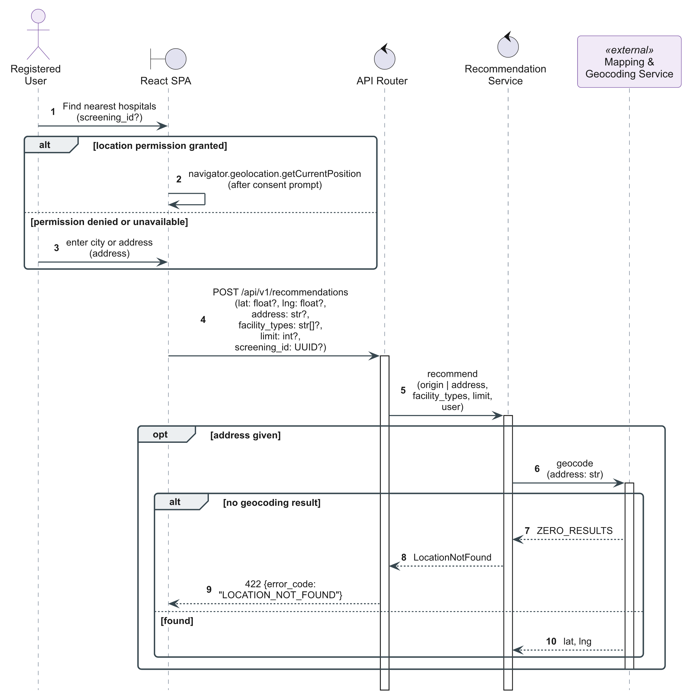

Figure : SD5 Nearest Hospital Recommendation (Part 1 of 3)

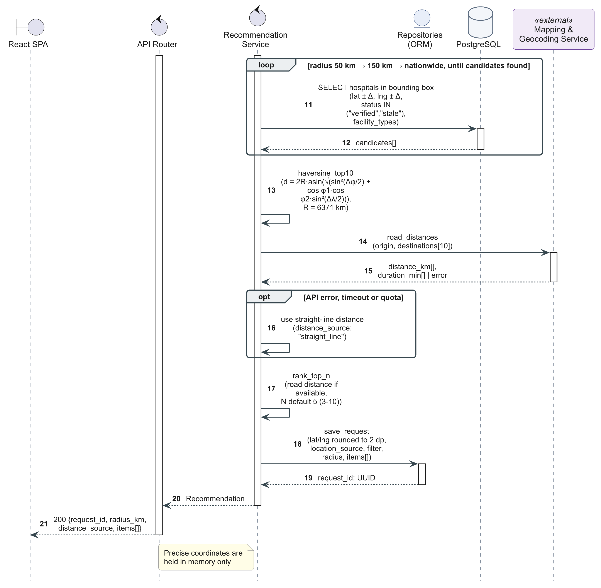

Figure : SD5 Nearest Hospital Recommendation (Part 2 of 3)

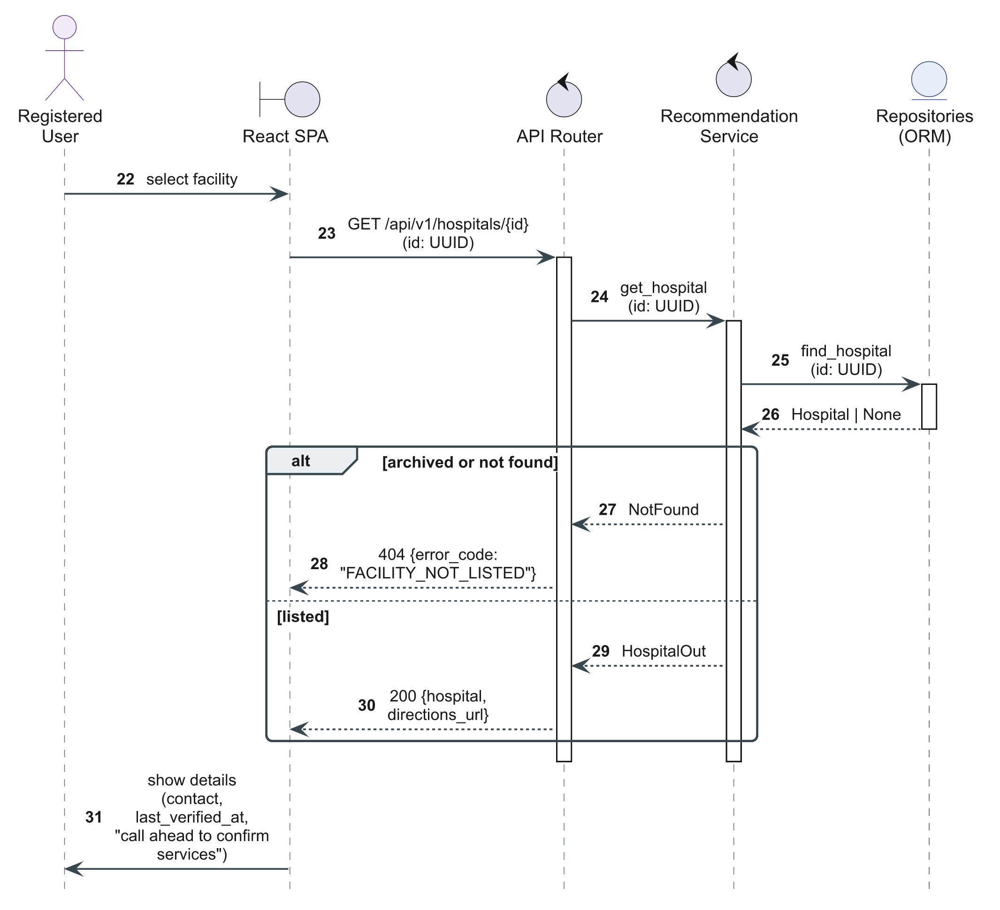

Figure : SD5 Nearest Hospital Recommendation (Part 3 of 3)

***Parameter list of SD5:***

| **Msg \#** | **Operation / Endpoint**                 | **Parameters (name: type)**                                                                         | **Returns**                                                                                            |
|------------|------------------------------------------|-----------------------------------------------------------------------------------------------------|--------------------------------------------------------------------------------------------------------|
| 1          | Find nearest hospitals                   | screening_id?                                                                                       | –                                                                                                      |
| 2          | navigator.geolocation.getCurrentPosition | after consent prompt                                                                                | –                                                                                                      |
| 3          | enter city or address                    | address                                                                                             | –                                                                                                      |
| 4          | POST /api/v1/recommendations             | lat: float?, lng: float?, address: str?, facility_types: str\[\]?, limit: int?, screening_id: UUID? | 9: 422 {error_code: "LOCATION_NOT_FOUND"}; 21: 200 {request_id, radius_km, distance_source, items\[\]} |
| 5          | recommend                                | origin \| address, facility_types, limit, user                                                      | 8: LocationNotFound; 20: Recommendation                                                                |
| 6          | geocode                                  | address: str                                                                                        | 7: ZERO_RESULTS; 10: lat, lng                                                                          |
| 11         | SELECT hospitals in bounding box         | lat ± Δ, lng ± Δ, status IN ("verified","stale"), facility_types                                    | 12: candidates\[\]                                                                                     |
| 13         | haversine_top10                          | d = 2R·asin(√(sin²(Δφ/2) + cos φ1·cos φ2·sin²(Δλ/2))), R = 6371 km                                  | –                                                                                                      |
| 14         | road_distances                           | origin, destinations\[10\]                                                                          | 15: distance_km\[\], duration_min\[\] \| error                                                         |
| 16         | use straight-line distance               | distance_source: "straight_line"                                                                    | –                                                                                                      |
| 17         | rank_top_n                               | road distance if available, N default 5 (3–10)                                                      | –                                                                                                      |
| 18         | save_request                             | lat/lng rounded to 2 dp, location_source, filter, radius, items\[\]                                 | 19: request_id: UUID                                                                                   |
| 22         | select facility                          | –                                                                                                   | –                                                                                                      |
| 23         | GET /api/v1/hospitals/{id}               | id: UUID                                                                                            | 28: 404 {error_code: "FACILITY_NOT_LISTED"}; 30: 200 {hospital, directions_url}                        |
| 24         | get_hospital                             | id: UUID                                                                                            | 27: NotFound; 29: HospitalOut                                                                          |
| 25         | find_hospital                            | id: UUID                                                                                            | 26: Hospital \| None                                                                                   |
| 31         | show details                             | contact, last_verified_at, "call ahead to confirm services"                                         | –                                                                                                      |

#### **Sequence Diagram 6: Chatbot Message Handling**

*A patient message passes through PII scrubbing and safety screening (with an immediate break for distress), intent routing, optional retrieval over the knowledge base, the guarded LLM call with its fallback, and the output check before the reply is streamed back. Realizes: UC-CHT-01, UC-CHT-02. Figures 31–34 show the diagram.*

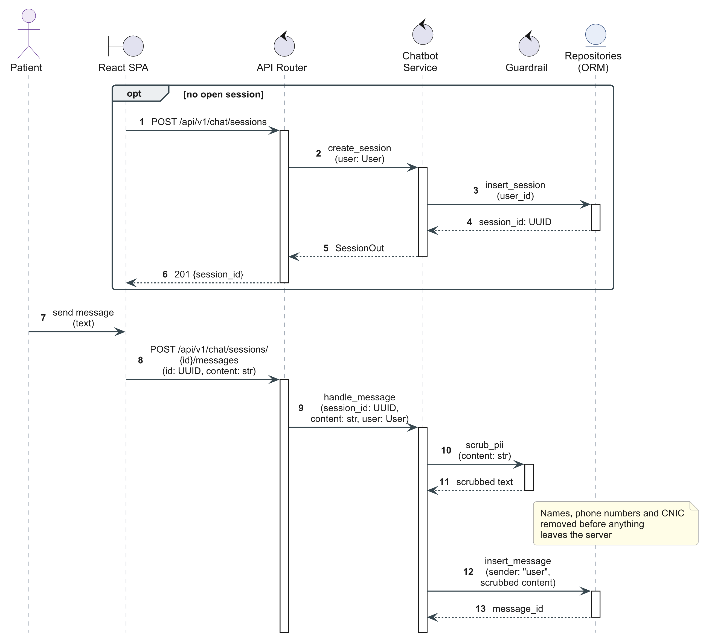

Figure : SD6 Chatbot Message Handling (Part 1 of 4)

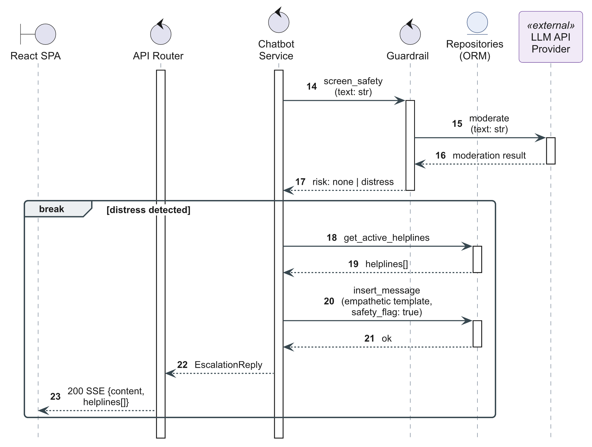

Figure : SD6 Chatbot Message Handling (Part 2 of 4)

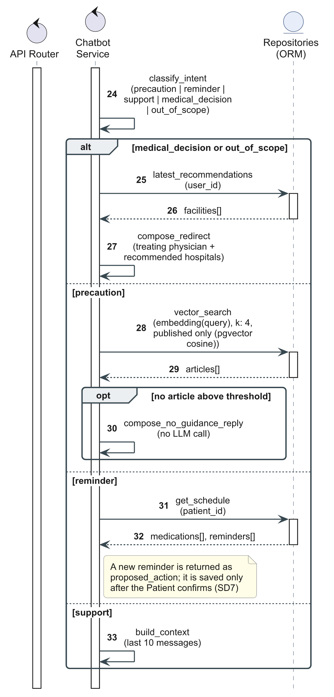

Figure : SD6 Chatbot Message Handling (Part 3 of 4)

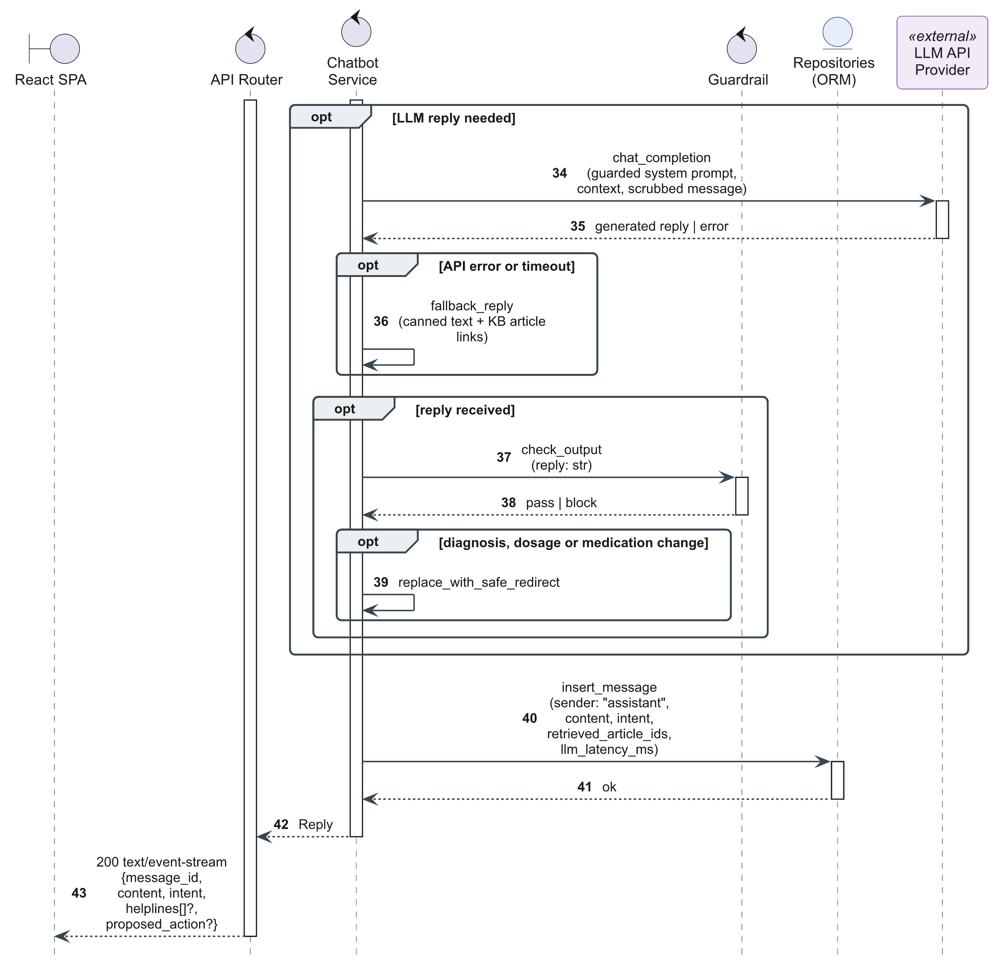

Figure : SD6 Chatbot Message Handling (Part 4 of 4)

***Parameter list of SD6:***

| **Msg \#** | **Operation / Endpoint**                 | **Parameters (name: type)**                                                 | **Returns**                                                                                                                     |
|------------|------------------------------------------|-----------------------------------------------------------------------------|---------------------------------------------------------------------------------------------------------------------------------|
| 1          | POST /api/v1/chat/sessions               | –                                                                           | 6: 201 {session_id}                                                                                                             |
| 2          | create_session                           | user: User                                                                  | 5: SessionOut                                                                                                                   |
| 3          | insert_session                           | user_id                                                                     | 4: session_id: UUID                                                                                                             |
| 7          | send message                             | text                                                                        | –                                                                                                                               |
| 8          | POST /api/v1/chat/sessions/{id}/messages | id: UUID, content: str                                                      | 23: 200 SSE {content, helplines\[\]}; 43: 200 text/event-stream {message_id, content, intent, helplines\[\]?, proposed_action?} |
| 9          | handle_message                           | session_id: UUID, content: str, user: User                                  | 22: EscalationReply; 42: Reply                                                                                                  |
| 10         | scrub_pii                                | content: str                                                                | 11: scrubbed text                                                                                                               |
| 12         | insert_message                           | sender: "user", scrubbed content                                            | 13: message_id                                                                                                                  |
| 14         | screen_safety                            | text: str                                                                   | 17: risk: none \| distress                                                                                                      |
| 15         | moderate                                 | text: str                                                                   | 16: moderation result                                                                                                           |
| 18         | get_active_helplines                     | –                                                                           | 19: helplines\[\]                                                                                                               |
| 20         | insert_message                           | empathetic template, safety_flag: true                                      | 21: ok                                                                                                                          |
| 24         | classify_intent                          | precaution \| reminder \| support \| medical_decision \| out_of_scope       | –                                                                                                                               |
| 25         | latest_recommendations                   | user_id                                                                     | 26: facilities\[\]                                                                                                              |
| 27         | compose_redirect                         | treating physician + recommended hospitals                                  | –                                                                                                                               |
| 28         | vector_search                            | embedding(query), k: 4, published only (pgvector cosine)                    | 29: articles\[\]                                                                                                                |
| 30         | compose_no_guidance_reply                | no LLM call                                                                 | –                                                                                                                               |
| 31         | get_schedule                             | patient_id                                                                  | 32: medications\[\], reminders\[\]                                                                                              |
| 33         | build_context                            | last 10 messages                                                            | –                                                                                                                               |
| 34         | chat_completion                          | guarded system prompt, context, scrubbed message                            | 35: generated reply \| error                                                                                                    |
| 36         | fallback_reply                           | canned text + KB article links                                              | –                                                                                                                               |
| 37         | check_output                             | reply: str                                                                  | 38: pass \| block                                                                                                               |
| 39         | replace_with_safe_redirect               | –                                                                           | –                                                                                                                               |
| 40         | insert_message                           | sender: "assistant", content, intent, retrieved_article_ids, llm_latency_ms | 41: ok                                                                                                                          |

#### **Sequence Diagram 7: Treatment Plan Creation and Reminder Dispatch/Acknowledgement**

*The patient creates a treatment plan and adds medications, which generates reminders. The scheduler worker claims due reminders every 60 s with SKIP LOCKED, notifies the patient in-app and by optional email, and marks unanswered reminders missed. The patient responds with taken, snooze or skip and views the adherence summary. Realizes: UC-MED-01, UC-MED-02, UC-MED-03. Figures 35–40 show the diagram.*

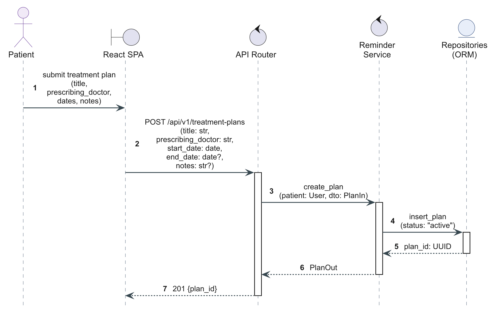

Figure : SD7 Treatment Plan Creation and Reminder Dispatch/Acknowledgement (Part 1 of 6)

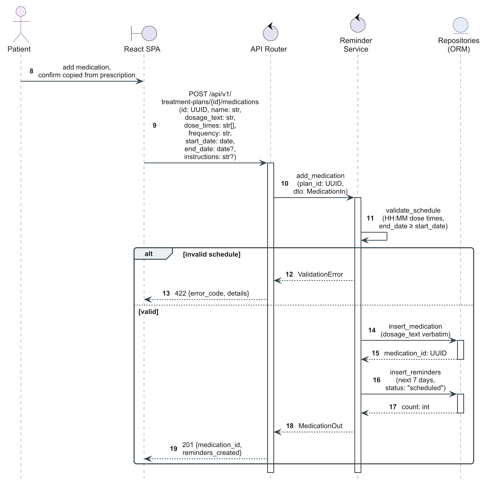

Figure : SD7 Treatment Plan Creation and Reminder Dispatch/Acknowledgement (Part 2 of 6)

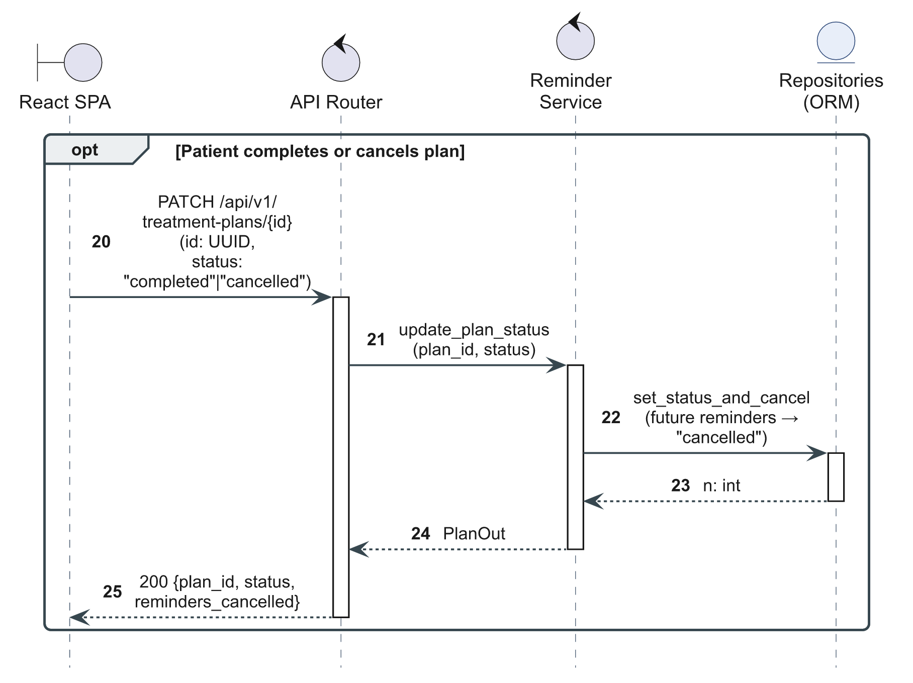

Figure : SD7 Treatment Plan Creation and Reminder Dispatch/Acknowledgement (Part 3 of 6)

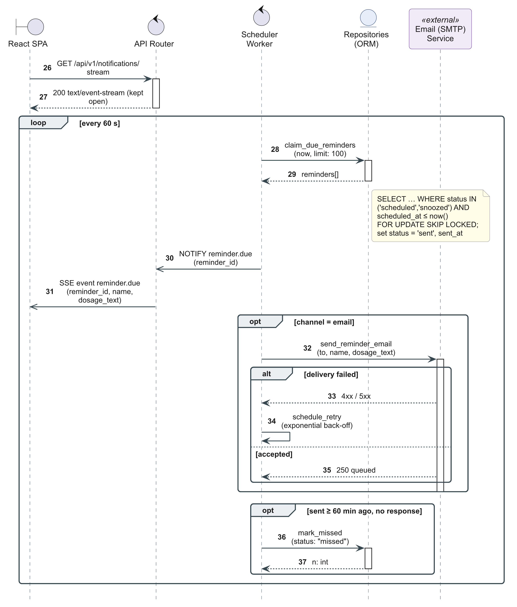

Figure : SD7 Treatment Plan Creation and Reminder Dispatch/Acknowledgement (Part 4 of 6)

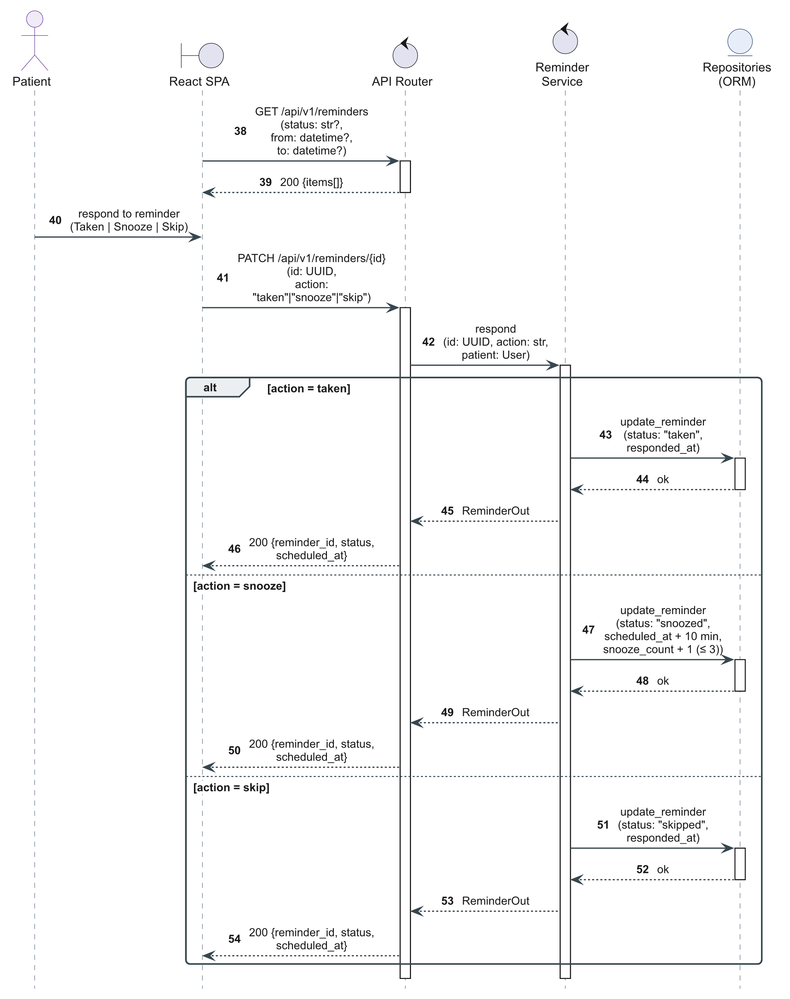

Figure : SD7 Treatment Plan Creation and Reminder Dispatch/Acknowledgement (Part 5 of 6)

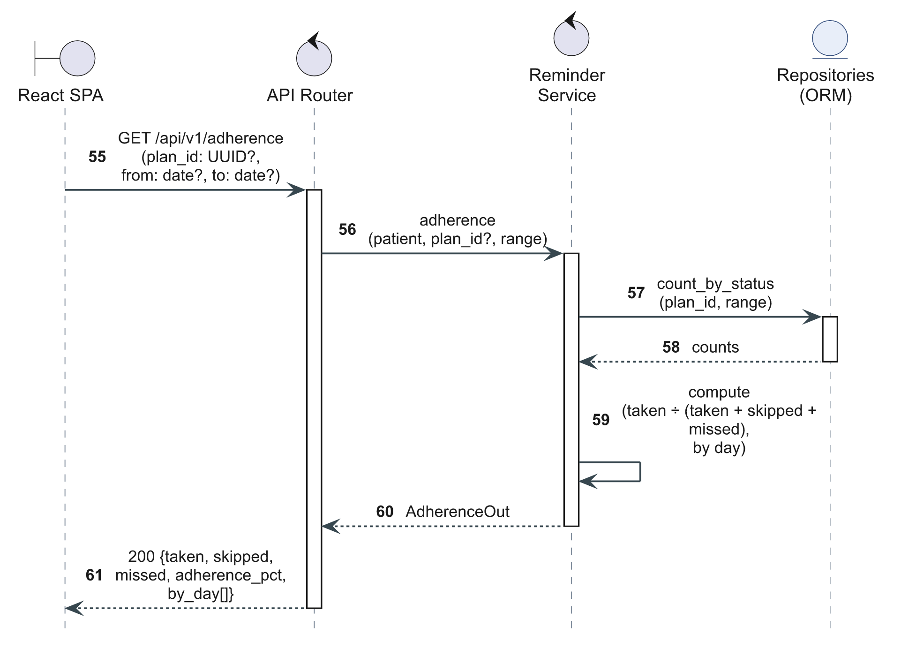

Figure : SD7 Treatment Plan Creation and Reminder Dispatch/Acknowledgement (Part 6 of 6)

***Parameter list of SD7:***

| **Msg \#** | **Operation / Endpoint**                         | **Parameters (name: type)**                                                                                                       | **Returns**                                                                                                                           |
|------------|--------------------------------------------------|-----------------------------------------------------------------------------------------------------------------------------------|---------------------------------------------------------------------------------------------------------------------------------------|
| 1          | submit treatment plan                            | title, prescribing_doctor, dates, notes                                                                                           | –                                                                                                                                     |
| 2          | POST /api/v1/treatment-plans                     | title: str, prescribing_doctor: str, start_date: date, end_date: date?, notes: str?                                               | 7: 201 {plan_id}                                                                                                                      |
| 3          | create_plan                                      | patient: User, dto: PlanIn                                                                                                        | 6: PlanOut                                                                                                                            |
| 4          | insert_plan                                      | status: "active"                                                                                                                  | 5: plan_id: UUID                                                                                                                      |
| 8          | add medication, confirm copied from prescription | –                                                                                                                                 | –                                                                                                                                     |
| 9          | POST /api/v1/treatment-plans/{id}/medications    | id: UUID, name: str, dosage_text: str, dose_times: str\[\], frequency: str, start_date: date, end_date: date?, instructions: str? | 13: 422 {error_code, details}; 19: 201 {medication_id, reminders_created}                                                             |
| 10         | add_medication                                   | plan_id: UUID, dto: MedicationIn                                                                                                  | 12: ValidationError; 18: MedicationOut                                                                                                |
| 11         | validate_schedule                                | HH:MM dose times, end_date ≥ start_date                                                                                           | –                                                                                                                                     |
| 14         | insert_medication                                | dosage_text verbatim                                                                                                              | 15: medication_id: UUID                                                                                                               |
| 16         | insert_reminders                                 | next 7 days, status: "scheduled"                                                                                                  | 17: count: int                                                                                                                        |
| 20         | PATCH /api/v1/treatment-plans/{id}               | id: UUID, status: "completed"\|"cancelled"                                                                                        | 25: 200 {plan_id, status, reminders_cancelled}                                                                                        |
| 21         | update_plan_status                               | plan_id, status                                                                                                                   | 24: PlanOut                                                                                                                           |
| 22         | set_status_and_cancel                            | future reminders → "cancelled"                                                                                                    | 23: n: int                                                                                                                            |
| 26         | GET /api/v1/notifications/stream                 | –                                                                                                                                 | 27: 200 text/event-stream (kept open)                                                                                                 |
| 28         | claim_due_reminders                              | now, limit: 100                                                                                                                   | 29: reminders\[\]                                                                                                                     |
| 30         | NOTIFY reminder.due                              | reminder_id                                                                                                                       | –                                                                                                                                     |
| 31         | SSE event reminder.due                           | reminder_id, name, dosage_text                                                                                                    | –                                                                                                                                     |
| 32         | send_reminder_email                              | to, name, dosage_text                                                                                                             | 33: 4xx / 5xx; 35: 250 queued                                                                                                         |
| 34         | schedule_retry                                   | exponential back-off                                                                                                              | –                                                                                                                                     |
| 36         | mark_missed                                      | status: "missed"                                                                                                                  | 37: n: int                                                                                                                            |
| 38         | GET /api/v1/reminders                            | status: str?, from: datetime?, to: datetime?                                                                                      | 39: 200 {items\[\]}                                                                                                                   |
| 40         | respond to reminder                              | Taken \| Snooze \| Skip                                                                                                           | –                                                                                                                                     |
| 41         | PATCH /api/v1/reminders/{id}                     | id: UUID, action: "taken"\|"snooze"\|"skip"                                                                                       | 46: 200 {reminder_id, status, scheduled_at}; 50: 200 {reminder_id, status, scheduled_at}; 54: 200 {reminder_id, status, scheduled_at} |
| 42         | respond                                          | id: UUID, action: str, patient: User                                                                                              | 45: ReminderOut; 49: ReminderOut; 53: ReminderOut                                                                                     |
| 43         | update_reminder                                  | status: "taken", responded_at                                                                                                     | 44: ok                                                                                                                                |
| 47         | update_reminder                                  | status: "snoozed", scheduled_at + 10 min, snooze_count + 1 (≤ 3)                                                                  | 48: ok                                                                                                                                |
| 51         | update_reminder                                  | status: "skipped", responded_at                                                                                                   | 52: ok                                                                                                                                |
| 55         | GET /api/v1/adherence                            | plan_id: UUID?, from: date?, to: date?                                                                                            | 61: 200 {taken, skipped, missed, adherence_pct, by_day\[\]}                                                                           |
| 56         | adherence                                        | patient, plan_id?, range                                                                                                          | 60: AdherenceOut                                                                                                                      |
| 57         | count_by_status                                  | plan_id, range                                                                                                                    | 58: counts                                                                                                                            |
| 59         | compute                                          | taken ÷ (taken + skipped + missed), by day                                                                                        | –                                                                                                                                     |

#### **Sequence Diagram 8: Admin Hospital Directory CSV Import with Geocoding and Verification**

*The administrator adds a facility or imports a CSV file; each row is validated, checked for duplicates and geocoded. A draft is then verified with an optimistic-locking update, and closed facilities are archived. Realizes: UC-ADM-02. Figures 41–44 show the diagram.*

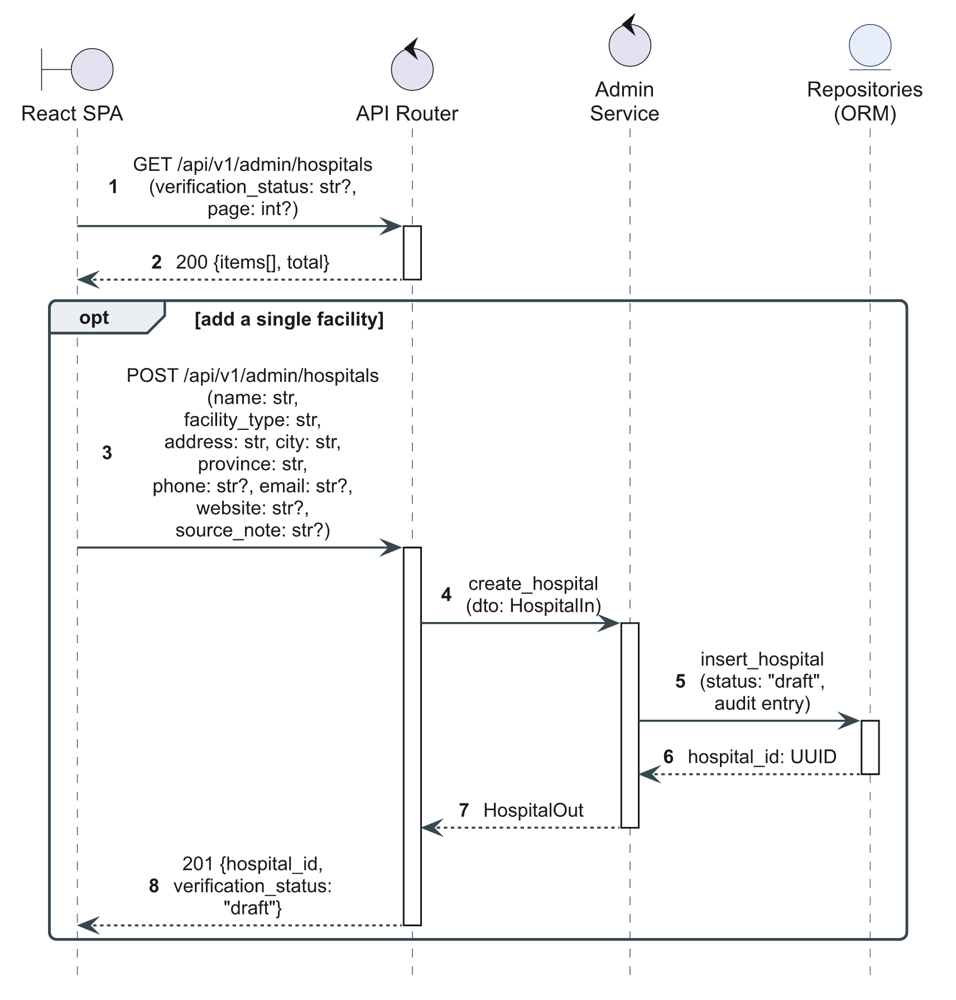

Figure : SD8 Admin Hospital Directory CSV Import with Geocoding and Verification (Part 1 of 4)

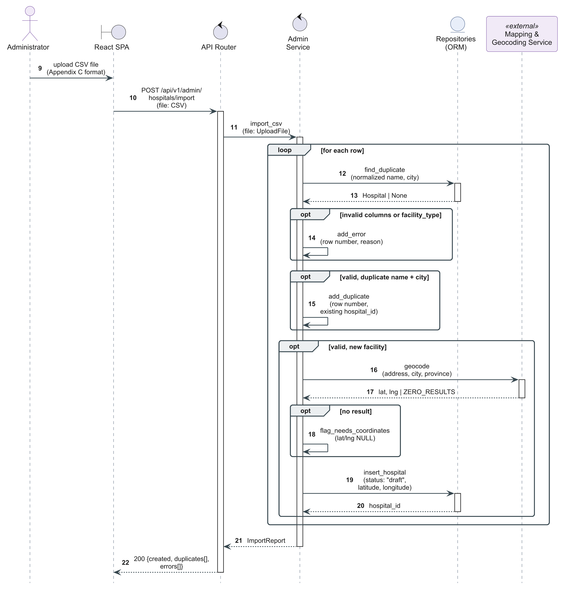

Figure : SD8 Admin Hospital Directory CSV Import with Geocoding and Verification (Part 2 of 4)

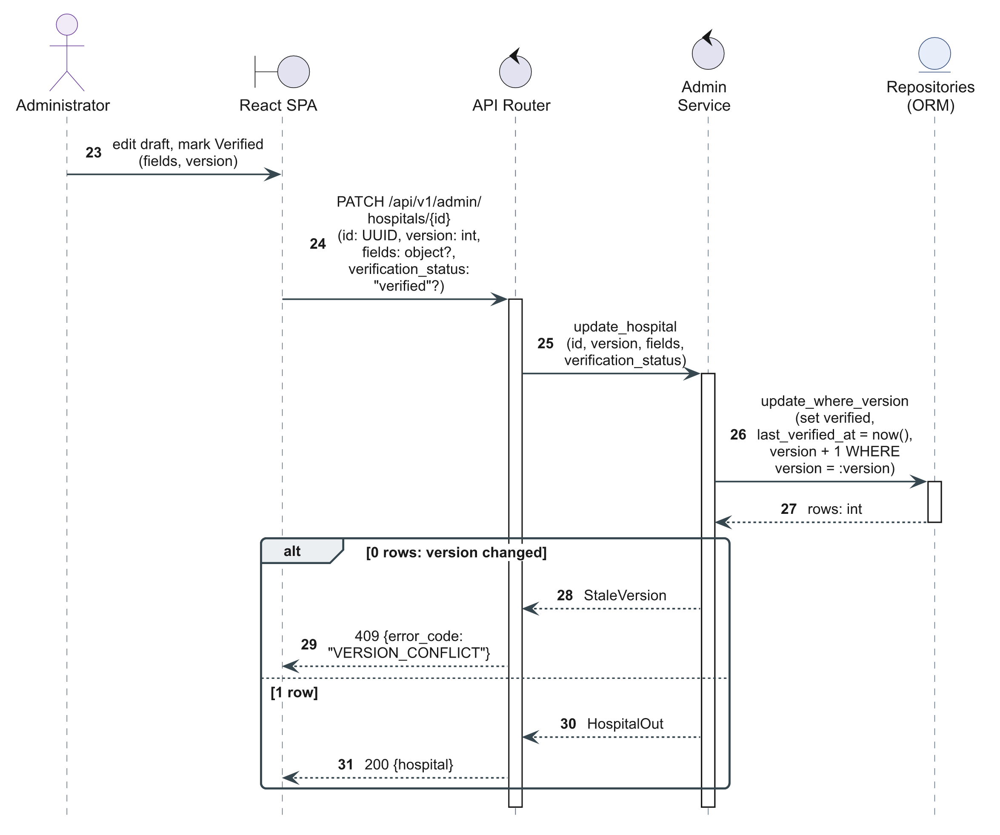

Figure : SD8 Admin Hospital Directory CSV Import with Geocoding and Verification (Part 3 of 4)

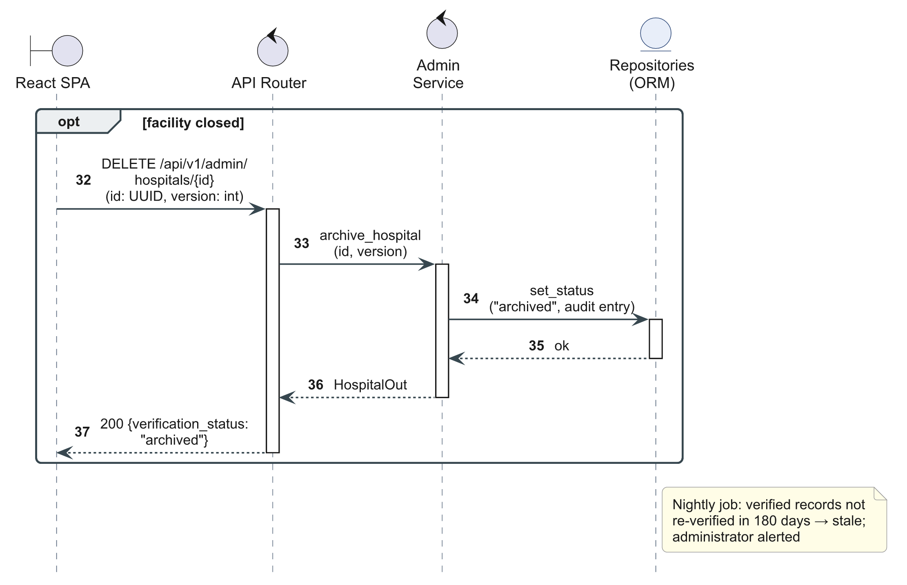

Figure : SD8 Admin Hospital Directory CSV Import with Geocoding and Verification (Part 4 of 4)

***Parameter list of SD8:***

| **Msg \#** | **Operation / Endpoint**            | **Parameters (name: type)**                                                                                                       | **Returns**                                                  |
|------------|-------------------------------------|-----------------------------------------------------------------------------------------------------------------------------------|--------------------------------------------------------------|
| 1          | GET /api/v1/admin/hospitals         | verification_status: str?, page: int?                                                                                             | 2: 200 {items\[\], total}                                    |
| 3          | POST /api/v1/admin/hospitals        | name: str, facility_type: str, address: str, city: str, province: str, phone: str?, email: str?, website: str?, source_note: str? | 8: 201 {hospital_id, verification_status: "draft"}           |
| 4          | create_hospital                     | dto: HospitalIn                                                                                                                   | 7: HospitalOut                                               |
| 5          | insert_hospital                     | status: "draft", audit entry                                                                                                      | 6: hospital_id: UUID                                         |
| 9          | upload CSV file                     | Appendix C format                                                                                                                 | –                                                            |
| 10         | POST /api/v1/admin/hospitals/import | file: CSV                                                                                                                         | 22: 200 {created, duplicates\[\], errors\[\]}                |
| 11         | import_csv                          | file: UploadFile                                                                                                                  | 21: ImportReport                                             |
| 12         | find_duplicate                      | normalized name, city                                                                                                             | 13: Hospital \| None                                         |
| 14         | add_error                           | row number, reason                                                                                                                | –                                                            |
| 15         | add_duplicate                       | row number, existing hospital_id                                                                                                  | –                                                            |
| 16         | geocode                             | address, city, province                                                                                                           | 17: lat, lng \| ZERO_RESULTS                                 |
| 18         | flag_needs_coordinates              | lat/lng NULL                                                                                                                      | –                                                            |
| 19         | insert_hospital                     | status: "draft", latitude, longitude                                                                                              | 20: hospital_id                                              |
| 23         | edit draft, mark Verified           | fields, version                                                                                                                   | –                                                            |
| 24         | PATCH /api/v1/admin/hospitals/{id}  | id: UUID, version: int, fields: object?, verification_status: "verified"?                                                         | 29: 409 {error_code: "VERSION_CONFLICT"}; 31: 200 {hospital} |
| 25         | update_hospital                     | id, version, fields, verification_status                                                                                          | 28: StaleVersion; 30: HospitalOut                            |
| 26         | update_where_version                | set verified, last_verified_at = now(), version + 1 WHERE version = :version                                                      | 27: rows: int                                                |
| 32         | DELETE /api/v1/admin/hospitals/{id} | id: UUID, version: int                                                                                                            | 37: 200 {verification_status: "archived"}                    |
| 33         | archive_hospital                    | id, version                                                                                                                       | 36: HospitalOut                                              |
| 34         | set_status                          | "archived", audit entry                                                                                                           | 35: ok                                                       |

#### **Sequence Diagram 9: Admin Model Version Registration and Activation**

*The administrator registers a model version, validates it with test metrics and a smoke test in the inference service, activates it as the primary model in one transaction and retires obsolete versions. Realizes: UC-ADM-03. Figures 45–48 show the diagram.*

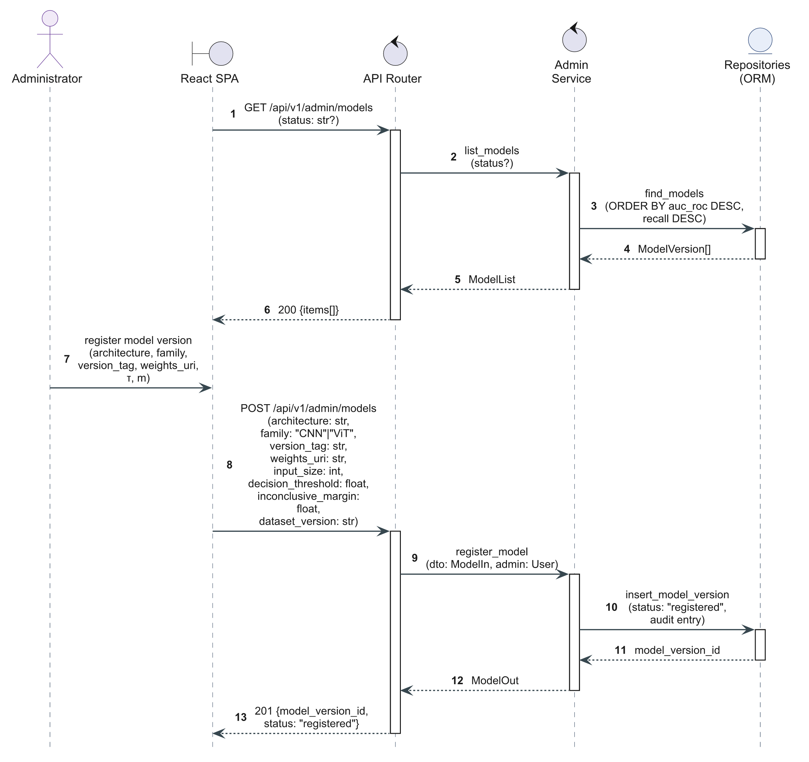

Figure : SD9 Admin Model Version Registration and Activation (Part 1 of 4)

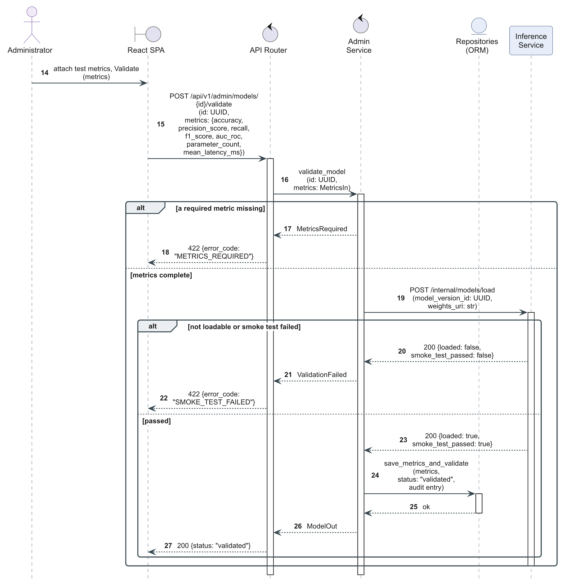

Figure : SD9 Admin Model Version Registration and Activation (Part 2 of 4)

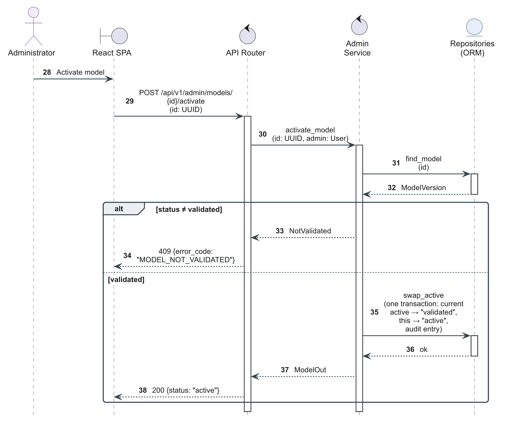

Figure : SD9 Admin Model Version Registration and Activation (Part 3 of 4)

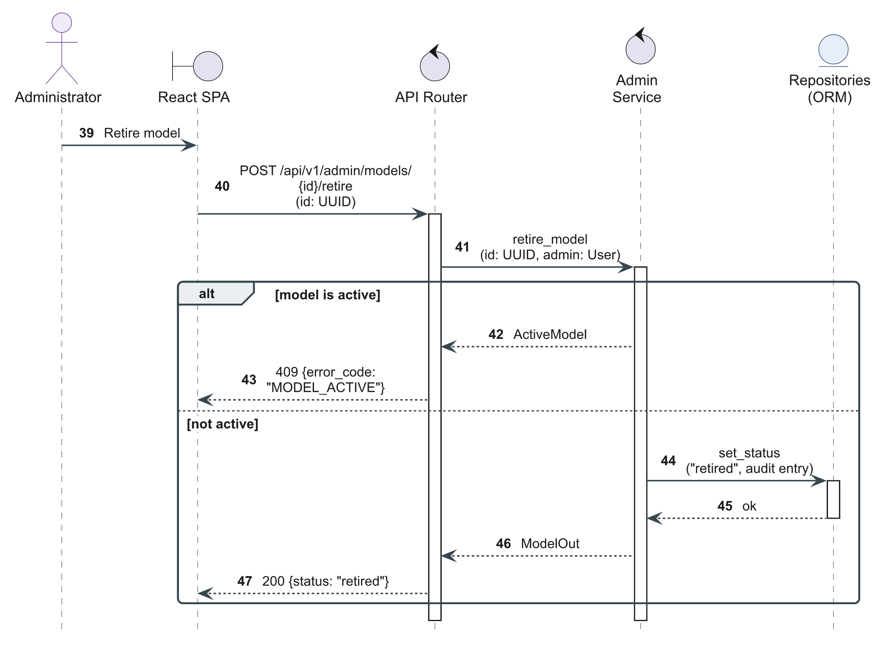

Figure : SD9 Admin Model Version Registration and Activation (Part 4 of 4)

***Parameter list of SD9:***

| **Msg \#** | **Operation / Endpoint**                | **Parameters (name: type)**                                                                                                                                               | **Returns**                                                                                                        |
|------------|-----------------------------------------|---------------------------------------------------------------------------------------------------------------------------------------------------------------------------|--------------------------------------------------------------------------------------------------------------------|
| 1          | GET /api/v1/admin/models                | status: str?                                                                                                                                                              | 6: 200 {items\[\]}                                                                                                 |
| 2          | list_models                             | status?                                                                                                                                                                   | 5: ModelList                                                                                                       |
| 3          | find_models                             | ORDER BY auc_roc DESC, recall DESC                                                                                                                                        | 4: ModelVersion\[\]                                                                                                |
| 7          | register model version                  | architecture, family, version_tag, weights_uri, τ, m                                                                                                                      | –                                                                                                                  |
| 8          | POST /api/v1/admin/models               | architecture: str, family: "CNN"\|"ViT", version_tag: str, weights_uri: str, input_size: int, decision_threshold: float, inconclusive_margin: float, dataset_version: str | 13: 201 {model_version_id, status: "registered"}                                                                   |
| 9          | register_model                          | dto: ModelIn, admin: User                                                                                                                                                 | 12: ModelOut                                                                                                       |
| 10         | insert_model_version                    | status: "registered", audit entry                                                                                                                                         | 11: model_version_id                                                                                               |
| 14         | attach test metrics, Validate           | metrics                                                                                                                                                                   | –                                                                                                                  |
| 15         | POST /api/v1/admin/models/{id}/validate | id: UUID, metrics: {accuracy, precision_score, recall, f1_score, auc_roc, parameter_count, mean_latency_ms}                                                               | 18: 422 {error_code: "METRICS_REQUIRED"}; 22: 422 {error_code: "SMOKE_TEST_FAILED"}; 27: 200 {status: "validated"} |
| 16         | validate_model                          | id: UUID, metrics: MetricsIn                                                                                                                                              | 17: MetricsRequired; 21: ValidationFailed; 26: ModelOut                                                            |
| 19         | POST /internal/models/load              | model_version_id: UUID, weights_uri: str                                                                                                                                  | 20: 200 {loaded: false, smoke_test_passed: false}; 23: 200 {loaded: true, smoke_test_passed: true}                 |
| 24         | save_metrics_and_validate               | metrics, status: "validated", audit entry                                                                                                                                 | 25: ok                                                                                                             |
| 28         | Activate model                          | –                                                                                                                                                                         | –                                                                                                                  |
| 29         | POST /api/v1/admin/models/{id}/activate | id: UUID                                                                                                                                                                  | 34: 409 {error_code: "MODEL_NOT_VALIDATED"}; 38: 200 {status: "active"}                                            |
| 30         | activate_model                          | id: UUID, admin: User                                                                                                                                                     | 33: NotValidated; 37: ModelOut                                                                                     |
| 31         | find_model                              | id                                                                                                                                                                        | 32: ModelVersion                                                                                                   |
| 35         | swap_active                             | one transaction: current active → "validated", this → "active", audit entry                                                                                               | 36: ok                                                                                                             |
| 39         | Retire model                            | –                                                                                                                                                                         | –                                                                                                                  |
| 40         | POST /api/v1/admin/models/{id}/retire   | id: UUID                                                                                                                                                                  | 43: 409 {error_code: "MODEL_ACTIVE"}; 47: 200 {status: "retired"}                                                  |
| 41         | retire_model                            | id: UUID, admin: User                                                                                                                                                     | 42: ActiveModel; 46: ModelOut                                                                                      |
| 44         | set_status                              | "retired", audit entry                                                                                                                                                    | 45: ok                                                                                                             |

#### **Sequence Diagram 10: Admin Knowledge Base and Helpline Management**

*The administrator creates and publishes knowledge-base articles (computing the 768-dimension embedding on publication) and manages helpline contacts. Realizes: UC-ADM-04. Figures 49–51 show the diagram.*

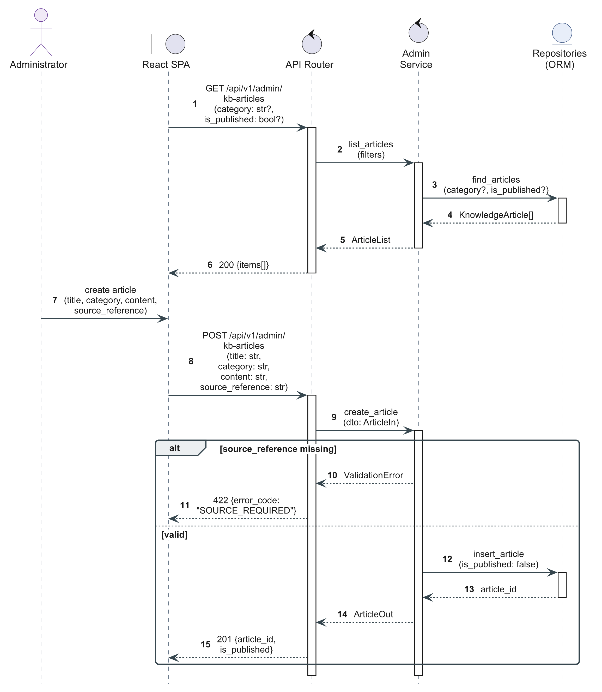

Figure : SD10 Admin Knowledge Base and Helpline Management (Part 1 of 3)

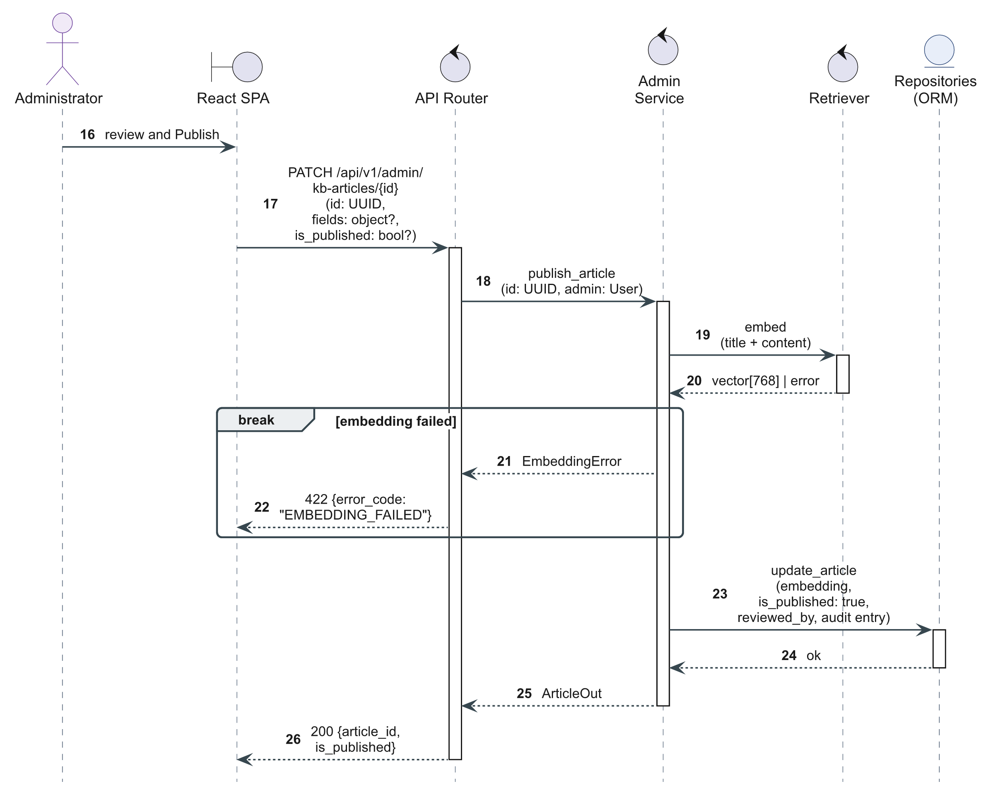

Figure : SD10 Admin Knowledge Base and Helpline Management (Part 2 of 3)

Figure : SD10 Admin Knowledge Base and Helpline Management (Part 3 of 3)

***Parameter list of SD10:***

| **Msg \#** | **Operation / Endpoint**             | **Parameters (name: type)**                                    | **Returns**                                                                  |
|------------|--------------------------------------|----------------------------------------------------------------|------------------------------------------------------------------------------|
| 1          | GET /api/v1/admin/kb-articles        | category: str?, is_published: bool?                            | 6: 200 {items\[\]}                                                           |
| 2          | list_articles                        | filters                                                        | 5: ArticleList                                                               |
| 3          | find_articles                        | category?, is_published?                                       | 4: KnowledgeArticle\[\]                                                      |
| 7          | create article                       | title, category, content, source_reference                     | –                                                                            |
| 8          | POST /api/v1/admin/kb-articles       | title: str, category: str, content: str, source_reference: str | 11: 422 {error_code: "SOURCE_REQUIRED"}; 15: 201 {article_id, is_published}  |
| 9          | create_article                       | dto: ArticleIn                                                 | 10: ValidationError; 14: ArticleOut                                          |
| 12         | insert_article                       | is_published: false                                            | 13: article_id                                                               |
| 16         | review and Publish                   | –                                                              | –                                                                            |
| 17         | PATCH /api/v1/admin/kb-articles/{id} | id: UUID, fields: object?, is_published: bool?                 | 22: 422 {error_code: "EMBEDDING_FAILED"}; 26: 200 {article_id, is_published} |
| 18         | publish_article                      | id: UUID, admin: User                                          | 21: EmbeddingError; 25: ArticleOut                                           |
| 19         | embed                                | title + content                                                | 20: vector\[768\] \| error                                                   |
| 23         | update_article                       | embedding, is_published: true, reviewed_by, audit entry        | 24: ok                                                                       |
| 27         | GET /api/v1/admin/helplines          | –                                                              | 32: 200 {items\[\]}                                                          |
| 28         | list_helplines                       | –                                                              | 31: HelplineList                                                             |
| 29         | find_helplines                       | –                                                              | 30: HelplineContact\[\]                                                      |
| 33         | POST /api/v1/admin/helplines         | name: str, phone: str, description: str?                       | 38: 201 {helpline_id}                                                        |
| 34         | create_helpline                      | dto: HelplineIn                                                | 37: HelplineOut                                                              |
| 35         | insert_helpline                      | is_active: true, audit entry                                   | 36: helpline_id                                                              |
| 39         | PATCH /api/v1/admin/helplines/{id}   | id: UUID, fields: object?, is_active: bool?                    | 44: 200 {helpline_id, is_active}                                             |
| 40         | update_helpline                      | id, fields, is_active                                          | 43: HelplineOut                                                              |
| 41         | update_helpline                      | fields, is_active, audit entry                                 | 42: ok                                                                       |

#### **Sequence Diagram 11: Admin User Management, System Health and Audit Logs**

*The administrator lists users, deactivates or reactivates accounts (self-deactivation is refused), checks system health and searches the audit log. Realizes: UC-ADM-01, UC-ADM-05. Figures 52–54 show the diagram.*

Figure : SD11 Admin User Management, System Health and Audit Logs (Part 1 of 3)

Figure : SD11 Admin User Management, System Health and Audit Logs (Part 2 of 3)

Figure : SD11 Admin User Management, System Health and Audit Logs (Part 3 of 3)

***Parameter list of SD11:***

| **Msg \#** | **Operation / Endpoint**       | **Parameters (name: type)**                                            | **Returns**                                                                                                            |
|------------|--------------------------------|------------------------------------------------------------------------|------------------------------------------------------------------------------------------------------------------------|
| 1          | GET /api/v1/admin/users        | status: str?, role: str?, page: int?                                   | 6: 200 {items\[\], total}                                                                                              |
| 2          | list_users                     | status?, role?, page                                                   | 5: UserPage                                                                                                            |
| 3          | find_users                     | filters, page                                                          | 4: User\[\]                                                                                                            |
| 7          | change account status          | status, reason                                                         | –                                                                                                                      |
| 8          | PATCH /api/v1/admin/users/{id} | id: UUID, account_status: "active"\|"deactivated", reason: str?        | 11: 409 {error_code: "SELF_DEACTIVATION"}; 17: 200 {account_status: "deactivated"}; 21: 200 {account_status: "active"} |
| 9          | set_account_status             | id, status, reason, admin: User                                        | 10: SelfAction; 16: UserOut; 20: UserOut                                                                               |
| 12         | deactivate                     | status, revoke tokens, audit entry                                     | 13: ok                                                                                                                 |
| 14         | send_account_notice            | to, reason                                                             | 15: 250 queued                                                                                                         |
| 18         | reactivate                     | status, failed_login_count = 0, audit entry                            | 19: ok                                                                                                                 |
| 22         | GET /api/v1/admin/health       | –                                                                      | 29: 200 {api, db, inference, worker, storage, external\[\]}                                                            |
| 23         | health                         | –                                                                      | 28: HealthReport                                                                                                       |
| 24         | probe_components               | db, inference, worker heartbeat, storage, LLM, mapping, SMTP           | –                                                                                                                      |
| 25         | mark_down                      | component, last_seen                                                   | –                                                                                                                      |
| 26         | metrics_24h                    | reminder lag, queue length, error rate                                 | 27: metrics                                                                                                            |
| 30         | GET /api/v1/admin/audit-logs   | actor: UUID?, action: str?, from: datetime?, to: datetime?, page: int? | 35: 200 {items\[\], total}                                                                                             |
| 31         | search_audit_logs              | filters, page                                                          | 34: AuditPage                                                                                                          |
| 32         | find_audit_logs                | actor?, action?, range, ORDER BY created_at DESC                       | 33: AuditLog\[\]                                                                                                       |

#### **Sequence Diagram 12: Profile, Chat History and Account Data Management**

*A registered user views and edits the profile, reads and deletes a chat session, deletes a screening and finally deletes the account with password confirmation. Realizes: UC-CHT-01, UC-SCR-05. Figures 55–57 show the diagram.*

Figure : SD12 Profile, Chat History and Account Data Management (Part 1 of 3)

Figure : SD12 Profile, Chat History and Account Data Management (Part 2 of 3)

Figure : SD12 Profile, Chat History and Account Data Management (Part 3 of 3)

***Parameter list of SD12:***

| **Msg \#** | **Operation / Endpoint**          | **Parameters (name: type)**                                                    | **Returns**                                                            |
|------------|-----------------------------------|--------------------------------------------------------------------------------|------------------------------------------------------------------------|
| 1          | GET /api/v1/users/me              | –                                                                              | 6: 200 {user, profile}                                                 |
| 2          | get_profile                       | user: User                                                                     | 5: ProfileOut                                                          |
| 3          | find_user_with_profile            | user_id                                                                        | 4: User, Profile                                                       |
| 7          | edit profile                      | full_name, phone, profile fields                                               | –                                                                      |
| 8          | PATCH /api/v1/users/me            | full_name: str?, phone: str?, profile: object?                                 | 13: 200 {user, profile}                                                |
| 9          | update_profile                    | user, dto: ProfileIn                                                           | 12: ProfileOut                                                         |
| 10         | update_user_and_profile           | fields, updated_at                                                             | 11: ok                                                                 |
| 14         | GET /api/v1/chat/sessions/{id}    | id: UUID                                                                       | 19: 200 {session, messages\[\]}                                        |
| 15         | get_session                       | id, user                                                                       | 18: SessionOut                                                         |
| 16         | find_session_messages             | session_id (owner only)                                                        | 17: Session, Message\[\]                                               |
| 20         | DELETE /api/v1/chat/sessions/{id} | id: UUID                                                                       | 25: 204                                                                |
| 21         | delete_session                    | id, user                                                                       | 24: None                                                               |
| 22         | delete_session_cascade            | session + messages                                                             | 23: ok                                                                 |
| 26         | DELETE /api/v1/screenings/{id}    | id: UUID                                                                       | 33: 204                                                                |
| 27         | delete_screening                  | id, user (requester only)                                                      | 32: None                                                               |
| 28         | delete_screening_cascade          | screening + predictions; image if unreferenced                                 | 29: orphan storage_uris\[\]                                            |
| 30         | delete_objects                    | storage_uris\[\]                                                               | 31: ok                                                                 |
| 34         | delete account                    | password                                                                       | –                                                                      |
| 35         | DELETE /api/v1/users/me           | password: str                                                                  | 38: 401 {error_code: "INVALID_CREDENTIALS"}; 44: 204 (cookies cleared) |
| 36         | delete_account                    | user, password                                                                 | 37: InvalidCredentials; 43: None                                       |
| 39         | delete_user_data                  | profile, links, screenings, plans, chats, tokens; audit entry kept without PII | 40: storage_uris\[\]                                                   |
| 41         | delete_objects                    | storage_uris\[\]                                                               | 42: ok                                                                 |

### **State Diagram**

*Each state diagram uses initial and final pseudostates and labels transitions as event \[guard\] / action. Where a state machine persists, its states are exactly the enum values of the column named in the description.*

#### **State Diagram 1: User Account Lifecycle**

*Lifecycle of* users.account_status*. Patients become active after email verification; professionals wait in pending_approval until an administrator decides. Figure 58 shows the state machine and the table lists its transitions.*

Figure : ST1 User Account Lifecycle

| **Source State**     | **Event \[Guard\] / Action**                                          | **Target State**     |
|----------------------|-----------------------------------------------------------------------|----------------------|
| ● (initial)          | register / store hashed token, send verification email                | pending_verification |
| pending_verification | resend \[token expired\] / issue new token                            | pending_verification |
| pending_verification | verify_email \[token valid\]                                          | role_check           |
| role_check           | \[role = patient\]                                                    | active               |
| role_check           | \[role = professional\] / notify administrators                       | pending_approval     |
| pending_approval     | approve / set approved_by, approved_at, email user                    | active               |
| pending_approval     | reject / email reason                                                 | deactivated          |
| active               | login_failed \[failed_login_count = 5\] / locked_until = now + 15 min | locked               |
| locked               | after(15 min) or password reset / failed_login_count = 0              | active               |
| active               | admin deactivate / revoke tokens, email notice                        | deactivated          |
| deactivated          | admin reactivate / failed_login_count = 0                             | active               |
| active               | delete account / erase personal data                                  | ◉ (final)            |

#### **State Diagram 2: Screening Request Lifecycle**

*Lifecycle of* screenings.status*, with the composite processing state and the outcome choice that sets* screening_predictions.outcome *(colored: red = oscc_suspected, amber = inconclusive, green = non_oscc). Figure 59 shows the state machine and the table lists its transitions.*

Figure : ST2 Screening Request Lifecycle

| **Source State** | **Event \[Guard\] / Action**                                           | **Target State** |
|------------------|------------------------------------------------------------------------|------------------|
| ● (initial)      | upload received / insert screening                                     | validating       |
| validating       | \[invalid format, size, resolution or color profile\] / set error_code | rejected         |
| validating       | \[valid\] / store image, sha256                                        | queued           |
| queued           | dispatch / POST /internal/infer                                        | processing       |
| processing       | \[inference unavailable and retries \< 3\] / retry_count + 1           | queued           |
| processing       | \[retries exhausted\] / set error_code                                 | failed           |
| processing       | predictions returned / store predictions, completed_at                 | completed        |
| Preprocessing    | patches tiled and normalized                                           | Inferring        |
| Inferring        | patch probabilities aggregated (mean)                                  | Explaining       |
| outcome_choice   | \[p ≥ τ + m\]                                                          | oscc_suspected   |
| outcome_choice   | \[τ − m ≤ p \< τ + m\]                                                 | inconclusive     |
| outcome_choice   | \[p \< τ − m\]                                                         | non_oscc         |
| rejected         | (completion)                                                           | ◉ (final)        |
| failed           | (completion)                                                           | ◉ (final)        |
| completed        | (completion)                                                           | ◉ (final)        |

#### **State Diagram 3: Hospital Recommendation Request**

*States of one nearest-facility request inside the recommendation service; this request lifecycle is transient and only its final result is persisted. Figure 60 shows the state machine and the table lists its transitions.*

Figure : ST3 Hospital Recommendation Request

| **Source State** | **Event \[Guard\] / Action**                                                          | **Target State** |
|------------------|---------------------------------------------------------------------------------------|------------------|
| ● (initial)      | Find nearest hospitals                                                                | AwaitingLocation |
| AwaitingLocation | location granted \[gps\] / keep coordinates in memory                                 | Searching        |
| AwaitingLocation | address entered \[manual\]                                                            | Geocoding        |
| Geocoding        | geocoded / lat, lng                                                                   | Searching        |
| Geocoding        | \[no result\] / show "Location not found"                                             | AwaitingLocation |
| Searching        | \[no candidate and radius \< nationwide\] / expand radius (50 km, 150 km, nationwide) | Searching        |
| Searching        | \[candidates found\] / haversine, keep 10 nearest                                     | Refining         |
| Searching        | \[no candidate nationwide\]                                                           | NoResults        |
| Refining         | road distances received / re-rank, top N                                              | Ranked           |
| Refining         | \[mapping API failed\] / straight-line distance                                       | Ranked           |
| Ranked           | filter or N changed / new facility_types                                              | Searching        |
| Ranked           | / save request with rounded coordinates                                               | ◉ (final)        |
| NoResults        | / suggest clearing the filter                                                         | ◉ (final)        |

#### **State Diagram 4: Chatbot Message Processing**

*Processing pipeline of one chatbot message, including the escalation, redirect, no-guidance and fallback paths; the routing step sets* chat_messages.intent*. Figure 61 shows the state machine and the table lists its transitions.*

Figure : ST4 Chatbot Message Processing

| **Source State** | **Event \[Guard\] / Action**                             | **Target State** |
|------------------|----------------------------------------------------------|------------------|
| ● (initial)      | message posted                                           | Received         |
| Received         | / start pipeline                                         | Scrubbing        |
| Scrubbing        | PII removed / store message                              | SafetyScreening  |
| SafetyScreening  | \[distress detected\] / safety_flag = true               | Escalated        |
| SafetyScreening  | \[no distress\] / classify intent                        | Routing          |
| Routing          | \[intent = precaution\]                                  | Retrieving       |
| Routing          | \[intent = support or reminder\] / build context         | Generating       |
| Routing          | \[intent = medical_decision or out_of_scope\] / redirect | Responded        |
| Retrieving       | \[article above threshold\] / add passages               | Generating       |
| Retrieving       | \[no article above threshold\] / no-guidance reply       | Responded        |
| Generating       | LLM reply received                                       | OutputCheck      |
| Generating       | \[LLM error or timeout\]                                 | Fallback         |
| OutputCheck      | \[pass\] / stream reply                                  | Responded        |
| OutputCheck      | \[blocked: diagnosis or dosage advice\]                  | Fallback         |
| Fallback         | / safe canned reply + KB links                           | Responded        |
| Escalated        | / empathetic reply + helplines                           | Responded        |
| Responded        | / store reply                                            | ◉ (final)        |

#### **State Diagram 5: Medication Reminder Lifecycle**

*Lifecycle of* medication_reminders.status*, driven by the scheduler worker and the patient's responses. Figure 62 shows the state machine and the table lists its transitions.*

Figure : ST5 Medication Reminder Lifecycle

| **Source State** | **Event \[Guard\] / Action**                                             | **Target State** |
|------------------|--------------------------------------------------------------------------|------------------|
| ● (initial)      | medication saved / generate next 7 days                                  | scheduled        |
| scheduled        | worker tick \[scheduled_at ≤ now\] / claim with SKIP LOCKED, SSE + email | sent             |
| sent             | Taken / responded_at = now                                               | taken            |
| sent             | Snooze \[snooze_count \< 3\] / scheduled_at + 10 min, snooze_count + 1   | snoozed          |
| snoozed          | worker tick \[scheduled_at ≤ now\] / re-dispatch                         | sent             |
| sent             | Skip / responded_at = now                                                | skipped          |
| sent             | worker tick \[60 min since sent_at, no response\]                        | missed           |
| scheduled        | plan cancelled or completed                                              | cancelled        |
| snoozed          | plan cancelled or completed                                              | cancelled        |
| taken            | (completion)                                                             | ◉ (final)        |
| skipped          | (completion)                                                             | ◉ (final)        |
| missed           | (completion)                                                             | ◉ (final)        |
| cancelled        | (completion)                                                             | ◉ (final)        |

#### **State Diagram 6: Hospital Directory Record Lifecycle**

*Lifecycle of* hospitals.verification_status*; only verified and stale records are used for recommendations. Figure 63 shows the state machine and the table lists its transitions.*

Figure : ST6 Hospital Directory Record Lifecycle

| **Source State** | **Event \[Guard\] / Action**                                               | **Target State** |
|------------------|----------------------------------------------------------------------------|------------------|
| ● (initial)      | created or imported / geocode address                                      | draft            |
| draft            | edit \[version matches\] / version + 1                                     | draft            |
| draft            | mark verified \[coordinates present\] / last_verified_at = now             | verified         |
| verified         | nightly job \[last_verified_at older than 180 days\] / alert administrator | stale            |
| stale            | re-verified / last_verified_at = now                                       | verified         |
| draft            | archive                                                                    | archived         |
| verified         | archive (facility closed)                                                  | archived         |
| stale            | archive                                                                    | archived         |
| archived         | (completion)                                                               | ◉ (final)        |

#### **State Diagram 7: Model Version Lifecycle**

*Lifecycle of* model_versions.status*; exactly one version is active at any time. Figure 64 shows the state machine and the table lists its transitions.*

Figure : ST7 Model Version Lifecycle

| **Source State** | **Event \[Guard\] / Action**                                   | **Target State** |
|------------------|----------------------------------------------------------------|------------------|
| ● (initial)      | register / store weights_uri, τ, m                             | registered       |
| registered       | validate \[metrics missing or smoke test failed\] / show error | registered       |
| registered       | validate \[metrics complete and smoke test passed\]            | validated        |
| validated        | activate / previous active → validated, audit                  | active           |
| active           | another version activated                                      | validated        |
| validated        | retire                                                         | retired          |
| registered       | retire                                                         | retired          |
| retired          | (completion)                                                   | ◉ (final)        |

#### **State Diagram 8: Overall System**

*Top-level application states: from Guest through authentication to the role-specific dashboards, the screening → result → recommendation → support flow, and logout or session timeout. Figure 65 shows the state machine and the table lists its transitions.*

Figure : ST8 Overall System

| **Source State**      | **Event \[Guard\] / Action**                                        | **Target State**      |
|-----------------------|---------------------------------------------------------------------|-----------------------|
| ● (initial)           | open application                                                    | Guest                 |
| Guest                 | submit credentials                                                  | Authenticating        |
| Authenticating        | \[invalid, locked or pending approval\] / show error                | Guest                 |
| Authenticating        | \[valid\] / issue tokens                                            | SignedIn              |
| role_choice           | \[role = patient\]                                                  | PatientDashboard      |
| role_choice           | \[role = professional\]                                             | ProfessionalDashboard |
| role_choice           | \[role = admin\]                                                    | AdminDashboard        |
| PatientDashboard      | New Screening                                                       | Screening             |
| ProfessionalDashboard | New Screening                                                       | Screening             |
| Screening             | result ready                                                        | Result                |
| Result                | Find nearest hospitals \[oscc_suspected or inconclusive\]           | Recommendations       |
| Recommendations       | open Support \[role = patient\]                                     | Support               |
| PatientDashboard      | open Support                                                        | Support               |
| SignedIn              | logout or session timeout \[refresh token expired\] / clear cookies | Guest                 |
| Guest                 | close application                                                   | ◉ (final)             |

### **Data Flow Diagram (Level 1)**

*The Level-1 DFD decomposes process 0 of the SRS context diagram into six processes and ten data stores (Gane–Sarson notation). Figures 66–68 show processes 1.0–2.0, 3.0–4.0 and 5.0–6.0. An entity drawn again to avoid crossing lines is marked with an asterisk. The external flows balance exactly with the context diagram, and every data store has both a writer and a reader.*

Figure : Level-1 DFD — Processes 1.0 and 2.0 (Part 1 of 3)

Figure : Level-1 DFD — Processes 3.0 and 4.0 (Part 2 of 3)

Figure : Level-1 DFD — Processes 5.0 and 6.0 (Part 3 of 3)

<table style="width:100%;">
<colgroup>
<col style="width: 18%" />
<col style="width: 33%" />
<col style="width: 33%" />
<col style="width: 15%" />
</colgroup>
<thead>
<tr class="header">
<th><strong>Process</strong></th>
<th><strong>Inputs (from)</strong></th>
<th><strong>Outputs (to)</strong></th>
<th><strong>Data stores</strong></th>
</tr>
<tr class="odd">
<th>1.0 Manage Accounts &amp; Access</th>
<th>
credentials &amp; profile (Patient)

credentials &amp; professional details (Healthcare Professional)

approval &amp; account actions (Administrator)

stored credentials (D1 Users &amp; Profiles)
</th>
<th>
pending approvals (Administrator)

verification &amp; reset emails (Email (SMTP) Service)

account &amp; token records (D1 Users &amp; Profiles)

auth events (D10 Audit Log)
</th>
<th>D1, D10</th>
</tr>
<tr class="header">
<th>2.0 Screen Histopathology Image</th>
<th>
histopathology image (Patient)

histopathology image (Healthcare Professional)

share request (Healthcare Professional)

care links (D1 Users &amp; Profiles)

image for inference (D2 Images)

active model versions (D4 Model Registry)
</th>
<th>
screening result &amp; advice (Patient)

screening &amp; comparison results (Healthcare Professional)

share notification email (Email (SMTP) Service)

image file (D2 Images)

screening &amp; predictions (D3 Screenings &amp; Predictions)
</th>
<th>D1, D2, D3, D4</th>
</tr>
<tr class="odd">
<th>3.0 Recommend Facilities</th>
<th>
location &amp; consent (Patient)

location &amp; consent (Healthcare Professional)

geocodes, road distance &amp; travel time (Mapping &amp; Geocoding Service)

screening outcome (D3 Screenings &amp; Predictions)

verified facilities (D5 Hospital Directory)
</th>
<th>
ranked facilities (Patient)

ranked facilities (Healthcare Professional)

address / coordinates (Mapping &amp; Geocoding Service)

recommendation results (D6 Recommendations)
</th>
<th>D3, D5, D6</th>
</tr>
<tr class="header">
<th>4.0 Provide Chat Support</th>
<th>
chat message (Patient)

generated reply &amp; moderation result (LLM API Provider)

recommended facilities (D6 Recommendations)

articles &amp; helplines (D9 Knowledge Base &amp; Helplines)

conversation context (D8 Chat Logs)

reminder schedule (D7 Treatment Plans &amp; Reminders)
</th>
<th>
chatbot reply (Patient)

scrubbed prompt + context (LLM API Provider)

scrubbed messages (D8 Chat Logs)
</th>
<th>D6, D7, D8, D9</th>
</tr>
<tr class="odd">
<th>5.0 Manage Treatment Reminders</th>
<th>
treatment plan &amp; schedule (Patient)

reminder response (Patient)

due reminders (D7 Treatment Plans &amp; Reminders)

patient contact (D1 Users &amp; Profiles)
</th>
<th>
medication reminder (Patient)

adherence summary (Patient)

reminder email (Email (SMTP) Service)

plans &amp; reminder states (D7 Treatment Plans &amp; Reminders)
</th>
<th>D1, D7</th>
</tr>
<tr class="header">
<th>6.0 Administer Directory, Models &amp; Content</th>
<th>
hospital records / CSV (Administrator)

model version &amp; metrics (Administrator)

KB articles &amp; helplines (Administrator)

geocodes, road distance &amp; travel time (Mapping &amp; Geocoding Service)

audit entries (D10 Audit Log)

prediction statistics (D3 Screenings &amp; Predictions)

model metrics (D4 Model Registry)
</th>
<th>
benchmark dashboard (Administrator)

health report &amp; audit log (Administrator)

address / coordinates (Mapping &amp; Geocoding Service)

model versions (D4 Model Registry)

facility records (D5 Hospital Directory)

articles &amp; helplines (D9 Knowledge Base &amp; Helplines)

admin actions (D10 Audit Log)
</th>
<th>D3, D4, D5, D9, D10</th>
</tr>
</thead>
<tbody>
</tbody>
</table>

# **References**

\[1\] K. He, X. Zhang, S. Ren, and J. Sun, “Deep residual learning for image recognition,” in *Proc. IEEE Conf. Comput. Vis. Pattern Recognit. (CVPR)*, 2016, pp. 770–778.

\[2\] M. Tan and Q. V. Le, “EfficientNet: Rethinking model scaling for convolutional neural networks,” in *Proc. 36th Int. Conf. Mach. Learn. (ICML)*, 2019, pp. 6105–6114.

\[3\] A. Dosovitskiy et al., “An image is worth 16x16 words: Transformers for image recognition at scale,” in *Proc. Int. Conf. Learn. Represent. (ICLR)*, 2021.

\[4\] J. Kumar, M. Kumar, and M. K. Jindal, “Efficient deep learning models for oral squamous cell carcinoma classification in histopathological images,” *Sci. Rep.*, vol. 16, art. 21734, 2026.

\[5\] K. Akram, M. Aslam, T. Waheed, N. Ayesha, F. S. Alamri, A. R. Mirdad, and A. Rehman, “Deep visual detection system for oral squamous cell carcinoma,” *Sci. Rep.*, vol. 16, art. 4219, 2026.

\[6\] M. Jagathesh and S. Narayanan, “Attention-aided hybrid transformer network for oral squamous cell carcinoma classification using histopathology images,” *Front. Artif. Intell.*, vol. 9, art. 1751520, 2026.

\[7\] S. Ramya and R. I. Minu, “Oral squamous cell carcinoma grading classification using deep transformer encoder assisted dilated convolution with global attention,” *Front. Artif. Intell.*, vol. 8, art. 1575427, 2025.

\[8\] J. Li, “Fusion feature-based hybrid methods for diagnosing oral squamous cell carcinoma in histopathological images,” *Front. Oncol.*, vol. 15, art. 1551876, 2025.

\[9\] N. Anwar et al., “Oral cancer: Clinicopathological features and associated risk factors in a high-risk population presenting to a major tertiary care center in Pakistan,” *PLoS ONE*, vol. 15, no. 8, e0236359, 2020.

\[10\] “OSCC Histopathology Image Dataset,” Zenodo, 2025. \[Online\]. Available: https://zenodo.org/records/16842637

\[11\] J. Guan, “OSCC-PathologyImageDataset,” GitHub repository. \[Online\]. Available: https://github.com/guanjinquan/OSCC-PathologyImageDataset

\[12\] A. F. Kebede, “Oral Cancer Histopathological Images,” Kaggle. \[Online\]. Available: https://www.kaggle.com/datasets/ashenafifasilkebede/dataset

\[13\] *ISO/IEC/IEEE International Standard — Systems and software engineering — Life cycle processes — Requirements engineering*, ISO/IEC/IEEE 29148:2018, 2018.

\[14\] *IEEE Recommended Practice for Software Requirements Specifications*, IEEE Std 830-1998, 1998.

\[15\] OWASP Foundation, “OWASP Top 10:2021.” \[Online\]. Available: https://owasp.org/Top10/

\[16\] W3C, “Web Content Accessibility Guidelines (WCAG) 2.1,” W3C Recommendation, 2018. \[Online\]. Available: https://www.w3.org/TR/WCAG21/

\[17\] “FastAPI documentation.” \[Online\]. Available: https://fastapi.tiangolo.com/

\[18\] “React documentation.” \[Online\]. Available: https://react.dev/

\[19\] The PostgreSQL Global Development Group, “PostgreSQL documentation.” \[Online\]. Available: https://www.postgresql.org/docs/

\[20\] “pgvector: Open-source vector similarity search for Postgres,” GitHub repository. \[Online\]. Available: https://github.com/pgvector/pgvector

\[21\] R. W. Sinnott, “Virtues of the Haversine,” *Sky and Telescope*, vol. 68, no. 2, p. 159, 1984.

\[22\] *IEEE Standard for Information Technology — Systems Design — Software Design Descriptions*, IEEE Std 1016-2009, 2009.

\[23\] R. R. Selvaraju, M. Cogswell, A. Das, R. Vedantam, D. Parikh, and D. Batra, “Grad-CAM: Visual explanations from deep networks via gradient-based localization,” in *Proc. IEEE Int. Conf. Comput. Vis. (ICCV)*, 2017, pp. 618–626.

\[24\] Object Management Group, *OMG Unified Modeling Language (OMG UML), Version 2.5.1*, formal/17-12-05, 2017.

\[25\] “Docker documentation.” \[Online\]. Available: https://docs.docker.com/

# **Appendices**

***Appendix A: Classification Model Training and Evaluation Protocol***

*Figure 69 shows the shared ML pipeline. The CNN and ViT tracks run under one protocol after a common data preparation stage, and their results meet in a single evaluation and selection stage. The table lists the planned protocol settings.*

Figure : ML Pipeline Activity Diagram

***Shared experimental protocol (planned; subject to tuning):***

| **Setting**                        | **Value**                                                                                                                                                                                       |
|------------------------------------|-------------------------------------------------------------------------------------------------------------------------------------------------------------------------------------------------|
| Input size                         | 224 × 224 pixel patches (tiled or resized).                                                                                                                                                     |
| Normalization                      | ImageNet mean and standard deviation; optional stain normalization applied identically in training and inference.                                                                               |
| Augmentation (training split only) | Horizontal and vertical flips, 90° rotations, mild color jitter.                                                                                                                                |
| Initialization                     | ImageNet-pretrained weights for ResNet50, EfficientNet, DenseNet and the ViT.                                                                                                                   |
| Optimizer                          | AdamW, identical settings for all models.                                                                                                                                                       |
| Learning rate                      | Search range 1e-5 to 1e-3 on the validation set; the chosen schedule is applied to every model.                                                                                                 |
| Batch size                         | 32 (reduced uniformly for all models if GPU memory requires).                                                                                                                                   |
| Epochs / early stopping            | Maximum 50 epochs; early stopping on validation AUC-ROC with patience 7; the best checkpoint is kept.                                                                                           |
| Random seed                        | 42 for splitting, initialization and data loading.                                                                                                                                              |
| Data split                         | Patient-level 70:15:15 (train/validation/test); no patient appears in more than one split; perceptual-hash deduplication across sources.                                                        |
| Metrics                            | Accuracy, precision, recall, F1-score, AUC-ROC and confusion matrix on the held-out test set, each with a 95% bootstrap confidence interval; parameter count, FLOPs and mean inference latency. |
| Threshold τ                        | Chosen on the validation set as the lowest threshold that reaches the target recall while maximizing F1; the inconclusive margin m is stored with τ in the model version.                       |
| Interpretation                     | Grad-CAM \[23\] for CNNs and attention rollout for the ViT.                                                                                                                                     |
| Model selection                    | Highest test AUC-ROC, with recall as the tie-breaker; the administrator activates the selected version.                                                                                         |

***Appendix B: REST API Endpoint Catalog***

*All public endpoints are served under* /api/v1 *over HTTPS;* /internal/\* *endpoints exist only on the private Docker network. Every endpoint below appears in at least one sequence diagram, and every endpoint in the sequence diagrams appears here. Error responses use the envelope* {error_code, message, details, request_id}*.*

| **Method** | **Path**                                 | **Role**                       | **Request**                                                                                                                                                               | **Response**                                                                             |
|------------|------------------------------------------|--------------------------------|---------------------------------------------------------------------------------------------------------------------------------------------------------------------------|------------------------------------------------------------------------------------------|
| POST       | /api/v1/auth/register                    | Public                         | full_name: str, email: str, password: str, role: "patient"\|"professional", phone: str?, profile: object                                                                  | 201 {user_id, account_status}; 409 {error_code}                                          |
| POST       | /api/v1/auth/verify-email                | Public                         | token: str                                                                                                                                                                | 200 {account_status}; 400 {error_code}                                                   |
| POST       | /api/v1/auth/login                       | Public                         | email: str, password: str                                                                                                                                                 | 200 {user_id, role, full_name} + Set-Cookie; 401 \| 403 \| 423                           |
| POST       | /api/v1/auth/refresh                     | Registered User, Administrator | refresh_token: cookie                                                                                                                                                     | 200 + Set-Cookie; 401 {error_code}                                                       |
| POST       | /api/v1/auth/logout                      | Registered User, Administrator | refresh_token: cookie                                                                                                                                                     | 204                                                                                      |
| POST       | /api/v1/auth/password-reset/request      | Public                         | email: str                                                                                                                                                                | 202 {}                                                                                   |
| POST       | /api/v1/auth/password-reset/confirm      | Public                         | token: str, new_password: str                                                                                                                                             | 204; 400 {error_code}                                                                    |
| GET        | /api/v1/users/me                         | Registered User                | –                                                                                                                                                                         | 200 {user, profile}                                                                      |
| PATCH      | /api/v1/users/me                         | Registered User                | full_name: str?, phone: str?, profile: object?                                                                                                                            | 200 {user, profile}                                                                      |
| DELETE     | /api/v1/users/me                         | Registered User                | password: str                                                                                                                                                             | 204; 401 {error_code}                                                                    |
| POST       | /api/v1/screenings                       | Registered User                | image: File, patient_id: UUID?, mode: "primary"\|"compare"                                                                                                                | 201 {screening_id, status}; 403 \| 422 {error_code}                                      |
| GET        | /api/v1/screenings/{id}                  | Registered User                | id: UUID                                                                                                                                                                  | 200 {screening, predictions\[\]}; 404 {error_code}                                       |
| GET        | /api/v1/screenings                       | Registered User                | page: int?, patient_id: UUID?                                                                                                                                             | 200 {items\[\], total}; 403 {error_code}                                                 |
| POST       | /api/v1/screenings/{id}/share            | Healthcare Professional        | id: UUID, patient_email: str                                                                                                                                              | 201 {link_id, link_status}; 404 {error_code}                                             |
| POST       | /api/v1/links/{id}/respond               | Patient                        | id: UUID, decision: "accept"\|"decline"                                                                                                                                   | 200 {link_status}                                                                        |
| DELETE     | /api/v1/screenings/{id}                  | Registered User                | id: UUID                                                                                                                                                                  | 204                                                                                      |
| POST       | /api/v1/recommendations                  | Registered User                | lat: float?, lng: float?, address: str?, facility_types: str\[\]?, limit: int?, screening_id: UUID?                                                                       | 200 {request_id, radius_km, distance_source, items\[\]}; 422 {error_code}                |
| GET        | /api/v1/hospitals/{id}                   | Registered User                | id: UUID                                                                                                                                                                  | 200 {hospital, directions_url}; 404 {error_code}                                         |
| POST       | /api/v1/chat/sessions                    | Patient                        | –                                                                                                                                                                         | 201 {session_id}                                                                         |
| POST       | /api/v1/chat/sessions/{id}/messages      | Patient                        | id: UUID, content: str                                                                                                                                                    | 200 text/event-stream {message_id, content, intent, helplines\[\]?, proposed_action?}    |
| GET        | /api/v1/chat/sessions/{id}               | Patient                        | id: UUID                                                                                                                                                                  | 200 {session, messages\[\]}                                                              |
| DELETE     | /api/v1/chat/sessions/{id}               | Patient                        | id: UUID                                                                                                                                                                  | 204                                                                                      |
| POST       | /api/v1/treatment-plans                  | Patient                        | title: str, prescribing_doctor: str, start_date: date, end_date: date?, notes: str?                                                                                       | 201 {plan_id}                                                                            |
| POST       | /api/v1/treatment-plans/{id}/medications | Patient                        | id: UUID, name: str, dosage_text: str, dose_times: str\[\], frequency: str, start_date: date, end_date: date?, instructions: str?                                         | 201 {medication_id, reminders_created}; 422 {error_code}                                 |
| PATCH      | /api/v1/treatment-plans/{id}             | Patient                        | id: UUID, status: "completed"\|"cancelled"                                                                                                                                | 200 {plan_id, status, reminders_cancelled}                                               |
| GET        | /api/v1/notifications/stream             | Registered User                | –                                                                                                                                                                         | 200 text/event-stream {event, payload}                                                   |
| GET        | /api/v1/reminders                        | Patient                        | status: str?, from: datetime?, to: datetime?                                                                                                                              | 200 {items\[\]}                                                                          |
| PATCH      | /api/v1/reminders/{id}                   | Patient                        | id: UUID, action: "taken"\|"snooze"\|"skip"                                                                                                                               | 200 {reminder_id, status, scheduled_at}                                                  |
| GET        | /api/v1/adherence                        | Patient                        | plan_id: UUID?, from: date?, to: date?                                                                                                                                    | 200 {taken, skipped, missed, adherence_pct, by_day\[\]}                                  |
| GET        | /api/v1/admin/users                      | Administrator                  | status: str?, role: str?, page: int?                                                                                                                                      | 200 {items\[\], total}                                                                   |
| POST       | /api/v1/admin/users/{id}/approve         | Administrator                  | id: UUID                                                                                                                                                                  | 200 {account_status}                                                                     |
| PATCH      | /api/v1/admin/users/{id}                 | Administrator                  | id: UUID, account_status: "active"\|"deactivated", reason: str?                                                                                                           | 200 {account_status}; 409 {error_code}                                                   |
| GET        | /api/v1/admin/hospitals                  | Administrator                  | verification_status: str?, page: int?                                                                                                                                     | 200 {items\[\], total}                                                                   |
| POST       | /api/v1/admin/hospitals                  | Administrator                  | name: str, facility_type: str, address: str, city: str, province: str, phone: str?, email: str?, website: str?, source_note: str?                                         | 201 {hospital_id, verification_status}                                                   |
| POST       | /api/v1/admin/hospitals/import           | Administrator                  | file: CSV                                                                                                                                                                 | 200 {created, duplicates\[\], errors\[\]}                                                |
| PATCH      | /api/v1/admin/hospitals/{id}             | Administrator                  | id: UUID, version: int, fields: object?, verification_status: "verified"?                                                                                                 | 200 {hospital}; 409 {error_code}                                                         |
| DELETE     | /api/v1/admin/hospitals/{id}             | Administrator                  | id: UUID, version: int                                                                                                                                                    | 200 {verification_status}                                                                |
| GET        | /api/v1/admin/models                     | Administrator                  | status: str?                                                                                                                                                              | 200 {items\[\]}                                                                          |
| POST       | /api/v1/admin/models                     | Administrator                  | architecture: str, family: "CNN"\|"ViT", version_tag: str, weights_uri: str, input_size: int, decision_threshold: float, inconclusive_margin: float, dataset_version: str | 201 {model_version_id, status}                                                           |
| POST       | /api/v1/admin/models/{id}/validate       | Administrator                  | id: UUID, metrics: {accuracy, precision_score, recall, f1_score, auc_roc, parameter_count, mean_latency_ms}                                                               | 200 {status}; 422 {error_code}                                                           |
| POST       | /api/v1/admin/models/{id}/activate       | Administrator                  | id: UUID                                                                                                                                                                  | 200 {status}; 409 {error_code}                                                           |
| POST       | /api/v1/admin/models/{id}/retire         | Administrator                  | id: UUID                                                                                                                                                                  | 200 {status}; 409 {error_code}                                                           |
| GET        | /api/v1/admin/kb-articles                | Administrator                  | category: str?, is_published: bool?                                                                                                                                       | 200 {items\[\]}                                                                          |
| POST       | /api/v1/admin/kb-articles                | Administrator                  | title: str, category: str, content: str, source_reference: str                                                                                                            | 201 {article_id, is_published}; 422 {error_code}                                         |
| PATCH      | /api/v1/admin/kb-articles/{id}           | Administrator                  | id: UUID, fields: object?, is_published: bool?                                                                                                                            | 200 {article_id, is_published}; 422 {error_code}                                         |
| GET        | /api/v1/admin/helplines                  | Administrator                  | –                                                                                                                                                                         | 200 {items\[\]}                                                                          |
| POST       | /api/v1/admin/helplines                  | Administrator                  | name: str, phone: str, description: str?                                                                                                                                  | 201 {helpline_id}                                                                        |
| PATCH      | /api/v1/admin/helplines/{id}             | Administrator                  | id: UUID, fields: object?, is_active: bool?                                                                                                                               | 200 {helpline_id, is_active}                                                             |
| GET        | /api/v1/admin/audit-logs                 | Administrator                  | actor: UUID?, action: str?, from: datetime?, to: datetime?, page: int?                                                                                                    | 200 {items\[\], total}                                                                   |
| GET        | /api/v1/admin/health                     | Administrator                  | –                                                                                                                                                                         | 200 {api, db, inference, worker, storage, external\[\]}                                  |
| POST       | /internal/infer                          | Internal (api → inference)     | image_uri: str, model_version_ids: UUID\[\]                                                                                                                               | 200 \[{model_version_id, oscc_probability, outcome, explanation_map_uri, inference_ms}\] |
| POST       | /internal/models/load                    | Internal (api → inference)     | model_version_id: UUID, weights_uri: str                                                                                                                                  | 200 {loaded, smoke_test_passed}                                                          |

***Appendix C: Hospital Directory CSV Import Format***

*The import file is UTF-8 CSV with a header row. Rows are validated individually; invalid rows and duplicates (same normalized name and city) are reported with their row numbers and are not imported. Coordinates are obtained by geocoding, so they are not part of the file.*

| **Column**    | **Required** | **Format / allowed values**                                     | **Maps to**             |
|---------------|--------------|-----------------------------------------------------------------|-------------------------|
| name          | Yes          | Text, at most 200 characters                                    | hospitals.name          |
| facility_type | Yes          | oncology_center \| ent_clinic \| general_hospital_oncology_ward | hospitals.facility_type |
| address       | Yes          | Street address, at most 300 characters                          | hospitals.address       |
| city          | Yes          | City name, at most 80 characters                                | hospitals.city          |
| province      | Yes          | Province or territory, at most 40 characters                    | hospitals.province      |
| phone         | No           | Public contact number, at most 30 characters                    | hospitals.phone         |
| email         | No           | Valid email address                                             | hospitals.email         |
| website       | No           | Absolute https URL                                              | hospitals.website       |
| source_note   | No           | Public source used for verification, at most 300 characters     | hospitals.source_note   |

*Example row:* "Example Cancer Hospital",oncology_center,"Street 1, Block A",Karachi,Sindh,+92-21-0000000,info@example.org,https://example.org,"Official website, checked 11/2026" *(illustrative values only; real records are verified by the administrator from public sources).*
