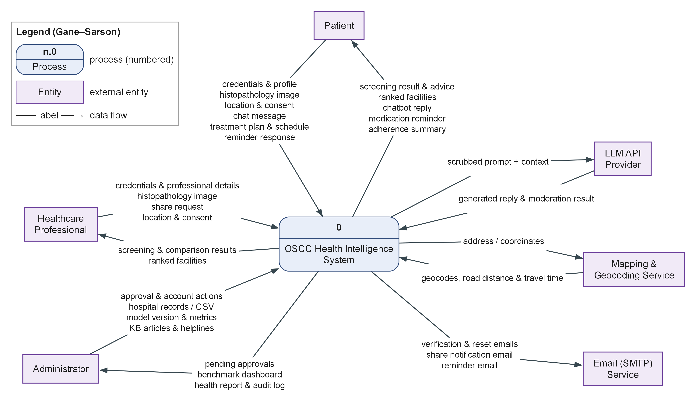
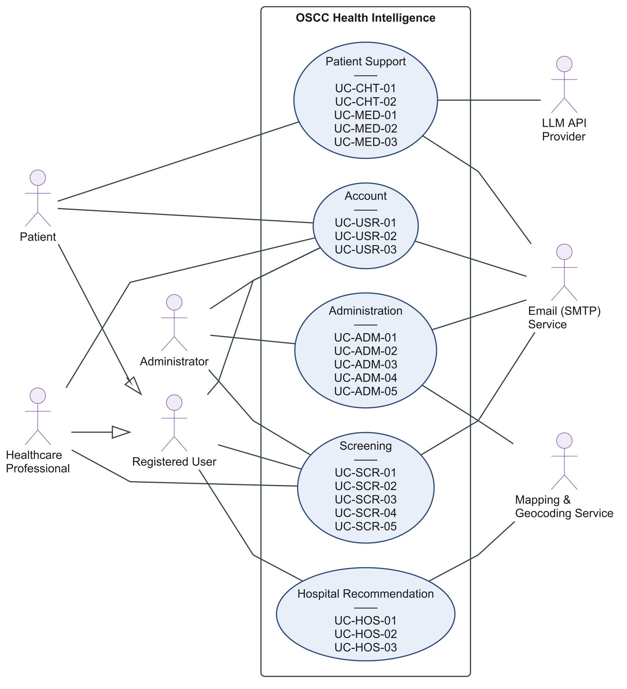
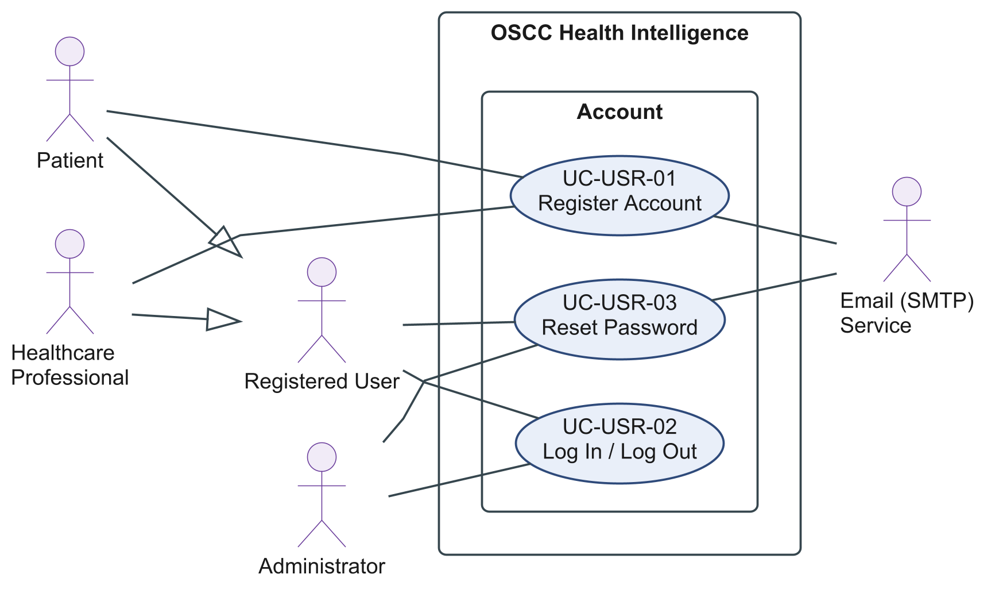
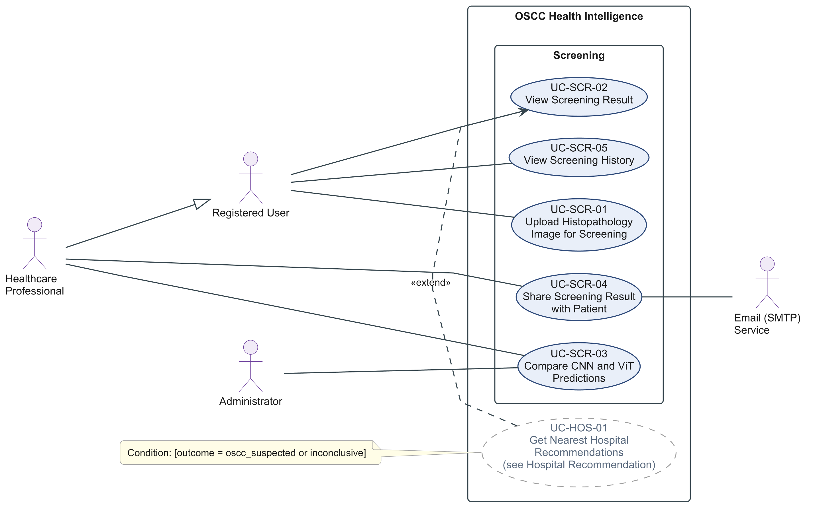
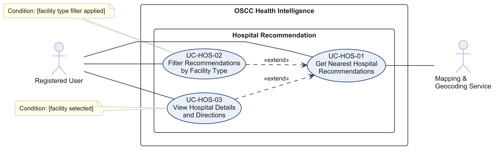
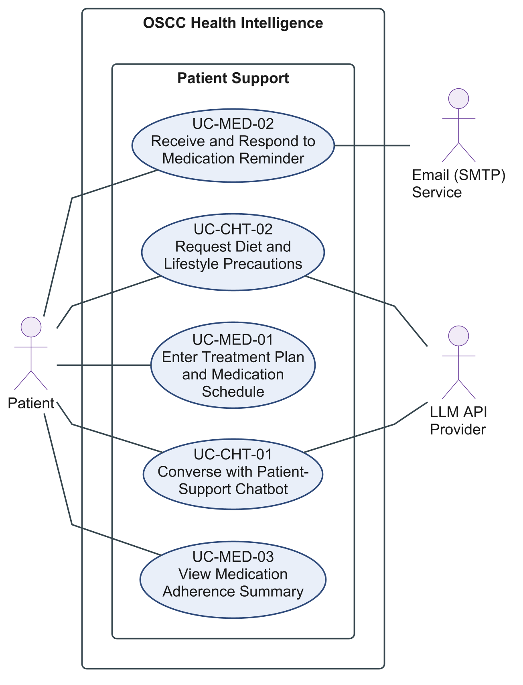
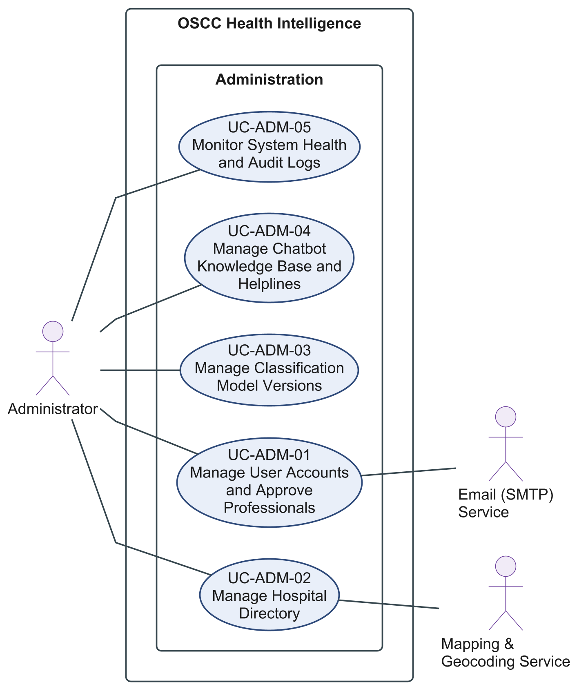

<table>
<colgroup>
<col style="width: 100%" />
</colgroup>
<thead>
<tr class="header">
<th>
<strong>Software Requirement Specifications</strong>

<strong><em>Version:</em> 1.0</strong>

<table>
<colgroup>
<col style="width: 50%" />
<col style="width: 50%" />
</colgroup>
<thead>
<tr class="header">
<th>Project ID</th>
<th>AI FYP 1015</th>
</tr>
<tr class="odd">
<th>Supervisor</th>
<th>Miss Rubab Manzar</th>
</tr>
<tr class="header">
<th>Co Supervisor</th>
<th>Miss Alina Arshad</th>
</tr>
<tr class="odd">
<th>Project Team</th>
<th>
Muhammad Mudassir Bhatti (23K-3003)

Shahryar (22K-4435)

Zaid (23K-0028)
</th>
</tr>
<tr class="header">
<th>Submission Date</th>
<th></th>
</tr>
</thead>
<tbody>
</tbody>
</table></th>
</tr>
</thead>
<tbody>
</tbody>
</table>

Document History

| **Version** | **Name of Person**             | **Date** | **Description of change**                                                    |
|-------------|--------------------------------|----------|------------------------------------------------------------------------------|
| 0.1         | Muhammad Mudassir Bhatti       | 09/15/26 | Document created from template                                               |
| 0.2         | Muhammad Mudassir Bhatti       | 09/22/26 | Introduction: purpose, audience, abbreviations, conventions                  |
| 0.3         | Muhammad Mudassir Bhatti, Zaid | 09/29/26 | Project background, scope, not-in-scope, objectives                          |
| 0.4         | Shahryar                       | 10/06/26 | Stakeholders, operating environment, constraints, assumptions & dependencies |
| 0.5         | Muhammad Mudassir Bhatti       | 10/13/26 | External interface requirements and context diagram                          |
| 0.6         | All members                    | 10/20/26 | Functional hierarchy and use case diagram                                    |
| 0.7         | Shahryar, Zaid                 | 10/27/26 | Use cases: screening and patient-support chatbot                             |
| 0.8         | Muhammad Mudassir Bhatti       | 11/03/26 | Use cases: hospital recommendation, reminders, administration                |
| 0.9         | All members                    | 11/10/26 | Non-functional requirements, references, appendices                          |
| 1.0         | All members                    |          | Final review for supervisor sign-off                                         |

Distribution List

| **Name**                                      | **Role** |               |
|-----------------------------------------------|----------|---------------|
| Miss Rubab Manzar                             |          | Supervisor    |
| Miss Alina Arshad                             |          | Co-Supervisor |
| FYP Coordinator's Office (through Supervisor) |          | Distribution  |

Document Sign-Off

| **Version** | **Sign-off Authority**         | **Sign-off Date** |
|-------------|--------------------------------|-------------------|
| 1.0         | Supervisor (Miss Rubab Manzar) |                   |

**Table of Contents**

> [**1 Introduction 7**](#_Toc9001)
>
> [1.1 Purpose of Document 7](#_Toc9002)
>
> [1.2 Intended Audience 7](#_Toc9003)
>
> [1.3 Abbreviations 7](#_Toc9004)
>
> [1.4 Document Convention 8](#_Toc9005)
>
> [**2 Overall System Description 9**](#_Toc9006)
>
> [2.1 Project Background 9](#_Toc9007)
>
> [2.2 Project Scope 9](#_Toc9008)
>
> [2.3 Not In Scope 10](#_Toc9009)
>
> [2.4 Project Objectives 10](#_Toc9010)
>
> [2.5 Stakeholders 11](#_Toc9011)
>
> [2.6 Operating Environment 12](#_Toc9012)
>
> [2.7 System Constraints 12](#_Toc9013)
>
> [2.8 Assumptions & Dependencies 12](#_Toc9014)
>
> [**3 External Interface Requirements 14**](#_Toc9015)
>
> [3.1 Hardware Interfaces 16](#_Toc9016)
>
> [3.2 Software Interfaces 16](#_Toc9017)
>
> [3.3 Communications Interfaces 16](#_Toc9018)
>
> [**4 Functional Requirements 17**](#_Toc9019)
>
> [4.1 Functional Hierarchy 17](#_Toc9020)
>
> [4.2 Use Cases 19](#_Toc9021)
>
> [4.2.1 UC-USR-01: Register Account 23](#_Toc9022)
>
> [4.2.2 UC-USR-02: Log In / Log Out 23](#_Toc9023)
>
> [4.2.3 UC-USR-03: Reset Password 24](#_Toc9024)
>
> [4.2.4 UC-SCR-01: Upload Histopathology Image for Screening 26](#_Toc9025)
>
> [4.2.5 UC-SCR-02: View Screening Result 27](#_Toc9026)
>
> [4.2.6 UC-SCR-03: Compare CNN and ViT Predictions 27](#_Toc9027)
>
> [4.2.7 UC-SCR-04: Share Screening Result with Patient 28](#_Toc9028)
>
> [4.2.8 UC-SCR-05: View Screening History 29](#_Toc9029)
>
> [4.2.9 UC-HOS-01: Get Nearest Hospital Recommendations 30](#_Toc9030)
>
> [4.2.10 UC-HOS-02: Filter Recommendations by Facility Type 31](#_Toc9031)
>
> [4.2.11 UC-HOS-03: View Hospital Details and Directions 31](#_Toc9032)
>
> [4.2.12 UC-CHT-01: Converse with Patient-Support Chatbot 33](#_Toc9033)
>
> [4.2.13 UC-CHT-02: Request Diet and Lifestyle Precautions 33](#_Toc9034)
>
> [4.2.14 UC-MED-01: Enter Treatment Plan and Medication Schedule 33](#_Toc9035)
>
> [4.2.15 UC-MED-02: Receive and Respond to Medication Reminder 35](#_Toc9036)
>
> [4.2.16 UC-MED-03: View Medication Adherence Summary 36](#_Toc9037)
>
> [4.2.17 UC-ADM-01: Manage User Accounts and Approve Professionals 37](#_Toc9038)
>
> [4.2.18 UC-ADM-02: Manage Hospital Directory 37](#_Toc9039)
>
> [4.2.19 UC-ADM-03: Manage Classification Model Versions 38](#_Toc9040)
>
> [4.2.20 UC-ADM-04: Manage Chatbot Knowledge Base and Helplines 39](#_Toc9041)
>
> [4.2.21 UC-ADM-05: Monitor System Health and Audit Logs 40](#_Toc9042)
>
> [**5 Non-functional Requirements 41**](#_Toc9043)
>
> [5.1 Performance Requirements 41](#_Toc9044)
>
> [5.2 Safety Requirements 41](#_Toc9045)
>
> [5.3 Security Requirements 41](#_Toc9046)
>
> [5.4 User Documentation 42](#_Toc9047)
>
> [**6 References 43**](#_Toc9048)
>
> [**7 Appendices 45**](#_Toc9049)

1.  ***Introduction***

    1.  ***Purpose of Document***

The purpose of this Software Requirements Specification (SRS) is to specify the functional and non-functional requirements of OSCC Health Intelligence, a web-based research prototype that screens Hematoxylin and Eosin (H&E) histopathology images for Oral Squamous Cell Carcinoma (OSCC) and connects a suspicious result to practical next steps. The SRS covers the three system modules (OSCC classification, nearest-hospital recommendation and the patient-support chatbot with medication reminders), the administration functions, and the offline model-development and benchmarking track that compares Convolutional Neural Network (CNN) and Vision Transformer (ViT) architectures under one shared protocol. The document covers both FYP-I and FYP-II; the phasing of the work is stated in Section 2.2. Its structure follows the FAST-NU template, informed by IEEE Std 830 \[14\] and ISO/IEC/IEEE 29148 \[13\]. This document is intended:

- To provide a clear communication framework among the team, the supervisor, the co-supervisor and the evaluation committee.

- To act as the reference for the system's design (recorded in the companion SDS), implementation and testing in FYP-II.

- To keep the system aligned with the research objectives stated in the project proposal.

- To establish a foundation for requirement traceability from proposal objectives to functional requirements and use cases (Appendix A).

  1.  ***Intended Audience***

- **FAST-NU FYP Evaluation Committee / Jury:** Sections 1–2 for scope and objectives, Section 4 for functionality, Appendix A for traceability.

- **Supervisor and Co-Supervisor:** the whole document, with emphasis on Sections 2.4, 4 and 5 for review and sign-off.

- **Project team (requirements and integration lead, ML engineers, chatbot developer, testers):** Sections 3–5 as the build and test baseline.

- **Future maintainers and student researchers:** Sections 2.6–2.8, 3 and 4.1 to understand the environment, interfaces and functional structure.

- **Potential clinical collaborators:** Sections 2.2, 2.3, 2.7 and 5.2 for the intended use, exclusions and safety requirements.

  1.  ***Abbreviations***

- API = Application Programming Interface

- AUC-ROC = Area Under the Receiver Operating Characteristic Curve

- CNIC = Computerized National Identity Card

- CNN = Convolutional Neural Network

- CRUD = Create, Read, Update, Delete

- DFD = Data Flow Diagram

- ENT = Ear, Nose and Throat

- ERD = Entity Relationship Diagram

- F1 = F1-score, the harmonic mean of precision and recall

- FYP = Final Year Project

- GPU = Graphics Processing Unit

- Grad-CAM = Gradient-weighted Class Activation Mapping

- H&E = Hematoxylin and Eosin

- HTTPS = Hypertext Transfer Protocol Secure

- JSON = JavaScript Object Notation

- JWT = JSON Web Token

- LLM = Large Language Model

- OSCC = Oral Squamous Cell Carcinoma

- PII = Personally Identifiable Information

- PMDC = Pakistan Medical and Dental Council

- RAG = Retrieval-Augmented Generation

- RBAC = Role-Based Access Control

- REST = Representational State Transfer

- ROC = Receiver Operating Characteristic

- SCC = Squamous Cell Carcinoma

- SDS = Software Design Specification

- SMTP = Simple Mail Transfer Protocol

- SPA = Single-Page Application

- SRS = Software Requirements Specification

- TLS = Transport Layer Security

- UML = Unified Modeling Language

- ViT = Vision Transformer

- WSI = Whole-Slide Image

  1.  ***Document Convention***

- Font family = Arial throughout the document.

- Font size = 16 pt for level-1 headings, 12 pt for level-2 headings, 14 pt for use case headings (level 3) and 10 pt for body text; tables use 9–12 pt.

- “Shall” denotes a mandatory requirement; “should” denotes a desirable requirement.

- Functional requirements are identified by their number in the functional hierarchy (Section 4.1), written as FR-x.y or FR-x.y.z (e.g., FR-2.4).

- Non-functional requirements use the format NFR-\<area\>-nn (e.g., NFR-PER-03); use cases use UC-\<module\>-nn (e.g., UC-SCR-01).

- Figures are numbered sequentially through the document; API paths and code identifiers appear in a monospace font (e.g., POST /api/v1/screenings).

2.  ***Overall System Description***

    1.  ***Project Background***

OSCC accounts for over ninety percent of oral cancers. In Pakistan, oral cancer is the most frequently diagnosed cancer among men and the second most common among women, with tobacco use, betel quid chewing and areca nut consumption identified as the dominant risk factors \[9\]. Manual examination of H&E-stained biopsy tissue remains the diagnostic gold standard, but it is time-consuming and subject to inter-observer variability, and the country has an acute shortage of trained oral pathologists. Delayed diagnosis is therefore a principal cause of poor prognosis.

Deep-learning research on OSCC histopathology has concentrated on CNN architectures such as ResNet, EfficientNet and DenseNet \[1\], \[2\], \[4\], \[5\]. Vision Transformers \[3\] model long-range dependencies across a tissue image, but the existing CNN–ViT comparisons are embedded inside hybrid models \[6\]–\[8\] rather than reported as a side-by-side benchmark under one protocol. Almost all studies also stop at the classification result, offering no patient-facing next step, and none is contextualized for Pakistan. OSCC Health Intelligence addresses these gaps by benchmarking both architecture families on public OSCC datasets \[10\]–\[12\] and extending the selected model into a Pakistan-specific facility-recommendation and patient-support system.

**Problem Statement:**

- There is no systematic CNN-versus-ViT benchmark for OSCC histopathology under a common data split, preprocessing pipeline and evaluation protocol.

- Screening results are not connected to actionable next steps for the patient or the healthcare worker assisting them.

- There is no Pakistan-specific guidance that maps a patient's location to nearby oncology and ENT facilities.

- Patients lack continuous medication-adherence and emotional support after a suspicious result.

  1.  ***Project Scope***

OSCC Health Intelligence is a responsive web application backed by a REST API and a separate model-inference service. A user uploads an H&E histopathology image, receives a non-diagnostic screening result produced by the selected classification model and, when the result is suspicious or inconclusive, is guided to the nearest suitable facilities and to an AI chatbot that provides precautionary guidance, moral support and medication reminders.

**Included Functionalities:**

- User registration, email verification, login and role-based access for patients, healthcare professionals and administrators.

- OSCC screening: image upload and validation, preprocessing, binary classification with the primary model, a compare mode across all registered models, explanation heatmaps, result sharing and history.

- Hospital recommendation: consent-based location capture, haversine ranking \[21\] refined by road distance and travel time, radius expansion, facility-type filtering and facility details.

- Patient-support chatbot: retrieval-based diet and lifestyle precautions, empathetic moral support, reminder queries, safety guardrails and distress escalation.

- Medication reminders: treatment-plan entry, scheduled reminders, taken/snooze/skip responses and an adherence summary.

- Administration: user approval, hospital-directory curation, model-version registry, knowledge-base and helpline management, audit logs and system health.

- Offline research track: dataset unification, patient-level splitting, CNN and ViT training under an identical protocol, evaluation, interpretation and model registration.

**Phasing.** FYP-I covers problem formulation, dataset acquisition and preprocessing, the literature review, the architecture design and the initial baseline CNN and ViT training. FYP-II covers full comparative benchmarking, the hospital module and its database, the chatbot, end-to-end integration and system testing.

1.  ***Not In Scope***

The following items are deliberately excluded so that the project remains a feasible research prototype; several are recorded as future work in the SDS.

- Clinical deployment, regulatory certification and large-scale multi-hospital validation.

- Hospital reviews and ratings (deferred to future work).

- Full Urdu localization of the user interface (the chatbot may answer in Urdu or Roman Urdu on a best-effort basis).

- Native mobile applications.

- OSCC grading and any multi-class classification.

- Whole-slide image (WSI) viewing or gigapixel WSI processing.

- Appointment booking and integration with hospital information systems.

  1.  ***Project Objectives***

The project pursues the five objectives stated in the proposal:

- To develop and preprocess a high-quality, unified OSCC histopathology image dataset drawn from public repositories.

- To design, train and evaluate CNN-based (ResNet, EfficientNet, DenseNet) and ViT-based models for binary OSCC classification, comparing accuracy, precision, recall, F1-score and AUC-ROC.

- To build a geolocation-based hospital recommendation module that maps a patient's location to the nearest oncology/ENT facilities from a curated Pakistani hospital database.

- To design an AI-driven chatbot that supports patients with medication reminders, dietary and lifestyle precautions and moral support.

- To integrate all three modules into a single, usable web application and evaluate its overall usability and reliability.

**Patient Functions:**

- Register, verify the email address, log in and manage the profile.

- Upload an image for screening and view the result with its non-diagnostic explanation and history.

- Find the nearest suitable facilities, filter them by type and open their contact details and directions.

- Converse with the support chatbot, request precautions, record a treatment plan and respond to medication reminders.

- View the adherence summary and delete chat history or account data.

**Healthcare Professional Functions:**

- Register with professional details and use the system after administrator approval.

- Screen images on behalf of patients, compare CNN and ViT predictions and inspect explanation heatmaps.

- Share results with registered patients and view the history of linked patients only.

- Look up recommended facilities for a patient.

**Administrator Functions:**

- Approve professionals and activate, deactivate or reactivate accounts.

- Curate the hospital directory through forms or CSV import, with geocoding, verification and staleness alerts.

- Register, validate, activate and retire classification model versions and review the benchmark dashboard.

- Manage knowledge-base articles and helpline contacts, and monitor audit logs and system health.

**Research Objectives:**

- Benchmark ResNet50, EfficientNet, DenseNet and a ViT on identical patient-level splits, preprocessing, optimizer settings, batch sizes and early-stopping rules.

- Report accuracy, precision, recall, F1-score, AUC-ROC and the confusion matrix for every model on the held-out test set, with 95% bootstrap confidence intervals.

- Compare computational cost: parameter count, FLOPs and mean inference latency.

- Interpret predictions with Grad-CAM for CNNs and attention rollout for the ViT.

  1.  ***Stakeholders***

- **Patients and caregivers:** timely, understandable screening guidance, nearby facilities and ongoing support.

- **Healthcare professionals:** a second-opinion screening aid and a model comparison for the cases they assist.

- **System administrator:** a maintainable, auditable platform with accurate facility and model data.

- **Supervisor (Miss Rubab Manzar) and co-supervisor (Miss Alina Arshad):** research quality, feasibility and timely delivery.

- **FAST-NU and the FYP committee:** a project that meets the FYP evaluation criteria and the Good Health and Well-Being SDG.

- **Development team:** clear, testable requirements and a shared design baseline.

- **Listed hospitals and clinics:** correct representation of their services and contact details.

- **Dataset providers:** use of their datasets in line with the published licenses and citations.

- **LLM and mapping API providers:** usage within their terms, quotas and acceptable-use policies.

- **Research community:** a reproducible CNN-versus-ViT benchmark on OSCC histopathology.

  1.  ***Operating Environment***

- **Client:** the latest two major versions of Chrome, Edge, Firefox or Safari on desktop or mobile; the interface is responsive.

- **Server:** a Linux virtual machine running Docker; an NVIDIA GPU is optional for the inference service.

- **Training:** a CUDA-capable GPU environment (a university lab machine or a cloud notebook).

- **Network:** internet access is required for the LLM, mapping and email features; screening itself runs on the project's own server.

  1.  ***System Constraints***

- The technology stack follows the proposal (Python, PyTorch/TensorFlow, HuggingFace Transformers, React, a REST back end, a relational/NoSQL database, Docker and a cloud host); the final technology choices are recorded in the SDS.

- Only public, de-identified datasets \[10\]–\[12\] are used; no real patient data is collected during the FYP.

- Model generalization is limited by dataset diversity and by staining and scanner variation across sources.

- External APIs (LLM, mapping, email) impose quotas, cost and latency that the design must tolerate.

- The budget is limited to free or academic tiers of cloud and API services.

- The work must fit the FYP timeline from September 2026 to May 2027.

- English is the primary user-interface language.

- The system is a research prototype and screening aid; it is not a medical device and must not be used for clinical decisions.

- Ethical AI: all results and chatbot replies use non-diagnostic language, and bias across datasets is analyzed and reported.

- Accessibility: the user interface targets WCAG 2.1 Level AA \[16\].

- Users may be non-technical, so the interface must use plain language and a guided flow.

  1.  ***Assumptions & Dependencies***

- Uploaded images are H&E-stained histopathology tiles at magnifications comparable to the training data.

- Users enter treatment plans truthfully, copied from their prescriptions.

- Hospital information can be compiled from public sources and verified by the administrator.

- Users have basic web literacy.

- The dataset licenses permit academic use.

**Dependencies**

- An LLM API with chat-completion and moderation endpoints.

- A mapping and geocoding API (Google Maps Platform, with OpenStreetMap Nominatim/OSRM as fallback).

- An SMTP service for email delivery.

- The browser Geolocation API for consent-based location capture.

- PyTorch/TensorFlow and pretrained weights from HuggingFace for model development.

- PostgreSQL with the pgvector extension \[19\], \[20\].

- Docker for packaging and deployment, and a cloud host for the demonstration deployment.

3.  ***External Interface Requirements***

OSCC Health Intelligence interacts with three human actors and three external systems. Figure 1 presents the context diagram (Level-0 DFD): the whole system is the single process 0, and every labeled arrow is a data flow that crosses the system boundary. These flows balance exactly with the Level-1 DFD in the SDS. The table below lists each external entity with its inbound and outbound flows.

| **External entity**         | **Inbound flows (entity → system)**                                                                                         | **Outbound flows (system → entity)**                                                                |
|-----------------------------|-----------------------------------------------------------------------------------------------------------------------------|-----------------------------------------------------------------------------------------------------|
| Patient                     | credentials & profile; histopathology image; location & consent; chat message; treatment plan & schedule; reminder response | screening result & advice; ranked facilities; chatbot reply; medication reminder; adherence summary |
| Healthcare Professional     | credentials & professional details; histopathology image; share request; location & consent                                 | screening & comparison results; ranked facilities                                                   |
| Administrator               | approval & account actions; hospital records / CSV; model version & metrics; KB articles & helplines                        | pending approvals; benchmark dashboard; health report & audit log                                   |
| LLM API Provider            | generated reply & moderation result                                                                                         | scrubbed prompt + context                                                                           |
| Mapping & Geocoding Service | geocodes, road distance & travel time                                                                                       | address / coordinates                                                                               |
| Email (SMTP) Service        | –                                                                                                                           | verification & reset emails; share notification email; reminder email                               |

Figure : Context Diagram (Level-0 DFD) of OSCC Health Intelligence

1.  ***Hardware Interfaces***

- **Client device:** any desktop, laptop or smartphone with a modern browser; at least 4 GB RAM recommended; optional GPS or location services for the hospital search.

- **Server:** at least 4 vCPUs, 16 GB RAM and 100 GB storage; an optional NVIDIA GPU with at least 8 GB VRAM accelerates inference.

- **Training environment:** a CUDA-capable GPU.

- No special peripherals are required; images are uploaded from file storage, not captured from microscopes or slide scanners.

  1.  ***Software Interfaces***

- **React SPA \[18\]:** the user interface; exchanges JSON with the back end and receives Server-Sent Events.

- **FastAPI back end:** the REST API under /api/v1; validates requests, enforces RBAC and orchestrates all modules.

- **Inference service:** an internal FastAPI service that receives an image URI and model-version IDs and returns probabilities, outcomes, explanation-map URIs and latencies.

- **PostgreSQL + pgvector:** stores users, screenings, predictions, hospitals, plans, reminders, chat logs, audit logs and knowledge-base embeddings.

- **Object storage:** stores uploaded images, explanation maps and model weights; accessed through short-lived signed URLs.

- **LLM API:** receives PII-scrubbed prompts with retrieved context and returns generated replies and moderation results.

- **Google Maps Platform / Nominatim / OSRM:** geocode addresses and return road distance and travel time between coordinates.

- **Browser Geolocation API:** returns the device's coordinates after the user grants consent.

- **SMTP server:** sends verification, password-reset, share-notification and reminder emails.

- **PyTorch/TensorFlow and HuggingFace Transformers:** train and run the CNN and ViT models.

- **Docker / Nginx:** package and run the services; Nginx terminates TLS and routes requests.

  1.  ***Communications Interfaces***

- All client–server traffic uses HTTPS with TLS 1.2 or higher.

- The API follows REST conventions with JSON bodies; images are uploaded as multipart/form-data.

- The API calls the inference service over internal HTTP on a private Docker network that is not exposed publicly.

- Calls to the LLM and mapping APIs use outbound HTTPS.

- Email is sent over SMTP with TLS (port 587).

- Streaming chatbot replies and in-app notifications use Server-Sent Events, with polling as a fallback.

- All timestamps are stored in UTC in ISO 8601 format and displayed in the user's local time (PKT).

4.  ***Functional Requirements***

    1.  ***Functional Hierarchy***

The functional hierarchy below groups the system's functions. The numbers are the functional-requirement identifiers used throughout the documents (FR-x.y or FR-x.y.z).

**1. User & Access Management**

> 1.1 Register account
>
> 1.1.1 Patient self-registration
>
> 1.1.2 Healthcare Professional self-registration with professional details
>
> 1.1.3 Email address verification
>
> 1.2 Professional account approval (pending accounts cannot screen)
>
> 1.3 Log in / log out
>
> 1.3.1 JWT access and refresh tokens in httpOnly cookies
>
> 1.3.2 Account lockout after 5 failed attempts for 15 minutes
>
> 1.4 Reset password
>
> 1.5 Manage profile and delete account data
>
> 1.6 Role-based access control (patient, professional, admin)

**2. OSCC Screening**

> 2.1 Upload histopathology image
>
> 2.2 Validate image (format, size, resolution, H&E color profile)
>
> 2.3 Preprocess image
>
> 2.3.1 Tile into 224×224 patches / resize
>
> 2.3.2 ImageNet mean/std normalization (and stain normalization if adopted in training)
>
> 2.4 Classify with the primary model
>
> 2.4.1 Aggregate patch probabilities (mean) into an image-level probability
>
> 2.4.2 Apply threshold τ and inconclusive band to assign the outcome
>
> 2.5 Compare mode across all registered models
>
> 2.6 Display result (category, probability, threshold, non-diagnostic disclaimer)
>
> 2.7 Explanation heatmap (Grad-CAM / attention rollout overlay)
>
> 2.8 Link and share a result with a patient
>
> 2.9 Screening history

**3. Hospital Recommendation**

> 3.1 Acquire location
>
> 3.1.1 Consent-based browser geolocation (GPS)
>
> 3.1.2 Manual city/address entry
>
> 3.2 Geocode address
>
> 3.3 Compute haversine distance
>
> 3.4 Refine with road distance and travel time
>
> 3.5 Expand search radius (50 km → 150 km → nationwide)
>
> 3.6 Rank and return top-N facilities
>
> 3.7 Filter by facility type
>
> 3.8 Show facility details, contact and directions link
>
> 3.9 Display last-verified date and call-ahead advice

**4. Patient-Support Chatbot**

> 4.1 Conversational interface
>
> 4.2 Diet and lifestyle precautions via retrieval
>
> 4.3 Moral support
>
> 4.4 Reminder queries and reminder creation with confirmation
>
> 4.5 Guardrails
>
> 4.5.1 PII scrubbing before any external call
>
> 4.5.2 Non-diagnostic output check
>
> 4.5.3 Out-of-scope redirect
>
> 4.6 Distress escalation with helpline contacts
>
> 4.7 Redirect to treating physician and recommended hospitals
>
> 4.8 Chat history view and delete

**5. Medication Reminder Management**

> 5.1 Treatment plan entry
>
> 5.2 Medication schedule
>
> 5.3 Reminder generation
>
> 5.4 Reminder delivery (in-app / email)
>
> 5.5 Acknowledge, snooze or skip a reminder
>
> 5.6 Missed-dose marking
>
> 5.7 Adherence summary

**6. Administration**

> 6.1 User management and professional approval
>
> 6.2 Hospital directory CRUD
>
> 6.3 Hospital CSV import
>
> 6.4 Hospital geocoding, verification and staleness flagging
>
> 6.5 Model version registry and activation
>
> 6.6 Benchmark dashboard
>
> 6.7 Knowledge-base article management
>
> 6.8 Helpline contact configuration
>
> 6.9 Audit logs and system health

**7. Model Development & Benchmarking (offline research track)**

> 7.1 Dataset acquisition and unification
>
> 7.2 Patient-level splitting and deduplication
>
> 7.3 Preprocessing and augmentation
>
> 7.4 CNN training
>
> 7.4.1 ResNet50
>
> 7.4.2 EfficientNet
>
> 7.4.3 DenseNet
>
> 7.5 ViT training
>
> 7.6 Identical-protocol enforcement
>
> 7.7 Evaluation (accuracy, precision, recall, F1, AUC-ROC, confusion matrix)
>
> 7.8 Computational cost (parameters, FLOPs, latency)
>
> 7.9 Interpretation (Grad-CAM / attention rollout)
>
> 7.10 Model export and registration

2.  ***Use Cases***

Figure 2 gives an overview of the actors and the five use case packages inside the system boundary. Figures 3–7 show the use cases of each package. Patient and Healthcare Professional specialize the abstract Registered User; external systems are shown as «system» actors on the right.

Figure : Use Case Diagram — Overview (Actors and Packages)

Figure : Use Case Diagram — Account Package

Figure : Use Case Diagram — Screening Package

Figure : Use Case Diagram — Hospital Recommendation Package

Figure : Use Case Diagram — Patient Support Package

Figure : Use Case Diagram — Administration Package

In the Screening package, UC-SCR-01 «include»s UC-SCR-02 because every successful upload ends by showing the result. UC-HOS-01 «extend»s UC-SCR-02 at the extension point “Next steps” under the condition \[outcome = oscc_suspected or inconclusive\]. Image validation and safety screening are modeled as steps inside UC-SCR-01 and UC-CHT-01 rather than as separate use cases.

1.  ***UC-USR-01: Register Account***

<table>
<colgroup>
<col style="width: 9%" />
<col style="width: 19%" />
<col style="width: 4%" />
<col style="width: 16%" />
<col style="width: 49%" />
</colgroup>
<thead>
<tr class="header">
<th colspan="5"><strong>UC-USR-01: Register Account</strong></th>
</tr>
<tr class="odd">
<th colspan="2"><strong>Use case Id:</strong></th>
<th colspan="3">UC-USR-01</th>
</tr>
<tr class="header">
<th colspan="5">
<strong>Actors:</strong> <strong>Patient:</strong> registers to screen images, view results and use the support features.

<strong>Healthcare Professional:</strong> registers to screen images for patients; the account needs administrator approval.

<strong>Email (SMTP) Service:</strong> delivers the verification email.
</th>
</tr>
<tr class="odd">
<th colspan="5"><strong>Feature:</strong> Self-registration with email verification and a role-specific profile (FR-1.1, FR-1.2).</th>
</tr>
<tr class="header">
<th colspan="2"><strong>Pre-condition:</strong></th>
<th colspan="3">The user is not logged in and has access to the email address being registered.</th>
</tr>
<tr class="odd">
<th colspan="5"><strong>Scenarios</strong></th>
</tr>
<tr class="header">
<th><strong>Step#</strong></th>
<th colspan="3"><strong>Action</strong></th>
<th><strong>Software Reaction</strong></th>
</tr>
<tr class="odd">
<th><strong>1.</strong></th>
<th colspan="3">User opens the Register page and selects a role (Patient or Healthcare Professional).</th>
<th>Displays the registration form with the role-specific profile fields.</th>
</tr>
<tr class="header">
<th><strong>2.</strong></th>
<th colspan="3">User enters full name, email, phone, password and profile details (professionals add designation, specialty, institution and an optional PMDC number).</th>
<th>Validates the fields in the browser (email format; password of at least 10 characters with letters and digits).</th>
</tr>
<tr class="odd">
<th><strong>3.</strong></th>
<th colspan="3">User submits the form.</th>
<th>Hashes the password with Argon2id, creates the account with status pending_verification and its profile, and stores a hashed verification token valid for 24 hours.</th>
</tr>
<tr class="header">
<th><strong>4.</strong></th>
<th colspan="3">User waits for the verification email.</th>
<th>Sends the verification link through the Email (SMTP) Service and shows "Check your inbox".</th>
</tr>
<tr class="odd">
<th><strong>5.</strong></th>
<th colspan="3">User opens the verification link.</th>
<th>Validates the token and sets the status to active (Patient) or pending_approval (Healthcare Professional); records the event in the audit log.</th>
</tr>
<tr class="header">
<th><strong>6.</strong></th>
<th colspan="3">Healthcare Professional reads the confirmation page.</th>
<th>Displays "Your account is awaiting administrator approval" and adds the account to the administrator's pending-approval list.</th>
</tr>
<tr class="odd">
<th colspan="5"><strong>Alternate Scenarios:</strong></th>
</tr>
<tr class="header">
<th colspan="5">
<strong>3a:</strong> If the email is already registered, the system rejects the request with "An account with this email already exists" and offers password reset.

<strong>5a:</strong> If the verification token has expired or was already used, the system shows an error and offers to resend the verification email.

<strong>6a:</strong> If the administrator rejects the professional (UC-ADM-01), the account is set to deactivated and the user is emailed the reason.
</th>
</tr>
<tr class="odd">
<th colspan="5"><strong>Post Conditions</strong></th>
</tr>
<tr class="header">
<th><strong>Step#</strong></th>
<th colspan="4"><strong>Description</strong></th>
</tr>
<tr class="odd">
<th><strong>1.</strong></th>
<th colspan="4">A user account and its role profile exist.</th>
</tr>
<tr class="header">
<th><strong>2.</strong></th>
<th colspan="4">A Patient account is active after email verification.</th>
</tr>
<tr class="odd">
<th><strong>3.</strong></th>
<th colspan="4">A Healthcare Professional account remains pending_approval until an administrator approves it.</th>
</tr>
<tr class="header">
<th><strong>4.</strong></th>
<th colspan="4">Registration and verification events are recorded in the audit log.</th>
</tr>
<tr class="odd">
<th colspan="3"><strong>Use Case Cross referenced</strong></th>
<th colspan="2">
<strong>UC-USR-02</strong>: Log In / Log Out

<strong>UC-ADM-01</strong>: Manage User Accounts and Approve Professionals
</th>
</tr>
</thead>
<tbody>
</tbody>
</table>

2.  ***UC-USR-02: Log In / Log Out***

<table>
<colgroup>
<col style="width: 9%" />
<col style="width: 19%" />
<col style="width: 4%" />
<col style="width: 16%" />
<col style="width: 49%" />
</colgroup>
<thead>
<tr class="header">
<th colspan="5"><strong>UC-USR-02: Log In / Log Out</strong></th>
</tr>
<tr class="odd">
<th colspan="2"><strong>Use case Id:</strong></th>
<th colspan="3">UC-USR-02</th>
</tr>
<tr class="header">
<th colspan="5">
<strong>Actors:</strong> <strong>Registered User:</strong> a Patient or Healthcare Professional who signs in to use the system.

<strong>Administrator:</strong> signs in to reach the administration console.
</th>
</tr>
<tr class="odd">
<th colspan="5"><strong>Feature:</strong> Session authentication with JWT cookies, account lockout and logout (FR-1.3, FR-1.6).</th>
</tr>
<tr class="header">
<th colspan="2"><strong>Pre-condition:</strong></th>
<th colspan="3">The account exists and its email address has been verified.</th>
</tr>
<tr class="odd">
<th colspan="5"><strong>Scenarios</strong></th>
</tr>
<tr class="header">
<th><strong>Step#</strong></th>
<th colspan="3"><strong>Action</strong></th>
<th><strong>Software Reaction</strong></th>
</tr>
<tr class="odd">
<th><strong>1.</strong></th>
<th colspan="3">User opens the login page.</th>
<th>Displays the email and password fields.</th>
</tr>
<tr class="header">
<th><strong>2.</strong></th>
<th colspan="3">User enters the email and password and submits.</th>
<th>Looks up the account and verifies the password against the stored Argon2id hash.</th>
</tr>
<tr class="odd">
<th><strong>3.</strong></th>
<th colspan="3">User waits while the session starts.</th>
<th>Resets failed_login_count, issues a 15-minute access token and a 7-day refresh token in httpOnly secure cookies, and records auth.login in the audit log.</th>
</tr>
<tr class="header">
<th><strong>4.</strong></th>
<th colspan="3">User is taken to the home screen.</th>
<th>Redirects to the role-specific dashboard (Patient, Professional or Admin).</th>
</tr>
<tr class="odd">
<th><strong>5.</strong></th>
<th colspan="3">User keeps working after the access token expires.</th>
<th>The SPA calls the refresh endpoint silently; the system rotates the refresh token and issues a new access token.</th>
</tr>
<tr class="header">
<th><strong>6.</strong></th>
<th colspan="3">User selects Log Out.</th>
<th>Revokes the refresh token, clears both cookies and returns to the landing page.</th>
</tr>
<tr class="odd">
<th colspan="5"><strong>Alternate Scenarios:</strong></th>
</tr>
<tr class="header">
<th colspan="5">
<strong>2a:</strong> If the password is wrong, the system increments failed_login_count and shows "Invalid email or password" without revealing which field was wrong.

<strong>2b:</strong> On the fifth consecutive failure the system sets the status to locked with locked_until 15 minutes ahead and shows "Account locked, try again in 15 minutes".

<strong>2c:</strong> If a Healthcare Professional account is still pending approval, login is refused with "Awaiting administrator approval", so the user cannot screen images.

<strong>5a:</strong> If the refresh token has expired or was revoked, the session ends and the user is redirected to the login page.
</th>
</tr>
<tr class="odd">
<th colspan="5"><strong>Post Conditions</strong></th>
</tr>
<tr class="header">
<th><strong>Step#</strong></th>
<th colspan="4"><strong>Description</strong></th>
</tr>
<tr class="odd">
<th><strong>1.</strong></th>
<th colspan="4">An authenticated session with the user's role claims is established.</th>
</tr>
<tr class="header">
<th><strong>2.</strong></th>
<th colspan="4">After logout the refresh token is revoked and the cookies are cleared.</th>
</tr>
<tr class="odd">
<th><strong>3.</strong></th>
<th colspan="4">Every login attempt outcome is recorded in the audit log.</th>
</tr>
<tr class="header">
<th colspan="3"><strong>Use Case Cross referenced</strong></th>
<th colspan="2">
<strong>UC-USR-01</strong>: Register Account

<strong>UC-USR-03</strong>: Reset Password
</th>
</tr>
</thead>
<tbody>
</tbody>
</table>

3.  ***UC-USR-03: Reset Password***

<table>
<colgroup>
<col style="width: 9%" />
<col style="width: 19%" />
<col style="width: 4%" />
<col style="width: 16%" />
<col style="width: 49%" />
</colgroup>
<thead>
<tr class="header">
<th colspan="5"><strong>UC-USR-03: Reset Password</strong></th>
</tr>
<tr class="odd">
<th colspan="2"><strong>Use case Id:</strong></th>
<th colspan="3">UC-USR-03</th>
</tr>
<tr class="header">
<th colspan="5">
<strong>Actors:</strong> <strong>Registered User:</strong> a Patient or Healthcare Professional who has forgotten the password.

<strong>Administrator:</strong> may reset the administrator password the same way.

<strong>Email (SMTP) Service:</strong> delivers the password-reset link.
</th>
</tr>
<tr class="odd">
<th colspan="5"><strong>Feature:</strong> Self-service password reset through a single-use emailed link (FR-1.4).</th>
</tr>
<tr class="header">
<th colspan="2"><strong>Pre-condition:</strong></th>
<th colspan="3">The user is not logged in.</th>
</tr>
<tr class="odd">
<th colspan="5"><strong>Scenarios</strong></th>
</tr>
<tr class="header">
<th><strong>Step#</strong></th>
<th colspan="3"><strong>Action</strong></th>
<th><strong>Software Reaction</strong></th>
</tr>
<tr class="odd">
<th><strong>1.</strong></th>
<th colspan="3">User selects "Forgot password" on the login page.</th>
<th>Displays the email form.</th>
</tr>
<tr class="header">
<th><strong>2.</strong></th>
<th colspan="3">User enters the account email and submits.</th>
<th>Always replies "If this email is registered, a reset link has been sent" so that account existence is not revealed.</th>
</tr>
<tr class="odd">
<th><strong>3.</strong></th>
<th colspan="3">User waits for the email.</th>
<th>If the account exists, stores a hashed reset token valid for 30 minutes and sends the reset link through the Email (SMTP) Service.</th>
</tr>
<tr class="header">
<th><strong>4.</strong></th>
<th colspan="3">User opens the link and enters the new password twice.</th>
<th>Validates the token and the password policy.</th>
</tr>
<tr class="odd">
<th><strong>5.</strong></th>
<th colspan="3">User submits the new password.</th>
<th>Updates the password hash, marks the token used, revokes all refresh tokens, clears any lockout and records the event in the audit log.</th>
</tr>
<tr class="header">
<th><strong>6.</strong></th>
<th colspan="3">User reads the confirmation.</th>
<th>Confirms the change and redirects to the login page.</th>
</tr>
<tr class="odd">
<th colspan="5"><strong>Alternate Scenarios:</strong></th>
</tr>
<tr class="header">
<th colspan="5">
<strong>2a:</strong> If the email is not registered, the same generic message is shown and no email is sent.

<strong>4a:</strong> If the reset token has expired or was already used, the system shows an error and offers a new reset request.

<strong>4b:</strong> If the new passwords do not match or fail the policy, an inline message explains the rule before submission.
</th>
</tr>
<tr class="odd">
<th colspan="5"><strong>Post Conditions</strong></th>
</tr>
<tr class="header">
<th><strong>Step#</strong></th>
<th colspan="4"><strong>Description</strong></th>
</tr>
<tr class="odd">
<th><strong>1.</strong></th>
<th colspan="4">The password is updated and all existing sessions are revoked.</th>
</tr>
<tr class="header">
<th><strong>2.</strong></th>
<th colspan="4">The reset token cannot be reused.</th>
</tr>
<tr class="odd">
<th colspan="3"><strong>Use Case Cross referenced</strong></th>
<th colspan="2"><strong>UC-USR-02</strong>: Log In / Log Out</th>
</tr>
</thead>
<tbody>
</tbody>
</table>

4.  ***UC-SCR-01: Upload Histopathology Image for Screening***

<table>
<colgroup>
<col style="width: 9%" />
<col style="width: 19%" />
<col style="width: 4%" />
<col style="width: 16%" />
<col style="width: 49%" />
</colgroup>
<thead>
<tr class="header">
<th colspan="5"><strong>UC-SCR-01: Upload Histopathology Image for Screening</strong></th>
</tr>
<tr class="odd">
<th colspan="2"><strong>Use case Id:</strong></th>
<th colspan="3">UC-SCR-01</th>
</tr>
<tr class="header">
<th colspan="5"><strong>Actors:</strong> <strong>Registered User:</strong> a Patient uploading their own image, or a Healthcare Professional uploading an image for a linked patient.</th>
</tr>
<tr class="odd">
<th colspan="5"><strong>Feature:</strong> Upload, validation, preprocessing and classification of an H&amp;E histopathology image with the primary model (FR-2.1 to FR-2.4).</th>
</tr>
<tr class="header">
<th colspan="2"><strong>Pre-condition:</strong></th>
<th colspan="3">The user is logged in with an active account, and an active primary model exists in the registry.</th>
</tr>
<tr class="odd">
<th colspan="5"><strong>Scenarios</strong></th>
</tr>
<tr class="header">
<th><strong>Step#</strong></th>
<th colspan="3"><strong>Action</strong></th>
<th><strong>Software Reaction</strong></th>
</tr>
<tr class="odd">
<th><strong>1.</strong></th>
<th colspan="3">User opens New Screening and selects a JPEG, PNG or TIFF image; a professional may choose a linked patient.</th>
<th>Shows a preview, the file size and the non-diagnostic notice.</th>
</tr>
<tr class="header">
<th><strong>2.</strong></th>
<th colspan="3">User submits the image.</th>
<th>Receives the multipart upload and creates the screening with status validating.</th>
</tr>
<tr class="odd">
<th><strong>3.</strong></th>
<th colspan="3">User waits while the image is checked.</th>
<th>Checks format, size (≤ 20 MB), resolution (≥ 224×224) and the H&amp;E color profile; computes the SHA-256 checksum and stores the image in private object storage.</th>
</tr>
<tr class="header">
<th><strong>4.</strong></th>
<th colspan="3">User waits for the analysis.</th>
<th>Sets the status to queued, then processing, and calls the inference service with the active primary model.</th>
</tr>
<tr class="odd">
<th><strong>5.</strong></th>
<th colspan="3">User waits for the analysis.</th>
<th>The inference service tiles the image into 224×224 patches, applies ImageNet mean/std normalization, predicts each patch and averages the patch probabilities.</th>
</tr>
<tr class="header">
<th><strong>6.</strong></th>
<th colspan="3">User waits for the analysis.</th>
<th>Applies threshold τ and the inconclusive margin to assign the outcome, creates the explanation map, stores the prediction with its model version and sets the status to completed.</th>
</tr>
<tr class="odd">
<th><strong>7.</strong></th>
<th colspan="3">User is shown the result.</th>
<th>Opens the result view (UC-SCR-02).</th>
</tr>
<tr class="header">
<th colspan="5"><strong>Alternate Scenarios:</strong></th>
</tr>
<tr class="odd">
<th colspan="5">
<strong>2a:</strong> If the account is a professional still pending approval, the upload is refused (403) with "Awaiting administrator approval".

<strong>3a:</strong> If the format is unsupported, the file exceeds 20 MB or the image is smaller than 224×224, the screening is set to rejected and the reason is shown.

<strong>3b:</strong> If the color profile is not H&amp;E-like (for example a photograph or screenshot), the screening is rejected with "This does not appear to be an H&amp;E-stained histopathology image".

<strong>4a:</strong> If the inference service is unavailable or times out, the screening stays queued, the user is told "Your result is queued and you will be notified", and the worker retries up to 3 times before setting the status to failed.
</th>
</tr>
<tr class="header">
<th colspan="5"><strong>Post Conditions</strong></th>
</tr>
<tr class="odd">
<th><strong>Step#</strong></th>
<th colspan="4"><strong>Description</strong></th>
</tr>
<tr class="header">
<th><strong>1.</strong></th>
<th colspan="4">The image is stored privately with its checksum.</th>
</tr>
<tr class="odd">
<th><strong>2.</strong></th>
<th colspan="4">The screening holds a prediction linked to the model version that produced it.</th>
</tr>
<tr class="header">
<th><strong>3.</strong></th>
<th colspan="4">The screening status is completed, or rejected/failed with an error_code.</th>
</tr>
<tr class="odd">
<th colspan="3"><strong>Use Case Cross referenced</strong></th>
<th colspan="2">
<strong>UC-SCR-02</strong>: View Screening Result

<strong>UC-SCR-03</strong>: Compare CNN and ViT Predictions

<strong>UC-HOS-01</strong>: Get Nearest Hospital Recommendations
</th>
</tr>
</thead>
<tbody>
</tbody>
</table>

5.  ***UC-SCR-02: View Screening Result***

<table>
<colgroup>
<col style="width: 9%" />
<col style="width: 19%" />
<col style="width: 4%" />
<col style="width: 16%" />
<col style="width: 49%" />
</colgroup>
<thead>
<tr class="header">
<th colspan="5"><strong>UC-SCR-02: View Screening Result</strong></th>
</tr>
<tr class="odd">
<th colspan="2"><strong>Use case Id:</strong></th>
<th colspan="3">UC-SCR-02</th>
</tr>
<tr class="header">
<th colspan="5"><strong>Actors:</strong> <strong>Registered User:</strong> the requester, the linked patient or the linked professional viewing a completed screening.</th>
</tr>
<tr class="odd">
<th colspan="5"><strong>Feature:</strong> Display of the outcome category, probability, threshold, explanation map and next-step advice (FR-2.6, FR-2.7).</th>
</tr>
<tr class="header">
<th colspan="2"><strong>Pre-condition:</strong></th>
<th colspan="3">The screening exists and the user is its requester, its linked patient or a professional linked to that patient.</th>
</tr>
<tr class="odd">
<th colspan="5"><strong>Scenarios</strong></th>
</tr>
<tr class="header">
<th><strong>Step#</strong></th>
<th colspan="3"><strong>Action</strong></th>
<th><strong>Software Reaction</strong></th>
</tr>
<tr class="odd">
<th><strong>1.</strong></th>
<th colspan="3">User opens a screening, or is redirected after upload.</th>
<th>Retrieves the screening and its primary prediction.</th>
</tr>
<tr class="header">
<th><strong>2.</strong></th>
<th colspan="3">User reads the result.</th>
<th>Displays the outcome label and wording, the OSCC probability, threshold τ, the model version and the non-diagnostic disclaimer.</th>
</tr>
<tr class="odd">
<th><strong>3.</strong></th>
<th colspan="3">User selects Show explanation.</th>
<th>Overlays the Grad-CAM or attention-rollout heatmap loaded through a short-lived signed URL.</th>
</tr>
<tr class="header">
<th><strong>4.</strong></th>
<th colspan="3">User reviews the next-step advice.</th>
<th>For oscc_suspected or inconclusive, displays "Medical review recommended" and offers Find nearest hospitals (extension point for UC-HOS-01).</th>
</tr>
<tr class="odd">
<th><strong>5.</strong></th>
<th colspan="3">User selects Find nearest hospitals.</th>
<th>Starts UC-HOS-01 with the screening as context.</th>
</tr>
<tr class="header">
<th colspan="5"><strong>Alternate Scenarios:</strong></th>
</tr>
<tr class="odd">
<th colspan="5">
<strong>1a:</strong> If the screening is still being processed, the view shows progress and polls every 3 seconds until it completes.

<strong>1b:</strong> If the user is not authorized for the screening, the system responds "Not found" so no information is leaked.

<strong>2a:</strong> If the outcome is inconclusive, the label reads "Inconclusive — medical review recommended" and the hospital offer is still shown.

<strong>2b:</strong> If the outcome is non_oscc, the label shows the non-diagnostic wording and the hospital search stays available as a link but is not prompted.
</th>
</tr>
<tr class="header">
<th colspan="5"><strong>Post Conditions</strong></th>
</tr>
<tr class="odd">
<th><strong>Step#</strong></th>
<th colspan="4"><strong>Description</strong></th>
</tr>
<tr class="header">
<th><strong>1.</strong></th>
<th colspan="4">The user has seen the result with its disclaimer.</th>
</tr>
<tr class="odd">
<th><strong>2.</strong></th>
<th colspan="4">Facility guidance is offered whenever the outcome is oscc_suspected or inconclusive.</th>
</tr>
<tr class="header">
<th colspan="3"><strong>Use Case Cross referenced</strong></th>
<th colspan="2">
<strong>UC-SCR-01</strong>: Upload Histopathology Image for Screening

<strong>UC-HOS-01</strong>: Get Nearest Hospital Recommendations

<strong>UC-SCR-04</strong>: Share Screening Result with Patient
</th>
</tr>
</thead>
<tbody>
</tbody>
</table>

6.  ***UC-SCR-03: Compare CNN and ViT Predictions***

<table>
<colgroup>
<col style="width: 9%" />
<col style="width: 19%" />
<col style="width: 4%" />
<col style="width: 16%" />
<col style="width: 49%" />
</colgroup>
<thead>
<tr class="header">
<th colspan="5"><strong>UC-SCR-03: Compare CNN and ViT Predictions</strong></th>
</tr>
<tr class="odd">
<th colspan="2"><strong>Use case Id:</strong></th>
<th colspan="3">UC-SCR-03</th>
</tr>
<tr class="header">
<th colspan="5">
<strong>Actors:</strong> <strong>Healthcare Professional:</strong> compares how the CNN and ViT models score a case.

<strong>Administrator:</strong> uses compare mode to demonstrate and audit the benchmark.
</th>
</tr>
<tr class="odd">
<th colspan="5"><strong>Feature:</strong> Compare mode: the same image is scored by every validated or active model and shown side by side (FR-2.5).</th>
</tr>
<tr class="header">
<th colspan="2"><strong>Pre-condition:</strong></th>
<th colspan="3">The user is an active Healthcare Professional or Administrator, and at least two models are validated or active.</th>
</tr>
<tr class="odd">
<th colspan="5"><strong>Scenarios</strong></th>
</tr>
<tr class="header">
<th><strong>Step#</strong></th>
<th colspan="3"><strong>Action</strong></th>
<th><strong>Software Reaction</strong></th>
</tr>
<tr class="odd">
<th><strong>1.</strong></th>
<th colspan="3">User ticks Compare all models on upload, or selects Compare models on an existing result.</th>
<th>Lists the models that will be used (every model with status validated or active).</th>
</tr>
<tr class="header">
<th><strong>2.</strong></th>
<th colspan="3">User submits.</th>
<th>Creates the screening with mode compare and sends the image to the inference service with all those model version IDs.</th>
</tr>
<tr class="odd">
<th><strong>3.</strong></th>
<th colspan="3">User waits for the analysis.</th>
<th>The inference service scores the image with each model using identical preprocessing and returns each probability, outcome, latency and explanation map.</th>
</tr>
<tr class="header">
<th><strong>4.</strong></th>
<th colspan="3">User waits for the analysis.</th>
<th>Stores one prediction per model and marks the primary model's prediction as is_primary.</th>
</tr>
<tr class="odd">
<th><strong>5.</strong></th>
<th colspan="3">User reviews the comparison.</th>
<th>Displays a side-by-side table: model, family, probability, outcome, inference time, registered test metrics and heatmaps.</th>
</tr>
<tr class="header">
<th><strong>6.</strong></th>
<th colspan="3">User selects a model's heatmap.</th>
<th>Enlarges that model's overlay for inspection.</th>
</tr>
<tr class="odd">
<th colspan="5"><strong>Alternate Scenarios:</strong></th>
</tr>
<tr class="header">
<th colspan="5">
<strong>1a:</strong> If a Patient requests compare mode, the option is hidden in the UI and the API refuses it (403).

<strong>3a:</strong> If one model fails during scoring, the other results are shown and the failed model is marked "unavailable".

<strong>3b:</strong> If scoring exceeds 30 seconds, it is handled like an inference timeout (UC-SCR-01, 4a).
</th>
</tr>
<tr class="odd">
<th colspan="5"><strong>Post Conditions</strong></th>
</tr>
<tr class="header">
<th><strong>Step#</strong></th>
<th colspan="4"><strong>Description</strong></th>
</tr>
<tr class="odd">
<th><strong>1.</strong></th>
<th colspan="4">One prediction per scoring model is stored with its model version.</th>
</tr>
<tr class="header">
<th><strong>2.</strong></th>
<th colspan="4">The primary result is unchanged by the comparison.</th>
</tr>
<tr class="odd">
<th colspan="3"><strong>Use Case Cross referenced</strong></th>
<th colspan="2">
<strong>UC-SCR-01</strong>: Upload Histopathology Image for Screening

<strong>UC-SCR-02</strong>: View Screening Result

<strong>UC-ADM-03</strong>: Manage Classification Model Versions
</th>
</tr>
</thead>
<tbody>
</tbody>
</table>

7.  ***UC-SCR-04: Share Screening Result with Patient***

<table>
<colgroup>
<col style="width: 9%" />
<col style="width: 19%" />
<col style="width: 4%" />
<col style="width: 16%" />
<col style="width: 49%" />
</colgroup>
<thead>
<tr class="header">
<th colspan="5"><strong>UC-SCR-04: Share Screening Result with Patient</strong></th>
</tr>
<tr class="odd">
<th colspan="2"><strong>Use case Id:</strong></th>
<th colspan="3">UC-SCR-04</th>
</tr>
<tr class="header">
<th colspan="5">
<strong>Actors:</strong> <strong>Healthcare Professional:</strong> shares a result with the patient it concerns.

<strong>Email (SMTP) Service:</strong> delivers the share notification to the patient.
</th>
</tr>
<tr class="odd">
<th colspan="5"><strong>Feature:</strong> Linking a screening to a registered patient and sharing it with consent (FR-2.8).</th>
</tr>
<tr class="header">
<th colspan="2"><strong>Pre-condition:</strong></th>
<th colspan="3">The professional is active and has a completed screening that they requested.</th>
</tr>
<tr class="odd">
<th colspan="5"><strong>Scenarios</strong></th>
</tr>
<tr class="header">
<th><strong>Step#</strong></th>
<th colspan="3"><strong>Action</strong></th>
<th><strong>Software Reaction</strong></th>
</tr>
<tr class="odd">
<th><strong>1.</strong></th>
<th colspan="3">Professional opens Screening History and selects a result.</th>
<th>Displays the result with a Share action.</th>
</tr>
<tr class="header">
<th><strong>2.</strong></th>
<th colspan="3">Professional selects Share and enters the patient's registered email.</th>
<th>Validates the email format.</th>
</tr>
<tr class="odd">
<th><strong>3.</strong></th>
<th colspan="3">Professional confirms.</th>
<th>Finds the patient account, creates a pending patient–professional link if none exists, sets the screening's patient_id and writes an audit entry.</th>
</tr>
<tr class="header">
<th><strong>4.</strong></th>
<th colspan="3">Professional sees the confirmation.</th>
<th>Sends a share notification email and an in-app notification to the patient.</th>
</tr>
<tr class="odd">
<th><strong>5.</strong></th>
<th colspan="3">Patient opens the notification and accepts.</th>
<th>Sets the link to active; the patient can now view the result and the professional can see that patient's history.</th>
</tr>
<tr class="header">
<th colspan="5"><strong>Alternate Scenarios:</strong></th>
</tr>
<tr class="odd">
<th colspan="5">
<strong>3a:</strong> If the email does not belong to a registered patient, the system responds "No patient account uses this email; ask the patient to register first".

<strong>3b:</strong> If an active link already exists, the screening is shared without creating a new link.

<strong>5a:</strong> If the patient declines, the link is set to revoked and the result stays visible only to the professional.
</th>
</tr>
<tr class="header">
<th colspan="5"><strong>Post Conditions</strong></th>
</tr>
<tr class="odd">
<th><strong>Step#</strong></th>
<th colspan="4"><strong>Description</strong></th>
</tr>
<tr class="header">
<th><strong>1.</strong></th>
<th colspan="4">A link exists with status pending, active or revoked.</th>
</tr>
<tr class="odd">
<th><strong>2.</strong></th>
<th colspan="4">The screening is associated with the patient.</th>
</tr>
<tr class="header">
<th><strong>3.</strong></th>
<th colspan="4">The patient has been notified.</th>
</tr>
<tr class="odd">
<th colspan="3"><strong>Use Case Cross referenced</strong></th>
<th colspan="2">
<strong>UC-SCR-02</strong>: View Screening Result

<strong>UC-SCR-05</strong>: View Screening History
</th>
</tr>
</thead>
<tbody>
</tbody>
</table>

8.  ***UC-SCR-05: View Screening History***

<table>
<colgroup>
<col style="width: 9%" />
<col style="width: 19%" />
<col style="width: 4%" />
<col style="width: 16%" />
<col style="width: 49%" />
</colgroup>
<thead>
<tr class="header">
<th colspan="5"><strong>UC-SCR-05: View Screening History</strong></th>
</tr>
<tr class="odd">
<th colspan="2"><strong>Use case Id:</strong></th>
<th colspan="3">UC-SCR-05</th>
</tr>
<tr class="header">
<th colspan="5"><strong>Actors:</strong> <strong>Registered User:</strong> a Patient reviewing their own and shared results, or a professional reviewing their requests and linked patients.</th>
</tr>
<tr class="odd">
<th colspan="5"><strong>Feature:</strong> Paginated screening history with filters and confirmed deletion (FR-2.9).</th>
</tr>
<tr class="header">
<th colspan="2"><strong>Pre-condition:</strong></th>
<th colspan="3">The user is logged in.</th>
</tr>
<tr class="odd">
<th colspan="5"><strong>Scenarios</strong></th>
</tr>
<tr class="header">
<th><strong>Step#</strong></th>
<th colspan="3"><strong>Action</strong></th>
<th><strong>Software Reaction</strong></th>
</tr>
<tr class="odd">
<th><strong>1.</strong></th>
<th colspan="3">User opens History.</th>
<th>Lists the screenings the user may see, newest first, 20 per page: a patient sees own and shared results; a professional sees own requests and linked patients.</th>
</tr>
<tr class="header">
<th><strong>2.</strong></th>
<th colspan="3">User filters by patient (professionals) or by outcome.</th>
<th>Applies the filter and refreshes the list.</th>
</tr>
<tr class="odd">
<th><strong>3.</strong></th>
<th colspan="3">User selects an entry.</th>
<th>Opens the result view (UC-SCR-02).</th>
</tr>
<tr class="header">
<th><strong>4.</strong></th>
<th colspan="3">User selects Delete on a screening they requested and confirms the dialog.</th>
<th>Deletes the screening and its predictions, and deletes the image if no other screening references it.</th>
</tr>
<tr class="odd">
<th colspan="5"><strong>Alternate Scenarios:</strong></th>
</tr>
<tr class="header">
<th colspan="5">
<strong>1a:</strong> If the user has no screenings, an empty state with a New Screening button is shown.

<strong>2a:</strong> If a professional filters by a patient who is not linked to them, the API refuses the request (403).

<strong>4a:</strong> If the user cancels the confirmation dialog, nothing is deleted.
</th>
</tr>
<tr class="odd">
<th colspan="5"><strong>Post Conditions</strong></th>
</tr>
<tr class="header">
<th><strong>Step#</strong></th>
<th colspan="4"><strong>Description</strong></th>
</tr>
<tr class="odd">
<th><strong>1.</strong></th>
<th colspan="4">The history has been displayed according to the user's access rights.</th>
</tr>
<tr class="header">
<th><strong>2.</strong></th>
<th colspan="4">Deleted screenings and their predictions are permanently removed.</th>
</tr>
<tr class="odd">
<th colspan="3"><strong>Use Case Cross referenced</strong></th>
<th colspan="2">
<strong>UC-SCR-02</strong>: View Screening Result

<strong>UC-SCR-04</strong>: Share Screening Result with Patient
</th>
</tr>
</thead>
<tbody>
</tbody>
</table>

9.  ***UC-HOS-01: Get Nearest Hospital Recommendations***

<table>
<colgroup>
<col style="width: 9%" />
<col style="width: 19%" />
<col style="width: 4%" />
<col style="width: 16%" />
<col style="width: 49%" />
</colgroup>
<thead>
<tr class="header">
<th colspan="5"><strong>UC-HOS-01: Get Nearest Hospital Recommendations</strong></th>
</tr>
<tr class="odd">
<th colspan="2"><strong>Use case Id:</strong></th>
<th colspan="3">UC-HOS-01</th>
</tr>
<tr class="header">
<th colspan="5">
<strong>Actors:</strong> <strong>Registered User:</strong> looks for the nearest suitable oncology or ENT facility.

<strong>Mapping &amp; Geocoding Service:</strong> geocodes addresses and supplies road distance and travel time.
</th>
</tr>
<tr class="odd">
<th colspan="5"><strong>Feature:</strong> Nearest-facility recommendation using haversine prefiltering refined by road distance (FR-3.1 to FR-3.6, FR-3.9).</th>
</tr>
<tr class="header">
<th colspan="2"><strong>Pre-condition:</strong></th>
<th colspan="3">The user is logged in; normally a completed screening with outcome oscc_suspected or inconclusive is in context, or the user opens Hospitals directly.</th>
</tr>
<tr class="odd">
<th colspan="5"><strong>Scenarios</strong></th>
</tr>
<tr class="header">
<th><strong>Step#</strong></th>
<th colspan="3"><strong>Action</strong></th>
<th><strong>Software Reaction</strong></th>
</tr>
<tr class="odd">
<th><strong>1.</strong></th>
<th colspan="3">User selects Find nearest hospitals.</th>
<th>Asks for the location: Use my location (browser consent) or Enter city/address.</th>
</tr>
<tr class="header">
<th><strong>2.</strong></th>
<th colspan="3">User allows the browser to share the location.</th>
<th>Receives the coordinates and keeps them only in memory.</th>
</tr>
<tr class="odd">
<th><strong>3.</strong></th>
<th colspan="3">User waits for the search.</th>
<th>Prefilters verified and stale facilities with a bounding box of 50 km, computes the haversine distance and keeps the 10 nearest.</th>
</tr>
<tr class="header">
<th><strong>4.</strong></th>
<th colspan="3">User waits for the search.</th>
<th>Requests road distance and travel time for those 10 candidates from the Mapping &amp; Geocoding Service.</th>
</tr>
<tr class="odd">
<th><strong>5.</strong></th>
<th colspan="3">User reviews the list.</th>
<th>Re-ranks by road distance and shows the top N (default 5) with name, type, distance, travel time, phone, last-verified date and "call ahead to confirm services".</th>
</tr>
<tr class="header">
<th><strong>6.</strong></th>
<th colspan="3">User continues to the list.</th>
<th>Stores the request with coordinates rounded to 2 decimal places, together with the ranked items.</th>
</tr>
<tr class="odd">
<th colspan="5"><strong>Alternate Scenarios:</strong></th>
</tr>
<tr class="header">
<th colspan="5">
<strong>2a:</strong> If location permission is denied or unavailable, the user enters a city or address and the system geocodes it.

<strong>2b:</strong> If the address cannot be geocoded, the system shows "Location not found; try a nearby city".

<strong>3a:</strong> If no facility lies within 50 km, the search expands to 150 km and then nationwide, and the radius used is shown.

<strong>4a:</strong> If the mapping API fails, times out or exceeds its quota, haversine-only results are returned labeled "straight-line distance".
</th>
</tr>
<tr class="odd">
<th colspan="5"><strong>Post Conditions</strong></th>
</tr>
<tr class="header">
<th><strong>Step#</strong></th>
<th colspan="4"><strong>Description</strong></th>
</tr>
<tr class="odd">
<th><strong>1.</strong></th>
<th colspan="4">A ranked list of facilities is displayed.</th>
</tr>
<tr class="header">
<th><strong>2.</strong></th>
<th colspan="4">The request is stored with rounded coordinates only; precise coordinates are discarded.</th>
</tr>
<tr class="odd">
<th colspan="3"><strong>Use Case Cross referenced</strong></th>
<th colspan="2">
<strong>UC-SCR-02</strong>: View Screening Result

<strong>UC-HOS-02</strong>: Filter Recommendations by Facility Type

<strong>UC-HOS-03</strong>: View Hospital Details and Directions
</th>
</tr>
</thead>
<tbody>
</tbody>
</table>

10. ***UC-HOS-02: Filter Recommendations by Facility Type***

<table>
<colgroup>
<col style="width: 9%" />
<col style="width: 19%" />
<col style="width: 4%" />
<col style="width: 16%" />
<col style="width: 49%" />
</colgroup>
<thead>
<tr class="header">
<th colspan="5"><strong>UC-HOS-02: Filter Recommendations by Facility Type</strong></th>
</tr>
<tr class="odd">
<th colspan="2"><strong>Use case Id:</strong></th>
<th colspan="3">UC-HOS-02</th>
</tr>
<tr class="header">
<th colspan="5"><strong>Actors:</strong> <strong>Registered User:</strong> narrows the recommendations to particular facility types.</th>
</tr>
<tr class="odd">
<th colspan="5"><strong>Feature:</strong> Facility-type filter and result-count control (FR-3.7).</th>
</tr>
<tr class="header">
<th colspan="2"><strong>Pre-condition:</strong></th>
<th colspan="3">A recommendation list is displayed (UC-HOS-01).</th>
</tr>
<tr class="odd">
<th colspan="5"><strong>Scenarios</strong></th>
</tr>
<tr class="header">
<th><strong>Step#</strong></th>
<th colspan="3"><strong>Action</strong></th>
<th><strong>Software Reaction</strong></th>
</tr>
<tr class="odd">
<th><strong>1.</strong></th>
<th colspan="3">User opens the filter panel.</th>
<th>Shows the types: oncology center, ENT clinic, general hospital with oncology ward.</th>
</tr>
<tr class="header">
<th><strong>2.</strong></th>
<th colspan="3">User selects one or more types and applies the filter.</th>
<th>Re-runs the recommendation for the same in-memory location with the facility_types filter.</th>
</tr>
<tr class="odd">
<th><strong>3.</strong></th>
<th colspan="3">User reviews the filtered list.</th>
<th>Returns the re-ranked top N facilities of the selected types.</th>
</tr>
<tr class="header">
<th><strong>4.</strong></th>
<th colspan="3">User changes the number of results (3 to 10).</th>
<th>Returns a list of the requested size.</th>
</tr>
<tr class="odd">
<th colspan="5"><strong>Alternate Scenarios:</strong></th>
</tr>
<tr class="header">
<th colspan="5">
<strong>2a:</strong> If no facility of the selected types exists even nationwide, the system shows "No facilities of this type found" and suggests clearing the filter.

<strong>4a:</strong> If a value outside 3–10 is entered, the control limits it to the allowed range.
</th>
</tr>
<tr class="odd">
<th colspan="5"><strong>Post Conditions</strong></th>
</tr>
<tr class="header">
<th><strong>Step#</strong></th>
<th colspan="4"><strong>Description</strong></th>
</tr>
<tr class="odd">
<th><strong>1.</strong></th>
<th colspan="4">A filtered list is displayed.</th>
</tr>
<tr class="header">
<th><strong>2.</strong></th>
<th colspan="4">The request is stored with its filter and rounded coordinates.</th>
</tr>
<tr class="odd">
<th colspan="3"><strong>Use Case Cross referenced</strong></th>
<th colspan="2">
<strong>UC-HOS-01</strong>: Get Nearest Hospital Recommendations

<strong>UC-HOS-03</strong>: View Hospital Details and Directions
</th>
</tr>
</thead>
<tbody>
</tbody>
</table>

11. ***UC-HOS-03: View Hospital Details and Directions***

<table>
<colgroup>
<col style="width: 9%" />
<col style="width: 19%" />
<col style="width: 4%" />
<col style="width: 16%" />
<col style="width: 49%" />
</colgroup>
<thead>
<tr class="header">
<th colspan="5"><strong>UC-HOS-03: View Hospital Details and Directions</strong></th>
</tr>
<tr class="odd">
<th colspan="2"><strong>Use case Id:</strong></th>
<th colspan="3">UC-HOS-03</th>
</tr>
<tr class="header">
<th colspan="5"><strong>Actors:</strong> <strong>Registered User:</strong> views a facility's details and gets directions.</th>
</tr>
<tr class="odd">
<th colspan="5"><strong>Feature:</strong> Facility details, contact actions and an external directions link (FR-3.8, FR-3.9).</th>
</tr>
<tr class="header">
<th colspan="2"><strong>Pre-condition:</strong></th>
<th colspan="3">A recommendation list is displayed.</th>
</tr>
<tr class="odd">
<th colspan="5"><strong>Scenarios</strong></th>
</tr>
<tr class="header">
<th><strong>Step#</strong></th>
<th colspan="3"><strong>Action</strong></th>
<th><strong>Software Reaction</strong></th>
</tr>
<tr class="odd">
<th><strong>1.</strong></th>
<th colspan="3">User selects a facility.</th>
<th>Retrieves the facility details.</th>
</tr>
<tr class="header">
<th><strong>2.</strong></th>
<th colspan="3">User reads the details.</th>
<th>Shows name, type, address, phone, email, website, last-verified date, the call-ahead advice and the distance with its source.</th>
</tr>
<tr class="odd">
<th><strong>3.</strong></th>
<th colspan="3">User selects Directions.</th>
<th>Opens the map provider's directions URL in a new tab, using the current location as origin if the user consented.</th>
</tr>
<tr class="header">
<th><strong>4.</strong></th>
<th colspan="3">User selects Call on a mobile device.</th>
<th>Opens the phone dialler through a tel: link.</th>
</tr>
<tr class="odd">
<th colspan="5"><strong>Alternate Scenarios:</strong></th>
</tr>
<tr class="header">
<th colspan="5">
<strong>1a:</strong> If the facility was archived after the list was produced, the system shows "This facility is no longer listed".

<strong>2a:</strong> If the record is stale, the details show "Details may be out of date — please call ahead".
</th>
</tr>
<tr class="odd">
<th colspan="5"><strong>Post Conditions</strong></th>
</tr>
<tr class="header">
<th><strong>Step#</strong></th>
<th colspan="4"><strong>Description</strong></th>
</tr>
<tr class="odd">
<th><strong>1.</strong></th>
<th colspan="4">The user has viewed the facility details; no data is modified.</th>
</tr>
<tr class="header">
<th colspan="3"><strong>Use Case Cross referenced</strong></th>
<th colspan="2">
<strong>UC-HOS-01</strong>: Get Nearest Hospital Recommendations

<strong>UC-ADM-02</strong>: Manage Hospital Directory
</th>
</tr>
</thead>
<tbody>
</tbody>
</table>

12. ***UC-CHT-01: Converse with Patient-Support Chatbot***

<table>
<colgroup>
<col style="width: 9%" />
<col style="width: 19%" />
<col style="width: 4%" />
<col style="width: 16%" />
<col style="width: 49%" />
</colgroup>
<thead>
<tr class="header">
<th colspan="5"><strong>UC-CHT-01: Converse with Patient-Support Chatbot</strong></th>
</tr>
<tr class="odd">
<th colspan="2"><strong>Use case Id:</strong></th>
<th colspan="3">UC-CHT-01</th>
</tr>
<tr class="header">
<th colspan="5">
<strong>Actors:</strong> <strong>Patient:</strong> seeks support, reminder help or general guidance.

<strong>LLM API Provider:</strong> generates replies under a guarded system prompt and provides moderation.
</th>
</tr>
<tr class="odd">
<th colspan="5"><strong>Feature:</strong> Guarded patient-support conversation with distress escalation and redirection (FR-4.1, FR-4.3 to FR-4.8).</th>
</tr>
<tr class="header">
<th colspan="2"><strong>Pre-condition:</strong></th>
<th colspan="3">The Patient is logged in with an active account.</th>
</tr>
<tr class="odd">
<th colspan="5"><strong>Scenarios</strong></th>
</tr>
<tr class="header">
<th><strong>Step#</strong></th>
<th colspan="3"><strong>Action</strong></th>
<th><strong>Software Reaction</strong></th>
</tr>
<tr class="odd">
<th><strong>1.</strong></th>
<th colspan="3">Patient opens Support and starts a conversation.</th>
<th>Creates a chat session and shows the notice "This assistant offers general support, not medical advice" with suggested prompts.</th>
</tr>
<tr class="header">
<th><strong>2.</strong></th>
<th colspan="3">Patient types a message and sends it.</th>
<th>Removes PII (names, phone numbers, CNIC numbers) from the text before storing or forwarding it.</th>
</tr>
<tr class="odd">
<th><strong>3.</strong></th>
<th colspan="3">Patient waits for the reply.</th>
<th>Screens the message for distress indicators with keyword rules and the provider's moderation endpoint.</th>
</tr>
<tr class="header">
<th><strong>4.</strong></th>
<th colspan="3">Patient waits for the reply.</th>
<th>Classifies the intent as precaution, reminder, support, medical_decision or out_of_scope.</th>
</tr>
<tr class="odd">
<th><strong>5.</strong></th>
<th colspan="3">Patient waits for the reply.</th>
<th>For support, calls the LLM with the guarded system prompt and recent conversation context.</th>
</tr>
<tr class="header">
<th><strong>6.</strong></th>
<th colspan="3">Patient reads the reply.</th>
<th>Checks the output (no diagnosis, no dosage changes, no advice to stop or alter medication), streams the reply and stores it with intent and latency.</th>
</tr>
<tr class="odd">
<th><strong>7.</strong></th>
<th colspan="3">Patient asks about reminders, for example "When is my next dose?" or "Remind me to take my tablet at 9 pm".</th>
<th>Answers from the stored schedule; for a new reminder, shows a proposed medication entry that the Patient must confirm (completed through UC-MED-01).</th>
</tr>
<tr class="header">
<th><strong>8.</strong></th>
<th colspan="3">Patient opens Conversation History and deletes a conversation after confirming.</th>
<th>Deletes the session and all of its messages permanently.</th>
</tr>
<tr class="odd">
<th colspan="5"><strong>Alternate Scenarios:</strong></th>
</tr>
<tr class="header">
<th colspan="5">
<strong>3a:</strong> If distress is detected, the system replies with an empathetic message, encourages contacting a trusted person or doctor, shows the active helpline contacts and sets safety_flag.

<strong>4a:</strong> If the intent is medical_decision or out_of_scope, the system politely redirects the Patient to their treating physician and the recommended hospitals.

<strong>5a:</strong> If the LLM API fails or times out, a canned fallback reply is sent with links to relevant knowledge-base articles.

<strong>6a:</strong> If the output check fails, the generated text is replaced with a safe redirect message.

<strong>7a:</strong> If the Patient declines the proposed reminder, nothing is saved.
</th>
</tr>
<tr class="odd">
<th colspan="5"><strong>Post Conditions</strong></th>
</tr>
<tr class="header">
<th><strong>Step#</strong></th>
<th colspan="4"><strong>Description</strong></th>
</tr>
<tr class="odd">
<th><strong>1.</strong></th>
<th colspan="4">Messages are stored in scrubbed form with intent and safety flag.</th>
</tr>
<tr class="header">
<th><strong>2.</strong></th>
<th colspan="4">No diagnosis, dosage or medication change has been given.</th>
</tr>
<tr class="odd">
<th colspan="3"><strong>Use Case Cross referenced</strong></th>
<th colspan="2">
<strong>UC-CHT-02</strong>: Request Diet and Lifestyle Precautions

<strong>UC-MED-01</strong>: Enter Treatment Plan and Medication Schedule

<strong>UC-HOS-01</strong>: Get Nearest Hospital Recommendations
</th>
</tr>
</thead>
<tbody>
</tbody>
</table>

13. ***UC-CHT-02: Request Diet and Lifestyle Precautions***

<table>
<colgroup>
<col style="width: 9%" />
<col style="width: 19%" />
<col style="width: 4%" />
<col style="width: 16%" />
<col style="width: 49%" />
</colgroup>
<thead>
<tr class="header">
<th colspan="5"><strong>UC-CHT-02: Request Diet and Lifestyle Precautions</strong></th>
</tr>
<tr class="odd">
<th colspan="2"><strong>Use case Id:</strong></th>
<th colspan="3">UC-CHT-02</th>
</tr>
<tr class="header">
<th colspan="5">
<strong>Actors:</strong> <strong>Patient:</strong> asks for diet and lifestyle precautions.

<strong>LLM API Provider:</strong> writes an answer grounded in the retrieved knowledge-base passages.
</th>
</tr>
<tr class="odd">
<th colspan="5"><strong>Feature:</strong> Retrieval-augmented precaution guidance over the administrator-curated knowledge base (FR-4.2, FR-4.5).</th>
</tr>
<tr class="header">
<th colspan="2"><strong>Pre-condition:</strong></th>
<th colspan="3">The Patient is in a chat session and at least one knowledge article is published.</th>
</tr>
<tr class="odd">
<th colspan="5"><strong>Scenarios</strong></th>
</tr>
<tr class="header">
<th><strong>Step#</strong></th>
<th colspan="3"><strong>Action</strong></th>
<th><strong>Software Reaction</strong></th>
</tr>
<tr class="odd">
<th><strong>1.</strong></th>
<th colspan="3">Patient asks, for example, "Which foods should I avoid during treatment?", or picks a topic chip.</th>
<th>Applies PII scrubbing and safety screening (UC-CHT-01, steps 2–3).</th>
</tr>
<tr class="header">
<th><strong>2.</strong></th>
<th colspan="3">Patient waits for the reply.</th>
<th>Classifies the intent as precaution.</th>
</tr>
<tr class="odd">
<th><strong>3.</strong></th>
<th colspan="3">Patient waits for the reply.</th>
<th>Embeds the question and retrieves the 4 most similar published articles with pgvector cosine similarity.</th>
</tr>
<tr class="header">
<th><strong>4.</strong></th>
<th colspan="3">Patient waits for the reply.</th>
<th>Calls the LLM with the guarded prompt and the retrieved passages, instructing it to answer only from them and to cite article titles.</th>
</tr>
<tr class="odd">
<th><strong>5.</strong></th>
<th colspan="3">Patient reads the answer.</th>
<th>Checks the output, then streams the answer with a Sources list and advice to confirm with the doctor.</th>
</tr>
<tr class="header">
<th><strong>6.</strong></th>
<th colspan="3">Patient opens a cited article.</th>
<th>Displays the full article with its source reference.</th>
</tr>
<tr class="odd">
<th colspan="5"><strong>Alternate Scenarios:</strong></th>
</tr>
<tr class="header">
<th colspan="5">
<strong>1a:</strong> If the question asks for a dose or a treatment decision, it is classified medical_decision and redirected (UC-CHT-01, 4a).

<strong>3a:</strong> If no article passes the similarity threshold, the system replies "I don't have reviewed guidance on that; please ask your doctor" without calling the LLM.

<strong>4a:</strong> If the LLM fails, the system lists the retrieved article titles and links directly.
</th>
</tr>
<tr class="odd">
<th colspan="5"><strong>Post Conditions</strong></th>
</tr>
<tr class="header">
<th><strong>Step#</strong></th>
<th colspan="4"><strong>Description</strong></th>
</tr>
<tr class="odd">
<th><strong>1.</strong></th>
<th colspan="4">The answer is grounded in curated articles, and their IDs are logged with the reply.</th>
</tr>
<tr class="header">
<th colspan="3"><strong>Use Case Cross referenced</strong></th>
<th colspan="2">
<strong>UC-CHT-01</strong>: Converse with Patient-Support Chatbot

<strong>UC-ADM-04</strong>: Manage Chatbot Knowledge Base and Helplines
</th>
</tr>
</thead>
<tbody>
</tbody>
</table>

14. ***UC-MED-01: Enter Treatment Plan and Medication Schedule***

<table>
<colgroup>
<col style="width: 9%" />
<col style="width: 19%" />
<col style="width: 4%" />
<col style="width: 16%" />
<col style="width: 49%" />
</colgroup>
<thead>
<tr class="header">
<th colspan="5"><strong>UC-MED-01: Enter Treatment Plan and Medication Schedule</strong></th>
</tr>
<tr class="odd">
<th colspan="2"><strong>Use case Id:</strong></th>
<th colspan="3">UC-MED-01</th>
</tr>
<tr class="header">
<th colspan="5"><strong>Actors:</strong> <strong>Patient:</strong> records a treatment plan and medication schedule copied from the prescription.</th>
</tr>
<tr class="odd">
<th colspan="5"><strong>Feature:</strong> Treatment plan and medication schedule entry with automatic reminder generation (FR-5.1 to FR-5.3).</th>
</tr>
<tr class="header">
<th colspan="2"><strong>Pre-condition:</strong></th>
<th colspan="3">The Patient is logged in with an active account.</th>
</tr>
<tr class="odd">
<th colspan="5"><strong>Scenarios</strong></th>
</tr>
<tr class="header">
<th><strong>Step#</strong></th>
<th colspan="3"><strong>Action</strong></th>
<th><strong>Software Reaction</strong></th>
</tr>
<tr class="odd">
<th><strong>1.</strong></th>
<th colspan="3">Patient opens Treatment Plans and selects New plan.</th>
<th>Shows the form: title, prescribing doctor, start and end dates, notes.</th>
</tr>
<tr class="header">
<th><strong>2.</strong></th>
<th colspan="3">Patient submits the plan.</th>
<th>Validates the dates and stores the plan with status active.</th>
</tr>
<tr class="odd">
<th><strong>3.</strong></th>
<th colspan="3">Patient adds a medication: name, dosage exactly as prescribed, dose times, frequency, dates and instructions.</th>
<th>Validates the time format (HH:MM) and the date range.</th>
</tr>
<tr class="header">
<th><strong>4.</strong></th>
<th colspan="3">Patient ticks "I copied this from my prescription" and saves.</th>
<th>Stores the medication with dosage_text verbatim and generates reminders for the next 7 days; the worker extends this window nightly.</th>
</tr>
<tr class="odd">
<th><strong>5.</strong></th>
<th colspan="3">Patient reviews the schedule.</th>
<th>Shows a preview of the upcoming reminders.</th>
</tr>
<tr class="header">
<th><strong>6.</strong></th>
<th colspan="3">Later, Patient marks the plan completed or cancelled and confirms.</th>
<th>Updates the plan status and cancels its future reminders.</th>
</tr>
<tr class="odd">
<th colspan="5"><strong>Alternate Scenarios:</strong></th>
</tr>
<tr class="header">
<th colspan="5">
<strong>3a:</strong> If a dose time is invalid or the end date is before the start date, the entry is rejected with a field-level message.

<strong>4a:</strong> If the medication was proposed by the chatbot, the same save step runs only after the Patient explicitly confirms the proposal.

<strong>6a:</strong> If the Patient cancels the confirmation dialog, the plan is unchanged.
</th>
</tr>
<tr class="odd">
<th colspan="5"><strong>Post Conditions</strong></th>
</tr>
<tr class="header">
<th><strong>Step#</strong></th>
<th colspan="4"><strong>Description</strong></th>
</tr>
<tr class="odd">
<th><strong>1.</strong></th>
<th colspan="4">The plan and its medications are stored, with dosage text verbatim from the prescription.</th>
</tr>
<tr class="header">
<th><strong>2.</strong></th>
<th colspan="4">Reminders are scheduled for the active plan.</th>
</tr>
<tr class="odd">
<th colspan="3"><strong>Use Case Cross referenced</strong></th>
<th colspan="2">
<strong>UC-MED-02</strong>: Receive and Respond to Medication Reminder

<strong>UC-CHT-01</strong>: Converse with Patient-Support Chatbot
</th>
</tr>
</thead>
<tbody>
</tbody>
</table>

15. ***UC-MED-02: Receive and Respond to Medication Reminder***

<table>
<colgroup>
<col style="width: 9%" />
<col style="width: 19%" />
<col style="width: 4%" />
<col style="width: 16%" />
<col style="width: 49%" />
</colgroup>
<thead>
<tr class="header">
<th colspan="5"><strong>UC-MED-02: Receive and Respond to Medication Reminder</strong></th>
</tr>
<tr class="odd">
<th colspan="2"><strong>Use case Id:</strong></th>
<th colspan="3">UC-MED-02</th>
</tr>
<tr class="header">
<th colspan="5">
<strong>Actors:</strong> <strong>Patient:</strong> receives and answers medication reminders.

<strong>Email (SMTP) Service:</strong> delivers optional reminder emails.
</th>
</tr>
<tr class="odd">
<th colspan="5"><strong>Feature:</strong> Exactly-once reminder dispatch with taken, snooze and skip responses and missed-dose marking (FR-5.4 to FR-5.6).</th>
</tr>
<tr class="header">
<th colspan="2"><strong>Pre-condition:</strong></th>
<th colspan="3">A reminder with status scheduled exists for an active plan.</th>
</tr>
<tr class="odd">
<th colspan="5"><strong>Scenarios</strong></th>
</tr>
<tr class="header">
<th><strong>Step#</strong></th>
<th colspan="3"><strong>Action</strong></th>
<th><strong>Software Reaction</strong></th>
</tr>
<tr class="odd">
<th><strong>1.</strong></th>
<th colspan="3">Patient goes about their day.</th>
<th>The scheduler worker runs every 60 seconds, claims due reminders with SELECT … FOR UPDATE SKIP LOCKED and marks them sent.</th>
</tr>
<tr class="header">
<th><strong>2.</strong></th>
<th colspan="3">Patient receives the reminder.</th>
<th>Pushes an in-app notification (Server-Sent Events) and, if the Patient opted in, sends a reminder email.</th>
</tr>
<tr class="odd">
<th><strong>3.</strong></th>
<th colspan="3">Patient reads the reminder showing the medicine name and the dosage text.</th>
<th>Offers Taken, Snooze 10 min and Skip.</th>
</tr>
<tr class="header">
<th><strong>4.</strong></th>
<th colspan="3">Patient selects Taken.</th>
<th>Sets the status to taken and records responded_at.</th>
</tr>
<tr class="odd">
<th><strong>5.</strong></th>
<th colspan="3">Patient sees the confirmation.</th>
<th>Updates the adherence figures (UC-MED-03).</th>
</tr>
<tr class="header">
<th colspan="5"><strong>Alternate Scenarios:</strong></th>
</tr>
<tr class="odd">
<th colspan="5">
<strong>4a:</strong> If the Patient selects Snooze, the reminder becomes snoozed, scheduled_at moves 10 minutes later and snooze_count increases; it is dispatched again (at most 3 snoozes).

<strong>4b:</strong> If the Patient selects Skip, the status becomes skipped.

<strong>3a:</strong> If there is no response within 60 minutes of dispatch, the worker marks the reminder missed.

<strong>2a:</strong> If the reminder email cannot be delivered, it is retried with back-off; the in-app notification is unaffected.
</th>
</tr>
<tr class="header">
<th colspan="5"><strong>Post Conditions</strong></th>
</tr>
<tr class="odd">
<th><strong>Step#</strong></th>
<th colspan="4"><strong>Description</strong></th>
</tr>
<tr class="header">
<th><strong>1.</strong></th>
<th colspan="4">The reminder ends as taken, skipped or missed.</th>
</tr>
<tr class="odd">
<th><strong>2.</strong></th>
<th colspan="4">Each reminder is dispatched exactly once per due time.</th>
</tr>
<tr class="header">
<th colspan="3"><strong>Use Case Cross referenced</strong></th>
<th colspan="2">
<strong>UC-MED-01</strong>: Enter Treatment Plan and Medication Schedule

<strong>UC-MED-03</strong>: View Medication Adherence Summary
</th>
</tr>
</thead>
<tbody>
</tbody>
</table>

16. ***UC-MED-03: View Medication Adherence Summary***

<table>
<colgroup>
<col style="width: 9%" />
<col style="width: 19%" />
<col style="width: 4%" />
<col style="width: 16%" />
<col style="width: 49%" />
</colgroup>
<thead>
<tr class="header">
<th colspan="5"><strong>UC-MED-03: View Medication Adherence Summary</strong></th>
</tr>
<tr class="odd">
<th colspan="2"><strong>Use case Id:</strong></th>
<th colspan="3">UC-MED-03</th>
</tr>
<tr class="header">
<th colspan="5"><strong>Actors:</strong> <strong>Patient:</strong> reviews how consistently doses were taken.</th>
</tr>
<tr class="odd">
<th colspan="5"><strong>Feature:</strong> Adherence summary by plan and date range (FR-5.7).</th>
</tr>
<tr class="header">
<th colspan="2"><strong>Pre-condition:</strong></th>
<th colspan="3">The Patient is logged in and has at least one treatment plan.</th>
</tr>
<tr class="odd">
<th colspan="5"><strong>Scenarios</strong></th>
</tr>
<tr class="header">
<th><strong>Step#</strong></th>
<th colspan="3"><strong>Action</strong></th>
<th><strong>Software Reaction</strong></th>
</tr>
<tr class="odd">
<th><strong>1.</strong></th>
<th colspan="3">Patient opens Adherence.</th>
<th>Requests the summary for the current plan over the last 7 days.</th>
</tr>
<tr class="header">
<th><strong>2.</strong></th>
<th colspan="3">Patient waits for the summary.</th>
<th>Computes adherence as taken ÷ (taken + skipped + missed) and a per-day breakdown.</th>
</tr>
<tr class="odd">
<th><strong>3.</strong></th>
<th colspan="3">Patient reviews the summary.</th>
<th>Shows the percentage, a chart with labeled bars and the list of missed doses.</th>
</tr>
<tr class="header">
<th><strong>4.</strong></th>
<th colspan="3">Patient changes the date range or plan.</th>
<th>Recalculates and refreshes the summary.</th>
</tr>
<tr class="odd">
<th colspan="5"><strong>Alternate Scenarios:</strong></th>
</tr>
<tr class="header">
<th colspan="5">
<strong>1a:</strong> If no reminder has been answered yet, the page shows "No doses recorded yet".

<strong>4a:</strong> If the range exceeds 90 days, the picker limits it to 90 days and says so.
</th>
</tr>
<tr class="odd">
<th colspan="5"><strong>Post Conditions</strong></th>
</tr>
<tr class="header">
<th><strong>Step#</strong></th>
<th colspan="4"><strong>Description</strong></th>
</tr>
<tr class="odd">
<th><strong>1.</strong></th>
<th colspan="4">The summary is displayed; no data is changed.</th>
</tr>
<tr class="header">
<th colspan="3"><strong>Use Case Cross referenced</strong></th>
<th colspan="2"><strong>UC-MED-02</strong>: Receive and Respond to Medication Reminder</th>
</tr>
</thead>
<tbody>
</tbody>
</table>

17. ***UC-ADM-01: Manage User Accounts and Approve Professionals***

<table>
<colgroup>
<col style="width: 9%" />
<col style="width: 19%" />
<col style="width: 4%" />
<col style="width: 16%" />
<col style="width: 49%" />
</colgroup>
<thead>
<tr class="header">
<th colspan="5"><strong>UC-ADM-01: Manage User Accounts and Approve Professionals</strong></th>
</tr>
<tr class="odd">
<th colspan="2"><strong>Use case Id:</strong></th>
<th colspan="3">UC-ADM-01</th>
</tr>
<tr class="header">
<th colspan="5">
<strong>Actors:</strong> <strong>Administrator:</strong> approves professionals and manages user accounts.

<strong>Email (SMTP) Service:</strong> notifies users of approval, rejection or deactivation.
</th>
</tr>
<tr class="odd">
<th colspan="5"><strong>Feature:</strong> Professional approval and account status management (FR-6.1, FR-1.2).</th>
</tr>
<tr class="header">
<th colspan="2"><strong>Pre-condition:</strong></th>
<th colspan="3">The Administrator is logged in.</th>
</tr>
<tr class="odd">
<th colspan="5"><strong>Scenarios</strong></th>
</tr>
<tr class="header">
<th><strong>Step#</strong></th>
<th colspan="3"><strong>Action</strong></th>
<th><strong>Software Reaction</strong></th>
</tr>
<tr class="odd">
<th><strong>1.</strong></th>
<th colspan="3">Administrator opens Users and selects Pending approvals.</th>
<th>Lists professionals with status pending_approval and their profile details.</th>
</tr>
<tr class="header">
<th><strong>2.</strong></th>
<th colspan="3">Administrator reviews the details and selects Approve.</th>
<th>Sets the status to active, records approved_by and approved_at, writes an audit entry and emails the professional.</th>
</tr>
<tr class="odd">
<th><strong>3.</strong></th>
<th colspan="3">Administrator searches users by role or status.</th>
<th>Lists the matching accounts.</th>
</tr>
<tr class="header">
<th><strong>4.</strong></th>
<th colspan="3">Administrator selects a user, chooses Deactivate, enters a reason and confirms.</th>
<th>Sets the status to deactivated, revokes the user's tokens and writes an audit entry.</th>
</tr>
<tr class="odd">
<th><strong>5.</strong></th>
<th colspan="3">Administrator reactivates a deactivated or locked account.</th>
<th>Sets the status to active and resets failed_login_count.</th>
</tr>
<tr class="header">
<th colspan="5"><strong>Alternate Scenarios:</strong></th>
</tr>
<tr class="odd">
<th colspan="5">
<strong>2a:</strong> If the Administrator rejects the professional, the account is set to deactivated and the reason is emailed.

<strong>4a:</strong> If the Administrator tries to deactivate their own account, the action is refused.
</th>
</tr>
<tr class="header">
<th colspan="5"><strong>Post Conditions</strong></th>
</tr>
<tr class="odd">
<th><strong>Step#</strong></th>
<th colspan="4"><strong>Description</strong></th>
</tr>
<tr class="header">
<th><strong>1.</strong></th>
<th colspan="4">Account statuses are updated and every change is in the audit log.</th>
</tr>
<tr class="odd">
<th><strong>2.</strong></th>
<th colspan="4">Affected users are notified.</th>
</tr>
<tr class="header">
<th colspan="3"><strong>Use Case Cross referenced</strong></th>
<th colspan="2">
<strong>UC-USR-01</strong>: Register Account

<strong>UC-ADM-05</strong>: Monitor System Health and Audit Logs
</th>
</tr>
</thead>
<tbody>
</tbody>
</table>

18. ***UC-ADM-02: Manage Hospital Directory***

<table>
<colgroup>
<col style="width: 9%" />
<col style="width: 19%" />
<col style="width: 4%" />
<col style="width: 16%" />
<col style="width: 49%" />
</colgroup>
<thead>
<tr class="header">
<th colspan="5"><strong>UC-ADM-02: Manage Hospital Directory</strong></th>
</tr>
<tr class="odd">
<th colspan="2"><strong>Use case Id:</strong></th>
<th colspan="3">UC-ADM-02</th>
</tr>
<tr class="header">
<th colspan="5">
<strong>Actors:</strong> <strong>Administrator:</strong> curates the directory of Pakistani oncology and ENT facilities.

<strong>Mapping &amp; Geocoding Service:</strong> converts facility addresses to coordinates.
</th>
</tr>
<tr class="odd">
<th colspan="5"><strong>Feature:</strong> Hospital directory CRUD, CSV import, geocoding, verification and staleness control (FR-6.2 to FR-6.4).</th>
</tr>
<tr class="header">
<th colspan="2"><strong>Pre-condition:</strong></th>
<th colspan="3">The Administrator is logged in.</th>
</tr>
<tr class="odd">
<th colspan="5"><strong>Scenarios</strong></th>
</tr>
<tr class="header">
<th><strong>Step#</strong></th>
<th colspan="3"><strong>Action</strong></th>
<th><strong>Software Reaction</strong></th>
</tr>
<tr class="odd">
<th><strong>1.</strong></th>
<th colspan="3">Administrator opens Hospital Directory.</th>
<th>Lists facilities with a verification-status filter.</th>
</tr>
<tr class="header">
<th><strong>2.</strong></th>
<th colspan="3">Administrator uploads a CSV file in the Appendix C format.</th>
<th>Parses the file and validates the required columns and facility types.</th>
</tr>
<tr class="odd">
<th><strong>3.</strong></th>
<th colspan="3">Administrator waits for the import.</th>
<th>Detects duplicates (same normalized name and city) and creates new records as draft.</th>
</tr>
<tr class="header">
<th><strong>4.</strong></th>
<th colspan="3">Administrator waits for the import.</th>
<th>Geocodes each new address through the Mapping &amp; Geocoding Service and stores latitude and longitude.</th>
</tr>
<tr class="odd">
<th><strong>5.</strong></th>
<th colspan="3">Administrator checks a draft against a public source, edits it if needed and marks it Verified.</th>
<th>Verifies the record (coordinates required), sets last_verified_at and increments version.</th>
</tr>
<tr class="header">
<th><strong>6.</strong></th>
<th colspan="3">Administrator reviews the stale-record alerts.</th>
<th>A nightly job marks verified records older than 180 days as stale and alerts the Administrator.</th>
</tr>
<tr class="odd">
<th><strong>7.</strong></th>
<th colspan="3">Administrator archives a facility that has closed.</th>
<th>Sets the status to archived and excludes it from recommendations.</th>
</tr>
<tr class="header">
<th colspan="5"><strong>Alternate Scenarios:</strong></th>
</tr>
<tr class="odd">
<th colspan="5">
<strong>2a:</strong> If a CSV row is invalid, it is rejected and listed with its row number and reason.

<strong>3a:</strong> If a row duplicates an existing facility, it is skipped and listed in the import report.

<strong>4a:</strong> If an address cannot be geocoded, the record stays draft and is flagged "needs coordinates".

<strong>5a:</strong> If another administrator edited the record meanwhile (version mismatch), the save is refused and the latest version is reloaded.
</th>
</tr>
<tr class="header">
<th colspan="5"><strong>Post Conditions</strong></th>
</tr>
<tr class="odd">
<th><strong>Step#</strong></th>
<th colspan="4"><strong>Description</strong></th>
</tr>
<tr class="header">
<th><strong>1.</strong></th>
<th colspan="4">The directory is updated; only verified and stale records are used for recommendations.</th>
</tr>
<tr class="odd">
<th><strong>2.</strong></th>
<th colspan="4">Every change is recorded in the audit log.</th>
</tr>
<tr class="header">
<th colspan="3"><strong>Use Case Cross referenced</strong></th>
<th colspan="2">
<strong>UC-HOS-01</strong>: Get Nearest Hospital Recommendations

<strong>UC-HOS-03</strong>: View Hospital Details and Directions
</th>
</tr>
</thead>
<tbody>
</tbody>
</table>

19. ***UC-ADM-03: Manage Classification Model Versions***

<table>
<colgroup>
<col style="width: 9%" />
<col style="width: 19%" />
<col style="width: 4%" />
<col style="width: 16%" />
<col style="width: 49%" />
</colgroup>
<thead>
<tr class="header">
<th colspan="5"><strong>UC-ADM-03: Manage Classification Model Versions</strong></th>
</tr>
<tr class="odd">
<th colspan="2"><strong>Use case Id:</strong></th>
<th colspan="3">UC-ADM-03</th>
</tr>
<tr class="header">
<th colspan="5"><strong>Actors:</strong> <strong>Administrator:</strong> registers, validates, activates and retires classification model versions.</th>
</tr>
<tr class="odd">
<th colspan="5"><strong>Feature:</strong> Model version registry, benchmark dashboard and primary-model activation (FR-6.5, FR-6.6, FR-7.10).</th>
</tr>
<tr class="header">
<th colspan="2"><strong>Pre-condition:</strong></th>
<th colspan="3">The Administrator is logged in, and the exported weights have been uploaded to object storage.</th>
</tr>
<tr class="odd">
<th colspan="5"><strong>Scenarios</strong></th>
</tr>
<tr class="header">
<th><strong>Step#</strong></th>
<th colspan="3"><strong>Action</strong></th>
<th><strong>Software Reaction</strong></th>
</tr>
<tr class="odd">
<th><strong>1.</strong></th>
<th colspan="3">Administrator opens Model Registry.</th>
<th>Lists the model versions with status and test metrics.</th>
</tr>
<tr class="header">
<th><strong>2.</strong></th>
<th colspan="3">Administrator registers a version: architecture, family, version tag, weights URI, τ, inconclusive margin and dataset version.</th>
<th>Stores the version with status registered.</th>
</tr>
<tr class="odd">
<th><strong>3.</strong></th>
<th colspan="3">Administrator attaches the test-set metrics from the evaluation report and selects Validate.</th>
<th>The inference service loads the weights and runs a smoke test; the status becomes validated.</th>
</tr>
<tr class="header">
<th><strong>4.</strong></th>
<th colspan="3">Administrator reviews the benchmark dashboard.</th>
<th>Shows every model's metrics side by side, ranked by AUC-ROC with recall as the tie-breaker.</th>
</tr>
<tr class="odd">
<th><strong>5.</strong></th>
<th colspan="3">Administrator selects Activate on the chosen model.</th>
<th>Sets it active, returns the previous active model to validated and writes an audit entry.</th>
</tr>
<tr class="header">
<th><strong>6.</strong></th>
<th colspan="3">Administrator retires an obsolete model.</th>
<th>Sets it to retired and removes it from compare mode.</th>
</tr>
<tr class="odd">
<th colspan="5"><strong>Alternate Scenarios:</strong></th>
</tr>
<tr class="header">
<th colspan="5">
<strong>3a:</strong> If the weights cannot be loaded or the smoke test fails, the version stays registered and the error is shown.

<strong>3b:</strong> If any required metric is missing, validation is refused with "Test metrics required".

<strong>5a:</strong> If the model is not validated (for example it has no metrics), activation is refused.

<strong>6a:</strong> If the model is the active one, retirement is refused until another model is activated.
</th>
</tr>
<tr class="odd">
<th colspan="5"><strong>Post Conditions</strong></th>
</tr>
<tr class="header">
<th><strong>Step#</strong></th>
<th colspan="4"><strong>Description</strong></th>
</tr>
<tr class="odd">
<th><strong>1.</strong></th>
<th colspan="4">Exactly one model version is active.</th>
</tr>
<tr class="header">
<th><strong>2.</strong></th>
<th colspan="4">Every new prediction records the model version that produced it.</th>
</tr>
<tr class="odd">
<th colspan="3"><strong>Use Case Cross referenced</strong></th>
<th colspan="2">
<strong>UC-SCR-01</strong>: Upload Histopathology Image for Screening

<strong>UC-SCR-03</strong>: Compare CNN and ViT Predictions
</th>
</tr>
</thead>
<tbody>
</tbody>
</table>

20. ***UC-ADM-04: Manage Chatbot Knowledge Base and Helplines***

<table>
<colgroup>
<col style="width: 9%" />
<col style="width: 19%" />
<col style="width: 4%" />
<col style="width: 16%" />
<col style="width: 49%" />
</colgroup>
<thead>
<tr class="header">
<th colspan="5"><strong>UC-ADM-04: Manage Chatbot Knowledge Base and Helplines</strong></th>
</tr>
<tr class="odd">
<th colspan="2"><strong>Use case Id:</strong></th>
<th colspan="3">UC-ADM-04</th>
</tr>
<tr class="header">
<th colspan="5"><strong>Actors:</strong> <strong>Administrator:</strong> curates the chatbot's knowledge base and the helpline contacts.</th>
</tr>
<tr class="odd">
<th colspan="5"><strong>Feature:</strong> Knowledge-base article curation with embedding, and helpline configuration (FR-6.7, FR-6.8).</th>
</tr>
<tr class="header">
<th colspan="2"><strong>Pre-condition:</strong></th>
<th colspan="3">The Administrator is logged in.</th>
</tr>
<tr class="odd">
<th colspan="5"><strong>Scenarios</strong></th>
</tr>
<tr class="header">
<th><strong>Step#</strong></th>
<th colspan="3"><strong>Action</strong></th>
<th><strong>Software Reaction</strong></th>
</tr>
<tr class="odd">
<th><strong>1.</strong></th>
<th colspan="3">Administrator opens Knowledge Base.</th>
<th>Lists articles with category and publication state.</th>
</tr>
<tr class="header">
<th><strong>2.</strong></th>
<th colspan="3">Administrator creates an article with title, category, content and source reference.</th>
<th>Stores it unpublished.</th>
</tr>
<tr class="odd">
<th><strong>3.</strong></th>
<th colspan="3">Administrator reviews the article and selects Publish.</th>
<th>Computes the 768-dimension embedding, sets is_published and records reviewed_by.</th>
</tr>
<tr class="header">
<th><strong>4.</strong></th>
<th colspan="3">Administrator edits a published article.</th>
<th>Saves the change and recomputes the embedding.</th>
</tr>
<tr class="odd">
<th><strong>5.</strong></th>
<th colspan="3">Administrator opens Helplines and adds or edits a contact.</th>
<th>Stores the helpline.</th>
</tr>
<tr class="header">
<th><strong>6.</strong></th>
<th colspan="3">Administrator deactivates a helpline.</th>
<th>Sets is_active to false; it is no longer shown in distress responses.</th>
</tr>
<tr class="odd">
<th colspan="5"><strong>Alternate Scenarios:</strong></th>
</tr>
<tr class="header">
<th colspan="5">
<strong>2a:</strong> If the source reference is missing, the article is rejected with a field-level message.

<strong>3a:</strong> If the embedding cannot be computed, the article stays unpublished and the error is shown.
</th>
</tr>
<tr class="odd">
<th colspan="5"><strong>Post Conditions</strong></th>
</tr>
<tr class="header">
<th><strong>Step#</strong></th>
<th colspan="4"><strong>Description</strong></th>
</tr>
<tr class="odd">
<th><strong>1.</strong></th>
<th colspan="4">Published articles are available to retrieval.</th>
</tr>
<tr class="header">
<th><strong>2.</strong></th>
<th colspan="4">Distress responses show only active helplines.</th>
</tr>
<tr class="odd">
<th colspan="3"><strong>Use Case Cross referenced</strong></th>
<th colspan="2">
<strong>UC-CHT-01</strong>: Converse with Patient-Support Chatbot

<strong>UC-CHT-02</strong>: Request Diet and Lifestyle Precautions
</th>
</tr>
</thead>
<tbody>
</tbody>
</table>

21. ***UC-ADM-05: Monitor System Health and Audit Logs***

<table>
<colgroup>
<col style="width: 9%" />
<col style="width: 19%" />
<col style="width: 4%" />
<col style="width: 16%" />
<col style="width: 49%" />
</colgroup>
<thead>
<tr class="header">
<th colspan="5"><strong>UC-ADM-05: Monitor System Health and Audit Logs</strong></th>
</tr>
<tr class="odd">
<th colspan="2"><strong>Use case Id:</strong></th>
<th colspan="3">UC-ADM-05</th>
</tr>
<tr class="header">
<th colspan="5"><strong>Actors:</strong> <strong>Administrator:</strong> monitors the platform and reviews the audit trail.</th>
</tr>
<tr class="odd">
<th colspan="5"><strong>Feature:</strong> System health dashboard and audit-log search (FR-6.9).</th>
</tr>
<tr class="header">
<th colspan="2"><strong>Pre-condition:</strong></th>
<th colspan="3">The Administrator is logged in.</th>
</tr>
<tr class="odd">
<th colspan="5"><strong>Scenarios</strong></th>
</tr>
<tr class="header">
<th><strong>Step#</strong></th>
<th colspan="3"><strong>Action</strong></th>
<th><strong>Software Reaction</strong></th>
</tr>
<tr class="odd">
<th><strong>1.</strong></th>
<th colspan="3">Administrator opens System Health.</th>
<th>Checks the API, database, inference service, scheduler worker, object storage and external APIs.</th>
</tr>
<tr class="header">
<th><strong>2.</strong></th>
<th colspan="3">Administrator reviews the dashboard.</th>
<th>Shows each component's status, the reminder-dispatch lag, the screening queue length and the 24-hour error rate.</th>
</tr>
<tr class="odd">
<th><strong>3.</strong></th>
<th colspan="3">Administrator opens Audit Logs and filters by actor, action or date.</th>
<th>Lists the matching entries, newest first.</th>
</tr>
<tr class="header">
<th><strong>4.</strong></th>
<th colspan="3">Administrator selects an entry.</th>
<th>Shows the entry's structured details.</th>
</tr>
<tr class="odd">
<th colspan="5"><strong>Alternate Scenarios:</strong></th>
</tr>
<tr class="header">
<th colspan="5">
<strong>1a:</strong> If a component does not respond, it is shown as Down with its last-seen time.

<strong>3a:</strong> If no entries match the filter, an empty state is shown.
</th>
</tr>
<tr class="odd">
<th colspan="5"><strong>Post Conditions</strong></th>
</tr>
<tr class="header">
<th><strong>Step#</strong></th>
<th colspan="4"><strong>Description</strong></th>
</tr>
<tr class="odd">
<th><strong>1.</strong></th>
<th colspan="4">The Administrator has an up-to-date view; no data is changed.</th>
</tr>
<tr class="header">
<th colspan="3"><strong>Use Case Cross referenced</strong></th>
<th colspan="2">
<strong>UC-ADM-01</strong>: Manage User Accounts and Approve Professionals

<strong>UC-ADM-03</strong>: Manage Classification Model Versions
</th>
</tr>
</thead>
<tbody>
</tbody>
</table>

5.  ***Non-functional Requirements***

    1.  ***Performance Requirements***

- **NFR-PER-01:** Primary-model classification shall complete within 5 s server-side per image (≤ 20 MB) on a GPU deployment and within 15 s on a CPU-only deployment, excluding upload time.

- **NFR-PER-02:** Compare mode shall return all model results within 30 s.

- **NFR-PER-03:** Hospital recommendations shall be returned within 2 s with haversine ranking only and within 5 s with road-distance refinement.

- **NFR-PER-04:** Chatbot replies shall start within 10 s at the 95th percentile (dependent on the LLM provider); all other API calls shall complete within 1 s at the 95th percentile.

- **NFR-PER-05:** The initial page load shall complete within 3 s on a 10 Mbps connection.

- **NFR-PER-06:** The system shall support 25 concurrent users without breaching NFR-PER-01 to NFR-PER-05.

- **NFR-PER-07:** Reminders shall be dispatched within 2 minutes of their scheduled time.

- **NFR-PER-08:** The system shall achieve at least 95% availability during the evaluation period.

- **NFR-PER-09:** The benchmark shall report accuracy, precision, recall, F1-score and AUC-ROC with 95% bootstrap confidence intervals on the patient-level held-out test set, together with the parameter count and mean inference latency of every model.

  1.  ***Safety Requirements***

- **NFR-SAF-01:** Every screening result and every chatbot screen shall display a non-diagnostic disclaimer.

- **NFR-SAF-02:** Probabilities inside the inconclusive band (τ − m ≤ p \< τ + m) shall be reported as “Inconclusive — medical review recommended”.

- **NFR-SAF-03:** The decision threshold τ shall be calibrated on the validation set to favor sensitivity (recall).

- **NFR-SAF-04:** Every oscc_suspected or inconclusive result shall offer facility guidance.

- **NFR-SAF-05:** The chatbot shall never provide a diagnosis, a dosage, or advice to stop or change prescribed medication.

- **NFR-SAF-06:** Detected distress shall trigger an empathetic reply that shows the configured helpline contacts and records a safety flag.

- **NFR-SAF-07:** Facility details shall show the last-verified date and the advice “call ahead to confirm services”.

- **NFR-SAF-08:** The database shall be backed up automatically every day, and a restore shall be tested at least once before the final evaluation.

- **NFR-SAF-09:** All inputs shall be validated, and the system shall degrade gracefully (fallback replies or straight-line distances) when an external API fails.

- **NFR-SAF-10:** Deleting a screening, a treatment plan, a chat history or an account shall require explicit confirmation.

- **NFR-SAF-11:** Every prediction shall record the model version that produced it.

  1.  ***Security Requirements***

- **NFR-SEC-01:** Passwords shall be hashed with Argon2id (bcrypt as an accepted alternative); plaintext passwords shall never be stored or logged.

- **NFR-SEC-02:** All external traffic shall use TLS 1.2 or higher.

- **NFR-SEC-03:** Access tokens shall expire after 15 minutes and refresh tokens after 7 days; both shall be held in httpOnly, secure cookies, and refresh tokens shall rotate on use.

- **NFR-SEC-04:** Role-based access control shall restrict every endpoint to the roles patient, professional and admin as specified in the SDS.

- **NFR-SEC-05:** An account shall be locked for 15 minutes after 5 consecutive failed login attempts.

- **NFR-SEC-06:** Images and explanation maps shall be stored in private object storage and served only through signed URLs that expire within 10 minutes.

- **NFR-SEC-07:** Location data shall be minimized: geolocation requires explicit consent, and only coordinates rounded to two decimal places shall be stored.

- **NFR-SEC-08:** Names, phone numbers and CNIC numbers shall be removed from chatbot messages before any call to an external API.

- **NFR-SEC-09:** Secrets (API keys, database credentials, signing keys) shall be supplied through environment variables and never committed to source code.

- **NFR-SEC-10:** The system shall mitigate the OWASP Top 10 (2021) risks \[15\].

- **NFR-SEC-11:** Logins, administrative actions and model activations shall be written to an audit log.

- **NFR-SEC-12:** Users shall be able to delete their chat history and their account data.

- **NFR-SEC-13:** A healthcare professional shall be able to view only the screenings of patients actively linked to them.

  1.  ***User Documentation***

- A **User Manual** for patients and healthcare professionals covering screening, results, hospital search, the chatbot and reminders.

- An **Administrator Guide** covering the hospital CSV format, model registration and activation, and knowledge-base curation.

- **In-app help, FAQ and onboarding tips** on first use of each module.

- **Context-sensitive tooltips** that explain each result category in plain language.

- **Auto-generated OpenAPI documentation** of the REST API \[17\].

- A **Deployment Guide / README** describing the Docker Compose setup and environment variables.

- A **Model Card** for every released model: intended use, training data, metrics with confidence intervals and limitations.

- A **Datasheet** for the unified dataset: sources, licenses, patient-level split and deduplication.

6.  ***References***

\[1\] K. He, X. Zhang, S. Ren, and J. Sun, “Deep residual learning for image recognition,” in *Proc. IEEE Conf. Comput. Vis. Pattern Recognit. (CVPR)*, 2016, pp. 770–778.

\[2\] M. Tan and Q. V. Le, “EfficientNet: Rethinking model scaling for convolutional neural networks,” in *Proc. 36th Int. Conf. Mach. Learn. (ICML)*, 2019, pp. 6105–6114.

\[3\] A. Dosovitskiy et al., “An image is worth 16x16 words: Transformers for image recognition at scale,” in *Proc. Int. Conf. Learn. Represent. (ICLR)*, 2021.

\[4\] J. Kumar, M. Kumar, and M. K. Jindal, “Efficient deep learning models for oral squamous cell carcinoma classification in histopathological images,” *Sci. Rep.*, vol. 16, art. 21734, 2026.

\[5\] K. Akram, M. Aslam, T. Waheed, N. Ayesha, F. S. Alamri, A. R. Mirdad, and A. Rehman, “Deep visual detection system for oral squamous cell carcinoma,” *Sci. Rep.*, vol. 16, art. 4219, 2026.

\[6\] M. Jagathesh and S. Narayanan, “Attention-aided hybrid transformer network for oral squamous cell carcinoma classification using histopathology images,” *Front. Artif. Intell.*, vol. 9, art. 1751520, 2026.

\[7\] S. Ramya and R. I. Minu, “Oral squamous cell carcinoma grading classification using deep transformer encoder assisted dilated convolution with global attention,” *Front. Artif. Intell.*, vol. 8, art. 1575427, 2025.

\[8\] J. Li, “Fusion feature-based hybrid methods for diagnosing oral squamous cell carcinoma in histopathological images,” *Front. Oncol.*, vol. 15, art. 1551876, 2025.

\[9\] N. Anwar et al., “Oral cancer: Clinicopathological features and associated risk factors in a high-risk population presenting to a major tertiary care center in Pakistan,” *PLoS ONE*, vol. 15, no. 8, e0236359, 2020.

\[10\] “OSCC Histopathology Image Dataset,” Zenodo, 2025. \[Online\]. Available: https://zenodo.org/records/16842637

\[11\] J. Guan, “OSCC-PathologyImageDataset,” GitHub repository. \[Online\]. Available: https://github.com/guanjinquan/OSCC-PathologyImageDataset

\[12\] A. F. Kebede, “Oral Cancer Histopathological Images,” Kaggle. \[Online\]. Available: https://www.kaggle.com/datasets/ashenafifasilkebede/dataset

\[13\] *ISO/IEC/IEEE International Standard — Systems and software engineering — Life cycle processes — Requirements engineering*, ISO/IEC/IEEE 29148:2018, 2018.

\[14\] *IEEE Recommended Practice for Software Requirements Specifications*, IEEE Std 830-1998, 1998.

\[15\] OWASP Foundation, “OWASP Top 10:2021.” \[Online\]. Available: https://owasp.org/Top10/

\[16\] W3C, “Web Content Accessibility Guidelines (WCAG) 2.1,” W3C Recommendation, 2018. \[Online\]. Available: https://www.w3.org/TR/WCAG21/

\[17\] “FastAPI documentation.” \[Online\]. Available: https://fastapi.tiangolo.com/

\[18\] “React documentation.” \[Online\]. Available: https://react.dev/

\[19\] The PostgreSQL Global Development Group, “PostgreSQL documentation.” \[Online\]. Available: https://www.postgresql.org/docs/

\[20\] “pgvector: Open-source vector similarity search for Postgres,” GitHub repository. \[Online\]. Available: https://github.com/pgvector/pgvector

\[21\] R. W. Sinnott, “Virtues of the Haversine,” *Sky and Telescope*, vol. 68, no. 2, p. 159, 1984.

7.  ***Appendices***

**Appendix A: Requirements Traceability Matrix**

Each proposal objective maps to the functional-requirement groups of Section 4.1 and to the use cases of Section 4.2.

| **Proposal objective**                                                          | **Functional requirements**                                           | **Use cases**                                                               |
|---------------------------------------------------------------------------------|-----------------------------------------------------------------------|-----------------------------------------------------------------------------|
| 1\. Develop a unified, preprocessed OSCC histopathology dataset                 | FR-7.1, FR-7.2, FR-7.3; FR-2.3                                        | UC-ADM-03, UC-SCR-01                                                        |
| 2\. Train and evaluate CNN and ViT models for binary OSCC classification        | FR-7.4–FR-7.10; FR-2.4, FR-2.5, FR-2.7; FR-6.5, FR-6.6                | UC-SCR-01, UC-SCR-02, UC-SCR-03, UC-ADM-03                                  |
| 3\. Geolocation-based hospital recommendation from a curated Pakistani database | FR-3.1–FR-3.9; FR-6.2, FR-6.3, FR-6.4                                 | UC-HOS-01, UC-HOS-02, UC-HOS-03, UC-ADM-02                                  |
| 4\. AI chatbot with medication reminders, precautions and moral support         | FR-4.1–FR-4.8; FR-5.1–FR-5.7; FR-6.7, FR-6.8                          | UC-CHT-01, UC-CHT-02, UC-MED-01, UC-MED-02, UC-MED-03, UC-ADM-04            |
| 5\. Integrate all modules into one usable web application                       | FR-1.1–FR-1.6; FR-2.1, FR-2.2, FR-2.6, FR-2.8, FR-2.9; FR-6.1, FR-6.9 | UC-USR-01, UC-USR-02, UC-USR-03, UC-SCR-04, UC-SCR-05, UC-ADM-01, UC-ADM-05 |

**Appendix B: Screening Outcome Categories and User-Facing Wording**

The outcome is assigned from the aggregated image-level OSCC probability p, the calibrated decision threshold τ and the inconclusive margin m stored with each model version.

| **Outcome (stored value)** | **Rule**           | **Text shown to the user**                                                                              | **Next step offered**                      |
|----------------------------|--------------------|---------------------------------------------------------------------------------------------------------|--------------------------------------------|
| oscc_suspected             | p ≥ τ + m          | Features suggestive of OSCC detected — medical review recommended.                                      | Find nearest hospitals (prompted); Support |
| inconclusive               | τ − m ≤ p \< τ + m | Inconclusive — medical review recommended.                                                              | Find nearest hospitals (prompted); Support |
| non_oscc                   | p \< τ − m         | No OSCC features detected by the model — this is not a diagnosis; consult a doctor if symptoms persist. | Hospital search available as a link        |
