# Mock UI demo (Phase U)

A working mock of the OSCC Health Intelligence web front end (`frontend/`), built so the supervisor and team can review the screens before the real API exists. **No model runs and no data leaves the browser.** Every page shows the banner "Demo mode — sample data, not a medical device".

## How to run

All commands run inside `frontend/` (Node 24+, npm 11).

| Task | Command |
| --- | --- |
| Install dependencies (once) | `npm ci` |
| Development server (http://localhost:5173) | `npm run dev` |
| Static build into `frontend/dist/` | `npm run build` |
| Serve the built site (http://localhost:4173) | `npm run preview` |
| Copy the research report into the site | `npm run sync-report` (or `npm run sync-report -- <path to summary.json>`) |
| Lint / types / formatting | `npm run lint`, `npm run typecheck`, `npm run format` then `npm run format:check` |
| Unit and component tests (Vitest + Testing Library + axe-core) | `npm test` |
| End-to-end click-through with axe (Playwright) | `npm run build`, then `npm run test:e2e` |
| Regenerate the screenshots below | `npm run build`, then `PW_CHANNEL=chrome npm run screenshots` |

**Browsers for Playwright.** CI installs Chromium with `npx playwright install --with-deps chromium` (see the frontend job in `.github/workflows/ci.yml`). On a laptop with a slow connection, skip the download and use the installed Google Chrome by setting `PW_CHANNEL=chrome` (Git Bash: `PW_CHANNEL=chrome npm run test:e2e`; PowerShell: `$env:PW_CHANNEL='chrome'; npm run test:e2e`).

## Real numbers vs sample data

- `oscc-ml report` writes `ml_research/runs/report/summary.json`. `npm run sync-report` copies it to `frontend/public/report/summary.json` (gitignored), which the app fetches as `/report/summary.json`. Run it before `npm run build` so the file is included in `dist/`.
- When the file is present and valid, benchmark tables show **"✓ Results from run folders — Report generated … (PKT)"**. Models the report lists as `not yet run`, or does not list at all (for example the tabular models), show "not yet run".
- When it is absent or malformed, the app uses fixtures and every table and result shows **"⚠ Sample data — not real results"**.
- Per-image predictions (Result and the first table on Compare) are **always** sample data, because no inference service is connected.

## Screens and routes

The guided flow is Upload → Result → Hospitals → Support (step indicator under the menu).

| Route | Screen | Use case(s) | Notes |
| --- | --- | --- | --- |
| `/` | Home | — | What the demo is |
| `/login`, `/register` | Log in / Register | UC-USR-01, UC-USR-02 | Mock: any input is accepted, including empty input. Nothing is stored or sent |
| `/upload` | Upload an H&E image | UC-SCR-01 | Checks type (JPEG/PNG/TIFF) and size (≤ 20 MB). The file is not uploaded: its **file name** picks a sample case (same name → same case). Or pick Sample case A/B/C |
| `/result/:caseId` | Screening result | UC-SCR-02 | Outcome as label + icon, p, τ, m, rule, model version (`dummy-v0`), SRS Appendix B wording, disclaimer, explanation-map placeholder. Suspected/inconclusive → "Find nearest hospitals" button; non-OSCC → hospital link |
| `/compare?case=…` | Compare models | UC-SCR-03 | ResNet50, EfficientNet-B0, DenseNet121, ViT-B/16, Logistic regression, Random forest, Gradient boosting. Tabular models show n/a for image predictions |
| `/hospitals` | Nearest hospitals | UC-HOS-01..03 | Fictional "Demo Hospital A–E", fictional distances labelled "straight-line distance", facility-type filter, details without phone numbers |
| `/treatment` | Treatment plan and reminders | UC-MED-01..03 | Plan entries repeat only what the user typed; reminders can be marked taken/snoozed/skipped; adherence summary; disclaimer |
| `/support` | Support (chatbot placeholder) | UC-CHT-01 | "Coming soon"; **no** input box; disclaimer |
| `/admin` | Admin benchmark and model registry | UC-ADM-03 | Name, version, family, registry status, active model, AUC (95% CI), recall (95% CI), τ, parameters, CPU latency |

## Where things live (for later changes)

| What | File |
| --- | --- |
| All user-facing text, including the Appendix B outcome wording and the disclaimer | `frontend/src/strings.ts` |
| Colours, spacing, radius, page width (design tokens) | `frontend/src/theme.ts` (applied as CSS variables; styles in `frontend/src/index.css`) |
| Routes, menu order, guided-flow steps | `frontend/src/navigation.ts` (screens are wired in `frontend/src/App.tsx`) |
| Mock responses (sample cases, registry and benchmark sample numbers, fictional hospitals, example plan) | `frontend/src/fixtures/*.ts` |
| API layer used by every screen | `frontend/src/api/` (`types.ts` = the `Api` interface, `mock.ts` = fixture implementation, `report.ts` = report loader). Replace `mockApi` in `api/index.ts` with a real HTTP client later |
| Outcome mapping (pure function) | `frontend/src/domain/outcome.ts` |
| One component per screen | `frontend/src/screens/` |
| Tests | `frontend/src/**/*.test.ts(x)` (Vitest), `frontend/e2e/` (Playwright) |

To change a colour, edit the token in `theme.ts` (keep text/background pairs at a contrast ratio of at least 4.5:1). To change wording, edit `strings.ts`, but **do not** reword `outcomeText`: it must match SRS Appendix B, and `src/strings.test.ts` enforces this.

## Safety and accessibility checks built in

- Outcome mapping `classifyOutcome(p, τ, m)`: `oscc_suspected` if p ≥ τ + m, `inconclusive` if τ − m ≤ p < τ + m, `non_oscc` if p < τ − m. It is tested at both boundaries, with m = 0 and with invalid input.
- Outcomes are always shown as an icon plus a text label, never by colour alone.
- The disclaimer appears on every result, on the treatment screen and on the chatbot placeholder.
- Tests check that hospitals are fictional ("Demo Hospital X", no phone numbers) and that strings and fixtures contain no dose amounts.
- axe-core runs in the component tests (all rules except colour contrast, which jsdom cannot compute) and in Playwright on every page (WCAG 2.1 A/AA and best-practice tags, including colour contrast). Both require zero violations. A Playwright test also checks the skip link with the keyboard.

## Screenshots (1280×800, regenerated with `npm run screenshots`)

| | |
| --- | --- |
| Home 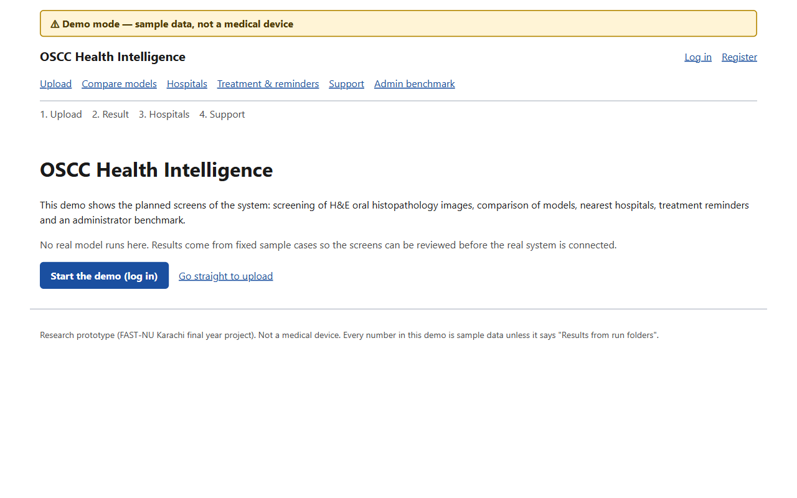 | Log in 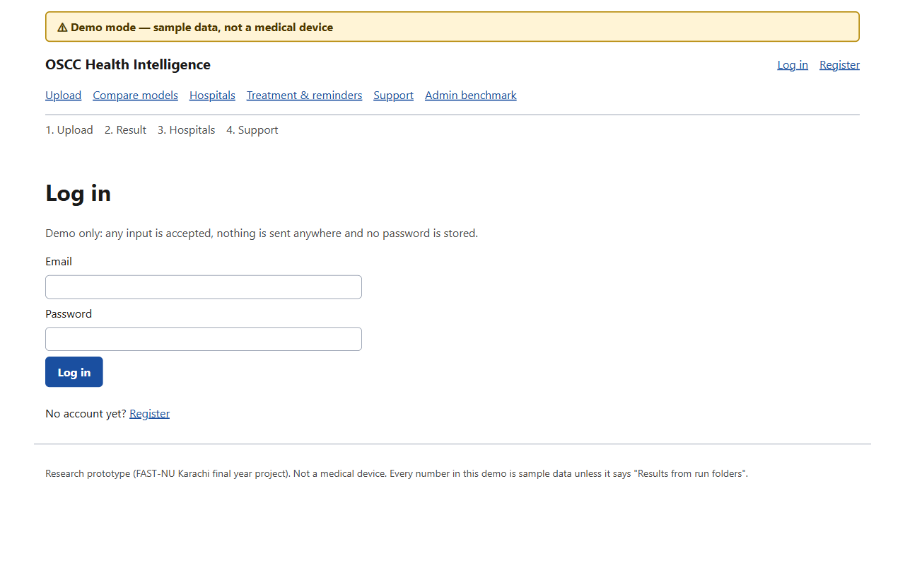 |
| Register 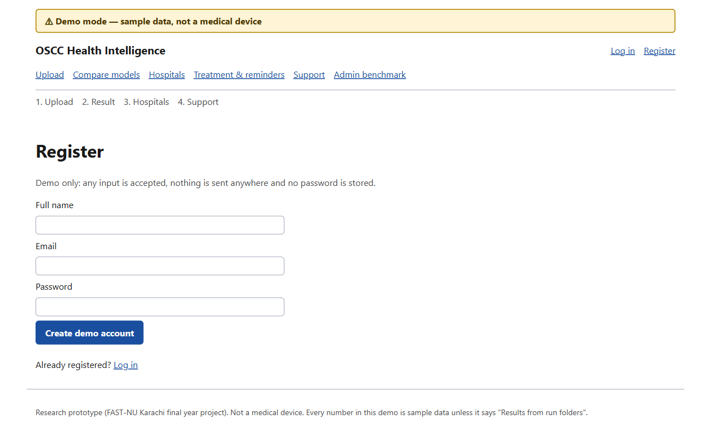 | Upload 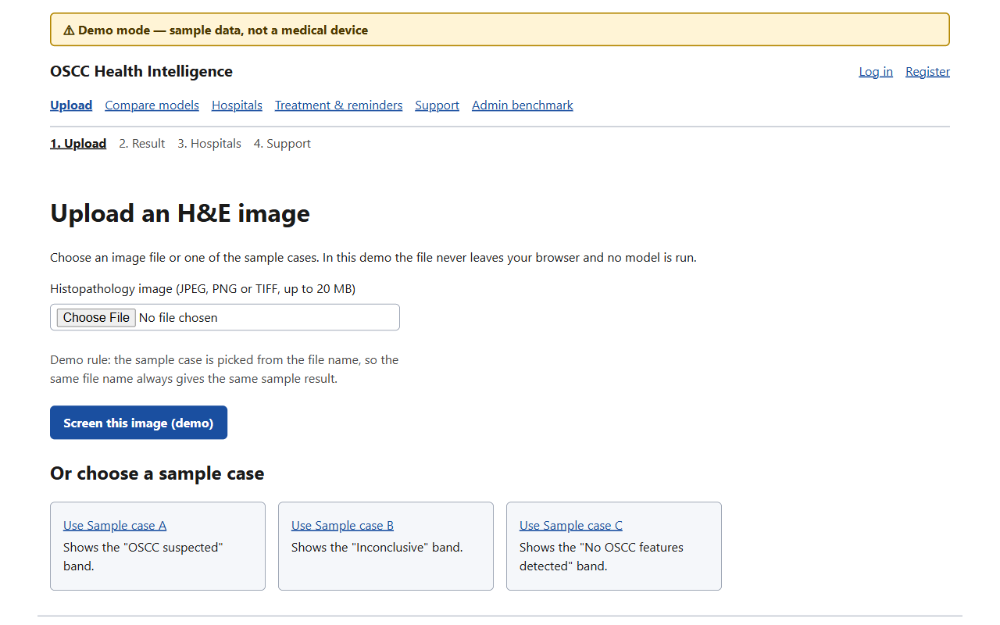 |
| Result: OSCC suspected 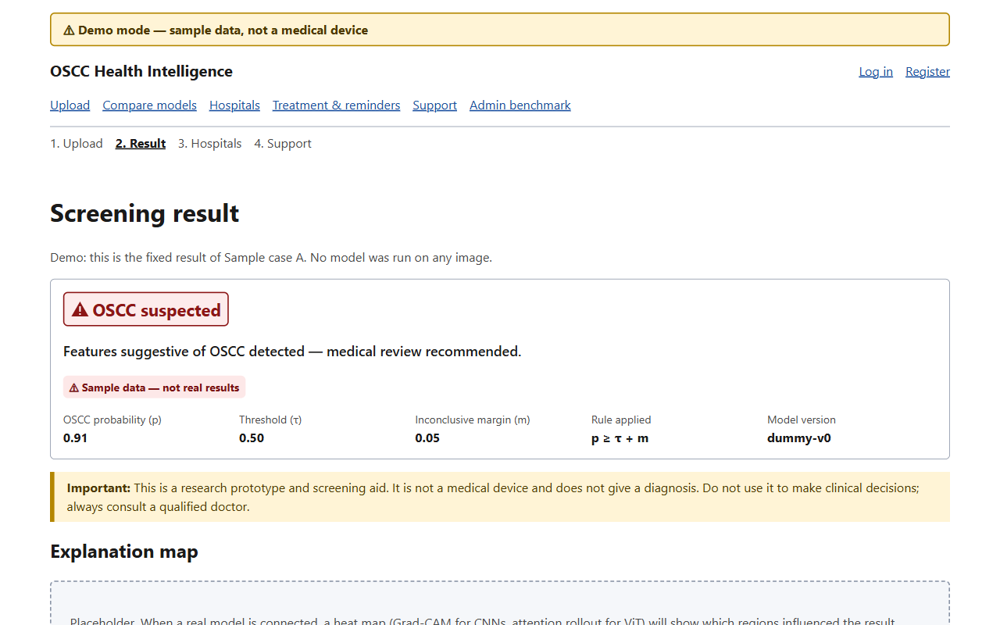 | Result: Inconclusive 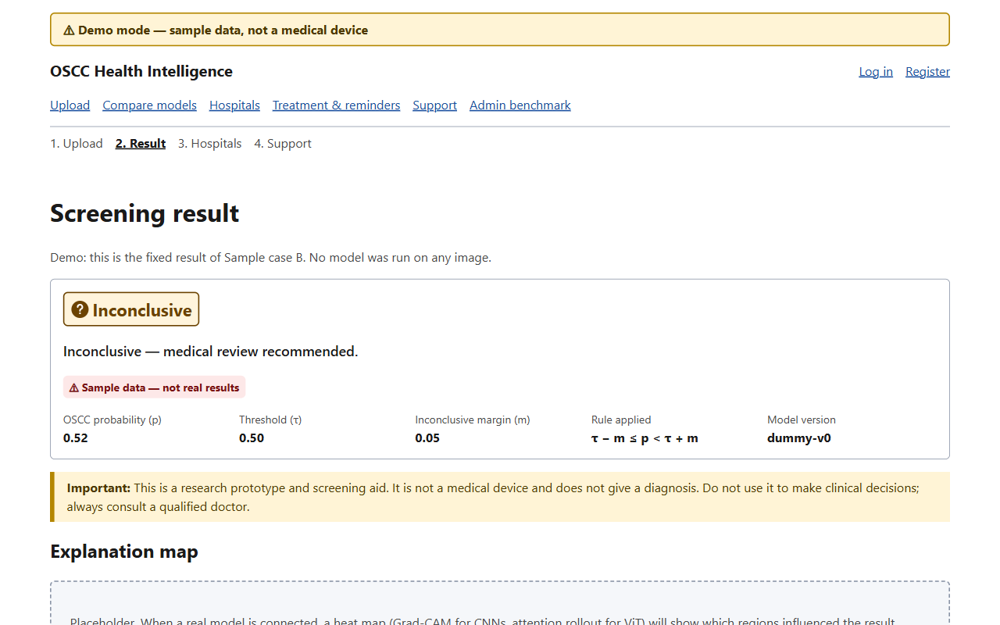 |
| Result: No OSCC features detected 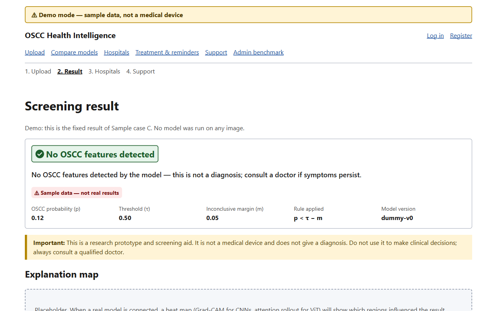 | Compare models 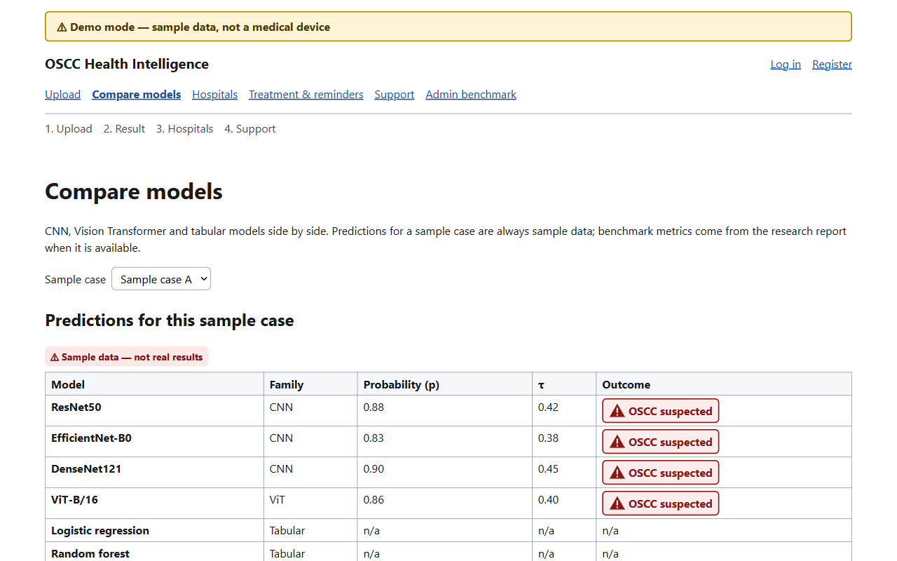 |
| Nearest hospitals 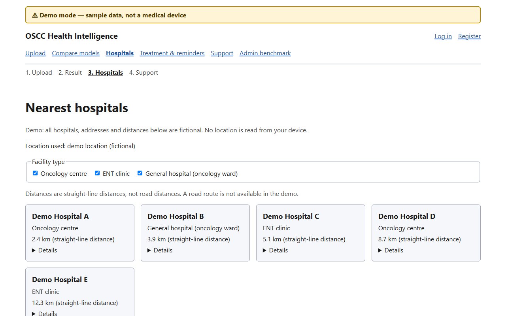 | Treatment and reminders 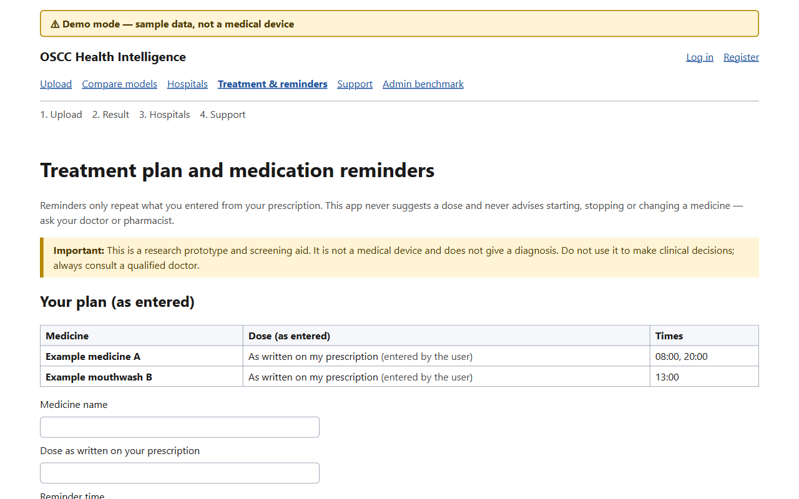 |
| Admin benchmark 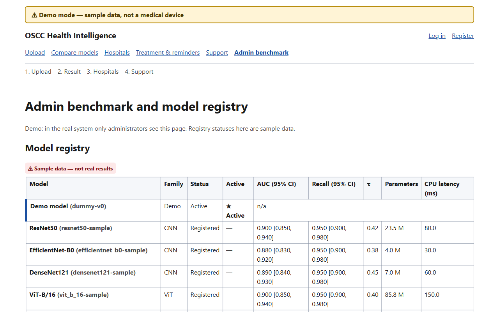 | Support (chatbot placeholder) 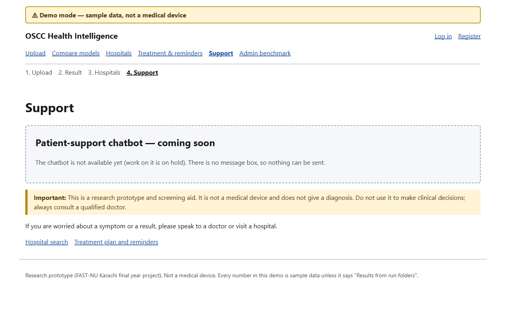 |

The screenshots show sample data (no `summary.json` was synced when they were taken).

## Open points for review

1. **Disclaimer wording.** The SRS requires a non-diagnostic disclaimer (NFR-SAF-01) but gives no exact text. The demo uses wording based on the SRS constraint ("research prototype and screening aid; not a medical device; must not be used for clinical decisions"). It is in `strings.disclaimer`; please confirm or replace it.
2. **Short outcome labels** ("OSCC suspected", "Inconclusive", "No OSCC features detected") are shown next to the icon. Appendix B defines only the full sentence, which is shown verbatim below the label.
3. **Accepted upload formats.** The SRS gives size (≤ 20 MB) and resolution (≥ 224×224) limits but no format list. The demo accepts JPEG, PNG and TIFF and does not check resolution or the H&E colour profile.
4. **Sample τ values** are per model in `fixtures/models.ts`; m = 0.05 (plan O3).
